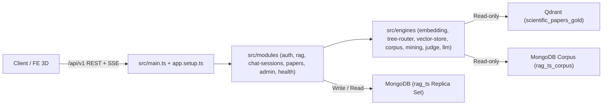

# backend_rag — Máy chủ Monolith NestJS 11 & Pipeline RAG Khoa học

- **Motivation/Background**: Cung cấp tài liệu đặc tả tự chứa ngay tại `backend_rag/` theo yêu cầu chuẩn hóa kiến trúc, giúp người đọc nắm bắt nhanh mục đích thư mục, trách nhiệm từng file và luồng nghiệp vụ mà không phải dò thủ công toàn bộ mã nguồn.
- **Purpose**: Thư mục gốc của dịch vụ backend `RAG_TS` (cổng mặc định `3000`, tiền tố HTTP `/api/v1`). Quản lý toàn bộ vòng đời API xác thực JWT/Argon2id, quản trị RBAC, phiên hỏi đáp MongoDB (`UUIDv7`), truy vấn vector Qdrant chỉ đọc, định tuyến cây 3D, rerank PageRank đồng tác giả và sinh câu trả lời stream SSE bằng LLM GGUF cục bộ.
- **Overview Pipeline**: Khởi động `src/main.ts`, nạp cấu hình nghiêm ngặt qua Zod , đặt... -> Cấu hình middleware toàn cục tại `src/app.setup.ts` -> Các HTTP module trong `src/modules/` điều phối xuống lớp domain engines để....
- **Detailed Plan**: Mục 1 định nghĩa phạm vi & vai trò; Mục 2 liệt kê cấu trúc thư mục con và danh mục file/export thực tế; Mục 3 mô tả chức năng, luồng nghiệp vụ kèm sơ đồ Mermaid; Mục 4 quy định hợp đồng I/O, bất biến hệ thống và lệnh kiểm chứng.
- **References**: [AGENTS.md](AGENTS.md), [PERFORMANCE_AND_CACHING.md](docs/PERFORMANCE_AND_CACHING.md), [API_DESIGN.md](../docs/api/API_DESIGN.md), [ARCHITECTURE_OVERVIEW.md](../docs/architecture/ARCHITECTURE_OVERVIEW.md).
- **Created**: 2026-11-15T12:55:00+07:00
- **Last Updated**: 2026-11-15T12:55:00+07:00

[STATUS: ACTIVE]

---
## 1. Mục đích & Phạm vi Thư mục (Directory Scope & Architectural Role)

Thư mục gốc của dịch vụ backend `RAG_TS` (cổng mặc định `3000`, tiền tố HTTP `/api/v1`). Quản lý toàn bộ vòng đời API xác thực JWT/Argon2id, quản trị RBAC, phiên hỏi đáp MongoDB (`UUIDv7`), truy vấn vector Qdrant chỉ đọc, định tuyến cây 3D, rerank PageRank đồng tác giả và sinh câu trả lời stream SSE bằng LLM GGUF cục bộ.

---

## 2. Đặc tả Kỹ thuật & Danh mục File (Technical Specification)

### 2.1. Danh mục Thư mục con (Subdirectories)

| Thư mục con | Liên kết Đặc tả | Vai trò Chính |
| :--- | :--- | :--- |
| **`benchmark/`** | [`benchmark/README.md`](benchmark/README.md) | Chứa bộ kịch bản kiểm thử chịu tải k6 (Open-Model Arrival Rate và Closed-Model Virtual Users), bộ sinh dữ liệu seeded MongoDB (`1,500 sessions`, `15,000 messages`), trình thu thập telemetry CPU/RAM và bộ đánh giá chất lượng mô hình Judge Laya. |
| **`docker/`** | [`docker/README.md`](docker/README.md) | Chứa script khởi tạo tự động chạy bên trong container MongoDB (`docker-compose.yml`) khi thư mục dữ liệu còn trống, tạo tài khoản ứng dụng không mang quyền root. |
| **`docs/`** | [`docs/README.md`](docs/README.md) | Tập hợp các bản thiết kế kỹ thuật chuyên sâu cho từng hệ thống con của `backend_rag`: Xác thực & Bảo mật JWT/Argon2id, Luồng Đăng xuất 1-RTT, Đặc tả Phiên chat UUIDv7 & Test Matrix, Thiết kế Schema MongoDB và Báo cáo Tối ưu Hiệu năng Caching. |
| **`scripts/`** | [`scripts/README.md`](scripts/README.md) | Tập hợp các script CLI chạy độc lập ngoài vòng đời HTTP chính: khởi tạo tài khoản Admin đầu tiên, tải mô hình GGUF, nạp collection Qdrant thử nghiệm, phục vụ server chấm điểm Qwen Judge và chạy benchmark Laya/Vector. |
| **`src/`** | [`src/README.md`](src/README.md) | Chứa toàn bộ mã nguồn TypeScript của backend: entrypoint khởi chạy `main.ts`, lắp ráp toàn cục `app.module.ts` & `app.setup.ts`, lớp hạ tầng dùng chung (`common/`, `config/`), các engine AI/truy xuất (`engines/`), các API feature module (`modules/`), tiện ích kiểm thử (`testing/`) và kiểu dữ liệu chuẩn (`types/`). |
| **`test/`** | [`test/README.md`](test/README.md) | Thực thi kiểm thử đầu-cuối toàn bộ ứng dụng NestJS (`flow.e2e-spec.ts`), bao gồm cả bài test **API contract (OpenAPI)** xác nhận mọi endpoint thực tế đều được khai báo trong Swagger, hỗ trợ XML/JSON negotiation, HATEOAS `_links`, luồng Auth/Chat/Papers/Admin đầy đủ. |

### 2.2. Danh mục File & Ký hiệu Kỹ thuật (File & Symbol Inventory)

| File | Loại / Tầng | Exports / Routes / Ký hiệu Chính | Mô tả Trách nhiệm |
| :--- | :--- | :--- | :--- |
| [`.dockerignore`](.dockerignore) | Project File | - | Thành phần `Project File` thuộc `backend_rag`. |
| [`.env.example`](.env.example) | Project File | - | Thành phần `Project File` thuộc `backend_rag`. |
| [`.gitignore`](.gitignore) | Project File | - | Thành phần `Project File` thuộc `backend_rag`. |
| [`.prettierrc`](.prettierrc) | Project File | - | Thành phần `Project File` thuộc `backend_rag`. |
| [`AGENTS.md`](AGENTS.md) | Markdown Spec | Markdown Document | AGENTS.md — Backend AI Agent Operating Manual (`backend_rag`) |
| [`ASSUMPTIONS.md`](ASSUMPTIONS.md) | Markdown Spec | Markdown Document | ASSUMPTIONS — backend RAG_TS |
| [`Dockerfile`](Dockerfile) | Project File | - | Thành phần `Project File` thuộc `backend_rag`. |
| [`PROGRESS.md`](PROGRESS.md) | Markdown Spec | Markdown Document | PROGRESS — backend RAG_TS |
| [`docker-compose.yml`](docker-compose.yml) | YAML Config | Config / Data (4259 B) | Cấu hình hoặc dữ liệu tĩnh `docker-compose.yml` |
| [`eslint.config.mjs`](eslint.config.mjs) | ESM Runner Script | - | Thành phần `ESM Runner Script` thuộc `backend_rag`. |
| [`nest-cli.json`](nest-cli.json) | JSON Config / Dataset | Config / Data (179 B) | Cấu hình hoặc dữ liệu tĩnh `nest-cli.json` |
| [`package-lock.json`](package-lock.json) | JSON Config / Dataset | Config / Data (515756 B) | Cấu hình hoặc dữ liệu tĩnh `package-lock.json` |
| [`package.json`](package.json) | JSON Config / Dataset | Config / Data (3142 B) | Cấu hình hoặc dữ liệu tĩnh `package.json` |
| [`tsconfig.build.json`](tsconfig.build.json) | JSON Config / Dataset | Config / Data (125 B) | Cấu hình hoặc dữ liệu tĩnh `tsconfig.build.json` |
| [`tsconfig.json`](tsconfig.json) | JSON Config / Dataset | Config / Data (656 B) | Cấu hình hoặc dữ liệu tĩnh `tsconfig.json` |

---

## 3. Mô tả Chức năng & Luồng Nghiệp vụ (Business Flow)

1. Khởi động `src/main.ts`, nạp cấu hình nghiêm ngặt qua Zod (`src/config/env.schema.ts`), đặt `UV_THREADPOOL_SIZE=4` cho Argon2id và cấu hình Express `TRUST_PROXY_HOPS`.
2. Cấu hình middleware toàn cục tại `src/app.setup.ts`: Helmet CSP, Content Negotiation JSON/XML, ValidationPipe, `HttpExceptionFilter`, và HATEOAS `_links`.
3. Các HTTP module trong `src/modules/` điều phối xuống lớp domain engines (`src/engines/`) để embed (Nomic v1.5), định tuyến cây tri thức, truy vấn Qdrant + Corpus MongoDB, đánh giá Laya và stream token Qwen2.5-7B qua SSE.
4. Kiểm thử tự động qua Jest unit/integration/e2e (`test/`) và đánh giá chịu tải SRE bằng k6 (`benchmark/`).



---

## 4. Hợp đồng Đầu vào / Đầu ra, Bất biến & Kiểm chứng

- **Đầu vào (Inputs)**: HTTP/HTTPS JSON, XML (`Accept: application/xml`) hoặc SSE POST `/api/v1/rag/chat/stream`; biến môi trường `.env`; dữ liệu vector Qdrant & tệp `WORLD_DATA_DIR` / `MINING_DIR` / `MODEL_PATH`.
- **Đầu ra & Tác động (Outputs / Side Effects)**: JSON/XML HATEOAS (`_links`), luồng SSE real-time (`phase`, `route`, `compare`, `retrieval`, `token`, `done`), log Pino JSON 1 dòng/request có `X-Request-Id`, và metric Prometheus.

### Bất biến & Quy tắc Kiến trúc (System Invariants)
- Qdrant (`scientific_papers_gold`) và `rag_ts_corpus` luôn chỉ đọc từ `backend_rag` (`D-058`).
- Argon2id giữ `memoryCost=65536, timeCost=3, parallelism=4` kết hợp `UV_THREADPOOL_SIZE=4` (`D-021`).
- Không bao giờ truy vấn tuần tự N+1 qua Cloudflare TCP tunnel `~15-25ms` (`D-002`).
- Mọi `.md` và API mới phải tuân thủ `API_DESIGN.md` (`D-047`) và `AGENTS.md`.

---

## 5. Hướng dẫn Vận hành, Docker & Biến Môi trường (Operational Guide)

Backend hỏi đáp khoa học có trích dẫn: embed câu hỏi (Nomic v1.5) ➔ đi qua cây World 3D ➔ tìm trong Qdrant ➔ rerank theo PageRank tác giả ➔ Qwen2.5-7B trả lời, stream qua SSE cho frontend 3D.

- **Hợp đồng API:** [`../docs/api/API_DESIGN.md`](../docs/api/API_DESIGN.md) — 18 route dưới `/api/v1`.
- **Kế hoạch triển khai:** [`../docs/architecture/SCIENTIFIC_RAG_BACKEND.md`](../docs/architecture/SCIENTIFIC_RAG_BACKEND.md) (B1–B11, Phụ lục A đồng bộ FE, Phụ lục B yêu cầu pipeline).
- **Giả định & tiến độ:** [`ASSUMPTIONS.md`](ASSUMPTIONS.md), [`PROGRESS.md`](PROGRESS.md).
- **Swagger:** `http://localhost:3000/api/v1/docs` (JSON: `/api/v1/docs-json`).

## Kiến trúc

| Thành phần | Vai trò | Ghi chú |
| :-- | :-- | :-- |
| MongoDB | `users`, `refresh_tokens`, `login_attempts`, `chat_sessions`, `chat_messages` | Replica set (cần cho transaction) |
| Qdrant `scientific_papers_gold` | Vector + payload chunk | **Chỉ đọc** — pipeline UTH ghi |
| `MINING_DIR` | `graph_coauthorship.json`, `association_rules.json` | Pipeline xuất (MinIO `gold/mining/`) |
| `WORLD_DATA_DIR` | `tree.json`, `centroids_l1.json`, `centroids_l2.json`, `categories.json` | Pipeline xuất; thiếu ➔ event `route` có `steps: []` |
| `MODEL_PATH` | GGUF Qwen2.5-7B Q4_K_M | node-llama-cpp, tự chọn Metal/CUDA/CPU |

Module: `auth`, `rag` (+ `embedding`, `vector-store`, `mining`, `tree-router`, `llm`), `chat-sessions`, `papers`, `health`; dùng chung ở `common/` (request-id, log JSON 1 dòng/request, body lỗi §1.2, pagination).

## Chạy dev (Mac M-series, Metal)

```bash
cp .env.example .env        # sửa MONGO_URI, QDRANT_URL/QDRANT_API_KEY, JWT_*; giữ MODEL_PATH, *_DIR
npm ci
npm run start:dev           # http://localhost:3000/api/v1
```

- Cần MongoDB replica set: đặt các biến `RAGTS_MONGO_*` trong `.env` (xem `.env.example`), chạy `docker compose up -d mongo`, rồi `MONGO_URI=mongodb://<app user>:<password>@localhost:27018/rag_ts?authSource=admin&replicaSet=rs0&directConnection=true` (cổng host đổi bằng `RAGTS_MONGO_PORT`).
- Qdrant: dùng Qdrant của pipeline (`QDRANT_URL=http://localhost:6333` + `QDRANT_API_KEY`).
- Lần đầu chạy, model embedding (~550 MB) được tải từ Hugging Face (vài phút), sau đó dùng cache.
- LLM nạp nền khoảng 5 s trên Metal; trước lúc đó `/health` báo `degraded` và chat trả 503 `llm unavailable`.

## Chạy bằng Docker

```bash
# Đặt JWT_*, QDRANT_API_KEY và RAGTS_MONGO_* trong .env (xem .env.example)
export JWT_ACCESS_SECRET=... JWT_REFRESH_SECRET=...   # mỗi khoá >= 32 ký tự
export QDRANT_API_KEY=...                              # key Qdrant của pipeline
docker compose up --build                              # app :3000 + mongo (rs0)
docker compose --profile standalone up                 # thêm Qdrant rỗng (không cần pipeline)
```

Biến riêng cho compose có tiền tố `RAGTS_` (`RAGTS_QDRANT_URL`, `RAGTS_PORT`, `RAGTS_MODEL_FILE`, …) để không đụng `.env` dev mà compose tự đọc. Volume: `../model` ➔ `/models`, `../data` ➔ `/data`, cache Hugging Face ở volume `hf-cache`.

> Docker trên Mac không có Metal: LLM chạy CPU, Qwen 7B cần ~6 GB RAM cho container. Máy ảo Docker 8 GB chạy kèm container khác sẽ bị kill (exit 137) — tăng RAM Docker, hoặc chạy app ngoài Docker khi dev.

## Biến môi trường

| Biến | Bắt buộc | Mặc định | Ý nghĩa |
| :-- | :--: | :-- | :-- |
| `MONGO_URI` | ✓ | — | MongoDB (replica set, có xác thực) |
| `TRUST_PROXY_HOPS` | | `0` | Số reverse proxy thật sự đứng trước app; `0` = bỏ qua `X-Forwarded-For` |
| `QDRANT_URL` | ✓ | — | Qdrant |
| `QDRANT_API_KEY` | | — | Key Qdrant |
| `QDRANT_COLLECTION` | | `scientific_papers_gold` | Collection đọc |
| `JWT_ACCESS_SECRET`, `JWT_REFRESH_SECRET` | ✓ | — | ≥ 32 ký tự |
| `EMBEDDING_MODEL` | | `nomic-ai/nomic-embed-text-v1.5` | Id Hub hoặc thư mục local |
| `MODEL_PATH` | ✓ | — | File GGUF |
| `LLM_GPU` | | `auto` | `auto` / `cuda` / `metal` / `vulkan` / `false` |
| `LLM_CONCURRENCY` | | `1` | Số lượt sinh song song |
| `LLM_MAX_QUEUE` | | `8` | Hàng chờ tối đa, đầy ➔ 429 |
| `LLM_TIMEOUT_MS` | | `60000` | Quá hạn ➔ 504 |
| `WORLD_DATA_DIR`, `MINING_DIR` | ✓ | — | File pipeline xuất |
| `PORT` | | `3000` | |
| `CORS_ORIGINS` | | `http://localhost:5173` | Phân tách bằng dấu phẩy |

Thiếu biến bắt buộc ➔ app dừng (exit 1) và liệt kê đủ các biến lỗi.

## Kiểm thử

```bash
npm test                                  # unit + integration (mongodb-memory-server, port giả)
npm run test:e2e                          # cả app, LLM/embedding giả, Qdrant in-memory
E2E_QDRANT_URL=http://localhost:6555 npm run test:e2e   # e2e với Qdrant thật (seed collection *_test)
QDRANT_URL=... QDRANT_COLLECTION=rag_ts_test npx ts-node scripts/seed-qdrant.ts
npx tsc --noEmit && npm run lint
```

`scripts/seed-qdrant.ts` từ chối mọi collection không có hậu tố `_test`.

## Đồng bộ với frontend 3D (Phụ lục A, tóm tắt)

| Điểm | Việc FE cần làm |
| :-- | :-- |
| Base URL | `VITE_API_BASE=/api/v1`, proxy Vite `/api/v1` ➔ `http://localhost:3000` |
| `nprobe` | Đã hỗ trợ trong body chat (1–6, mặc định 2) |
| Event SSE | Khớp; `done` có thêm `session_id`, `message_id` |
| Health | Đọc `components.{mongo,qdrant,llm,world}` thay cho `{ lancedb, llm, world }` |
| World 3D, luồng cào | Gọi pipeline UTH (`VITE_PIPELINE_BASE`), không qua RAG_TS |

## Giới hạn đã biết

- Pipeline chưa xuất file world (`tree.json`, centroid, `categories.json`) và payload `twig_id`, `chunk_index` (Phụ lục B) ➔ `route` rỗng, `compare` không lọc theo nhánh, `category_index` = -1.
- Huỷ stream khi LLM còn đang đọc prompt dài: slot LLM chỉ giải phóng khi sinh tới token đầu (~15 s với `top_k` 5 trên Metal).
- `prompt_fe_3d.md` (được tham chiếu trong kế hoạch) không có trong repo — định dạng world lấy theo type FE `frontend_rag/src/shared/types/world.ts`.
