# Tài Liệu Kỹ Thuật: Hệ Thống Kiểm Chuẩn Hiệu Năng & Stress Test (Benchmark Suite)

> Thư mục: `backend_rag/benchmark/`  
> Phục vụ: Đánh giá độ chịu tải, độ trễ phân vị (P50/P90/P95/P99), thông lượng (Throughput RPS) và khả năng phục hồi của hệ thống RAG-TS.

---

## 1. Triết Lý & Phương Pháp Kiểm Thử Hiệu Năng

Hệ thống RAG-TS phân tách bài toán kiểm thử thành **3 tầng độc lập** theo nguyên tắc **Cô lập biến số (Isolation of Variables)**:

```mermaid
flowchart TD
    subgraph TIER1 ["Tầng 1: Gateway I/O (Stateless)"]
        G1["Endpoint: GET /api/v1/health"] --> G2["Mục tiêu: Trần chịu tải Event Loop & Mạng"]
        G2 --> G3["Chứng nhận: 1,600 CUs | 3,958.5 req/s | P95: 379ms"]
    end

    subgraph TIER2 ["Tầng 2: Authenticated Sessions (Stateful DB CRUD)"]
        D1["Endpoints: GET /me (50%), GET /chat-sessions (40%), PATCH /me (10%)"] --> D2["Mục tiêu: Sức bền JWT Guard & MongoDB Connection Pool"]
        D2 --> D3["Chứng nhận: Rule L1 (Giữ tải liên tục 3 phút)"]
    end

    subgraph TIER3 ["Tầng 3: Deep AI Inference (GPU / LLM RAG)"]
        R1["Endpoint: POST /api/v1/rag/chat"] --> R2["Mục tiêu: Khảo sát Hàng đợi & Backpressure"]
        R2 --> R3["Cơ chế: RagQueue (1 active GPU + 8 waiting = 9 slots)"]
    end
```



### Các Quy Tắc Kiểm Định Cốt Lõi:
1. **Quy tắc L1 (3-Minute Sustained Hold-out)**:
   * Một mức tải (CUs) **CHỈ ĐƯỢC CÔNG NHẬN CHÍNH THỨC** nếu hệ thống duy trì được mức tải đó **liên tục trong suốt 3 phút (180 giây)** mà không rớt kết nối, không crash tiến trình, và giữ vững SLA:
     $$\text{P95} < 500\text{ ms}, \quad \text{P99} < 1,000\text{ ms}, \quad \text{Error Rate} < 1.00\%$$
2. **Pre-authenticated Token Pool (Khử nhiễu CPU Argon2id)**:
   * Thuật toán băm mật khẩu `Argon2id` ngốn rất nhiều CPU/RAM để chống tấn công brute-force. Nếu mỗi request stress test đều login, CPU máy chủ sẽ bị nghẽn 100% bởi Argon2id chứ không kiểm thử được MongoDB hay JWT Guard.
   * *Giải pháp*: Tạo trước 100 tài khoản mẫu (`auth_bench_pool_100.json`) kèm 100 JWT token hợp lệ để các Virtual Users (VUs) sử dụng xoay vòng ngay lập tức.

---

## 2. Danh Mục Tệp & Chức Năng Chi Tiết (File Inventory)

### 2.1. Nhóm Kịch Bản Kiểm Thử k6 (`k6_*.ts`)

| Tên Tệp | Mục Tiêu & Endpoint | Quy Mô Tải | Đặc Điểm Kỹ Thuật |
| :--- | :--- | :--- | :--- |
| **`k6_fast_api.ts`** | `GET /api/v1/health` | 100 $\rightarrow$ 1,600 VUs | Kịch bản tăng tải bậc thang đo trần thông lượng mạng của NestJS. |
| **`k6_extreme_fast_api.ts`** | `GET /api/v1/health` | 1,000 $\rightarrow$ 2,000 VUs | Thử thách tải cực hạn trên tầng Gateway. |
| **`k6_qualification_soak.ts`** | `/health`, `/documents`, `/rag/chat` | 1,600 VUs (5 phút) | Bài kiểm thử ngâm tải (Soak Test) 5 phút chính thức đạt 1.18M requests. |
| **`k6_break_point_test.ts`** | `GET /api/v1/health` | 500 $\rightarrow$ 3,000 VUs | Tìm điểm gãy socket TCP (Ephemeral Port Exhaustion trên Windows). |
| **`k6_authenticated_sessions.ts`** | `/auth/me`, `/chat-sessions` | 5 $\rightarrow$ 200 VUs (3 phút) | Kiểm thử có xác thực chuẩn: **Đạt P95: 282ms, 0% lỗi**. |
| **`k6_authenticated_sessions_1000cu.ts`** | `/auth/me`, `/chat-sessions` | 50 $\rightarrow$ 1,000 VUs (3 phút) | Kiểm thử tải cực đại trên tầng cơ sở dữ liệu MongoDB: **42,414 reqs, 0% lỗi**. |
| **`k6_auth_candidate_scan.ts`** | `/auth/me`, `/chat-sessions` | 100 $\rightarrow$ 650 VUs (1.5 phút) | Quét nhanh để định vị mốc CUs tối ưu trước khi chạy bài test 3 phút. |
| **`k6_auth_certified_holdout.ts`** | `/auth/me`, `/chat-sessions` | 300 VUs cố định (3 phút) | Bài test giữ tải 3 phút liên tục chứng nhận kỷ lục CUs bền vững theo Quy tắc L1. |
| **`k6_user_session.ts`** | `/health`, `/papers/:id`, `/rag/chat` | 80 VUs (5 phút) | Mô phỏng hành vi 80 nhà nghiên cứu duyệt bài báo và hỏi đáp AI. |
| **`k6_queue_experiment.ts`** | `POST /api/v1/rag/chat` | 1 $\rightarrow$ 14 VUs | Đánh giá cơ chế xếp hàng `RagQueue` và trả mã HTTP 429 khi bão hòa GPU. |
| **`k6_rag_chat.ts`** | `POST /api/v1/rag/chat` | 1 $\rightarrow$ 14 VUs | Đo độ trễ suy luận LLM (node-llama-cpp) kết hợp tìm kiếm vector Qdrant. |

---

### 2.2. Nhóm Sinh Biểu Đồ Trực Quan Hóa Python (`render_*.py`)

| Tên Tệp | Thư Viện Sử Dụng | Biểu Đồ Đầu Ra | Ý Nghĩa Phân Tích |
| :--- | :--- | :--- | :--- |
| **`render_auth_1000cu_plots.py`** | Matplotlib, Seaborn | `auth_1000cu_latency_percentiles.png`<br>`auth_1000cu_throughput_comparison.png` | Vẽ phân vị độ trễ (P50/P90/P95/P99) so với ngưỡng SLA 500ms và so sánh thông lượng Gateway vs DB. |
| **`render_qualification_plots.py`** | Matplotlib, Seaborn | `qualification_5min_sustained_throughput.png`<br>`qualification_5min_continuous_timeline.png` | Minh họa thông lượng 3,958.5 req/s và độ ổn định qua các mốc 1 phút, 3 phút, 5 phút. |
| **`render_user_journey.py`** | Matplotlib, Seaborn | `user_journey_timeline_flow.png`<br>`realistic_user_session_throughput.png` | Mô tả luồng trải nghiệm người dùng thực tế kèm think-time và độ trễ đọc/hỏi AI. |
| **`render_queue_tradeoff.py`** | Matplotlib, Seaborn | `queue_depth_comparison_tradeoff.png`<br>`failure_taxonomy_distribution.png` | Phân tích sự đánh đổi giữa độ dài hàng đợi RAG và tỷ lệ từ chối lỗi 429. |

---

### 2.3. Nhóm Biên Dịch Báo Cáo HTML & Trình Chiếu (`generate_*.py`)

| Tên Tệp | Đầu Ra | Mô Tả Chức Năng |
| :--- | :--- | :--- |
| **`generate_auth_html_report.py`** | [`auth_benchmark_report.html`](file:///C:/document/Study%20documents/backend_rag/RAG_TS/backend_rag/benchmark/auth_benchmark_report.html) | Biên dịch báo cáo HTML độc lập cho bài test xác thực 1,000 CUs, nhúng sẵn Base64 biểu đồ, thẻ KPI và bảng SLA. |
| **`generate_html_report.py`** | [`benchmark_report.html`](file:///C:/document/Study%20documents/backend_rag/RAG_TS/backend_rag/benchmark/benchmark_report.html) | Biên dịch báo cáo tổng thể toàn hệ thống (Gateway 1,600 CUs + RAG Queue + Khám nghiệm lỗi Windows Port Exhaustion). |
| **`generate_slides.py`** | [`docs/report_slides.html`](file:///C:/document/Study%20documents/backend_rag/RAG_TS/docs/report_slides.html) | Biên dịch bộ slide trình chiếu tối giản 12 slide với SVG vector diagrams và số liệu Lighthouse/Stress test mới nhất. |

---

### 2.4. Nhóm Tệp Dữ Liệu & Pool Tài Khoản

* **`auth_bench_pool_100.json`**: Danh sách 100 tài khoản thử nghiệm (`bench_vu_0@...` đến `bench_vu_99@...`) kèm User ID và token JWT đã ký hợp lệ.
* **`results/*.json`**: Lưu trữ toàn bộ kết quả đo lường k6 dạng thô và summary export để tái hiện thực nghiệm.

---

## 3. Hướng Dẫn Thực Thi Nhanh (Quick Start)

### Chạy bài test xác thực chuẩn L1 (Giữ tải 3 phút):
```bash
# 1. Đảm bảo Backend và MongoDB đang chạy tại cổng 3000 và 27017
curl http://127.0.0.1:3000/api/v1/health

# 2. Khởi chạy bài test k6
k6 run --summary-export=benchmark/results/auth_certified_summary.json benchmark/k6_auth_certified_holdout.ts

# 3. Tái tạo biểu đồ và cập nhật báo cáo HTML
python benchmark/render_auth_1000cu_plots.py
python benchmark/generate_auth_html_report.py
```
