# Tài Liệu Kỹ Thuật: Hệ Thống Kiểm Chuẩn Hiệu Năng & Production SRE Stress Test (Benchmark Suite)

> Thư mục: `backend_rag/benchmark/`  
> Phục vụ: Đánh giá độ chịu tải thực tế (Open-Model Arrival Rate & Closed-Model CUs), độ trễ phân vị (P50/P90/P95/P99), thông lượng (Throughput RPS), giám sát tài nguyên máy chủ (CPU/RAM Telemetry) và cô lập tải mã hóa Argon2id của hệ thống RAG-TS.

---

## 1. Triết Lý & Phương Pháp Kiểm Thử Hiệu Năng Chuẩn Production SRE

Hệ thống RAG-TS phân tách bài toán kiểm thử thành **4 tầng độc lập** theo nguyên tắc **Cô lập biến số (Isolation of Variables)** và loại bỏ hoàn toàn sai số **Coordinated Omission**:

```mermaid
flowchart TD
    subgraph TIER1 ["Tầng 1: Gateway I/O (Stateless)"]
        G1["Endpoint: GET /api/v1/health"] --> G2["Mục tiêu: Trần chịu tải Event Loop & Mạng"]
        G2 --> G3["Chứng nhận: 1,600 CUs | 3,958.5 req/s | P95: 379ms"]
    end

    subgraph TIER2 ["Tầng 2: Production Authenticated CRUD (Open-Model + Seeded DB)"]
        D1["6 Endpoints: List Page 1/2, Regex Search, Session Detail (10 msgs), Auth Me, Rename, Patch"] --> D2["Dữ liệu thực: 1,500 Sessions & 15,000 Messages (Citations + Chunks)"]
        D2 --> D3["Chứng nhận Rule L1 (3 Phút): 71 RPS (P95: 470.7ms) | 65 RPS Hold-Out (12,812 reqs, 0% lỗi)"]
    end

    subgraph TIER3 ["Tầng 3: Auth Crypto & Token Rotation (CPU / Threadpool Isolation)"]
        C1["Endpoints: POST /auth/login (Argon2id) + POST /auth/refresh + GET /auth/me Probe"] --> C2["Mục tiêu: Đo bão hòa libuv Threadpool (UV_THREADPOOL_SIZE=4) & Cô lập Event Loop"]
        C2 --> C3["Kết quả: Peak 310.2% CPU (3.1 Cores) | 100% Refresh OK | Event Loop Probe P50: 177.7ms"]
    end

    subgraph TIER4 ["Tầng 4: Deep AI Inference (GPU / LLM RAG)"]
        R1["Endpoint: POST /api/v1/rag/chat"] --> R2["Mục tiêu: Khảo sát Hàng đợi & Backpressure"]
        R2 --> R3["Cơ chế: LlmService Semaphore + Queue (4 active contexts + 16 waiting)"]
    end
```



### Các Quy Tắc Kiểm Định Cốt Lõi (Production SRE Standards):
1. **Quy tắc L1 (3-Minute Sustained Hold-out)**:
   * Một mức tải (CUs / RPS) **CHỈ ĐƯỢC CÔNG NHẬN CHÍNH THỨC** nếu hệ thống duy trì được mức tải đó **liên tục trong suốt 3 phút (180 giây)** mà không rớt kết nối, không rò rỉ bộ nhớ (Memory Leak), và giữ vững SLA:
     $$\text{P95} < 500\text{ ms}, \quad \text{P99} < 1,000\text{ ms}, \quad \text{Error Rate} < 1.00\%$$
2. **Open Workload Model (`ramping-arrival-rate`) — Chống Coordinated Omission**:
   * Trong mô hình đóng (`ramping-vus` kèm `sleep()`), khi máy chủ bị chậm đi, các VU cũng tự động gửi ít request hơn, làm đẹp số liệu giả tạo.
   * Với `ramping-arrival-rate` và `timeout: '2s'`, k6 bơm đúng số lượng request/giây bất chấp server nhanh hay chậm, giúp phát hiện chính xác **Điểm nghẽn bão hòa (Saturation Knee)** tại **150 $\rightarrow$ 200 RPS**.
3. **Seeded Database Realism (1,500 Sessions & 15,000 Messages)**:
   * Thay vì truy vấn bảng rỗng (`items: []`, 2 bytes), kịch bản `seed_prod_auth_data.js` nạp sẵn **15 phiên chat/người dùng** (kích hoạt phân trang con trỏ Trang 1 + Trang 2 do `SESSION_PAGE_SIZE = 10`) và **10 tin nhắn/phiên** (gồm trích dẫn khoa học `citations`, `grounded_chunks` và `timings`), tạo tải tuần tự hóa JSON thực tế (~4.6 KB/response).

---

## 2. Danh Mục Tệp & Chức Năng Chi Tiết (File Inventory)

### 2.1. Nhóm Kịch Bản Kiểm Thử k6 (`k6_*.ts`)

| Tên Tệp | Mục Tiêu & Endpoint | Quy Mô Tải & Mô Hình | Đặc Điểm Kỹ Thuật & Kết Quả Thực Nghiệm |
| :--- | :--- | :--- | :--- |
| **`k6_prod_open_breakpoint.ts`** | **6-Endpoint Production Mix** (`GET /chat-sessions`, `?cursor=`, `?q=`, `GET /chat-sessions/:id`, `GET /auth/me`, `PATCH /chat-sessions/:id`, `PATCH /auth/me`) | **Open Model** (`71` $\rightarrow$ `300 RPS`) | Quét tìm điểm gãy Arrival Rate thực tế trên 15,000 tin nhắn: **71 RPS đạt P95 = 470.7ms (0% lỗi)**; **150 RPS đạt P95 = 514.4ms (0% lỗi)**; gãy tại **200+ RPS**. |
| **`k6_prod_certified_holdout.ts`** | **6-Endpoint Production Mix** (30% Page 1, 10% Page 2/Regex, 30% Detail, 15% Me, 15% Writes) | **Open Model Hold-Out** (`65 RPS` & `50 RPS` / `100 CUs` trong **3 phút**) | Chứng nhận **Rule L1 3 phút**: Phục vụ **12,812 requests (59 MB)** với **100.00% check pass (21,771/21,771)**. Phát hiện `GET /chat-sessions/:id` tốn gấp đôi độ trễ (`408ms` vs `188ms`) do 2 truy vấn WAN tuần tự. |
| **`k6_prod_auth_crypto.ts`** | `POST /auth/login` (Argon2id) + `POST /auth/refresh` + `GET /auth/me` | **Crypto Ramp** (`2` $\rightarrow$ `50 VUs` trong 60s) | Kiểm thử chuyên biệt thuật toán băm `Argon2id` và xoay vòng Refresh Token: **100% Refresh thành công (302/302)**, Event Loop không bị khóa (`GET /auth/me` P50 = `177.7ms`). |
| **`k6_authenticated_sessions.ts`** | `/auth/me`, `/chat-sessions`, `PATCH /auth/me` | **Closed Model** (`200 VUs`, 3 phút, DB rỗng) | Đường cơ sở 1 truy vấn/request: **61,120 reqs, 339.27 req/s, P95 = 282.47ms, 0% lỗi**. |
| **`k6_auth_certified_holdout.ts`** | `/auth/me`, `/chat-sessions`, `PATCH /auth/me` | **Closed Model** (`300 VUs`, 3 phút, DB rỗng) | Giữ tải 300 CUs liên tục 3 phút: **59,640 reqs, 283.82 req/s, 0% lỗi**, nhưng P95 = `1.27s` (vượt ngưỡng 500ms). |
| **`k6_authenticated_sessions_1000cu.ts`** | `/auth/me`, `/chat-sessions`, `PATCH /auth/me` | **Closed Model** (`1,000 VUs`, 3 phút, DB rỗng) | Thử thách 1,000 CUs: **42,414 reqs, 0% lỗi**, P95 = `3.60s` do hàng đợi Connection Pool. |
| **`k6_auth_candidate_scan.ts`** | `/auth/me`, `/chat-sessions`, `PATCH /auth/me` | **Closed Model** (`100` $\rightarrow$ `650 VUs`) | Quét nhanh các bậc CUs trong mô hình đóng. |
| **`k6_fast_api.ts`** | `GET /api/v1/health` | `100` $\rightarrow$ `1,600 VUs` | Kịch bản tăng tải bậc thang đo trần thông lượng mạng của NestJS. |
| **`k6_extreme_fast_api.ts`** | `GET /api/v1/health` | `1,000` $\rightarrow$ `2,000 VUs` | Thử thách tải cực hạn trên tầng Gateway. |
| **`k6_qualification_soak.ts`** | `/health`, `/documents`, `/rag/chat` | `1,600 VUs` (5 phút) | Bài kiểm thử ngâm tải (Soak Test) 5 phút chính thức đạt 1.18M requests. |
| **`k6_break_point_test.ts`** | `GET /api/v1/health` | `500` $\rightarrow$ `3,000 VUs` | Tìm điểm gãy socket TCP (Ephemeral Port Exhaustion trên Windows). |
| **`k6_user_session.ts`** | `/health`, `/papers/:id`, `/rag/chat` | `80 VUs` (5 phút) | Mô phỏng hành vi 80 nhà nghiên cứu duyệt bài báo và hỏi đáp AI. |
| **`k6_queue_experiment.ts`** | `POST /api/v1/rag/chat` | `1` $\rightarrow$ `14 VUs` | Đánh giá cơ chế xếp hàng `RagQueue` và trả mã HTTP 429 khi bão hòa GPU. |
| **`k6_rag_chat.ts`** | `POST /api/v1/rag/chat` | `1` $\rightarrow$ `14 VUs` | Đo độ trễ suy luận LLM (`node-llama-cpp`) kết hợp tìm kiếm vector Qdrant. |

---

### 2.2. Nhóm Công Cụ Nạp Dữ Liệu & Giám Sát Tài Nguyên (`*.js`)

| Tên Tệp | Chức Năng Kỹ Thuật | Đầu Ra |
| :--- | :--- | :--- |
| **`seed_prod_auth_data.js`** | Nạp dữ liệu chuẩn Production cho 100 tài khoản (`vu_bench_0@bench.test` .. `vu_bench_99@bench.test`): tạo **1,500 `chat_sessions`** (UUIDv7) và **15,000 `chat_messages`** (kèm `citations`, `grounded_chunks`, `timings`), đồng thời tính trước `page1Cursor` và ký JWT 24h. | `auth_bench_pool_100.json` + Dữ liệu MongoDB |
| **`collect_telemetry.js`** | Trình thu thập Telemetry không tạo tiến trình con lặp (Zero-spawn PowerShell loop): lấy mẫu mỗi 2 giây các chỉ số **CPU % (Single-Core Equivalent & Total System)** và **Working Set RAM (MB)** của `node.exe` (NestJS) và `cloudflared.exe` (MongoDB WAN Tunnel). | `results/prod_server_telemetry.json`<br>`results/prod_crypto_telemetry.json` |

---

### 2.3. Nhóm Sinh Biểu Đồ Trực Quan Hóa Python (`render_*.py`)

| Tên Tệp | Biểu Đồ Đầu Ra (`results/*.png`) | Ý Nghĩa Phân Tích |
| :--- | :--- | :--- |
| **`render_auth_breakpoint_plots.py`** | 1. `prod_open_breakpoint_curve.png`<br>2. `prod_endpoint_breakdown.png`<br>3. `prod_server_telemetry_timeline.png`<br>4. `prod_auth_crypto_isolation.png` | Bộ 4 biểu đồ chuẩn Production SRE (300 DPI): Đường cong điểm gãy Open-Model (71–300 RPS), Phân rã độ trễ 6 Endpoint (chỉ rõ chi phí 2.0× truy vấn tuần tự), So sánh Telemetry CPU/RAM (I/O-bound vs CPU-bound Argon2id), và Cô lập Event Loop khi đăng nhập ồ ạt. |
| **`render_auth_1000cu_plots.py`** | `auth_1000cu_latency_percentiles.png`<br>`auth_1000cu_throughput_comparison.png` | Biểu đồ so sánh phân vị độ trễ và thông lượng của bài test Closed-Model 1,000 CUs. |
| **`render_qualification_plots.py`** | `qualification_5min_sustained_throughput.png`<br>`qualification_5min_continuous_timeline.png` | Minh họa thông lượng 3,958.5 req/s và độ ổn định qua các mốc 1 phút, 3 phút, 5 phút trên tầng Gateway. |
| **`render_user_journey.py`** | `user_journey_timeline_flow.png`<br>`realistic_user_session_throughput.png` | Mô tả luồng trải nghiệm người dùng thực tế kèm think-time và độ trễ đọc/hỏi AI. |
| **`render_queue_tradeoff.py`** | `queue_depth_comparison_tradeoff.png`<br>`failure_taxonomy_distribution.png` | Phân tích sự đánh đổi giữa độ dài hàng đợi RAG và tỷ lệ từ chối lỗi 429. |

---

### 2.4. Nhóm Biên Dịch Báo Cáo HTML (`generate_*.py`)

| Tên Tệp | Đầu Ra | Mô Tả Chức Năng |
| :--- | :--- | :--- |
| **`generate_auth_html_report.py`** | [`auth_benchmark_report.html`](file:///C:/document/Study%20documents/backend_rag/RAG_TS/backend_rag/benchmark/auth_benchmark_report.html) | Biên dịch báo cáo HTML tổng hợp chuẩn Production SRE (Open-Model Breakpoint, Rule L1 3-Minute Hold-Out, 6-Endpoint Breakdown, Server Telemetry, Stage C Argon2id Crypto, và tham chiếu Closed-Model). |
| **`generate_html_report.py`** | [`benchmark_report.html`](file:///C:/document/Study%20documents/backend_rag/RAG_TS/backend_rag/benchmark/benchmark_report.html) | Biên dịch báo cáo tổng thể tầng Gateway 1,600 CUs + RAG Queue + Khám nghiệm lỗi Windows Port Exhaustion. |

---

## 3. Hướng Dẫn Tái Hiện Thực Nghiệm (Reproducibility Guide)

```powershell
# Bước 1: Nạp dữ liệu chuẩn Production (1,500 sessions, 15,000 messages) & tạo pool 100 users
node benchmark/seed_prod_auth_data.js

# Bước 2: Chạy Stage A — Quét điểm gãy Open-Model Arrival Rate (71 -> 300 RPS)
k6 run --summary-export=benchmark/results/prod_open_breakpoint_summary.json benchmark/k6_prod_open_breakpoint.ts

# Bước 3: Chạy Stage B — Giữ tải 3 phút theo Quy tắc L1 kèm thu thập Telemetry máy chủ
$job = Start-Job { Set-Location "C:\document\Study documents\backend_rag\RAG_TS\backend_rag"; node benchmark/collect_telemetry.js 195 }
k6 run --summary-export=benchmark/results/prod_certified_holdout_summary.json benchmark/k6_prod_certified_holdout.ts
Wait-Job $job | Receive-Job

# Bước 4: Chạy Stage C — Kiểm thử tải mã hóa Argon2id Login & Refresh Token Rotation
k6 run --summary-export=benchmark/results/prod_auth_crypto_summary.json benchmark/k6_prod_auth_crypto.ts

# Bước 5: Kết xuất bộ biểu đồ PNG (300 DPI) và biên dịch báo cáo HTML
python benchmark/render_auth_breakpoint_plots.py
python benchmark/generate_auth_html_report.py
```
