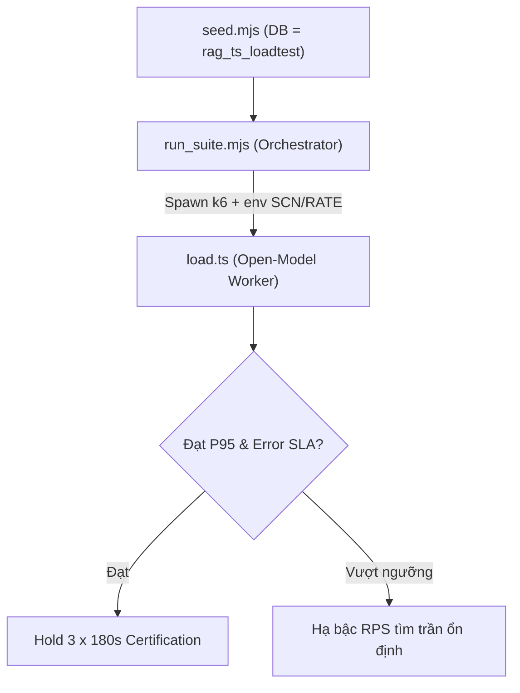

# benchmark/v2 — Bộ Điều phối Quét Ngưỡng Chịu tải Tự động (Open-Model v2)

- **Motivation/Background**: Cung cấp tài liệu đặc tả tự chứa ngay tại `backend_rag/benchmark/v2/` theo yêu cầu chuẩn hóa kiến trúc, giúp người đọc nắm bắt nhanh mục đích thư mục, trách nhiệm từng file và luồng nghiệp vụ mà không phải dò thủ công toàn bộ mã nguồn.
- **Purpose**: Thế hệ kịch bản benchmark v2 tự động hóa hoàn toàn việc tìm trần RPS đạt chuẩn SLA cho từng kịch bản nghiệp vụ rồi giữ tải 3 hiệp x 3 phút liên tiếp để xác nhận ổn định trước và sau tối ưu.
- **Overview Pipeline**: `seed.mjs` kiểm tra nghiêm ngặt tên DB phải là `rag_ts_loadtest` rồi tạo pool... -> `run_suite.mjs` điều phối nhị phân / bậc thang nhiều tiến trình k6 con chạy... -> `load.ts` phát lưu lượng open-model độc lập tốc độ phản hồi server và đối....
- **Detailed Plan**: Mục 1 định nghĩa phạm vi & vai trò; Mục 2 liệt kê cấu trúc thư mục con và danh mục file/export thực tế; Mục 3 mô tả chức năng, luồng nghiệp vụ kèm sơ đồ Mermaid; Mục 4 quy định hợp đồng I/O, bất biến hệ thống và lệnh kiểm chứng.
- **References**: [benchmark/README.md](../README.md), [PERFORMANCE_AND_CACHING.md](../../docs/PERFORMANCE_AND_CACHING.md), [AGENTS.md](../../AGENTS.md).
- **Created**: 2026-11-15T12:55:00+07:00
- **Last Updated**: 2026-11-15T12:55:00+07:00

[STATUS: ACTIVE]

---
## 1. Mục đích & Phạm vi Thư mục (Directory Scope & Architectural Role)

Thế hệ kịch bản benchmark v2 tự động hóa hoàn toàn việc tìm trần RPS đạt chuẩn SLA cho từng kịch bản nghiệp vụ rồi giữ tải 3 hiệp x 3 phút liên tiếp để xác nhận ổn định trước và sau tối ưu.

---

## 2. Đặc tả Kỹ thuật & Danh mục File (Technical Specification)

### 2.2. Danh mục File & Ký hiệu Kỹ thuật (File & Symbol Inventory)

| File | Loại / Tầng | Exports / Routes / Ký hiệu Chính | Mô tả Trách nhiệm |
| :--- | :--- | :--- | :--- |
| [`load.ts`](load.ts) | TypeScript Module | `options` | One load step. Chosen by env: SCN (scenario), then RATE + DURATION (open model: arrivals do not |
| [`run_suite.mjs`](run_suite.mjs) | ESM Runner Script | - | Finds the highest load that meets the SLA for each scenario, then holds it 3 x 3 minutes. Each |
| [`seed.mjs`](seed.mjs) | ESM Runner Script | - | Seeds a THROWAWAY MongoDB for the load tests and writes the k6 pool. Refuses any database whose |

---

## 3. Mô tả Chức năng & Luồng Nghiệp vụ (Business Flow)

1. `seed.mjs` kiểm tra nghiêm ngặt tên DB phải là `rag_ts_loadtest` rồi tạo pool user + session thử tải.
2. `run_suite.mjs` điều phối nhị phân / bậc thang nhiều tiến trình k6 con chạy `load.ts` theo từng biến môi trường `SCN`, `RATE`, `DURATION`.
3. `load.ts` phát lưu lượng open-model độc lập tốc độ phản hồi server và đối chiếu tiêu chí SLA theo từng pha.



---

## 4. Hợp đồng Đầu vào / Đầu ra, Bất biến & Kiểm chứng

- **Đầu vào (Inputs)**: Biến môi trường `SCN`, `RATE`, `DURATION`, `MONGO_URI` trỏ tới DB `rag_ts_loadtest`.
- **Đầu ra & Tác động (Outputs / Side Effects)**: Kết quả trần thông lượng bền vững theo từng kịch bản và pool test tạm.

### Bất biến & Quy tắc Kiến trúc (System Invariants)
- `seed.mjs` kiên quyết từ chối chạy nếu database không mang tên `rag_ts_loadtest` nhằm bảo vệ dữ liệu thật.

### Lệnh Kiểm chứng (Verification)
```powershell
cd backend_rag && node benchmark/v2/run_suite.mjs --help
```
