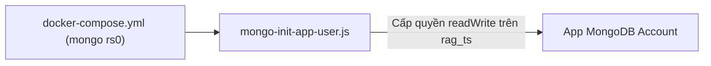

# docker — Tập lệnh Khởi tạo MongoDB Docker & Quyền Least-Privilege

- **Motivation/Background**: Cung cấp tài liệu đặc tả tự chứa ngay tại `backend_rag/docker/` theo yêu cầu chuẩn hóa kiến trúc, giúp người đọc nắm bắt nhanh mục đích thư mục, trách nhiệm từng file và luồng nghiệp vụ mà không phải dò thủ công toàn bộ mã nguồn.
- **Purpose**: Chứa script khởi tạo tự động chạy bên trong container MongoDB (`docker-compose.yml`) khi thư mục dữ liệu còn trống, tạo tài khoản ứng dụng không mang quyền root.
- **Overview Pipeline**: Docker Compose khởi chạy dịch vụ `mongo` ở chế độ Replica Set `rs0` và mount... -> Script đọc thông tin user ứng dụng và cấp quyền tối thiểu `readWrite` trên....
- **Detailed Plan**: Mục 1 định nghĩa phạm vi & vai trò; Mục 2 liệt kê cấu trúc thư mục con và danh mục file/export thực tế; Mục 3 mô tả chức năng, luồng nghiệp vụ kèm sơ đồ Mermaid; Mục 4 quy định hợp đồng I/O, bất biến hệ thống và lệnh kiểm chứng.
- **References**: [docker-compose.yml](../docker-compose.yml), [AGENTS.md](../AGENTS.md), [AGENTS.md](../../AGENTS.md).
- **Created**: 2026-11-15T12:55:00+07:00
- **Last Updated**: 2026-11-15T12:55:00+07:00

[STATUS: ACTIVE]

---
## 1. Mục đích & Phạm vi Thư mục (Directory Scope & Architectural Role)

Chứa script khởi tạo tự động chạy bên trong container MongoDB (`docker-compose.yml`) khi thư mục dữ liệu còn trống, tạo tài khoản ứng dụng không mang quyền root.

---

## 2. Đặc tả Kỹ thuật & Danh mục File (Technical Specification)

### 2.2. Danh mục File & Ký hiệu Kỹ thuật (File & Symbol Inventory)

| File | Loại / Tầng | Exports / Routes / Ký hiệu Chính | Mô tả Trách nhiệm |
| :--- | :--- | :--- | :--- |
| [`mongo-init-app-user.js`](mongo-init-app-user.js) | Node/Mongo Script | - | Runs once, on an empty data directory: the account the app uses, limited to its own database. |

---

## 3. Mô tả Chức năng & Luồng Nghiệp vụ (Business Flow)

1. Docker Compose khởi chạy dịch vụ `mongo` ở chế độ Replica Set `rs0` và mount `mongo-init-app-user.js` vào `/docker-entrypoint-initdb.d/`.
2. Script đọc thông tin user ứng dụng và cấp quyền tối thiểu `readWrite` trên database `rag_ts` (tách biệt khỏi tài khoản root và `rag_ts_corpus`).



---

## 4. Hợp đồng Đầu vào / Đầu ra, Bất biến & Kiểm chứng

- **Đầu vào (Inputs)**: Biến môi trường MongoDB khởi tạo trong container (`RAGTS_MONGO_*`).
- **Đầu ra & Tác động (Outputs / Side Effects)**: Tài khoản `readWrite` cho `rag_ts` sẵn sàng phục vụ NestJS Mongoose transactions.

### Bất biến & Quy tắc Kiến trúc (System Invariants)
- MongoDB luôn bật xác thực và chỉ bind `127.0.0.1`; ứng dụng dùng tài khoản `readWrite` riêng trên `rag_ts`, tuyệt đối không dùng root (`D-056`).

### Lệnh Kiểm chứng (Verification)
```powershell
cd backend_rag && docker compose config
```
