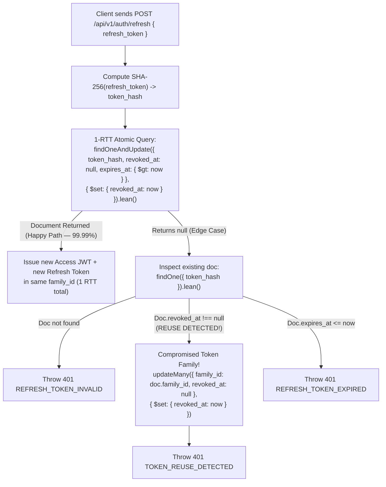

# AUTH_AND_SECURITY_ARCHITECTURE.md — Authentication, Token Rotation & Cryptographic Architecture

- **Motivation/Background**: `backend_rag` implements production-grade OWASP authentication combining memory-hard `Argon2id` password hashing (`64 MB`), short-lived stateless JWT access tokens, stateful opaque refresh tokens with family reuse detection, progressive account lockout, and write-through in-memory caching (`LRUCache`). AI agents modifying `src/auth/` must understand both the cryptographic security guarantees and the 1-RTT latency optimizations so neither security nor `400 CU` throughput is compromised.
- **Purpose**: Provide the definitive technical specification for `AuthModule` (`AuthController`, `AuthService`, `TokenService`, `JwtAuthGuard`, `OptionalJwtAuthGuard`), including database schemas, token rotation state machines, and cache coherency rules.
- **Overview Pipeline**: Client Auth Request → `AuthService` (`userByEmailCache` / `attemptCountCache` / `Argon2id` on libuv pool `UV_THREADPOOL_SIZE=4`) → `TokenService` (Parallel JWT Sign + SHA-256 Refresh Token Store / 1-RTT Atomic `findOneAndUpdate` Rotation) → Write-Through `userCache` Update.
- **Detailed Plan**: Section 1 covers Password Cryptography & Threadpool Tuning; Section 2 details Dual-Token JWT & 1-RTT Refresh Rotation with Family Reuse Revocation; Section 3 explains Progressive Brute-Force Lockout; Section 4 documents Auth Cache Coherency Rules; Section 5 maps all `/api/v1/auth/*` Endpoints & Error Codes.
- **References**: [../AGENTS.md](../AGENTS.md), [AUTH_LOGOUT_DESIGN.md](AUTH_LOGOUT_DESIGN.md), [PERFORMANCE_AND_CACHING.md](PERFORMANCE_AND_CACHING.md), [MONGODB_SCHEMA_DESIGN.md](MONGODB_SCHEMA_DESIGN.md), [../benchmark/BOTTLENECK_ANALYSIS_AND_OPTIMIZATION.md](../benchmark/BOTTLENECK_ANALYSIS_AND_OPTIMIZATION.md).
- **Created**: 2026-10-29T19:46:00+07:00
- **Last Updated**: 2026-10-29T19:46:00+07:00

[STATUS: ACTIVE]

---

## 1. Password Cryptography (`Argon2id`) & Threadpool Isolation

### 1.1 OWASP-Compliant `Argon2id` Parameters
Defined in [`src/auth/auth.service.ts`](../src/auth/auth.service.ts):
```typescript
const ARGON2_OPTIONS: argon2.Options = {
  type: argon2.argon2id,
  memoryCost: 65536, // 64 MB per hash operation
  timeCost: 3,       // 3 iterations
  parallelism: 4,    // 4 lanes
};
```
- **Why `Argon2id` (`64 MB`)?** Provides resistance against both GPU/ASIC cracking (via `64 MB` memory-hardness) and side-channel timing attacks (hybrid data-independent/data-dependent addressing).
- **Never downgrade these parameters** (`D-021`): Even under stress testing, `memoryCost: 65536` is preserved to maintain production cryptographic strength.

### 1.2 Libuv Threadpool Pinning (`UV_THREADPOOL_SIZE = 4`, `D-022`)
Because `argon2.hash()` and `argon2.verify()` execute asynchronously in C++ on Node.js's `libuv` worker threadpool:
- [`src/main.ts`](../src/main.ts) pins `process.env.UV_THREADPOOL_SIZE = '4'` at the very top of the file before importing NestJS modules.
- **Why `4` instead of `12`?** Each active `Argon2id` job allocates and sweeps a `64 MB` memory matrix (`4 × 64 MB = 256 MB` concurrent working set). Empirical Stage C testing (`D-022`) proved that raising `UV_THREADPOOL_SIZE` to `12` (`768 MB` concurrent working set) saturated DRAM memory bandwidth and L3 cache lines, **degrading `POST /auth/login` P50 latency from `2.62s` to `3.32s` (`+26.7%` slower)**.
- **Zero Event Loop Starvation**: Because `Argon2id` runs off the main V8 Event Loop on those 4 worker threads, concurrent `GET /api/v1/auth/me` requests during a heavy login storm maintain a `P95` latency of **`48.03ms`** (`0.00%` errors).

---

## 2. Dual-Token Architecture & 1-RTT Refresh Rotation (`TokenService`)

### 2.1 Access Token vs. Refresh Token
| Token Type | Format | Default TTL | Storage & Verification |
| :--- | :--- | :--- | :--- |
| **Access Token** | Stateless JWT (`HS256`) containing `{ sub: userId, email, role }` | `15m` (`900s`) | Verified in-memory by [`JwtAuthGuard`](../src/auth/guards/jwt-auth.guard.ts) (`0` DB queries). |
| **Refresh Token** | `48-byte` CSPRNG hex string (`96` hex chars) | `7d` | Only the **SHA-256 hash** (`token_hash`) is stored in MongoDB `refresh_tokens` along with `user_id`, `family_id`, `expires_at`, and `revoked_at`. |

### 2.2 Parallel Token Issuance (`issue()`)
In [`src/auth/token.service.ts`](../src/auth/token.service.ts), `issue(userId, email, role, meta, familyId?)` executes JWT signing (`jwt.signAsync`) and MongoDB refresh token insertion (`refreshModel.create`) **in parallel via `Promise.all`**, saving CPU + I/O overlap on every login, registration, and token refresh.

### 2.3 1-RTT Optimistic Atomic Refresh Consumption (`consume()`, `D-021`)
Previously, `consume()` performed 2 sequential MongoDB round-trips (`findOne` followed by `updateOne`). Over the Cloudflare TCP tunnel (`~20ms` RTT), that doubled token rotation latency.

`TokenService.consume(rawToken)` now uses an **optimistic 1-RTT atomic `findOneAndUpdate`** on the happy path while preserving full **Token Family Reuse Detection**:



---

## 3. Progressive Brute-Force Lockout & Fast-Path Login

To protect accounts against credential stuffing without allowing attackers to DoS the database:
1. **Lockout Policy**:
   - Up to `MAX_FAILED_ATTEMPTS = 5` failed logins within a `15-minute` window are tracked in `login_attempts` (with a MongoDB TTL index).
   - Upon the 5th failed attempt, `users.locked_until` is set to `now + 15 minutes` (`423 Locked` / `ACCOUNT_LOCKED`).
2. **1-RTT Fast-Path `login()` (`D-021`)**:
   - [`AuthService.login()`](../src/auth/auth.service.ts) checks `userByEmailCache` and `attemptCountCache` first, falling back to a parallel `Promise.all` query only on a cache miss.
   - If the user has `0` recent failed attempts (`attemptCount === 0`), `login()` **skips** the redundant `attempts.deleteMany({ email })` write on successful login, cutting happy-path login DB round-trips from `4 RTTs` down to **`1 RTT`** (the refresh token insert).
3. **Timing-Attack Prevention against User Enumeration**:
   - If `login()` receives an email that does not exist in `users`, it still runs `argon2.verify(DUMMY_ARGON2_HASH, password)` so an attacker cannot distinguish "email not found" (`~2.6s`) from "wrong password" (`~2.6s`) via response timing.

---

## 4. Auth In-Memory Cache Coherency (`src/auth/auth.service.ts`)

[`AuthService`](../src/auth/auth.service.ts) maintains three bounded `LRUCache` instances (`max: 5000`, `ttl: 300_000` ms = `5 minutes`, `updateAgeOnGet: true`):

| Cache Name | Key | Cached Value | Invalidation / Update Rules |
| :--- | :--- | :--- | :--- |
| `userCache` | `userId` (`string`) | `UserResponseDto` (`id, email, full_name, role, is_active, created_at, last_login_at`) | • Populated on `register()`, `login()`, and `getMe()`.<br>• Updated in-place on `updateProfile()`. |
| `userByEmailCache` | `email` (lowercase `string`) | Lean `User` record (including `password_hash`, `locked_until`, `is_active`) | • Populated on `register()` and `login()`.<br>• Updated in-place on `updateProfile()`.<br>• **Deleted (`delete(email)`) on `changePassword()`** and when setting `locked_until`. |
| `attemptCountCache` | `email` (lowercase `string`) | `number` of failed login attempts in current window | • Incremented on wrong password.<br>• Reset to `0` on successful login or when lockout is triggered. |

---

## 5. Auth Endpoints & Guard Summary (`/api/v1/auth/*`)

| Method & Route | Guard | Rate Limit (`@nestjs/throttler`) | Description |
| :--- | :--- | :--- | :--- |
| `POST /api/v1/auth/register` | Public | `5 req / 60s` | Validates email/password, hashes with `Argon2id`, creates user, and returns `201` with `user + access_token + refresh_token`. |
| `POST /api/v1/auth/login` | Public | `10 req / 60s` | Verifies lockout & `Argon2id` password, updates `last_login_at`, and returns `200` with `user + access_token + refresh_token`. |
| `POST /api/v1/auth/refresh` | Public | `30 req / 60s` | Atomically consumes `refresh_token` (`1 RTT`) and rotates a new token pair in the same `family_id`. |
| `POST /api/v1/auth/logout` | [`JwtAuthGuard`](../src/auth/guards/jwt-auth.guard.ts) | Default | Revokes the single provided `refresh_token` (`204 No Content`). See [`AUTH_LOGOUT_DESIGN.md`](AUTH_LOGOUT_DESIGN.md). |
| `POST /api/v1/auth/logout-all` | [`JwtAuthGuard`](../src/auth/guards/jwt-auth.guard.ts) | Default | Revokes **all** active refresh tokens for `req.user.sub` across all devices (`200 { revoked_count }`). |
| `GET /api/v1/auth/me` | [`JwtAuthGuard`](../src/auth/guards/jwt-auth.guard.ts) | Default | Returns `UserResponseDto` from `userCache` (`~0.1ms` hit) or `.lean()` MongoDB lookup. |
| `PATCH /api/v1/auth/me` | [`JwtAuthGuard`](../src/auth/guards/jwt-auth.guard.ts) | Default | Updates `full_name` via `.findOneAndUpdate(...).lean()` and updates `userCache` & `userByEmailCache` in-place. |
| `POST /api/v1/auth/change-password` | [`JwtAuthGuard`](../src/auth/guards/jwt-auth.guard.ts) | `5 req / 60s` | Verifies `current_password`, hashes `new_password` with `Argon2id`, invalidates `userByEmailCache`, and revokes all existing refresh tokens (`revokeAllForUser`). |
