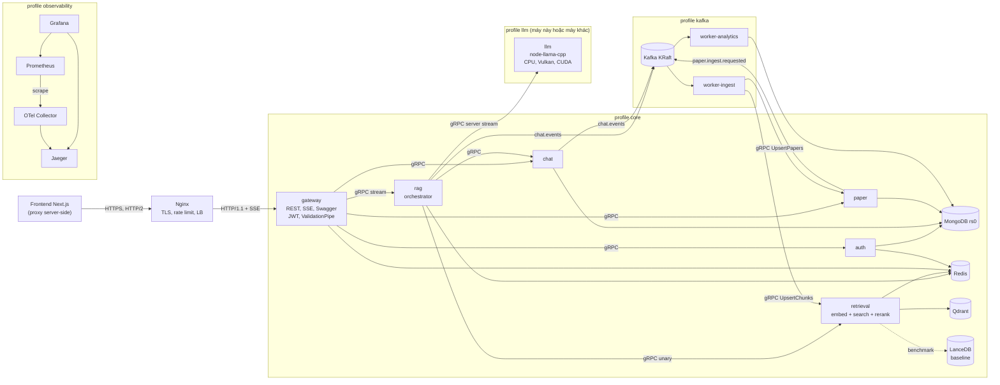
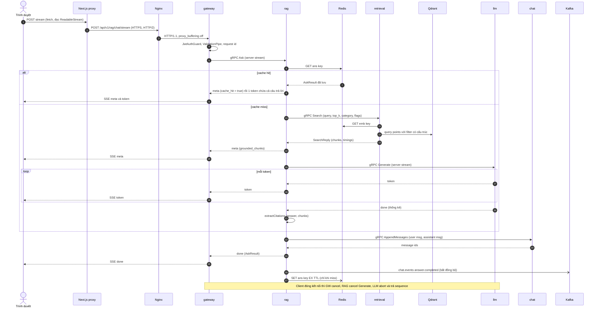

# MICROSERVICE_ARCHITECTURE.md — Thiết kế tách monolith Scientific RAG thành microservice (gRPC-first)

- **Motivation/Background**: Backend [`TS_backend_rag`](../README.md) hiện là một monolith NestJS (F1–F6) chạy embedding, vector search, rerank và LLM trong cùng một tiến trình. Hệ quả: nhiều request đồng thời làm cạn sequence của LLM, token không stream được, LLM không chạy được trên máy khác và chưa có số đo performance. Môn học yêu cầu tách microservice (gRPC, Kafka, MongoDB, Redis, Qdrant), cấm SQL và chấm kỹ performance với số đo trước/sau.
- **Purpose**: Đặc tả kiến trúc microservice đích, hợp đồng REST/gRPC, mô hình dữ liệu, kế hoạch chuyển đổi và cách kiểm chứng, để mỗi bước triển khai sau này có cơ sở rõ ràng và đo được.
- **Overview Pipeline**: Đọc code hiện có trong [`src/`](../src/) và [`scripts/`](../scripts/), tài liệu nhóm trong `RAG_TS/` (chỉ đọc) và [đặc tả phiên chat](../../CHAT_SESSIONS_SPECIFICATION%20copy.md). Đối chiếu để tìm bug và chỗ mâu thuẫn, sau đó thiết kế theo 7 bước của prompt (Yêu cầu → API → Dữ liệu → Module → Pseudocode → Kiểm chứng → Quyết định), theo quy trình trong [`lesson_2.md`](../../RAG_TS/docs/lesson_2.md).
- **Detailed Plan**: §0 Hiện trạng, bug và rủi ro; §1 Yêu cầu và phạm vi; §2 API Contract (REST/SSE, bản nháp `.proto`, ánh xạ mã lỗi, chính sách tiến hoá API); §3 Dữ liệu (MongoDB, Qdrant, Redis, Kafka, quyền sở hữu); §4 Kiến trúc module (service, monorepo, guard/pipe/interceptor, ánh xạ file, Docker Compose, quan sát hệ thống); §5 Pseudocode; §6 Kiểm chứng (test, k6, so sánh Qdrant với LanceDB); §7 ADR; §8 Bản ghi thay đổi; §9 Lộ trình triển khai; §10 Câu hỏi mở; §11 Giả định đã dùng; §12 Tài liệu tham chiếu.
- **References**: NestJS 11 (`@nestjs/microservices` gRPC/Kafka), gRPC, Protocol Buffers (proto3), buf, ts-proto, Apache Kafka (KRaft), Nginx, MongoDB, Redis, Qdrant, LanceDB, node-llama-cpp, `@xenova/transformers`, OpenTelemetry, Jaeger, Prometheus, Grafana, k6, Docker Compose; [`MD_CONVENTION.md`](../../RAG_TS/agents/rules/MD_CONVENTION.md), [`COMMIT_CONVENTION.md`](../../RAG_TS/agents/rules/COMMIT_CONVENTION.md), [`API_SPECIFICATION.md`](../../RAG_TS/docs/API_SPECIFICATION.md), [`RAG.md`](../../RAG_TS/docs/RAG.md), [`SCIENTIFIC_RAG_BACKEND.md`](../../RAG_TS/docs/SCIENTIFIC_RAG_BACKEND.md), [`CHAT_SESSIONS_SPECIFICATION copy.md`](../../CHAT_SESSIONS_SPECIFICATION%20copy.md).
- **Created**: 2026-10-16T20:11:28+07:00
- **Last Updated**: 2026-10-16T20:11:28+07:00

---

[STATUS: DRAFT]

> **Cách đọc**: `B-xx` = bug/rủi ro hiện có, `Q-xx` = câu hỏi mở, `A-xx` = giả định, `CR-xx` = bản ghi thay đổi, `ADR-xx` = quyết định công nghệ, `M-xx` = bước trong lộ trình.
> Đường dẫn đến file **đang tồn tại** đều là link tương đối. Đường dẫn trong `apps/`, `libs/`, `deploy/`, `k6/`, `bench/` là **đề xuất, chưa tồn tại**, nên được viết dạng `code` và sẽ đổi thành link khi file được tạo (A-16).
> Tài liệu này chỉ là thiết kế. Không có dòng code, package hay cấu hình nào được thay đổi.

## Table of Contents

- [0. Hiện trạng monolith và rủi ro cần xử lý](#0-hiện-trạng-monolith-và-rủi-ro-cần-xử-lý)
  - [0.1 Kiến trúc hiện tại](#01-kiến-trúc-hiện-tại)
  - [0.2 Bug và rủi ro cần xử lý khi tách](#02-bug-và-rủi-ro-cần-xử-lý-khi-tách)
- [1. Yêu cầu và phạm vi](#1-yêu-cầu-và-phạm-vi)
  - [1.1 Yêu cầu chức năng](#11-yêu-cầu-chức-năng)
  - [1.2 Input và Output của các luồng chính](#12-input-và-output-của-các-luồng-chính)
  - [1.3 Ràng buộc](#13-ràng-buộc)
  - [1.4 Cấm SQL: chỗ tài liệu cũ gợi ý và phương án thay thế](#14-cấm-sql-chỗ-tài-liệu-cũ-gợi-ý-và-phương-án-thay-thế)
  - [1.5 Yêu cầu phi chức năng và chỉ số performance](#15-yêu-cầu-phi-chức-năng-và-chỉ-số-performance)
  - [1.6 Ngoài phạm vi](#16-ngoài-phạm-vi)
- [2. API Contract](#2-api-contract)
  - [2.1 Vì sao gateway vẫn là HTTP còn nội bộ là gRPC](#21-vì-sao-gateway-vẫn-là-http-còn-nội-bộ-là-grpc)
  - [2.2 Danh mục endpoint REST ở gateway](#22-danh-mục-endpoint-rest-ở-gateway)
  - [2.3 Hợp đồng chi tiết từng nhóm endpoint](#23-hợp-đồng-chi-tiết-từng-nhóm-endpoint)
  - [2.4 Định dạng lỗi và bảng ánh xạ gRPC sang HTTP](#24-định-dạng-lỗi-và-bảng-ánh-xạ-grpc-sang-http)
  - [2.5 Bản nháp .proto](#25-bản-nháp-proto)
  - [2.6 Ánh xạ proto với type TypeScript](#26-ánh-xạ-proto-với-type-typescript)
  - [2.7 Chính sách tiến hoá API](#27-chính-sách-tiến-hoá-api)
- [3. Dữ liệu và quyền sở hữu](#3-dữ-liệu-và-quyền-sở-hữu)
  - [3.1 Service nào sở hữu dữ liệu nào](#31-service-nào-sở-hữu-dữ-liệu-nào)
  - [3.2 MongoDB](#32-mongodb)
  - [3.3 Qdrant](#33-qdrant)
  - [3.4 Redis](#34-redis)
  - [3.5 Kafka](#35-kafka)
  - [3.6 Nạp dữ liệu ban đầu](#36-nạp-dữ-liệu-ban-đầu)
- [4. Kiến trúc module](#4-kiến-trúc-module)
  - [4.1 Danh sách service](#41-danh-sách-service)
  - [4.2 Vì sao không tách quá nhỏ](#42-vì-sao-không-tách-quá-nhỏ)
  - [4.3 Sơ đồ kiến trúc tổng thể](#43-sơ-đồ-kiến-trúc-tổng-thể)
  - [4.4 Cấu trúc thư mục monorepo](#44-cấu-trúc-thư-mục-monorepo)
  - [4.5 Guard, pipe, interceptor và filter](#45-guard-pipe-interceptor-và-filter)
  - [4.6 Ánh xạ file hiện có sang service mới](#46-ánh-xạ-file-hiện-có-sang-service-mới)
  - [4.7 Docker Compose theo profile và chạy LLM ở máy khác](#47-docker-compose-theo-profile-và-chạy-llm-ở-máy-khác)
  - [4.8 Quan sát hệ thống](#48-quan-sát-hệ-thống)
- [5. Pseudocode các luồng chính](#5-pseudocode-các-luồng-chính)
  - [5.1 Luồng hỏi đáp có stream](#51-luồng-hỏi-đáp-có-stream)
  - [5.2 Luồng phiên chat với cursor pagination](#52-luồng-phiên-chat-với-cursor-pagination)
  - [5.3 Luồng nạp paper qua Kafka](#53-luồng-nạp-paper-qua-kafka)
  - [5.4 Luồng health check](#54-luồng-health-check)
  - [5.5 Khác biệt so với pseudocode gốc trong prompt](#55-khác-biệt-so-với-pseudocode-gốc-trong-prompt)
- [6. Kiểm chứng](#6-kiểm-chứng)
  - [6.1 Test cần có cho mỗi service](#61-test-cần-có-cho-mỗi-service)
  - [6.2 Kịch bản k6](#62-kịch-bản-k6)
  - [6.3 So sánh Qdrant với LanceDB](#63-so-sánh-qdrant-với-lancedb)
  - [6.4 Quy tắc đo và báo cáo](#64-quy-tắc-đo-và-báo-cáo)
  - [6.5 Checklist kiểm chứng tài liệu này](#65-checklist-kiểm-chứng-tài-liệu-này)
- [7. Quyết định công nghệ (ADR)](#7-quyết-định-công-nghệ-adr)
- [8. Bản ghi thay đổi](#8-bản-ghi-thay-đổi)
- [9. Lộ trình triển khai](#9-lộ-trình-triển-khai)
- [10. Câu hỏi mở](#10-câu-hỏi-mở)
- [11. Danh sách giả định đã dùng](#11-danh-sách-giả-định-đã-dùng)
- [12. Tài liệu tham chiếu](#12-tài-liệu-tham-chiếu)

---

## 0. Hiện trạng monolith và rủi ro cần xử lý

### 0.1 Kiến trúc hiện tại

Toàn bộ backend là một tiến trình NestJS ([`src/main.ts`](../src/main.ts)). Hàm [`RagService.executeRagPipeline`](../src/rag/rag.service.ts#L36) gọi tuần tự các bước sau:

| Bước | Hàm (file) | Việc làm | Tài nguyên tiêu tốn |
| :--- | :--- | :--- | :--- |
| 1 | `MiningService.expandQueryTerms` ([`mining.service.ts`](../src/mining/mining.service.ts#L168)) | Mở rộng query bằng luật FP-Growth (chỉ khi `expand_query = true`) | JSON nằm trong RAM |
| 2 | `EmbeddingService.generateEmbedding` ([`embedding.service.ts`](../src/embedding/embedding.service.ts#L33)) | Thêm tiền tố `search_query: `, chạy nomic v1.5, ra vector 768-D | CPU, model ONNX |
| 3 | `VectorStoreService.search` ([`vector-store.service.ts`](../src/vector-store/vector-store.service.ts#L92)) | Tìm cosine trên LanceDB, lấy `max(top_k × 3, 20)` ứng viên | Đĩa local hoặc R2 (S3) |
| 4 | `MiningService.rerankChunks` ([`mining.service.ts`](../src/mining/mining.service.ts#L191)) | `final = 0.85 × sim + 0.15 × authority`, sắp xếp, cắt `top_k` | CPU |
| 5 | Prompt grounding trong [`rag.service.ts`](../src/rag/rag.service.ts#L62) và `LlmService.generateGroundedAnswer` ([`llm.service.ts`](../src/llm/llm.service.ts#L99)) | Qwen2.5 GGUF chạy qua node-llama-cpp, trả về **cả chuỗi một lần** | CPU/GPU, RAM |
| 6 | `RagService.extractCitations` ([`rag.service.ts`](../src/rag/rag.service.ts#L100)) | Dùng regex trích `[Paper: id]`, `[n]`, `(Paper ID: …)` | CPU |

- **REST hiện có**: `POST /api/rag/chat`, `GET /api/rag/health` ([`rag.controller.ts`](../src/rag/rag.controller.ts)), `GET /` (trả `Hello World!`, [`app.controller.ts`](../src/app.controller.ts)), Swagger tại `/api/docs` và `/api/docs-json`. Cổng mặc định là `GATEWAY_PORT || PORT || 8000` ([`main.ts`](../src/main.ts#L43)).
- **Frontend (chỉ đọc)** chỉ gọi đúng 2 endpoint, qua proxy server-side: [`chat/route.ts`](../../RAG_TS/frontend_rag/app/api/rag/chat/route.ts) và [`health/route.ts`](../../RAG_TS/frontend_rag/app/api/rag/health/route.ts). Frontend coi `status === 'ok'` là backend đang online và chỉ nhận diện GPU loại `cuda`/`metal` ([`Navbar.tsx`](../../RAG_TS/frontend_rag/components/Navbar.tsx#L13-L15)). Navbar có link cứng tới `http://localhost:8000/api/docs` ([`Navbar.tsx`](../../RAG_TS/frontend_rag/components/Navbar.tsx#L75)). Lịch sử chat hiện chỉ nằm trong state React ([`page.tsx`](../../RAG_TS/frontend_rag/app/page.tsx#L17)).
- **Chưa có**: xác thực, lưu lịch sử chat phía server, cache, stream token, metrics, tracing, hàng đợi LLM.
- **Dữ liệu**: tại thời điểm viết (2026-10-16), workspace không có thư mục `data/` cục bộ, nên LanceDB và các file mining phải lấy từ R2. File `.env` có khai báo `LANCEDB_URI` và `R2_PUBLIC_URL` (A-08, Q-22).
- **Cấu hình dev**: LLM `qwen2.5-0.5b-instruct-q4_k_m` (file GGUF 491.400.032 byte trong `models/`), `LLM_CONTEXT_SIZE=4096`, `LLM_MAX_TOKENS=512`, `LLM_SEQUENCES=1`. Máy: Intel Core Ultra 5 125H, iGPU Intel Arc (không có NVIDIA), RAM 15,5 GB.

### 0.2 Bug và rủi ro cần xử lý khi tách

| ID | Vấn đề | Bằng chứng | Hậu quả | Hướng xử lý khi tách | Cách kiểm chứng |
| :--- | :--- | :--- | :--- | :--- | :--- |
| B-01 | Đường dẫn Windows viết cứng; đường dẫn phụ thuộc `process.cwd()` | [`llm.service.ts#L85`](../src/llm/llm.service.ts#L85), [`mining.service.ts#L40`](../src/mining/mining.service.ts#L40), [`#L104`](../src/mining/mining.service.ts#L104), [`vector-store.service.ts#L33`](../src/vector-store/vector-store.service.ts#L33); `envFilePath: ['.env', '../.env']` tại [`app.module.ts#L11`](../src/app.module.ts#L11) | Trong container Linux các đường dẫn này không tồn tại. Kết quả phụ thuộc thư mục chạy lệnh. Lộ cấu trúc thư mục máy cá nhân | Mỗi service có một schema cấu hình (zod, ADR-23), validate lúc khởi động. Đường dẫn lấy từ env, không còn danh sách "đoán". Thiếu biến thì thoát với mã lỗi khác 0 | Unit test schema: thiếu biến thì throw. CI chặn chuỗi `C:\` trong `apps/` và `libs/` |
| B-02 | `LLM_SEQUENCES` cạn khi có request đồng thời | [`llm.service.ts#L61`](../src/llm/llm.service.ts#L61) tạo context với N sequence (mặc định 2, dev đặt 1). [`#L108`](../src/llm/llm.service.ts#L108) gọi `getSequence()` cho mỗi request mà không có hàng đợi | Request thứ N+1 chạy đồng thời sẽ lỗi (node-llama-cpp ném lỗi khi hết sequence, cần tái hiện, A-05), trả HTTP 500 | Service `llm` có hàng đợi giới hạn: concurrency = N, có sức chứa và thời gian chờ tối đa. Hàng đợi đầy thì trả `RESOURCE_EXHAUSTED`, gateway đổi thành HTTP 429 kèm `Retry-After`. Thêm gauge `llm_queue_length` | k6 S5 với 4 VU và `LLM_SEQUENCES=1`: trước khi sửa có 5xx; sau khi sửa không còn 5xx, chỉ có 200 hoặc 429 |
| B-03 | LLM không stream | [`llm.service.ts#L117`](../src/llm/llm.service.ts#L117): `session.prompt()` trả về cả chuỗi | TTFT bằng toàn bộ thời gian sinh. Ví dụ trong API_SPECIFICATION là `latency_ms: 14185` (7B trên RTX 4060) | Dùng callback stream token của node-llama-cpp (A-05), chuyển thành gRPC server stream rồi SSE ở gateway | Histogram `rag_ttft_seconds` và k6 S3: so TTFT p95 trước/sau |
| B-04 | Embedding chạy trên event loop chính | [`embedding.service.ts#L46`](../src/embedding/embedding.service.ts#L46): tokenizer và mean pooling chạy bằng JS trên luồng chính. Phần ONNX chặn đến mức nào phụ thuộc binding, cần đo | Trong lúc embed, request khác (kể cả health) bị trễ | Chạy embedding trong pool `worker_threads` (Piscina) bên trong `retrieval`, thêm cache `emb:` trên Redis | `perf_hooks.monitorEventLoopDelay` p99 trước/sau, đo khi k6 bắn song song chat và health |
| B-05 | Rerank khớp tên tác giả bằng chuỗi con | [`mining.service.ts#L153-L155`](../src/mining/mining.service.ts#L153-L155): `clean.includes(infName) \|\| infName.includes(clean)` | (a) Tên trở thành rỗng sau khi bỏ "et al." (ví dụ tác giả `"et al."`) khớp **mọi** influencer vì `"x".includes("")` luôn đúng, nên authority = 1,0. (b) Họ ngắn như "He", "Li" khớp nhầm vào tên dài. (c) Influencer trong RAG.md có dạng `"Ashish Vaswani (Attention Is All You Need)"`. (d) Mỗi chunk tốn O(authors × influencers) | Chuẩn hoá tên (NFKD, bỏ dấu, bỏ phần trong ngoặc, bỏ dấu câu, gộp khoảng trắng) rồi tra `Map` theo tên đã chuẩn hoá, khớp chính xác. Bỏ qua tên rỗng hoặc ngắn hơn 2 ký tự. Có thể thêm bảng alias | Unit test với `""`, `"et al."`, `"He"`, `"Li"`. Báo cáo khác biệt thứ hạng top_k trước/sau trên bộ query cố định |
| B-06 | `detectGpu` chỉ nhận NVIDIA và Apple | [`gpu.util.ts#L48-L82`](../src/utils/gpu.util.ts#L48-L82). [`llm.service.ts#L46-L48`](../src/llm/llm.service.ts#L46-L48) đặt `gpuLayers = 0` khi `hasGpu = false` | iGPU Intel Arc (Vulkan) bị coi là CPU nên không offload layer nào. Frontend hiển thị "CPU Fallback" | Để node-llama-cpp tự dò (`getLlama({ gpu: LLM_GPU })` với mặc định `auto`), đọc backend thực tế từ `llama.gpu`, đặt `gpuLayers` mặc định `'auto'` (A-05). Thêm biến `LLM_GPU` nhận `auto`, `cuda`, `vulkan`, `metal`, `false` | Health báo `gpu.type = 'vulkan'` trên máy dev. So tokens/s giữa CPU và Vulkan |
| B-07 | LLM rơi vào chế độ fallback im lặng khi sai đường dẫn model | [`llm.service.ts#L30-L35`](../src/llm/llm.service.ts#L30-L35) chỉ warn khi không thấy model; [`#L71-L76`](../src/llm/llm.service.ts#L71-L76) chỉ log khi load lỗi; [`#L103-L106`](../src/llm/llm.service.ts#L103-L106) trả câu "insufficient details … fallback mode" với HTTP 200 | Client không phân biệt được câu trả lời thật và giả. k6 cho latency "rất đẹp" nhưng vô nghĩa. Health vẫn báo `status: 'ok'` | Fail-fast: không load được model thì tiến trình thoát (trừ khi `LLM_ALLOW_FALLBACK=true`, chỉ dùng cho test). Nếu đang chạy mà model chưa sẵn sàng thì trả `UNAVAILABLE`, gateway đổi thành 503 | Sai `LLM_MODEL_PATH` thì exit code khác 0. E2E: tắt llm thì nhận 503, không còn 200 giả |
| B-08 | Lọc category bằng chuỗi điều kiện ghép tay | [`vector-store.service.ts#L115-L118`](../src/vector-store/vector-store.service.ts#L115-L118) ghép chuỗi điều kiện, chỉ escape dấu `'` | Đây là dạng truy vấn chuỗi bị loại khỏi luồng chính (xem §1.4). Escape chưa đủ (không xử lý `\`) | Dùng filter JSON có cấu trúc của Qdrant | Unit test category chứa `'` và `\`: không lỗi, không lọt điều kiện |
| B-09 | Khởi tạo embedding nuốt lỗi và có thể khởi tạo lặp | [`embedding.service.ts#L24-L26`](../src/embedding/embedding.service.ts#L24-L26), [`#L38-L41`](../src/embedding/embedding.service.ts#L38-L41) | Load lỗi thì mỗi request lại thử load. Nhiều request đồng thời có thể load model song song | Ghi nhớ một Promise khởi tạo duy nhất. Readiness = false cho tới khi load xong. Lỗi thì trả `UNAVAILABLE` | Test: 10 lời gọi đồng thời chỉ tạo pipeline 1 lần |
| B-10 | Tự đặt similarity 0,5 khi thiếu `_distance` | [`mining.service.ts#L196`](../src/mining/mining.service.ts#L196) (`?? 0.5`) | Chunk không có khoảng cách vẫn được xếp hạng như có sim 0,5 | Thiếu điểm thì loại chunk và tăng counter `retrieval_missing_score_total` | Unit test |
| B-11 | Công thức similarity không thống nhất | Code dùng `1 - d` ([`mining.service.ts#L197`](../src/mining/mining.service.ts#L197)), tài liệu dùng `1 - d/2` | Đổi thang điểm làm lệch trọng số 0,85/0,15, thứ hạng thay đổi | **Không tự chọn**, xem Q-03 | — |
| B-12 | Health luôn trả `ok` | [`rag.controller.ts#L56`](../src/rag/rag.controller.ts#L56) | Không dùng được cho readiness probe hay Docker healthcheck | v1: health tổng hợp thật, có thêm live/ready. Legacy giữ `ok` để frontend không vỡ (CR-06) | E2E health |
| B-13 | E2E test khởi động toàn bộ `AppModule` | [`test/app.e2e-spec.ts#L11-L16`](../test/app.e2e-spec.ts#L11-L16) | Test phải load LLM, embedding và LanceDB nên chậm và phụ thuộc mạng/model | E2E của gateway dùng mock gRPC client. Test tích hợp tách riêng theo profile | So thời gian chạy test |
| B-14 | Tên biến môi trường lệch nhau | [`.env_example`](../.env_example) dùng `MODEL_PATH`, `CONTEXT_SIZE`, `DEFAULT_TOP_K`, `USE_AUTHORITY_BOOST` (2 biến cuối không được code đọc). `.env` có `LLM_SERVICE_URL`, `RETRIEVAL_MODE`, `LLM_MODE`, `LLM_PORT` nhưng `src/` không đọc (đã grep) | Có những cấu hình tưởng có tác dụng nhưng thực ra không | Mỗi service có schema env, `.env.example` sinh từ schema. Trong giai đoạn chuyển đổi vẫn đọc tên cũ kèm cảnh báo (CR-17) | Test schema |
| B-15 | Hợp đồng `authority_score` không khớp | [`mining.service.ts#L209`](../src/mining/mining.service.ts#L209) trả `undefined` khi điểm = 0 nên JSON bỏ field. Swagger khai báo bắt buộc ([`response.dto.ts#L28-L29`](../src/rag/dto/response.dto.ts#L28-L29)). Type frontend khai báo `authority_score: number` ([`rag.ts`](../../RAG_TS/frontend_rag/src/types/rag.ts#L10)) | Frontend có thể nhận `undefined` | Không đổi hành vi khi chưa thống nhất, xem Q-12 | Contract test |
| B-16 | Mô tả cứng "913,205 chunks", "Qwen2.5-7B", "CUDA" | [`main.ts#L31`](../src/main.ts#L31), [`rag.controller.ts#L26`](../src/rag/rag.controller.ts#L26), [`Navbar.tsx#L44`](../../RAG_TS/frontend_rag/components/Navbar.tsx#L44) | Lệch với cấu hình dev (0.5B, iGPU) | Lấy mô tả lúc runtime từ `IndexInfo` và `LlmHealthReply` | — |
| B-17 | Biến thể ONNX dùng cho query có thể khác lúc index | [`embedding.service.ts#L22`](../src/embedding/embedding.service.ts#L22) gọi `pipeline()` với tuỳ chọn mặc định của `@xenova/transformers` (mặc định có thể là bản quantized, A-06), trong khi vector tài liệu được tạo ở pipeline Python | Không gian vector lệch nhẹ, có thể giảm recall | Đo cosine giữa vector query sinh bằng Node và vector tham chiếu từ Python cho cùng một câu, chọn biến thể theo số đo | Script so sánh và recall@10 |
| B-18 | Ghi log nguyên văn query | [`rag.controller.ts#L39`](../src/rag/rag.controller.ts#L39), [`rag.service.ts#L40`](../src/rag/rag.service.ts#L40) | Khi gom log tập trung, dữ liệu người dùng nằm trong log | Ở mức info chỉ log độ dài và hash của query; nội dung chỉ log ở mức debug | Review log |

---

## 1. Yêu cầu và phạm vi

### 1.1 Yêu cầu chức năng

| ID | Chức năng | Service chính |
| :--- | :--- | :--- |
| FR-01 | Hỏi đáp RAG không stream, **giữ nguyên hợp đồng** `POST /api/rag/chat` | gateway → rag |
| FR-02 | Hỏi đáp RAG có stream token (SSE): gửi `grounded_chunks` trước, sau đó token, cuối cùng là citations | gateway → rag → retrieval, llm |
| FR-03 | Health tổng hợp, kèm liveness/readiness; **giữ** `GET /api/rag/health` | gateway |
| FR-04 | Phiên chat: liệt kê (cursor), mở, tạo, đổi tên, xoá; lưu lịch sử hỏi đáp theo [đặc tả phiên chat](../../CHAT_SESSIONS_SPECIFICATION%20copy.md) | chat |
| FR-05 | Xác thực: đăng ký, đăng nhập, làm mới token, đăng xuất (JWT) | auth |
| FR-06 | Tra metadata paper theo `paper_id` (dữ liệu tầng Silver) | paper |
| FR-07 | Nạp paper bất đồng bộ qua Kafka; migrate vector từ LanceDB sang Qdrant | worker-ingest, retrieval |
| FR-08 | Ghi sự kiện phân tích (`answer.completed`, …) qua Kafka | worker-analytics |
| FR-09 | LLM chạy độc lập, chạy được trên máy khác, hỗ trợ CPU/Vulkan/CUDA | llm |
| FR-10 | Xuất metrics và trace để đo performance | tất cả |

### 1.2 Input và Output của các luồng chính

| Luồng | Input | Output | Lỗi chính |
| :--- | :--- | :--- | :--- |
| Hỏi đáp (legacy và v1, không stream) | `QueryDto`: `query` (bắt buộc), `top_k` 1–20 (mặc định 5), `category?`, `use_authority_boost` (mặc định true), `expand_query` (mặc định false); v1 có thêm `session_id?` | `RAGSynthesisResponse` (5 field như hiện tại); v1 có thêm field (§2.3.1) | 400, 401 (chỉ v1), 429, 500, 503, 504 |
| Hỏi đáp có stream | Giống v1 | Luồng SSE `meta` → `token`* → `done` hoặc `error` | Như trên. Lỗi xảy ra sau khi đã gửi header thì đi qua event `error` |
| Phiên chat | `limit`, `cursor`, `session_id`, `title`, `expected_version?` | `ChatSessionSummary`, `ChatSession`, trang có `next_cursor` | 400, 401, 404, 409, 429, 503 |
| Nạp paper | Danh sách `paper_id` + nguồn | 202 Accepted; sự kiện `paper.ingested` | 400, 401, 403, 503 (khi Kafka tắt) |
| Health | — | JSON tổng hợp hoặc JSON theo shape legacy | `/ready` trả 503 khi `down` |

### 1.3 Ràng buộc

| ID | Ràng buộc | Nguồn |
| :--- | :--- | :--- |
| C-01 | Cấm SQL ở mọi nơi (§1.4) | Prompt, ràng buộc môn học |
| C-02 | Gọi nội bộ đồng bộ: gRPC. REST và SSE chỉ có ở gateway. Bất đồng bộ: Kafka | Prompt |
| C-03 | `POST /api/rag/chat` và `GET /api/rag/health` phải chạy suốt giai đoạn chuyển đổi, giữ nguyên request/response | Prompt, frontend |
| C-04 | Mỗi thay đổi so với hiện tại phải có bản ghi thay đổi (§8). Mỗi công nghệ phải có ADR (§7) | Prompt |
| C-05 | Không tách quá nhỏ: embedding, vector search và rerank nằm chung `retrieval` (§4.2) | Prompt |
| C-06 | Máy yếu: Compose chia profile; LLM chạy được ở máy khác qua gRPC | Prompt |
| C-07 | Proto có version trong tên package; chỉ được thêm field; field bỏ đi đưa vào `reserved` | Prompt |
| C-08 | Mỗi document MongoDB có `schema_version` | Prompt |
| C-09 | Mọi thay đổi ảnh hưởng frontend phải ghi vào §10 để thống nhất trước khi làm | Prompt |
| C-10 | Không suy đoán khi thiếu thông tin: ghi vào §10 và dừng ở đó | Prompt, [`lesson_2.md`](../../RAG_TS/docs/lesson_2.md) |

### 1.4 Cấm SQL: chỗ tài liệu cũ gợi ý và phương án thay thế

Đây là **mục duy nhất** liệt kê các từ khoá bị cấm, để giải thích vì sao chúng bị loại.

| Nơi gợi ý | Nội dung gợi ý | Vì sao loại | Thay bằng |
| :--- | :--- | :--- | :--- |
| [`RAG.md` §4.4](../../RAG_TS/docs/RAG.md#44-querying-parquets-with-duckdb-in-typescript), §9 và checklist cuối | Dùng DuckDB (`duckdb-async`) chạy câu `SELECT … FROM read_parquet(?) WHERE paper_id = ?` trên Parquet tầng Silver | DuckDB là engine SQL, vi phạm C-01 | Import Parquet **một lần** bằng `parquet-wasm` + `apache-arrow` (ADR-17) vào collection MongoDB `papers`. Lúc runtime tra theo `_id` bằng truy vấn document của MongoDB, qua service `paper` |
| [`RAG.md` §2.3 và §8.1](../../RAG_TS/docs/RAG.md#23-typescript-sample-vector-retrieval-via-lancedblancedb), [`RAG_TS/docs/prompt.md` F3](../../RAG_TS/docs/prompt.md) | `builder.where("primary_category = '…'")` của LanceDB | Bộ lọc dạng chuỗi kiểu SQL, phải ghép chuỗi nên có rủi ro injection (B-08) | Qdrant filter JSON: `{ must: [{ key: "primary_category", match: { value } }] }`. LanceDB chỉ còn làm baseline benchmark, **không dùng filter** (§6.3) |
| Code [`vector-store.service.ts#L117`](../src/vector-store/vector-store.service.ts#L117) | Giống dòng trên | Giống dòng trên | Adapter Qdrant trong `retrieval` (CR-10, CR-11) |
| Lựa chọn vector store | Postgres + pgvector, SQLite-vss, MySQL | Đều là SQL | Qdrant (ADR-12) |
| Lựa chọn kho dữ liệu nghiệp vụ | Postgres, MySQL, SQLite (kể cả qua ORM như Prisma/TypeORM ở chế độ SQL) | SQL | MongoDB (ADR-07) |

Quy tắc kèm theo: không dùng lớp giao tiếp SQL của bất kỳ hệ nào (kể cả lớp SQL của MongoDB Atlas hay của Qdrant nếu có). Truy vấn MongoDB chỉ dùng filter, aggregation pipeline và index dạng document. Ở bước review, CI có thể grep các từ khoá trong mục này trên `apps/` và `libs/` để chặn.

### 1.5 Yêu cầu phi chức năng và chỉ số performance

**Chỉ số cần đo** (tên metric theo OpenTelemetry; khi xuất sang Prometheus, dấu `.` được đổi thành `_`):

| Chỉ số | Định nghĩa chính xác | Điểm đo | Công cụ / metric |
| :--- | :--- | :--- | :--- |
| Latency end-to-end p50/p95/p99 | Từ lúc request tới gateway đến khi gửi xong response (không stream) | Client và gateway | k6 `http_req_duration`; `http.server.request.duration` |
| TTFT (time to first token) | Từ lúc gateway nhận request stream đến khi ghi event `token` đầu tiên | Gateway (chính), client (đối chiếu) | Histogram `rag_ttft_seconds`; xk6-sse hoặc script Node (§6.2) |
| Tokens/s | `completion_tokens / (t_token_cuối − t_token_đầu)` | llm | Histogram `llm_tokens_per_second` |
| Thời gian chờ hàng đợi LLM | Từ lúc vào hàng đợi đến khi lấy được sequence | llm | `llm_queue_wait_seconds`, gauge `llm_queue_length`, `llm_sequences_in_use` |
| Thời gian từng bước | `expand`, `embed`, `search`, `rerank` (retrieval); `cache_get`, `retrieval`, `llm`, `persist`, `cache_set` (rag) | retrieval, rag | `retrieval_step_duration_seconds{step}`, `rag_step_duration_seconds{step}`; span trong Jaeger |
| Cache hit rate | `hit / (hit + miss)` cho cache `ans` và `emb` | rag, retrieval | Counter `cache_requests_total{cache, result}` |
| Tỉ lệ lỗi | Theo mã HTTP; 429 đếm riêng, không coi là 5xx | Gateway, k6 | `http_req_failed`, counter theo `status` |
| Event loop delay p99 | Độ trễ event loop của từng service | Mọi service Node | `perf_hooks.monitorEventLoopDelay`, xuất qua OTel |
| Tài nguyên | RSS, CPU theo container | Docker | `docker stats` (chụp số trong lúc chạy k6) |
| Recall@10 và latency tìm kiếm | Theo §6.3 | bench | Script `bench/` |
| Throughput | Số request hoàn thành mỗi phút ở số VU cố định | k6 | `iterations` |

**Mục tiêu**:

- Đã chốt (định tính): không còn 5xx do quá tải (thay bằng 429 có `Retry-After`); TTFT stream nhỏ hơn rõ rệt so với latency không stream ở cùng cấu hình; mỗi request có 1 trace xuyên qua mọi service; không còn câu trả lời fallback giả.
- Mục tiêu định lượng (ví dụ ngưỡng p95, recall@10 tối thiểu) **chốt sau baseline M-00**, xem Q-20. Không đặt số trước khi có baseline.

**Phi chức năng khác**:

- **Suy giảm có kiểm soát**: tắt profile `kafka` hoặc `observability` thì luồng hỏi đáp vẫn chạy (publish thành no-op có đếm).
- **Bảo mật**: TLS kết thúc ở Nginx; JWT cho `/api/v1/*`; mạng nội bộ Docker coi là tin cậy ở giai đoạn 1 (A-18).
- **Khả chuyển**: chạy được trên Linux container, không còn đường dẫn Windows.
- **Bảo trì**: hợp đồng proto có lint và kiểm tra breaking tự động (ADR-03).

### 1.6 Ngoài phạm vi

- Viết code frontend (tài liệu chỉ đề xuất thay đổi API, §10).
- Đổi hoặc huấn luyện lại mô hình embedding; chunk lại toàn bộ corpus.
- Kubernetes, triển khai cloud production.
- Đưa ngữ cảnh hội thoại nhiều lượt vào prompt (Q-19).
- Ghi dữ liệu khi offline ở frontend (đặc tả phiên chat đã chốt offline chỉ đọc).

---

## 2. API Contract

### 2.1 Vì sao gateway vẫn là HTTP còn nội bộ là gRPC

**Gateway phải là HTTP vì**:

1. Trình duyệt không gọi được gRPC thuần (HTTP/2 trailers). Muốn gọi phải dùng gRPC-Web kèm proxy (Envoy) và viết lại client frontend.
2. Frontend hiện gọi qua proxy Next.js bằng `fetch` + JSON. Hai endpoint legacy phải giữ nguyên (C-03).
3. SSE là chuẩn có sẵn của trình duyệt, đi qua Nginx, Next.js proxy và k6 dễ dàng.
4. Swagger/OpenAPI ở `/api/docs` là công cụ nhóm đang dùng ([`main.ts#L28-L41`](../src/main.ts#L28-L41)).
5. Nginx làm TLS, HTTP/2, rate limit và load balancing tự nhiên nhất với HTTP.

**Nội bộ dùng gRPC vì**:

1. Schema chặt, sinh type TypeScript từ `.proto`, lỗi hợp đồng lộ ra lúc build thay vì lúc chạy.
2. Có server streaming để chuyển token từ `llm` qua `rag` về gateway mà không cần lớp phụ.
3. Payload Protobuf nhỏ hơn JSON (vector 768 float, mảng `grounded_chunks`). Cần đo, ADR-02.
4. Có deadline và cancel lan truyền: client đóng kết nối thì huỷ được việc sinh token ở `llm`.
5. HTTP/2 multiplexing, giữ kết nối lâu, phù hợp khi LLM ở máy khác.

### 2.2 Danh mục endpoint REST ở gateway

| Method | Path | Auth | Mô tả | gRPC phía sau | Trạng thái |
| :--- | :--- | :--- | :--- | :--- | :--- |
| `POST` | `/api/rag/chat` | Không | Legacy. Alias của v1, giữ nguyên hợp đồng | `Rag.AskOnce` | Giữ, `deprecated` (CR-02) |
| `GET` | `/api/rag/health` | Không | Legacy. Giữ nguyên shape | Các rpc `*.Health` | Giữ, `deprecated` (CR-02, CR-06) |
| `GET` | `/` | Không | `Hello World!` | — | Giữ nguyên, không đổi |
| `GET` | `/api/docs`, `/api/docs-json` | Không | Swagger UI và OpenAPI JSON | — | Giữ |
| `POST` | `/api/v1/rag/chat` | JWT (Q-14) | Hỏi đáp không stream | `Rag.AskOnce` | Mới (CR-02, CR-03) |
| `POST` | `/api/v1/rag/chat/stream` | JWT (Q-14) | Hỏi đáp qua SSE | `Rag.Ask` | Mới (CR-01) |
| `GET` | `/api/v1/health` | Không | Health tổng hợp, luôn trả 200 kèm `status` | Các rpc `*.Health` | Mới (CR-06) |
| `GET` | `/api/v1/health/live` | Không | Liveness, không gọi phụ thuộc | — | Mới |
| `GET` | `/api/v1/health/ready` | Không | Readiness, trả 503 khi `down` | Các rpc `*.Health` | Mới |
| `POST` | `/api/v1/auth/register` | Không | Đăng ký | `Auth.Register` | Mới (CR-05) |
| `POST` | `/api/v1/auth/login` | Không | Đăng nhập | `Auth.Login` | Mới |
| `POST` | `/api/v1/auth/refresh` | Refresh token | Lấy access token mới | `Auth.Refresh` | Mới |
| `POST` | `/api/v1/auth/logout` | JWT | Thu hồi refresh token | `Auth.Logout` | Mới |
| `GET` | `/api/v1/auth/me` | JWT | Thông tin người dùng | `Auth.GetUser` | Mới |
| `GET` | `/api/v1/chat-sessions?limit&cursor` | JWT | Danh sách bản tóm tắt | `Chat.ListSessions` | Mới (CR-04) |
| `POST` | `/api/v1/chat-sessions` | JWT | Tạo phiên rỗng tường minh (chờ Q-17) | `Chat.CreateSession` | Mới |
| `GET` | `/api/v1/chat-sessions/{session_id}` | JWT | Chi tiết phiên kèm tin nhắn | `Chat.GetSession` | Mới |
| `PATCH` | `/api/v1/chat-sessions/{session_id}` | JWT | Đổi tên | `Chat.RenameSession` | Mới |
| `DELETE` | `/api/v1/chat-sessions/{session_id}` | JWT | Xoá, idempotent | `Chat.DeleteSession` | Mới |
| `GET` | `/api/v1/papers/{paper_id}` | JWT (Q-14) | Metadata paper | `Paper.GetPaper` | Mới (CR-08) |
| `POST` | `/api/v1/admin/papers/ingest` | JWT, role `admin` | Yêu cầu nạp paper, trả 202 | `Paper.RequestIngest` | Mới (CR-19) |

### 2.3 Hợp đồng chi tiết từng nhóm endpoint

#### 2.3.1 `POST /api/rag/chat` (legacy) và `POST /api/v1/rag/chat`

- **Legacy**: request và response **giữ nguyên** theo [`API_SPECIFICATION.md` §2](../../RAG_TS/docs/API_SPECIFICATION.md#2-post-apiragchat) (5 field `query`, `answer`, `citations`, `grounded_chunks`, `latency_ms`). Gateway giữ `ValidationPipe` với `whitelist`, `forbidNonWhitelisted`, `transform` như [`main.ts#L11-L17`](../src/main.ts#L11-L17). Thay đổi duy nhất là **thêm header**: `Deprecation`, `Sunset` (ngày chờ Q-15), `Link: </api/v1/rag/chat>; rel="successor-version"`, `X-Request-Id`. Mã lỗi có thêm 429 và 504 (CR-12, CR-07).
- **v1, request**: `QueryDto` + `session_id?: string` (UUID). Không có field bắt buộc mới.
- **v1, response**: 5 field legacy, cộng thêm các field sau (chỉ thêm, không đổi field cũ):

```json
{
  "query": "How does LoRA optimize large models?",
  "answer": "… [Paper: 2106.09685]",
  "citations": ["2106.09685"],
  "grounded_chunks": [{ "chunk_id": "2106.09685_sec8", "paper_id": "2106.09685", "title": "…", "authors": ["…"], "section_title": "…", "text": "…", "similarity_score": 0.5278, "authority_score": 0.3059, "final_score": 0.4945, "citation_tag": "[Paper: 2106.09685]", "primary_category": "cs.CL" }],
  "latency_ms": 2140,
  "request_id": "0199f0c2-7a3e-7c1d-9a52-3c9d8f1e2b10",
  "session_id": "0199f0c2-7a3e-7c1d-9a52-3c9d8f1e2b11",
  "cache_hit": false,
  "persisted": true,
  "user_message_id": "…",
  "assistant_message_id": "…",
  "timings": { "expand_ms": 0, "embed_ms": 35, "search_ms": 18, "rerank_ms": 1, "queue_wait_ms": 0, "ttft_ms": 420, "generate_ms": 1600, "persist_ms": 6, "total_ms": 2140, "tokens_per_second": 21.5 }
}
```

Các con số trong ví dụ chỉ để minh hoạ hình dạng JSON, không phải số đo.

#### 2.3.2 `POST /api/v1/rag/chat/stream` (SSE)

- **Request**: giống `POST /api/v1/rag/chat`.
- **Response header**: `200`, `Content-Type: text/event-stream; charset=utf-8`, `Cache-Control: no-cache, no-transform`, `Connection: keep-alive`, `X-Accel-Buffering: no` (để Nginx không gom buffer), `X-Request-Id`.
- **Event**:

| `event:` | Khi nào | `data:` (JSON) |
| :--- | :--- | :--- |
| `meta` | Đúng 1 lần, trước token đầu tiên | `{ request_id, session_id, cache_hit, grounded_chunks }` |
| `token` | 0..n lần | `{ index, text }` (đoạn text tăng dần) |
| `done` | Đúng 1 lần nếu thành công | `{ query, answer, citations, latency_ms, timings, persisted, user_message_id, assistant_message_id }`. Không gửi lại `grounded_chunks`, frontend gộp với `meta` |
| `error` | Thay cho `done` khi lỗi xảy ra sau khi đã gửi header | Định dạng lỗi ở §2.4 |
| (comment) `: ping` | Mỗi 15 giây | Giữ kết nối qua proxy |

```text
event: meta
data: {"request_id":"0199…","session_id":"0199…","cache_hit":false,"grounded_chunks":[…]}

event: token
data: {"index":0,"text":"LoRA"}

event: done
data: {"query":"…","answer":"LoRA … [Paper: 2106.09685]","citations":["2106.09685"],"latency_ms":2140,"timings":{…},"persisted":true}
```

- **Quy tắc**:
  - Thứ tự luôn là `meta` → `token`* → (`done` hoặc `error`).
  - Client đóng kết nối thì gateway huỷ gRPC call, và việc huỷ lan tới tận `llm`.
  - Giai đoạn 1 chưa hỗ trợ nối lại bằng `Last-Event-ID`.
- **Lưu ý cho frontend** (Q-10): `EventSource` của trình duyệt chỉ hỗ trợ GET, nên frontend phải dùng `fetch` và đọc `ReadableStream`. Proxy Next.js phải trả thẳng `upstream.body`, không được `await response.json()`.
- **Lưu ý triển khai NestJS**: decorator `@Sse()` đăng ký route GET, nên endpoint POST này phải ghi SSE thủ công qua `@Res()` (A-07).

#### 2.3.3 `/api/v1/chat-sessions`

Theo [đặc tả phiên chat §3](../../CHAT_SESSIONS_SPECIFICATION%20copy.md#3-hợp-đồng-api-backend), có các điều chỉnh sau (CR-04):

- **Prefix**: `/api/v1/chat-sessions` thay vì `/api/chat-sessions` (theo quy tắc version ở §2.7).
- **`GET` danh sách**: trả `{ items: ChatSessionSummary[], next_cursor: string | null, has_more: boolean }`. Tên tham số, giá trị mặc định và giá trị tối đa (đặc tả gợi ý `limit`, 20, 50) chờ quyết định 3 của đặc tả (Q-18). Cursor là `base64url(JSON) + HMAC-SHA256`, client không đọc hay sửa được (§5.2).
- **`GET` chi tiết**: trả `ChatSession` (summary + messages). Mỗi assistant message giữ nguyên `citations`, `grounded_chunks`, `latency_ms`.
- **`PATCH`**: body `{ "title": "…", "expected_version"?: number }`. Tiêu đề được trim; rỗng thì 400; tối đa 120 ký tự Unicode. Lệch version thì 409 (chính sách xung đột chờ Q-18).
- **`DELETE`**: luôn trả 204, kể cả gọi lặp (idempotent). Xoá mềm hay xoá cứng chờ Q-18.
- **Lỗi**: 400, 401, 404 (phiên không tồn tại hoặc không thuộc người gọi), 409, 429, 503.

#### 2.3.4 Auth

- **`register`/`login`** trả về:
  `{ access_token, token_type: "Bearer", expires_in, refresh_token, refresh_expires_in, user: { id, email, display_name, roles } }`.
  Nơi lưu refresh token phía frontend (cookie HttpOnly do proxy Next.js giữ, hay trả trong body) chờ Q-16.
- **JWT claims**: `sub`, `roles`, `iat`, `exp`, `jti`, `iss`, `aud`.
- **Kiểm tra token**: gateway tự verify bằng JWKS lấy từ `Auth.GetJwks` (cache theo `kid`), không gọi `auth` cho mỗi request (ADR-06).
- **Thời hạn token**: access 15 phút, refresh 7 ngày có xoay vòng (A-13).

#### 2.3.5 Papers

- `GET /api/v1/papers/{paper_id}?include=sections` trả JSON snake_case theo `ScientificPaperSilver`.
- `clean_full_text` chỉ trả khi có `include=full_text`.
- Không tìm thấy thì 404.
- `paper_id` có thể chứa `:` và `.` (ví dụ `openalex:W2594538354`, `2310.00297`), client phải URL-encode, route phải chấp nhận các ký tự này.

#### 2.3.6 Health

`GET /api/v1/health`:

```json
{
  "status": "degraded",
  "service": "gateway",
  "timestamp": "2026-10-16T13:11:28.000Z",
  "components": {
    "rag": { "status": "SERVING", "latency_ms": 3 },
    "retrieval": { "status": "SERVING", "latency_ms": 4, "detail": "qdrant ok, embedder loaded" },
    "llm": { "status": "SERVING", "latency_ms": 2, "model_id": "qwen2.5-0.5b-instruct-q4_k_m", "gpu": { "has_gpu": true, "type": "vulkan" }, "queue_length": 0 },
    "chat": { "status": "NOT_SERVING", "detail": "mongo timeout" },
    "auth": { "status": "SERVING" },
    "paper": { "status": "SERVING" }
  }
}
```

`GET /api/rag/health` (legacy) **giữ đúng shape cũ**, các field được suy ra như sau (CR-06):

| Field legacy | Lấy từ | Quy tắc |
| :--- | :--- | :--- |
| `status` | — | Luôn là `"ok"` khi gateway trả lời được. Giữ như cũ để [`Navbar.tsx#L15`](../../RAG_TS/frontend_rag/components/Navbar.tsx#L15) không chuyển sang "Offline" |
| `service` | — | `"scientific-rag-backend"` |
| `components.vectorStore` | `retrieval.Health` | `SERVING` → `"ready"`, ngược lại → `"connecting_or_fallback"` |
| `components.llm` | `llm.Health` | `SERVING` và model đã load → `"ready"`, ngược lại → `"fallback"` |
| `components.gpu` | `LlmHealthReply.gpu` | Đổi snake_case sang camelCase (`has_gpu` → `hasGpu`, …); `node_llama_gpu_option = "false"` đổi thành boolean `false` |

### 2.4 Định dạng lỗi và bảng ánh xạ gRPC sang HTTP

**Body lỗi** là tập cha của định dạng NestJS hiện tại (`statusCode`, `message`, `error`), nên client cũ không vỡ:

```json
{ "statusCode": 429, "error": "Too Many Requests", "message": "LLM queue is full", "code": "RESOURCE_EXHAUSTED", "reason": "LLM_QUEUE_FULL", "request_id": "0199…" }
```

Service gửi lý do cụ thể qua metadata gRPC `x-error-reason` và gợi ý thời gian thử lại qua `retry-after-ms`. Gateway đổi `retry-after-ms` thành header `Retry-After` (tính bằng giây).

| gRPC status | HTTP | Ví dụ `reason` | Ghi chú |
| :--- | :--- | :--- | :--- |
| `OK` | 200 / 201 / 204 | — | — |
| `INVALID_ARGUMENT` | 400 | `INVALID_QUERY`, `INVALID_CURSOR`, `INVALID_TITLE` | Lỗi validate ở service (gateway đã validate DTO trước) |
| `FAILED_PRECONDITION` | 400 | `EMBEDDING_DIMENSION_MISMATCH` | — |
| `OUT_OF_RANGE` | 400 | `TOP_K_OUT_OF_RANGE` | — |
| `UNAUTHENTICATED` | 401 | `TOKEN_EXPIRED`, `TOKEN_INVALID` | — |
| `PERMISSION_DENIED` | 403 | `ROLE_REQUIRED` | — |
| `NOT_FOUND` | 404 | `SESSION_NOT_FOUND`, `PAPER_NOT_FOUND` | — |
| `ALREADY_EXISTS` | 409 | `EMAIL_TAKEN` | — |
| `ABORTED` | 409 | `SESSION_VERSION_CONFLICT` | Xung đột cập nhật đồng thời |
| `RESOURCE_EXHAUSTED` | 429 + `Retry-After` | `LLM_QUEUE_FULL`, `RATE_LIMITED` | Theo bảng ánh xạ chuẩn của Google API |
| `CANCELLED` | 499 (chỉ ghi log) | `CLIENT_CLOSED` | Client đã đóng kết nối, không có ai nhận response |
| `DEADLINE_EXCEEDED` | 504 | `LLM_TIMEOUT`, `SEARCH_TIMEOUT` | — |
| `UNIMPLEMENTED` | 501 | — | — |
| `UNAVAILABLE` | 503 | `LLM_MODEL_NOT_LOADED`, `VECTOR_STORE_UNAVAILABLE`, `KAFKA_DISABLED` | Gateway được retry 1 lần với rpc idempotent |
| `INTERNAL` | 500 | `LLM_EMPTY_ANSWER` | Không trả stack trace ra ngoài |
| `UNKNOWN` | 500 | — | — |
| `DATA_LOSS` | 500 | — | — |

Với SSE, lỗi xảy ra **trước** khi gửi header thì trả HTTP status như bảng; lỗi xảy ra **sau** đó thì gửi `event: error` với body như trên rồi đóng stream.

### 2.5 Bản nháp .proto

**Quy ước chung** (áp dụng cho mọi file):

- Vị trí: `libs/contracts/proto/rag/<service>/v1/<service>.proto`. Package có version: `rag.<service>.v1`.
- Nạp bằng `@grpc/proto-loader` với `keepCase: true`, để tên field giữ snake_case giống type TS hiện tại.
- Dùng `optional` của proto3 cho field cần phân biệt "không gửi" với "giá trị 0".
- **Không dùng số nguyên 64-bit**: JS sẽ nhận `Long` hoặc chuỗi. Dùng `uint32` (đủ cho ms, đếm, số point).
- Thời gian là chuỗi RFC 3339 UTC, khớp với hợp đồng JSON (ADR-02).
- Enum có giá trị 0 là `*_UNSPECIFIED`.
- Mỗi service có rpc `Health` chi tiết, và đăng ký thêm `grpc.health.v1.Health` chuẩn để probe.
- Phần dưới là **bản nháp**: số field được cấp lần đầu, và từ lúc merge thì không bao giờ tái sử dụng (§2.7.2).

```proto
// libs/contracts/proto/rag/common/v1/common.proto
syntax = "proto3";
package rag.common.v1;

// Ánh xạ GroundedChunkResult (src/types/scientific-rag.ts). Dùng chung giữa retrieval, rag, chat.
message GroundedChunk {
  string chunk_id = 1;
  string paper_id = 2;
  string title = 3;
  repeated string authors = 4;
  string section_title = 5;
  string text = 6;
  double similarity_score = 7;
  optional double authority_score = 8;   // TS: authority_score?: number (xem Q-12)
  double final_score = 9;
  string citation_tag = 10;              // "[Paper: {paper_id}]"
  optional string primary_category = 11; // bổ sung: Swagger đã khai báo, code chưa điền
  optional double vector_score = 12;     // bổ sung: điểm thô của vector store, phục vụ Q-03
}

enum ServingStatus {
  SERVING_STATUS_UNSPECIFIED = 0;
  SERVING_STATUS_SERVING = 1;
  SERVING_STATUS_DEGRADED = 2;
  SERVING_STATUS_NOT_SERVING = 3;
}

message DependencyStatus {
  string name = 1;          // "mongo", "redis", "qdrant", "embedder", "model", "kafka"…
  ServingStatus status = 2;
  string detail = 3;
  uint32 latency_ms = 4;
}

message HealthReply {
  string service = 1;
  ServingStatus status = 2;
  string version = 3;       // git sha của build
  repeated DependencyStatus dependencies = 4;
  string checked_at = 5;    // RFC 3339 UTC
}
```

```proto
// libs/contracts/proto/rag/llm/v1/llm.proto
syntax = "proto3";
package rag.llm.v1;

import "google/protobuf/empty.proto";
import "rag/common/v1/common.proto";

service Llm {
  // Stream token. Client huỷ call => dừng sinh, trả sequence về pool.
  // Hàng đợi đầy => RESOURCE_EXHAUSTED; model chưa load => UNAVAILABLE.
  rpc Generate (GenerateRequest) returns (stream GenerateEvent);
  rpc Health (google.protobuf.Empty) returns (LlmHealthReply);
}

message GenerateRequest {
  string request_id = 1;
  string system_prompt = 2;
  string user_prompt = 3;
  optional uint32 max_tokens = 4;        // mặc định LLM_MAX_TOKENS
  optional float temperature = 5;        // mặc định 0.2 như code hiện tại
  optional uint32 queue_timeout_ms = 6;  // quá hạn chờ => RESOURCE_EXHAUSTED
}

message GenerateEvent {
  oneof event {
    Queued queued = 1;
    Token token = 2;
    GenerateDone done = 3;
  }
}

message Queued { uint32 position = 1; }
message Token { string text = 1; uint32 index = 2; }

enum FinishReason {
  FINISH_REASON_UNSPECIFIED = 0;
  FINISH_REASON_STOP = 1;
  FINISH_REASON_LENGTH = 2;
  FINISH_REASON_ABORTED = 3;
}

message GenerateDone {
  FinishReason finish_reason = 1;
  uint32 prompt_tokens = 2;
  uint32 completion_tokens = 3;
  uint32 queue_wait_ms = 4;
  uint32 ttft_ms = 5;
  uint32 generate_ms = 6;
  double tokens_per_second = 7;
  string model_id = 8;
}

// Ánh xạ GpuInfo (src/utils/gpu.util.ts): camelCase -> snake_case.
message GpuInfo {
  bool has_gpu = 1;
  string type = 2;                  // "cuda" | "metal" | "vulkan" | "cpu"
  string platform = 3;
  string arch = 4;
  string details = 5;
  string node_llama_gpu_option = 6; // "auto" | "cuda" | "metal" | "vulkan" | "false"
}

message LlmHealthReply {
  rag.common.v1.HealthReply health = 1;
  GpuInfo gpu = 2;
  string model_id = 3;
  bool model_loaded = 4;
  uint32 sequences_total = 5;
  uint32 sequences_in_use = 6;
  uint32 queue_length = 7;
  uint32 queue_capacity = 8;
  uint32 context_size = 9;
}
```

```proto
// libs/contracts/proto/rag/retrieval/v1/retrieval.proto
syntax = "proto3";
package rag.retrieval.v1;

import "google/protobuf/empty.proto";
import "rag/common/v1/common.proto";

service Retrieval {
  // expand -> embed (cache emb:) -> vector search -> rerank, trong cùng 1 service (§4.2)
  rpc Search (SearchRequest) returns (SearchReply);
  // Prefix do service tự thêm: QUERY -> "search_query: ", DOCUMENT -> "search_document: "
  rpc Embed (EmbedRequest) returns (EmbedReply);
  // Chỉ worker-ingest và script migrate gọi; retrieval là nơi duy nhất ghi Qdrant
  rpc UpsertChunks (UpsertChunksRequest) returns (UpsertChunksReply);
  rpc ExpandQuery (ExpandQueryRequest) returns (ExpandQueryReply);
  rpc ListInfluencers (ListInfluencersRequest) returns (ListInfluencersReply);
  rpc GetIndexInfo (google.protobuf.Empty) returns (IndexInfo);
  rpc Health (google.protobuf.Empty) returns (rag.common.v1.HealthReply);
}

enum VectorBackend {
  VECTOR_BACKEND_UNSPECIFIED = 0;  // theo cấu hình VECTOR_BACKEND
  VECTOR_BACKEND_QDRANT = 1;
  VECTOR_BACKEND_LANCEDB = 2;      // chỉ cho benchmark, không filter category
}

// Ánh xạ RAGSearchRequest (đủ 5 field) + trường điều khiển.
message SearchRequest {
  string request_id = 1;
  string query = 2;
  optional uint32 top_k = 3;              // 1..20, mặc định 5
  optional string category = 4;
  optional bool expand_query = 5;         // mặc định false
  optional bool use_authority_boost = 6;  // mặc định true
  VectorBackend backend = 7;
  optional uint32 candidate_limit = 8;    // mặc định max(top_k*3, 20) như code hiện tại
}

message StepTimings {
  uint32 expand_ms = 1;
  uint32 embed_ms = 2;
  uint32 search_ms = 3;
  uint32 rerank_ms = 4;
}

message SearchReply {
  repeated rag.common.v1.GroundedChunk chunks = 1; // đã rerank và cắt top_k
  string search_input = 2;                         // query sau khi mở rộng
  repeated string expanded_terms = 3;
  StepTimings timings = 4;
  bool embedding_cache_hit = 5;
  string index_version = 6;
  VectorBackend backend = 7;
}

enum EmbedTask {
  EMBED_TASK_UNSPECIFIED = 0;
  EMBED_TASK_QUERY = 1;
  EMBED_TASK_DOCUMENT = 2;
}

message EmbedRequest { repeated string texts = 1; EmbedTask task = 2; }
message Vector { repeated float values = 1; }    // proto3: repeated scalar mặc định packed
message EmbedReply { repeated Vector vectors = 1; uint32 dimension = 2; string model_id = 3; }

// Ánh xạ ScientificChunk (src/types/scientific-rag.ts).
message ScientificChunk {
  string chunk_id = 1;
  string paper_id = 2;
  string title = 3;
  repeated string authors = 4;
  string primary_category = 5;
  string section_title = 6;
  string section_type = 7;        // SectionType hoặc chuỗi khác
  string text = 8;
  string context_text = 9;
  uint32 word_count = 10;
  repeated float vector = 11;     // vector?: rỗng => retrieval tự embed (DOCUMENT)
  optional double distance = 12;  // _distance?: proto không cho tên field bắt đầu bằng "_"
}

message UpsertChunksRequest { string request_id = 1; repeated ScientificChunk chunks = 2; string index_version = 3; }
message UpsertChunksReply { uint32 upserted = 1; uint32 embedded = 2; }

// Ánh xạ AssociationRule.
message AssociationRule {
  repeated string antecedents = 1;
  repeated string consequents = 2;
  double support = 3;
  double confidence = 4;
  double lift = 5;
}
message ExpandQueryRequest { string query = 1; }
message ExpandQueryReply { repeated string terms = 1; repeated AssociationRule matched_rules = 2; }

// Ánh xạ GraphInfluencer.
message GraphInfluencer { string author = 1; double pagerank = 2; optional uint32 degree = 3; }
message ListInfluencersRequest { optional uint32 limit = 1; }
message ListInfluencersReply { repeated GraphInfluencer influencers = 1; double max_pagerank = 2; }

message IndexInfo {
  string index_version = 1;     // ví dụ "scientific_chunks_v1@nomic-v1.5@<ngày nạp>"
  VectorBackend backend = 2;
  string collection = 3;
  uint32 points_count = 4;
  uint32 dimension = 5;
  string embedding_model_id = 6;
  uint32 influencers_loaded = 7;
  uint32 rules_loaded = 8;
}
```

```proto
// libs/contracts/proto/rag/rag/v1/rag.proto
syntax = "proto3";
package rag.rag.v1;

import "google/protobuf/empty.proto";
import "rag/common/v1/common.proto";

service Rag {
  rpc Ask (AskRequest) returns (stream AskEvent);  // cho SSE
  rpc AskOnce (AskRequest) returns (AskResult);    // cho POST /api/rag/chat và /api/v1/rag/chat
  rpc Health (google.protobuf.Empty) returns (rag.common.v1.HealthReply);
}

// Ánh xạ RAGSearchRequest (đủ 5 field) + ngữ cảnh phiên và người gọi.
message AskRequest {
  string request_id = 1;
  optional string session_id = 2;
  string query = 3;
  optional uint32 top_k = 4;
  optional string category = 5;
  optional bool expand_query = 6;
  optional bool use_authority_boost = 7;
  string user_id = 8;   // gateway điền từ JWT; rỗng = ẩn danh (legacy)
}

message Timings {
  uint32 expand_ms = 1;
  uint32 embed_ms = 2;
  uint32 search_ms = 3;
  uint32 rerank_ms = 4;
  uint32 queue_wait_ms = 5;
  uint32 ttft_ms = 6;
  uint32 generate_ms = 7;
  uint32 persist_ms = 8;
  uint32 total_ms = 9;
  double tokens_per_second = 10;
}

message AskMeta {
  string request_id = 1;
  optional string session_id = 2;
  bool cache_hit = 3;
  repeated rag.common.v1.GroundedChunk grounded_chunks = 4;
}

message TokenDelta { string text = 1; uint32 index = 2; }

// Ánh xạ RAGSynthesisResponse (5 field đầu) + field bổ sung của v1.
message AskResult {
  string query = 1;
  string answer = 2;
  repeated string citations = 3;
  repeated rag.common.v1.GroundedChunk grounded_chunks = 4;
  uint32 latency_ms = 5;
  string request_id = 6;
  optional string session_id = 7;
  bool cache_hit = 8;
  Timings timings = 9;
  bool persisted = 10;
  optional string user_message_id = 11;
  optional string assistant_message_id = 12;
}

message AskEvent {
  oneof event {
    AskMeta meta = 1;
    TokenDelta token = 2;
    AskResult done = 3;
  }
}
```

```proto
// libs/contracts/proto/rag/chat/v1/chat.proto
syntax = "proto3";
package rag.chat.v1;

import "google/protobuf/empty.proto";
import "rag/common/v1/common.proto";

service Chat {
  rpc CreateSession (CreateSessionRequest) returns (ChatSessionSummary);
  rpc ListSessions (ListSessionsRequest) returns (ListSessionsReply);
  rpc GetSession (GetSessionRequest) returns (ChatSession);
  rpc RenameSession (RenameSessionRequest) returns (ChatSessionSummary);
  rpc DeleteSession (DeleteSessionRequest) returns (google.protobuf.Empty);
  rpc AppendMessages (AppendMessagesRequest) returns (AppendMessagesReply); // idempotent theo request_id
  rpc Health (google.protobuf.Empty) returns (rag.common.v1.HealthReply);
}

// Ánh xạ ChatSessionSummary (đặc tả phiên chat §2.1).
message ChatSessionSummary {
  string id = 1;
  string title = 2;
  string created_at = 3;                 // RFC 3339 UTC
  string updated_at = 4;
  uint32 message_count = 5;
  optional string last_message_at = 6;   // null khi chưa có tin nhắn
  uint32 version = 7;                    // bổ sung: phát hiện cập nhật lỗi thời (đặc tả §5.3)
}

enum Role {
  ROLE_UNSPECIFIED = 0;
  ROLE_USER = 1;
  ROLE_ASSISTANT = 2;
}

// Ánh xạ ChatMessage (RAG_TS/frontend_rag/src/types/rag.ts).
message ChatMessage {
  string id = 1;
  Role role = 2;
  string content = 3;
  string timestamp = 4;                  // RFC 3339 UTC
  repeated string citations = 5;
  repeated rag.common.v1.GroundedChunk grounded_chunks = 6;
  optional uint32 latency_ms = 7;
  uint32 seq = 8;                        // bổ sung: thứ tự do server cấp (đặc tả §2.4)
  optional string request_id = 9;
}

// Đặc tả: ChatSession extends ChatSessionSummary. Proto dùng composition; gateway làm phẳng ra JSON.
message ChatSession { ChatSessionSummary summary = 1; repeated ChatMessage messages = 2; }

message ListSessionsRequest { string owner_id = 1; optional uint32 limit = 2; optional string cursor = 3; }
message ListSessionsReply { repeated ChatSessionSummary items = 1; optional string next_cursor = 2; bool has_more = 3; }
message GetSessionRequest { string owner_id = 1; string session_id = 2; }
message CreateSessionRequest { string owner_id = 1; optional string title = 2; string request_id = 3; }
message RenameSessionRequest { string owner_id = 1; string session_id = 2; string title = 3; optional uint32 expected_version = 4; }
message DeleteSessionRequest { string owner_id = 1; string session_id = 2; }

message NewMessage {
  Role role = 1;
  string content = 2;
  repeated string citations = 3;
  repeated rag.common.v1.GroundedChunk grounded_chunks = 4;
  optional uint32 latency_ms = 5;
  optional bool cache_hit = 6;
}
message AppendMessagesRequest { string owner_id = 1; optional string session_id = 2; string request_id = 3; repeated NewMessage messages = 4; }
message AppendMessagesReply { ChatSessionSummary session = 1; repeated string message_ids = 2; bool session_created = 3; bool duplicate = 4; }
```

```proto
// libs/contracts/proto/rag/auth/v1/auth.proto
syntax = "proto3";
package rag.auth.v1;

import "google/protobuf/empty.proto";
import "rag/common/v1/common.proto";

service Auth {
  rpc Register (RegisterRequest) returns (AuthTokens);
  rpc Login (LoginRequest) returns (AuthTokens);
  rpc Refresh (RefreshRequest) returns (AuthTokens);   // xoay vòng refresh token
  rpc Logout (LogoutRequest) returns (google.protobuf.Empty);
  rpc GetUser (GetUserRequest) returns (User);
  rpc GetJwks (google.protobuf.Empty) returns (Jwks);  // gateway cache để verify JWT tại chỗ
  rpc Health (google.protobuf.Empty) returns (rag.common.v1.HealthReply);
}

message RegisterRequest { string email = 1; string password = 2; optional string display_name = 3; }
message LoginRequest { string email = 1; string password = 2; optional string user_agent = 3; }
message RefreshRequest { string refresh_token = 1; }
message LogoutRequest { string refresh_token = 1; }

message User {
  string id = 1;
  string email = 2;
  string display_name = 3;
  repeated string roles = 4;   // "user", "admin"
  string created_at = 5;
}

message AuthTokens {
  string access_token = 1;
  uint32 expires_in = 2;          // giây
  string refresh_token = 3;
  uint32 refresh_expires_in = 4;
  string token_type = 5;          // "Bearer"
  User user = 6;
}

message GetUserRequest { string user_id = 1; }

message Jwk {
  string kid = 1;
  string kty = 2;   // "OKP" (EdDSA) hoặc "RSA"
  string alg = 3;
  string use = 4;
  string crv = 5;
  string x = 6;
  string n = 7;
  string e = 8;
}
message Jwks { repeated Jwk keys = 1; }
```

```proto
// libs/contracts/proto/rag/paper/v1/paper.proto
syntax = "proto3";
package rag.paper.v1;

import "google/protobuf/empty.proto";
import "rag/common/v1/common.proto";

service Paper {
  rpc GetPaper (GetPaperRequest) returns (Paper);
  rpc BatchGetPapers (BatchGetPapersRequest) returns (BatchGetPapersReply);
  rpc UpsertPapers (UpsertPapersRequest) returns (UpsertPapersReply);         // chỉ worker-ingest và script import gọi
  rpc RequestIngest (RequestIngestRequest) returns (RequestIngestReply);      // publish paper.ingest.requested
  rpc Health (google.protobuf.Empty) returns (rag.common.v1.HealthReply);
}

// Ánh xạ PaperSection.
message PaperSection {
  string section_id = 1;
  string section_title = 2;
  string section_type = 3;
  string content = 4;
  repeated string paragraphs = 5;
}

// Ánh xạ ScientificPaperSilver (đủ 21 field; sections_json tách thành 2 dạng).
message Paper {
  string paper_id = 1;
  string abstract_hash = 2;
  optional string doi = 3;                // string | null
  optional string journal_ref = 4;        // string | null
  string title = 5;
  string abstract = 6;
  repeated string authors = 7;
  repeated string categories = 8;
  string primary_category = 9;
  string published_date = 10;
  string crawled_at = 11;
  string pdf_url = 12;
  string html_url = 13;
  uint32 total_sections = 14;
  uint32 total_math_count = 15;
  uint32 total_words = 16;
  optional string sections_json = 17;     // dạng chuỗi gốc
  repeated PaperSection sections = 18;    // dạng đã parse
  optional string clean_full_text = 19;   // chỉ trả khi include_full_text
  string transformed_at = 20;
  uint32 cite_count = 21;
  uint32 year = 22;
}

message GetPaperRequest { string paper_id = 1; bool include_sections = 2; bool include_full_text = 3; }
message BatchGetPapersRequest { repeated string paper_ids = 1; bool include_sections = 2; }
message BatchGetPapersReply { repeated Paper papers = 1; repeated string not_found = 2; }
message UpsertPapersRequest { string request_id = 1; repeated Paper papers = 2; }
message UpsertPapersReply { uint32 inserted = 1; uint32 updated = 2; }
message RequestIngestRequest { string request_id = 1; repeated string paper_ids = 2; string source = 3; string requested_by = 4; }
message RequestIngestReply { uint32 accepted = 1; }
```

**Vì sao `Llm.Generate` trả `GenerateEvent` thay vì `stream Token` như ví dụ trong prompt**: `rag` cần số liệu cuối (`ttft_ms`, `completion_tokens`, `tokens_per_second`, `finish_reason`) để đo §1.5 và ghi sự kiện. Gói các loại event vào một `oneof` giúp sau này thêm loại event mới mà không phá tương thích (CR-23).

### 2.6 Ánh xạ proto với type TypeScript

**Đủ 8 type trong [`scientific-rag.ts`](../src/types/scientific-rag.ts)**:

| Type TS | Message proto | Khác biệt và cách ánh xạ (không mất field) |
| :--- | :--- | :--- |
| `ScientificChunk` (12 field) | `rag.retrieval.v1.ScientificChunk` | `_distance` → `distance` (proto không cho tên bắt đầu bằng `_`). `vector?` → `repeated float` (rỗng nghĩa là không có). `section_type: SectionType \| string` → `string` (validate union ở tầng service) |
| `PaperSection` (5) | `rag.paper.v1.PaperSection` | 1:1 |
| `ScientificPaperSilver` (21) | `rag.paper.v1.Paper` | `doi`/`journal_ref: string \| null` → `optional string`. `sections_json: string \| PaperSection[]` → `sections_json` (chuỗi) + `sections` (đã parse). Số nguyên → `uint32` |
| `GraphInfluencer` (3) | `rag.retrieval.v1.GraphInfluencer` | `degree?` → `optional uint32` |
| `AssociationRule` (5) | `rag.retrieval.v1.AssociationRule` | 1:1 |
| `RAGSearchRequest` (5) | `rag.retrieval.v1.SearchRequest`, `rag.rag.v1.AskRequest` | Đủ 5 field, đều `optional` trừ `query`. Mặc định (5, true, false) áp dụng ở service, không áp dụng ở proto |
| `GroundedChunkResult` (10) | `rag.common.v1.GroundedChunk` | 10 field 1:1 + 2 field bổ sung (`primary_category`, `vector_score`) |
| `RAGSynthesisResponse` (5) | `rag.rag.v1.AskResult` (field 1–5) | 1:1, `latency_ms` → `uint32`. Field 6–12 là bổ sung của v1; legacy chỉ chiếu ra 5 field |

**Mọi message còn lại**:

| Message | Nguồn type hiện có |
| :--- | :--- |
| `rag.llm.v1.GpuInfo` | `GpuInfo` ([`gpu.util.ts`](../src/utils/gpu.util.ts#L5-L12)), đổi camelCase sang snake_case; `nodeLlamaGpuOption: false` → `"false"` |
| `rag.llm.v1.LlmHealthReply`, `rag.common.v1.HealthReply` | Một phần của `HealthResponseDto` ([`response.dto.ts`](../src/rag/dto/response.dto.ts#L86-L98)); phần còn lại là mới |
| `rag.chat.v1.ChatSessionSummary`, `ChatSession` | `ChatSessionSummary`, `ChatSession` trong [đặc tả phiên chat §2](../../CHAT_SESSIONS_SPECIFICATION%20copy.md#2-mô-hình-miền-được-khuyến-nghị) |
| `rag.chat.v1.ChatMessage` | `ChatMessage` ([`rag.ts`](../../RAG_TS/frontend_rag/src/types/rag.ts#L43-L51)); `role` → enum; thêm `seq`, `request_id` |
| `GenerateRequest/Event`, `Token`, `Queued`, `GenerateDone`, `Embed*`, `Vector`, `UpsertChunks*`, `ExpandQuery*`, `ListInfluencers*`, `IndexInfo`, `StepTimings`, `Timings`, `AskMeta`, `TokenDelta`, `AskEvent`, các message của auth, `*Request`/`*Reply` của chat và paper, `DependencyStatus` | **Mới**, chưa có type tương ứng. Khi triển khai, type TS được sinh từ proto bằng ts-proto vào `libs/contracts`, không viết tay |

### 2.7 Chính sách tiến hoá API

#### 2.7.1 REST

- **Version theo URI**: `/api/v1/...`. Hai endpoint `/api/rag/chat` và `/api/rag/health` là legacy, không có version.
- **Thay đổi được phép trong cùng v1** (không phá vỡ): thêm endpoint; thêm field **tuỳ chọn** vào request; thêm field vào response; thêm giá trị enum mới, với điều kiện đã ghi rõ client phải bỏ qua giá trị lạ.
- **Thay đổi phá vỡ** (xoá hoặc đổi tên field, đổi kiểu, đổi ý nghĩa, thêm field bắt buộc, đổi mã lỗi thành công): tạo `/api/v2/...` chạy song song với v1, kèm bản ghi thay đổi.
- Swagger sinh tự động từ DTO và được lưu snapshot `openapi.json` trong repo. CI so sánh snapshot (ví dụ bằng `oasdiff`) để phát hiện thay đổi phá vỡ chưa có version mới.

#### 2.7.2 gRPC / proto

- Package có version (`rag.<svc>.v1`). Có thay đổi phá vỡ thì tạo package `v2` **chạy song song**: server implement cả v1 và v2 cho tới khi mọi client chuyển xong.
- **Chỉ thêm field mới**. Không đổi kiểu, không đổi số thứ tự, không đổi tên field đã phát hành. Field bỏ đi phải đưa **số và tên** vào `reserved`. Ví dụ:

  ```proto
  message SearchRequest {
    reserved 8;                 // trước đây: candidate_limit
    reserved "candidate_limit";
  }
  ```

- **Enum**: 0 luôn là `*_UNSPECIFIED`; không tái sử dụng giá trị số; giá trị bỏ đi cũng đưa vào `reserved`.
- **Không đổi field thường thành `oneof`** hoặc ngược lại sau khi phát hành.
- **Công cụ** (ADR-03): `buf lint` (quy tắc đặt tên) và `buf breaking --against '.git#branch=main'` chạy trong CI, chặn merge nếu phá tương thích.

#### 2.7.3 Dữ liệu MongoDB

- Mỗi document có `schema_version` (số nguyên, bắt đầu từ 1).
- **Thêm field tuỳ chọn**: không tăng version. Code đọc phải có giá trị mặc định khi field vắng mặt.
- **Thay đổi phá vỡ**: tăng `schema_version`, và làm 2 việc:
  1. Repository có hàm `upgrade(doc)` chuyển từ v(n) lên v(n+1) ngay khi đọc (lazy), và ghi lại ở lần lưu tiếp theo.
  2. Có script migrate theo lô `scripts/migrations/<service>/<NNN>-<mô-tả>.ts` (duyệt bằng cursor, ghi bằng `bulkWrite`, chạy lại được nhiều lần). Mỗi lần chạy ghi vào collection `_migrations` của DB đó.
- Validator `$jsonSchema` chạy ở `validationLevel: "moderate"` trong lúc migrate, chuyển về `"strict"` khi đã xong.

#### 2.7.4 Sự kiện Kafka

- Envelope có `schema_version`. Consumer phải bỏ qua field lạ.
- Thay đổi phá vỡ thì đặt `type` mới (ví dụ `answer.completed.v2`) hoặc topic mới có hậu tố `.v2`. Producer ghi song song trong giai đoạn chuyển đổi.

#### 2.7.5 Quy trình deprecate

1. Viết bản ghi thay đổi (§8) và câu hỏi mở cho bên tiêu thụ (§10).
2. Phát hành endpoint hoặc package mới song song với cái cũ.
3. Đánh dấu cái cũ: `@ApiOperation({ deprecated: true })` trong Swagger; mọi response gửi header `Deprecation` ([RFC 9745](https://www.rfc-editor.org/rfc/rfc9745)), `Sunset` ([RFC 8594](https://www.rfc-editor.org/rfc/rfc8594)) và `Link: <…>; rel="successor-version"`. Với proto thì dùng `option deprecated = true;`.
4. Đếm số lần gọi endpoint cũ (metric `http_requests_deprecated_total{route}`).
5. Chỉ gỡ khi **cả hai** điều kiện đúng: frontend xác nhận đã chuyển xong, **và** metric bằng 0 trong N ngày liên tiếp (N chờ Q-15). Ghi changelog khi gỡ.

#### 2.7.6 Mẫu bản ghi thay đổi

```markdown
| ID | Hiện trạng | Lý do + bằng chứng | Phương án thay thế | Ảnh hưởng | Kế hoạch chuyển đổi | Kiểm chứng |
| :--- | :--- | :--- | :--- | :--- | :--- | :--- |
| CR-NN | <hành vi/API/schema hiện tại, kèm link file:dòng> | <bug B-xx / số đo / yêu cầu mới> | <ít nhất 1 phương án đã cân nhắc và lý do không chọn> | <service, frontend, dữ liệu, người dùng nào bị ảnh hưởng> | <các bước, thứ tự, cờ cấu hình, điều kiện gỡ cái cũ> | <test / k6 / metric cụ thể, so trước và sau> |
```

---

## 3. Dữ liệu và quyền sở hữu

### 3.1 Service nào sở hữu dữ liệu nào

Nguyên tắc: **mỗi kho dữ liệu chỉ có một service ghi**. Service khác muốn đọc hay ghi phải gọi gRPC của service sở hữu. Trên MongoDB, mỗi service có **database riêng** và **user riêng**, user chỉ có quyền trên database của mình.

| Kho | Đối tượng | Service sở hữu (ghi) | Service khác truy cập bằng cách |
| :--- | :--- | :--- | :--- |
| MongoDB `auth_db` | `users` | auth | `Auth.GetUser`; gateway verify JWT tại chỗ |
| MongoDB `chat_db` | `chat_sessions`, `chat_messages` | chat | `Chat.*` (rag gọi `AppendMessages`) |
| MongoDB `paper_db` | `papers` | paper | `Paper.*` (worker-ingest gọi `UpsertPapers`) |
| MongoDB `analytics_db` | `events` | worker-analytics | Không có API đọc ở giai đoạn 1; xem qua Grafana hoặc script |
| Qdrant | collection `scientific_chunks_v1` (alias `scientific_chunks`) | retrieval | `Retrieval.Search`; ghi qua `Retrieval.UpsertChunks` |
| LanceDB | bảng `scientific_papers_gold` (chỉ đọc) | retrieval | Chỉ dùng cho benchmark |
| File mining | `graph_coauthorship.json`, `association_rules.json` (chỉ đọc) | retrieval | `Retrieval.ExpandQuery`, `ListInfluencers` |
| File GGUF | model LLM | llm | `Llm.Generate` |
| Redis | `emb:*`, `idx:*` | retrieval | — |
| Redis | `ans:*`, `lock:ans:*` | rag | — |
| Redis | `auth:*` | auth | — |
| Redis | `rl:*`, `health:*`, `jwks:*` | gateway | — |
| Kafka | `chat.events` | rag, chat (producer) | Consumer: worker-analytics |
| Kafka | `paper.ingest.requested` | paper (producer) | Consumer: worker-ingest |
| Kafka | `paper.ingested` | worker-ingest (producer) | Consumer: worker-analytics |

### 3.2 MongoDB

**Quy ước chung**:

- `_id` là chuỗi UUIDv7 (sắp xếp được theo thời gian; ADR-25). Riêng `papers` dùng chính `paper_id` làm `_id`.
- Mọi document có `schema_version`. Thời gian lưu dạng `Date` (UTC).
- Mỗi collection có validator `$jsonSchema`.
- Chạy replica set một node (`rs0`) để có transaction nhiều document và change stream (ADR-07).
- Index tuân theo quy tắc ESR (Equality, Sort, Range): field so sánh bằng đứng trước, rồi field sắp xếp, cuối cùng là field so sánh khoảng.

#### `auth_db.users`

```json
{ "_id": "0199…", "schema_version": 1, "email": "student@example.edu", "password_hash": "$argon2id$v=19$…",
  "display_name": "…", "roles": ["user"], "status": "active",
  "created_at": { "$date": "2026-10-16T13:11:28Z" }, "updated_at": { "$date": "…" }, "last_login_at": null }
```

| Index | Mục đích |
| :--- | :--- |
| `{ email: 1 }` unique (email lưu dạng chữ thường) | Đăng nhập, chặn trùng email |

Refresh token **không** lưu trong MongoDB mà lưu trong Redis (`auth:rt:*`, §3.4), vì cần TTL và thu hồi nhanh.

#### `chat_db.chat_sessions`

```json
{ "_id": "0199…", "schema_version": 1, "owner_id": "0199…", "title": "2026-10-16 13:11", "title_is_custom": false,
  "created_at": { "$date": "…" }, "updated_at": { "$date": "…" }, "last_message_at": { "$date": "…" },
  "message_count": 4, "next_seq": 4, "version": 3, "deleted_at": null }
```

| Index | Mục đích | Ghi chú |
| :--- | :--- | :--- |
| `{ owner_id: 1, deleted_at: 1, <SORT_KEY>: -1, _id: -1 }` | Liệt kê theo cursor, không quét toàn collection | `SORT_KEY` là `last_message_at` hoặc `updated_at`, chờ quyết định 4 của đặc tả (Q-18). Chỉ tạo index cho khoá được chọn |
| `{ _id: 1, owner_id: 1 }` (dùng index `_id` mặc định, lọc thêm `owner_id`) | Get, rename, delete theo chủ sở hữu | — |

`deleted_at` chỉ dùng nếu chọn xoá mềm (Q-18). Nếu chọn xoá cứng thì bỏ field này khỏi schema và index.

#### `chat_db.chat_messages`

```json
{ "_id": "0199…", "schema_version": 1, "session_id": "0199…", "owner_id": "0199…", "seq": 3,
  "role": "assistant", "content": "… [Paper: 2106.09685]", "created_at": { "$date": "…" },
  "request_id": "0199…",
  "rag": { "citations": ["2106.09685"], "grounded_chunks": [ /* GroundedChunk */ ], "latency_ms": 2140,
           "cache_hit": false, "model_id": "qwen2.5-0.5b-instruct-q4_k_m", "index_version": "…", "prompt_version": "v1" } }
```

| Index | Mục đích |
| :--- | :--- |
| `{ session_id: 1, seq: 1 }` unique | Đọc tin nhắn đúng thứ tự; chặn trùng `seq` |
| `{ session_id: 1, request_id: 1, role: 1 }` unique, partial theo `request_id` có tồn tại | Idempotency cho `AppendMessages` khi rag retry |
| `{ owner_id: 1, created_at: -1 }` | Xoá theo người dùng, phục vụ thống kê |

Rủi ro kích thước: mỗi assistant message chứa tới 20 chunk kèm `text`. Tải cả phiên dài có thể nặng, xem quyết định 9 của đặc tả (Q-18). Cần đo kích thước trung bình một message ở M-15.

#### `paper_db.papers`

```json
{ "_id": "2310.00297", "schema_version": 1, "abstract_hash": "…", "doi": null, "journal_ref": null,
  "title": "…", "abstract": "…", "authors": ["…"], "categories": ["cs.CV", "cs.AI"], "primary_category": "cs.CV",
  "published_date": "2024-02-21", "crawled_at": "…", "pdf_url": "…", "html_url": "…",
  "total_sections": 9, "total_math_count": 120, "total_words": 8400,
  "sections": [ { "section_id": "S1", "section_title": "1 Introduction", "section_type": "introduction", "content": "…", "paragraphs": ["…"] } ],
  "clean_full_text": "…", "transformed_at": "…", "cite_count": 0, "year": 2026,
  "source": "arxiv", "ingested_at": { "$date": "…" } }
```

| Index | Mục đích |
| :--- | :--- |
| `_id` (mặc định) | `GetPaper` |
| `{ primary_category: 1, year: -1 }` | Duyệt theo chủ đề và năm (dự phòng) |
| `{ abstract_hash: 1 }` | Phát hiện trùng giữa các nguồn khi import |
| `{ authors: 1 }` (multikey) | Tra theo tác giả (dự phòng) |

`clean_full_text` và `sections` lớn, nên mặc định bị loại bằng projection. Kích thước thật cần đo khi import ở M-17. Mỗi document phải dưới giới hạn 16 MB của MongoDB.

#### `analytics_db.events`

```json
{ "_id": "0199…(event id do producer sinh)", "schema_version": 1, "type": "answer.completed",
  "occurred_at": { "$date": "…" }, "session_id": "0199…", "user_id": "0199…", "request_id": "0199…",
  "payload": { "latency_ms": 2140, "ttft_ms": 420, "cache_hit": false, "top_k": 5, "category": null,
               "completion_tokens": 180, "tokens_per_second": 21.5, "step_ms": { "embed": 35, "search": 18, "rerank": 1 } },
  "kafka": { "topic": "chat.events", "partition": 1, "offset": 1234 } }
```

| Index | Mục đích |
| :--- | :--- |
| `_id` (mặc định, chính là event id) | Consumer idempotent: chèn trùng thì bị lỗi duplicate key, bỏ qua |
| `{ occurred_at: 1 }` có TTL (`expireAfterSeconds` = 30 ngày, A-12) | Tự xoá dữ liệu cũ |
| `{ type: 1, occurred_at: -1 }` | Thống kê theo loại sự kiện |

Không dùng time-series collection, vì loại này không hỗ trợ unique index cho idempotency (ADR-07, phương án thay thế).

### 3.3 Qdrant

**Collection** `scientific_chunks_v1`, truy cập qua alias `scientific_chunks`. Khi cần index lại (đổi model, đổi cách chunk) thì tạo collection `_v2` và đổi alias một lần, không gián đoạn dịch vụ.

```json
{
  "vectors": { "size": 768, "distance": "Cosine", "on_disk": true },
  "hnsw_config": { "m": 16, "ef_construct": 100 },
  "quantization_config": { "scalar": { "type": "int8", "quantile": 0.99, "always_ram": true } },
  "on_disk_payload": true
}
```

- **Point ID** = `UUIDv5(chunk_id, NAMESPACE_CỐ_ĐỊNH)`. Cùng một chunk luôn cho cùng một ID, nên upsert lại nhiều lần vẫn an toàn (Qdrant chỉ nhận ID là số nguyên không âm hoặc UUID).
- **Payload**: `chunk_id`, `paper_id`, `title`, `authors[]`, `primary_category`, `section_title`, `section_type`, `text`, `context_text`, `word_count` (giống 10 cột mà [`vector-store.service.ts#L120-L131`](../src/vector-store/vector-store.service.ts#L120-L131) đang select), thêm `index_version`.
- **Payload index**: `primary_category` (keyword), `paper_id` (keyword), `section_type` (keyword).
- **Filter**: `{ "must": [{ "key": "primary_category", "match": { "value": "cs.LG" } }] }`. Đây là JSON có cấu trúc, không phải chuỗi ghép tay (B-08).
- **Tham số tìm kiếm**: `hnsw_ef` (quét các giá trị 32/64/128/256 ở §6.3), `quantization: { rescore: true, oversampling: 2.0 }`, `limit = candidate_limit`.
- **Điểm số**: với metric Cosine, `score` của Qdrant chính là cosine similarity (A-07). LanceDB trả **khoảng cách** (A-06). Vì vậy `similarity_score` ở hai bên chỉ so sánh được sau khi chốt công thức (Q-03). Trong lúc chờ, proto trả thêm `vector_score` thô để công thức nào cũng tính được.
- **Ước lượng RAM cho vector** (chưa tính payload và đồ thị HNSW). Con số phụ thuộc số chunk, mà số chunk đang mâu thuẫn (Q-01):

| Số chunk | float32 (768 × 4 B) | int8 sau scalar quantization |
| :--- | :--- | :--- |
| 164.876 | ≈ 0,47 GiB | ≈ 0,12 GiB |
| 913.205 | ≈ 2,61 GiB | ≈ 0,65 GiB |

Vector gốc để trên đĩa (`on_disk: true`), bản int8 giữ trong RAM (`always_ram: true`). Có bật quantization hay không sẽ quyết định theo recall@10 đo được (§6.3, ADR-12).

### 3.4 Redis

| Key | Giá trị | TTL | Sở hữu | Mục đích / cách vô hiệu hoá |
| :--- | :--- | :--- | :--- | :--- |
| `emb:v1:<sha256(model_id \| task \| text đã chuẩn hoá)>` | 768 float32 dạng binary (3.072 byte) | 7 ngày (A-12) | retrieval | Bỏ qua bước embed khi gặp lại query. Đổi model thì đổi `model_id` nên key đổi theo |
| `idx:version` | Chuỗi `index_version` | Không | retrieval | Tăng sau mỗi lô ingest hoặc khi đổi alias |
| `ans:v1:<sha256(…)>` (công thức §5.1) | `AskResult` JSON (không chứa field của phiên) | 1 giờ (A-12) | rag | Cache câu trả lời. Key có `model_id`, `prompt_version`, `index_version` nên khi một trong ba đổi thì key tự đổi. Có bật cache hay không chờ Q-13 |
| `lock:ans:<key>` | Token | 30 giây | rag | Tuỳ chọn (M-13): chỉ một request sinh câu trả lời cho cùng key, tránh cache stampede |
| `auth:rt:<jti>` | `{ user_id, family_id, token_hash }` | Bằng thời hạn refresh token | auth | Danh sách refresh token hợp lệ. Xoá khi logout hoặc khi phát hiện token bị dùng lại |
| `auth:deny:<jti>` | `1` | Phần đời còn lại của access token | auth (ghi), gateway (đọc) | Thu hồi access token trước hạn (tuỳ chọn) |
| `rl:<user_id hoặc ip>:<route>:<cửa sổ>` | Counter | Bằng độ dài cửa sổ | gateway | Rate limit theo người dùng (`@nestjs/throttler`, Redis storage) |
| `health:agg` | JSON health tổng hợp | 2 giây | gateway | Tránh fan-out gọi Health mỗi lần frontend poll |
| `jwks:cache` | JWKS | 10 phút | gateway | Verify JWT không cần gọi auth |

Cấu hình đề xuất: `maxmemory 256mb` và `maxmemory-policy volatile-lru` (chỉ xoá key có TTL; A-12). Theo dõi `evicted_keys`; nếu key `auth:*` bị xoá thì tách thành 2 instance (cache riêng, auth/rate-limit riêng).

### 3.5 Kafka

**Broker**: chế độ KRaft, 1 node cho dev, replication factor 1, `auto.create.topics.enable=false` (topic tạo bằng script). Producer đặt `acks=all` và `idempotent=true`. Giao nhận theo **at-least-once**, nên consumer phải idempotent.

| Topic | Key | Partition (dev) | Producer | Consumer group | Retention | DLQ |
| :--- | :--- | :--- | :--- | :--- | :--- | :--- |
| `chat.events` | `session_id` (ẩn danh thì dùng `request_id`) | 3 | rag, chat | `analytics-v1` (worker-analytics) | 7 ngày | `chat.events.dlq` |
| `paper.ingest.requested` | `paper_id` | 3 | paper | `ingest-v1` (worker-ingest) | 7 ngày | `paper.ingest.requested.dlq` |
| `paper.ingested` | `paper_id` | 3 | worker-ingest | `analytics-v1` | 7 ngày | — |
| `*.dlq` | Giữ key gốc | 1 | consumer khi xử lý thất bại | Người vận hành, script replay | 14 ngày | — |

- **Thứ tự**: key theo `session_id` để mọi sự kiện của một phiên vào cùng partition, nên giữ đúng thứ tự.
- **Số partition** là mức song song tối đa của consumer. Ba partition là đủ cho dev (A-11).
- **Loại sự kiện** trong `chat.events`: `answer.completed`, `message.appended`, `session.created`, `session.renamed`, `session.deleted`.
- **Envelope** (JSON; ADR-10, phương án Protobuf hoặc Avro kèm schema registry để sau):

```json
{ "id": "0199…", "type": "answer.completed", "source": "rag", "time": "2026-10-16T13:11:30.120Z",
  "schema_version": 1, "subject": "<session_id>", "trace_parent": "00-…-…-01",
  "data": { "request_id": "0199…", "latency_ms": 2140, "ttft_ms": 420, "cache_hit": false, "top_k": 5 } }
```

- **Retry và DLQ**: consumer thử tối đa 3 lần với lỗi tạm thời, backoff 1 s → 4 s → 16 s, gọi `heartbeat()` trong lúc chờ để không bị rebalance. Hết số lần thì gửi bản gốc sang `<topic>.dlq` kèm header `error`, `attempts`, `original_topic`, `original_partition`, `original_offset`, rồi commit offset. Lỗi không thể thử lại (schema lạ, dữ liệu hỏng) thì gửi DLQ ngay. Có script replay từ DLQ về topic gốc.
- **Khi profile `kafka` tắt**: `KAFKA_ENABLED=false`, publisher thành no-op và tăng counter `kafka_publish_skipped_total`. `POST /api/v1/admin/papers/ingest` trả 503 với `reason: KAFKA_DISABLED`.

### 3.6 Nạp dữ liệu ban đầu

| Dữ liệu | Từ | Đến | Cách làm | Kiểm chứng |
| :--- | :--- | :--- | :--- | :--- |
| Vector và payload chunk | LanceDB `scientific_papers_gold` (local hoặc R2) | Qdrant `scientific_chunks_v1` | Script chạy trong codebase retrieval (`scripts/migrate-lancedb-to-qdrant.ts`): đọc theo lô 1.000 dòng bằng truy vấn **không filter**, upsert với ID xác định, ghi checkpoint để chạy tiếp được khi bị ngắt | `count(Qdrant) == countRows(LanceDB)`; so khớp ngẫu nhiên 100 point (payload và vector giống nhau) |
| Metadata paper | Silver Parquet (~13.293 dòng) | MongoDB `papers` | `scripts/import-silver-parquet.ts` dùng `parquet-wasm` + `apache-arrow` (ADR-17); parse `sections_json`; `bulkWrite` upsert theo `_id` | Số document bằng số dòng (sau khi bỏ trùng `paper_id`); đo dung lượng; đo RAM đỉnh |
| Artifact mining | `data/gold/mining/*.json` hoặc R2 | RAM của retrieval | Nạp lúc khởi động từ `MINING_PATH`, nếu không có thì lấy từ `R2_PUBLIC_URL` như [`mining.service.ts#L58-L72`](../src/mining/mining.service.ts#L58-L72) nhưng bỏ đường dẫn cứng | `IndexInfo.influencers_loaded > 0`, `rules_loaded > 0` |

---

## 4. Kiến trúc module

### 4.1 Danh sách service

Cổng gRPC 50051–50056 là **đề xuất** (A-01). Cổng HTTP của gateway là biến `GATEWAY_PORT`, giá trị chờ Q-02.

| Service | Trách nhiệm | Transport nhận vào | Cổng | Gọi tới | Dữ liệu sở hữu | Profile |
| :--- | :--- | :--- | :--- | :--- | :--- | :--- |
| nginx | TLS termination, HTTP/2 với client, rate limit theo IP, load balancing tới gateway, tắt buffer cho SSE | HTTPS | 443 (80 chuyển hướng) | gateway | — | core |
| gateway | REST/SSE, Swagger, verify JWT, validate DTO, request id, ánh xạ lỗi, health tổng hợp, alias legacy | HTTP/1.1 | `${GATEWAY_PORT}` | rag, chat, auth, paper, llm/retrieval (Health) | `rl:*`, `health:*`, `jwks:*` | core |
| auth | Đăng ký, đăng nhập, phát hành và xoay vòng JWT, JWKS | gRPC | 50051 | MongoDB, Redis | `users`, `auth:*` | core |
| chat | Phiên chat, tin nhắn, cursor, version | gRPC | 50052 | MongoDB, Kafka | `chat_sessions`, `chat_messages` | core |
| rag | Điều phối: cache → retrieval → prompt → llm (stream) → citations → lưu → sự kiện | gRPC (có stream) | 50053 | retrieval, llm, chat, Redis, Kafka | `ans:*` | core |
| retrieval | Mở rộng query, embed (pool worker), tìm vector (Qdrant; LanceDB baseline), rerank PageRank, ghi Qdrant | gRPC | 50054 | Qdrant, LanceDB, Redis | Collection Qdrant, `emb:*`, `idx:*` | core |
| llm | Hàng đợi có giới hạn, sinh token stream, huỷ, CPU/Vulkan/CUDA | gRPC (stream) | 50055 | File GGUF | Model | llm (chạy được ở máy khác) |
| paper | Metadata paper, nhận yêu cầu nạp | gRPC | 50056 | MongoDB, Kafka | `papers` | core |
| worker-analytics | Đọc `chat.events` và `paper.ingested`, ghi `events` | Kafka consumer | — | MongoDB | `events` | kafka |
| worker-ingest | Đọc `paper.ingest.requested`, chunk, gọi retrieval upsert, gọi paper upsert, phát `paper.ingested` | Kafka consumer | — | retrieval, paper, Kafka | — | kafka |

### 4.2 Vì sao không tách quá nhỏ

**Gộp embedding, vector search và rerank vào chung `retrieval`**, vì:

1. **Chuỗi tuần tự và chặt**: ba bước luôn chạy liền nhau trong mỗi query. Tách ra sẽ thêm 2 lần gọi mạng, 2 lần serialize, và phải chuyển dữ liệu trung gian lớn (vector 768 float; `max(top_k × 3, 20)` ứng viên có kèm `text`) qua mạng.
2. **Nhất quán phiên bản**: vector query phải sinh bằng **đúng** model đã dùng để index (B-17). Đặt chung một service giúp `index_version` và `embedding_model_id` luôn đi cùng nhau.
3. **Tài nguyên giống nhau**: cả ba đều tốn CPU và scale cùng nhau. Artifact mining nhỏ, nạp vào RAM một lần là đủ.
4. **Chi phí vận hành**: trên máy 15,5 GB, mỗi tiến trình Node thêm vào tốn RAM nền và thêm một điểm có thể hỏng.

**Cách chứng minh bằng số đo**: dùng k6 gRPC (S7) đo chi phí một hop gRPC trên localhost cho payload `grounded_chunks` thật, rồi so với thời gian từng bước (`retrieval_step_duration_seconds`). Nếu chi phí hop gần bằng `rerank_ms` thì tách rerank ra là vô lý.

**Những chỗ vẫn tách, và vì sao**:

- **`llm`**: tài nguyên khác hẳn (GPU, RAM theo model), phải chạy được trên máy khác, stream kéo dài, cần cô lập khi crash.
- **`rag` tách khỏi gateway**: gateway mỏng (chỉ lo HTTP, auth, SSE), còn nghiệp vụ điều phối test được qua gRPC. Gộp `rag` vào gateway là phương án thay thế hợp lý để bớt một hop; ghi trong ADR-01 và đo bằng S2.
- **`chat`, `auth`, `paper`**: dữ liệu và vòng đời riêng biệt.

### 4.3 Sơ đồ kiến trúc tổng thể



Mọi service Node gửi trace và metric (OTLP) tới OTel Collector. Các mũi tên đó không vẽ ra để sơ đồ đỡ rối.

### 4.4 Cấu trúc thư mục monorepo

```text
TS_backend_rag/
├── apps/
│   ├── gateway/src/            main.ts, gateway.module.ts, rag/ (v1 + SSE), legacy/ (alias /api/rag/*),
│   │                           chat-sessions/, auth/, papers/, health/, common/ (filters, interceptors, guards)
│   ├── auth/src/               main.ts (gRPC), auth.grpc.controller.ts, users.repository.ts, tokens/
│   ├── chat/src/               main.ts, chat.grpc.controller.ts, sessions.repository.ts, cursor.ts
│   ├── rag/src/                main.ts, rag.grpc.controller.ts, rag.service.ts, prompt/grounding-prompt.ts,
│   │                           citations/extract-citations.ts, cache/answer-cache.ts
│   ├── retrieval/src/          main.ts, retrieval.grpc.controller.ts, embedding/ (pool worker),
│   │                           vector-store/{vector-store.port.ts, qdrant.store.ts, lancedb.store.ts},
│   │                           mining/ (expand + rerank), cli/ (migrate)
│   ├── llm/src/                main.ts, llm.grpc.controller.ts, llm.service.ts, queue/bounded-queue.ts, gpu/
│   ├── paper/src/              main.ts, paper.grpc.controller.ts, papers.repository.ts, cli/ (import Parquet)
│   ├── worker-analytics/src/   main.ts (Kafka consumer), events.repository.ts
│   └── worker-ingest/src/      main.ts (Kafka consumer), chunker/ (chờ Q-21)
├── libs/
│   ├── contracts/              proto/rag/<svc>/v1/*.proto, buf.yaml, buf.gen.yaml, src/generated/ (ts-proto)
│   ├── types/                  scientific-rag.ts (chuyển từ src/types), DTO dùng chung
│   ├── common/                 config (zod), grpc-errors (bảng §2.4), request-context, kafka envelope, ids (uuidv7/v5)
│   ├── observability/          khởi tạo OTel SDK, logger pino có trace_id
│   └── testing/                mock gRPC client, fixture chunk, testcontainers helper
├── scripts/                    download-model.ts, sync-r2.ts, inspect-r2.ts, migrate-lancedb-to-qdrant.ts,
│                               import-silver-parquet.ts, create-kafka-topics.ts, migrations/
├── bench/                      vector-recall.ts (Qdrant với LanceDB), query vectors, kết quả
├── k6/                         chat-baseline.js, chat-stream.js, overload.js, grpc-hop.js, data/queries.json
├── deploy/                     docker-compose.yml, docker/*.Dockerfile, nginx/, otel/, prometheus/, grafana/
├── docs/                       MICROSERVICE_ARCHITECTURE.md, experiments/EXP_<NN>_*.md
├── nest-cli.json               "monorepo": true, projects cho từng app/lib
└── package.json                script build/test/lint cho từng app, proto:lint, proto:breaking, proto:gen
```

Lưu ý khi build: `node-llama-cpp`, `onnxruntime-node` (bên trong `@xenova/transformers`) và `@lancedb/lancedb` là native module, phải để `externals` (không bundle bằng webpack) hoặc build app đó bằng `tsc`.

### 4.5 Guard, pipe, interceptor và filter

| Tầng | Thành phần | Áp dụng ở | Việc làm |
| :--- | :--- | :--- | :--- |
| HTTP | `ValidationPipe` (global) | gateway | Giữ nguyên `whitelist`, `forbidNonWhitelisted`, `transform` như [`main.ts#L11-L17`](../src/main.ts#L11-L17) |
| HTTP | `JwtAuthGuard` | gateway, `/api/v1/*` trừ health, docs, register/login/refresh | Verify chữ ký bằng JWKS cache, kiểm `exp`, `aud`, `iss`; có thể kiểm thêm `auth:deny:<jti>` |
| HTTP | `RolesGuard` + `@Roles('admin')` | gateway, `/api/v1/admin/*` | Kiểm role |
| HTTP | `ThrottlerGuard` (Redis storage) | gateway | Rate limit theo `user_id`, riêng cho route chat (LLM đắt) |
| HTTP | `ParseCursorPipe` | gateway, chat-sessions | Kiểm định dạng base64url; chữ ký HMAC do service chat kiểm |
| HTTP | `ParseUUIDPipe` | gateway, `session_id` | 400 khi sai định dạng |
| HTTP | `RequestIdInterceptor` | gateway | Nhận `X-Request-Id` hợp lệ hoặc sinh UUIDv7; trả lại trong header; gắn vào metadata gRPC |
| HTTP | `LoggingInterceptor` | gateway | Log JSON (pino): route, status, latency, request_id, trace_id; query chỉ log hash (B-18) |
| HTTP | `DeprecationInterceptor` | gateway, `legacy/*` | Thêm `Deprecation`, `Sunset`, `Link`; tăng `http_requests_deprecated_total` |
| HTTP | `TimeoutInterceptor` | gateway, route không stream | Hết thời gian thì 504 |
| HTTP | `GrpcToHttpExceptionFilter` | gateway | Ánh xạ theo §2.4; với SSE đã gửi header thì ghi `event: error` |
| HTTP | `SseWriter` (helper) | gateway, stream | Ghi header SSE, heartbeat, backpressure (`res.write` trả false thì `call.pause()`), `req.on('close')` thì `call.cancel()` |
| gRPC | `GrpcContextInterceptor` | mọi service gRPC | Đọc metadata `x-request-id`, `x-user-id` (chỉ tin khi đến từ gateway, A-18); trace context do OTel tự lan truyền |
| gRPC | `GrpcValidationPipe` | mọi service gRPC | `ValidationPipe` với `exceptionFactory` ném `RpcException({ code: INVALID_ARGUMENT })` |
| gRPC | `GrpcExceptionFilter` | mọi service gRPC | Đổi lỗi nghiệp vụ sang status gRPC kèm `x-error-reason`; không lộ stack |
| gRPC | `DeadlineGuard` | rag, retrieval, llm | Từ chối sớm nếu deadline còn quá ít; deadline con không dài hơn deadline cha |
| gRPC client | Retry policy (service config) | gateway, rag | Retry 1 lần với `UNAVAILABLE` cho rpc idempotent (Search, GetSession, Health, AppendMessages có `request_id`). **Không** retry `Generate` hay `Ask` |
| Kafka | `KafkaRetryHandler` | worker-* | Retry 3 lần kèm backoff rồi chuyển DLQ (§3.5); bỏ qua sự kiện trùng (idempotent) |

### 4.6 Ánh xạ file hiện có sang service mới

Phủ đủ 25 file trong [`src/`](../src/), 3 file trong [`scripts/`](../scripts/) và 2 file trong [`test/`](../test/).

| File hiện có | Đích mới | Thay đổi chính |
| :--- | :--- | :--- |
| [`src/main.ts`](../src/main.ts) | `apps/gateway/src/main.ts` (mỗi app có `main.ts` riêng để bootstrap gRPC hoặc Kafka) | Giữ Swagger, ValidationPipe, CORS. Thêm OTel và pino. Cổng theo `GATEWAY_PORT` (Q-02) |
| [`src/app.module.ts`](../src/app.module.ts) | `apps/gateway/src/gateway.module.ts` | `ConfigModule` validate bằng zod; bỏ `../.env` (B-01); đăng ký gRPC client |
| [`src/app.controller.ts`](../src/app.controller.ts) | `apps/gateway/src/app.controller.ts` | Giữ nguyên `GET /` (không đổi API) |
| [`src/app.service.ts`](../src/app.service.ts) | `apps/gateway/src/app.service.ts` | Giữ nguyên |
| [`src/app.controller.spec.ts`](../src/app.controller.spec.ts) | `apps/gateway/src/app.controller.spec.ts` | Giữ nguyên |
| [`src/embedding/embedding.module.ts`](../src/embedding/embedding.module.ts) | `apps/retrieval/src/embedding/embedding.module.ts` | Đăng ký pool worker |
| [`src/embedding/embedding.service.ts`](../src/embedding/embedding.service.ts) | `apps/retrieval/src/embedding/embedding.service.ts` + `embedding.worker.ts` | Chạy trong worker_threads (B-04); Promise khởi tạo duy nhất (B-09); cache `emb:`; thêm task DOCUMENT; kiểm biến thể ONNX (B-17) |
| [`src/embedding/embedding.service.spec.ts`](../src/embedding/embedding.service.spec.ts) | `apps/retrieval/src/embedding/embedding.service.spec.ts` | Giữ 3 case cũ; thêm case cache hit, khởi tạo đồng thời, prefix DOCUMENT |
| [`src/vector-store/vector-store.module.ts`](../src/vector-store/vector-store.module.ts) | `apps/retrieval/src/vector-store/vector-store.module.ts` | Chọn adapter theo `VECTOR_BACKEND` |
| [`src/vector-store/vector-store.service.ts`](../src/vector-store/vector-store.service.ts) | `apps/retrieval/src/vector-store/lancedb.store.ts` (baseline) + `qdrant.store.ts` mới, cùng implement `vector-store.port.ts` | Bỏ đường dẫn cứng (B-01). Bỏ filter chuỗi khỏi luồng chính (B-08, §1.4). Qdrant là mặc định |
| [`src/vector-store/vector-store.service.spec.ts`](../src/vector-store/vector-store.service.spec.ts) | `apps/retrieval/src/vector-store/lancedb.store.spec.ts` + `qdrant.store.spec.ts` | Case filter Qdrant với category chứa ký tự đặc biệt |
| [`src/mining/mining.module.ts`](../src/mining/mining.module.ts) | `apps/retrieval/src/mining/mining.module.ts` | — |
| [`src/mining/mining.service.ts`](../src/mining/mining.service.ts) | `apps/retrieval/src/mining/mining.service.ts` | Chuẩn hoá và khớp chính xác tên (B-05); bỏ `?? 0.5` (B-10); bỏ đường dẫn cứng (B-01); công thức similarity theo Q-03 |
| [`src/mining/mining.service.spec.ts`](../src/mining/mining.service.spec.ts) | `apps/retrieval/src/mining/mining.service.spec.ts` | Giữ 5 case cũ; thêm `""`, `"et al."`, `"He"`, `"Li"` |
| [`src/llm/llm.module.ts`](../src/llm/llm.module.ts) | `apps/llm/src/llm.module.ts` | — |
| [`src/llm/llm.service.ts`](../src/llm/llm.service.ts) | `apps/llm/src/llm.service.ts` + `queue/bounded-queue.ts` | Hàng đợi và backpressure (B-02); stream token và abort (B-03); fail-fast (B-07); bỏ đường dẫn cứng (B-01); `gpuLayers: 'auto'` (B-06) |
| [`src/utils/gpu.util.ts`](../src/utils/gpu.util.ts) | `apps/llm/src/gpu/gpu.util.ts` | Lấy backend thực tế từ node-llama-cpp; hỗ trợ Vulkan (B-06) |
| [`src/utils/gpu.util.spec.ts`](../src/utils/gpu.util.spec.ts) | `apps/llm/src/gpu/gpu.util.spec.ts` | Thêm case parse `LLM_GPU` |
| [`src/rag/rag.service.ts`](../src/rag/rag.service.ts) | `apps/rag/src/rag.service.ts`; prompt → `prompt/grounding-prompt.ts`; `extractCitations` → `citations/extract-citations.ts` (hàm thuần) | Gọi retrieval, llm, chat qua gRPC; thêm cache; stream; huỷ; `prompt_version` |
| [`src/rag/rag.service.spec.ts`](../src/rag/rag.service.spec.ts) | `apps/rag/src/rag.service.spec.ts` + `citations/extract-citations.spec.ts` | Mock gRPC client; giữ case citations cũ; thêm case cache hit, huỷ, lỗi khi lưu |
| [`src/rag/rag.controller.ts`](../src/rag/rag.controller.ts) | `apps/gateway/src/legacy/legacy-rag.controller.ts` (alias) + `apps/gateway/src/rag/rag.controller.ts` (v1, SSE) + `apps/gateway/src/health/health.controller.ts` | Gọi `Rag.AskOnce`/`Ask`; health tổng hợp; map shape legacy (CR-06) |
| [`src/rag/rag.module.ts`](../src/rag/rag.module.ts) | Tách thành `apps/gateway/src/rag/rag-http.module.ts` (gRPC client) và `apps/rag/src/rag.module.ts` | — |
| [`src/rag/dto/query.dto.ts`](../src/rag/dto/query.dto.ts) | `apps/gateway/src/rag/dto/query.dto.ts` (legacy, giữ nguyên) + `query-v1.dto.ts` (thêm `session_id?`) | Không đổi DTO legacy |
| [`src/rag/dto/response.dto.ts`](../src/rag/dto/response.dto.ts) | `apps/gateway/src/rag/dto/response.dto.ts` + `response-v1.dto.ts` + `health-v1.dto.ts` | Legacy giữ nguyên; xử lý `authority_score` theo Q-12 |
| [`src/types/scientific-rag.ts`](../src/types/scientific-rag.ts) | `libs/types/src/scientific-rag.ts` | Là nguồn type cho DTO REST; bảng ánh xạ §2.6 là hợp đồng giữa type này và proto |
| [`scripts/download-model.ts`](../scripts/download-model.ts) | `scripts/download-model.ts` | Đang cứng model 7B và thư mục `../models` ([`#L6-L16`](../scripts/download-model.ts#L6-L16)), lệch với `models/` mà code đọc. Cần nhận tên model và thư mục đích qua tham số. Chỉ chạy khi bạn đồng ý tải |
| [`scripts/sync-r2.ts`](../scripts/sync-r2.ts) | `scripts/sync-r2.ts` | Giữ; thư mục đích lấy từ `MINING_PATH` thay vì `../data/gold/mining` |
| [`scripts/inspect-r2.ts`](../scripts/inspect-r2.ts) | `scripts/inspect-r2.ts` | Giữ; bỏ `dotenv.config({ path: '../.env' })` cứng |
| [`test/app.e2e-spec.ts`](../test/app.e2e-spec.ts) | `apps/gateway/test/app.e2e-spec.ts` | Dùng mock gRPC client thay cho cả `AppModule` (B-13); thêm e2e legacy chat/health, SSE |
| [`test/jest-e2e.json`](../test/jest-e2e.json) | `apps/<app>/test/jest-e2e.json` | Mỗi app một file cấu hình |

Các file gốc khác: [`package.json`](../package.json) (thêm script theo app; dependency `openai` hiện không được dùng trong `src/`, xem Q-04), [`nest-cli.json`](../nest-cli.json) (`monorepo: true`), [`tsconfig.json`](../tsconfig.json) (path alias `@app/contracts`, `@app/common`, …), [`.env_example`](../.env_example) (thay bằng `deploy/.env.example` sinh từ schema, CR-17).

### 4.7 Docker Compose theo profile và chạy LLM ở máy khác

| Profile | Thành phần | Khi nào bật |
| :--- | :--- | :--- |
| `core` | nginx, gateway, auth, chat, rag, retrieval, paper, mongo (rs0), redis, qdrant | Luôn bật |
| `llm` | llm | Bật khi LLM chạy trên cùng máy. Tắt khi LLM chạy ở máy khác |
| `kafka` | kafka (KRaft), worker-analytics, worker-ingest, job tạo topic | Khi demo hoặc đo luồng bất đồng bộ |
| `observability` | otel-collector, jaeger, prometheus, grafana | Khi đo performance |

- **Máy yếu, tối thiểu**: `docker compose --profile core --profile llm up -d`. Thêm `--profile observability` khi đo; thêm `--profile kafka` khi cần.
- **Phụ thuộc giữa các profile**: dùng `depends_on: { kafka: { condition: service_started, required: false } }` để service ở `core` vẫn khởi động được khi `kafka` tắt (cần Compose v2.20 trở lên, A-17).
- **Giới hạn RAM đề xuất** (giá trị khởi điểm, chỉnh theo `docker stats`; A-12):
  - mongo `--wiredTigerCacheSizeGB 0.5`;
  - redis `maxmemory 256mb`;
  - kafka `KAFKA_HEAP_OPTS=-Xmx512m`;
  - mỗi service Node ≤ 256–384 MB, riêng retrieval cần thêm RAM cho model embedding;
  - qdrant theo §3.3;
  - llm theo model: GGUF 0.5B q4_k_m nặng 491 MB trên đĩa, cộng KV cache cho context 4096. Bản 7B q4_k_m là 4,68 GB theo [`SCIENTIFIC_RAG_BACKEND.md` §5](../../RAG_TS/docs/SCIENTIFIC_RAG_BACKEND.md#5-local-llm-inference-engine).
- **Cổng mở ra máy host**: 443/80 (nginx), 16686 (Jaeger UI), 3300 (Grafana, tránh trùng cổng 3000 của Next.js dev), 9090 (Prometheus), 6333 (Qdrant dashboard). MongoDB, Redis và Kafka chỉ mở khi cần debug.

```yaml
# deploy/docker-compose.yml (trích, đề xuất)
services:
  rag:
    profiles: ["core"]
    build: { context: .., dockerfile: deploy/docker/node.Dockerfile, args: { APP: rag } }
    environment:
      LLM_GRPC_URL: ${LLM_GRPC_URL:-llm:50055}   # đổi thành <ip-máy-LLM>:50055 khi LLM chạy ở máy khác
      RETRIEVAL_GRPC_URL: retrieval:50054
      KAFKA_ENABLED: ${KAFKA_ENABLED:-false}
      OTEL_SDK_DISABLED: ${OTEL_SDK_DISABLED:-true}
    depends_on:
      retrieval: { condition: service_healthy }
      kafka: { condition: service_started, required: false }
  llm:
    profiles: ["llm"]
    build: { context: .., dockerfile: deploy/docker/llm.Dockerfile, args: { VARIANT: cpu } }  # cpu | cuda | vulkan
    volumes: ["${LLM_MODELS_DIR}:/models:ro"]
    environment:
      LLM_MODEL_PATH: /models/${LLM_MODEL_FILE}
      LLM_GPU: ${LLM_GPU:-auto}
      LLM_SEQUENCES: ${LLM_SEQUENCES:-1}
      LLM_CONTEXT_SIZE: ${LLM_CONTEXT_SIZE:-4096}
      LLM_MAX_TOKENS: ${LLM_MAX_TOKENS:-512}
    ports: ["50055:50055"]
```

**Chạy LLM ở máy khác (máy B)**:

1. Trên máy B chạy `docker compose --profile llm up -d`. Nếu máy B là Windows và cần Vulkan thì chạy native: `node dist/apps/llm/main.js`.
2. Trên máy A chạy profile `core` với `LLM_GRPC_URL=<ip-máy-B>:50055`.
3. Bật keepalive cho gRPC (`grpc.keepalive_time_ms`) để stream dài không bị cắt khi rảnh.
4. Mã hoá kênh gRPC giữa 2 máy (TLS hoặc VPN) chờ Q-23.

**Hỗ trợ CPU/Vulkan/CUDA**:

- Biến `LLM_GPU` truyền vào `getLlama({ gpu })`.
- Image `cuda` cần NVIDIA Container Toolkit (máy Linux hoặc WSL2 có NVIDIA).
- Image `vulkan` trên Linux cần map `/dev/dri`.
- Docker Desktop trên Windows (WSL2) không chuyển iGPU Intel Arc vào container cho Vulkan một cách tin cậy, nên trên máy dev hiện tại llm nên chạy native (A-15).
- Mỗi lần khởi động, `llm` log và báo qua Health backend thực tế (`llama.gpu`) cùng số layer đã offload.

### 4.8 Quan sát hệ thống

- **Trace**: OpenTelemetry Node SDK với auto-instrumentation cho http, express, grpc, kafkajs, mongodb, ioredis. Context `traceparent` tự lan qua HTTP, metadata gRPC và header Kafka.
- **Span tự tạo**: `retrieval.expand`, `retrieval.embed`, `retrieval.search`, `retrieval.rerank`, `llm.queue_wait`, `llm.generate` (thuộc tính: `top_k`, `cache_hit`, `completion_tokens`, `backend`).
- **Luồng dữ liệu**: service gửi OTLP tới **OTel Collector**. Collector chuyển trace sang Jaeger và mở endpoint Prometheus cho Prometheus scrape. Grafana đọc Prometheus và Jaeger (ADR-18, ADR-19).
- **Dashboard Grafana tối thiểu**:
  1. Latency p50/p95/p99 theo route;
  2. TTFT p95;
  3. Tokens/s;
  4. Hàng đợi LLM (độ dài, thời gian chờ, sequence đang dùng);
  5. Cache hit rate `ans` và `emb`;
  6. Thời gian từng bước retrieval;
  7. Lỗi theo status;
  8. Event loop delay p99;
  9. Consumer lag Kafka.
- **Log**: pino dạng JSON, có `trace_id`, `request_id`; mặc định không log nội dung query (B-18).
- **Overhead**: đo p95 khi bật và tắt tracing (`OTEL_SDK_DISABLED`), là một biến trong §6.4.

---

## 5. Pseudocode các luồng chính

### 5.1 Luồng hỏi đáp có stream

```text
// ===== gateway: POST /api/v1/rag/chat/stream =====
handleStream(req, res):
    user  = JwtAuthGuard(req)                      // 401 nếu thiếu hoặc sai (route legacy không có guard)
    dto   = ValidationPipe(req.body)               // 400 nếu sai
    reqId = validUuid(req.header("x-request-id")) ?? uuidv7()
    call  = ragClient.Ask({ request_id: reqId, user_id: user.id, session_id: dto.session_id,
                            query: dto.query, top_k: dto.top_k, category: dto.category,
                            expand_query: dto.expand_query, use_authority_boost: dto.use_authority_boost },
                          metadata { x-request-id: reqId }, deadline = now + ASK_DEADLINE_MS)
    first = await call.nextOrError()               // lỗi trước khi có event => trả HTTP status theo §2.4
    res.writeHead(200, SSE_HEADERS)                // text/event-stream, no-cache, X-Accel-Buffering: no
    hb = setInterval(15 s, () => res.write(": ping\n\n"))
    req.on("close", () => call.cancel())           // client bỏ đi => huỷ cả chuỗi tới llm
    for ev in [first] + call:
        ok = res.write(sse(ev.kind, ev.payload))   // meta | token | done
        if ev.kind == "token" and first token: metrics.ttft.observe(now - req.startedAt)
        if not ok: call.pause(); await once(res, "drain"); call.resume()   // backpressure khi client chậm
    on grpcError(e): res.write(sse("error", toHttpError(e)))
    finally: clearInterval(hb); res.end()

// ===== rag: Ask (server stream); AskOnce dùng chung logic, chỉ gom lại thành AskResult =====
Ask(req, stream):
    t0 = now()
    p  = normalize(req)    // query = NFC + trim + gộp khoảng trắng; top_k ?? 5; expand ?? false; boost ?? true
    if p.query == "" or p.top_k not in [1, 20]: throw INVALID_ARGUMENT
    idx = indexInfoCache.get()                     // Retrieval.GetIndexInfo, làm mới mỗi 30 s
    key = sha256(["v1", p.query, p.top_k, p.category ?? "", p.expand_query, p.use_authority_boost,
                  LLM_MODEL_ID, PROMPT_VERSION, idx.index_version, LLM_MAX_TOKENS])
    session = await ensureSession(req)             // [chờ Q-17] tạo ngầm nếu session_id rỗng và có user_id
    cached  = ANS_CACHE_ENABLED ? await safe(redis.get("ans:v1:" + key)) : null   // Redis lỗi => coi như miss
    if cached:
        stream.write(meta{ request_id, session_id: session?.id, cache_hit: true, grounded_chunks: cached.grounded_chunks })
        stream.write(token{ index: 0, text: cached.answer })
        result = cached + { latency_ms: now() - t0, cache_hit: true }
    else:
        sr = await retrieval.Search({ request_id, query: p.query, top_k: p.top_k, category: p.category,
                                      expand_query: p.expand_query, use_authority_boost: p.use_authority_boost },
                                    deadline = now + SEARCH_DEADLINE_MS)
        stream.write(meta{ request_id, session_id: session?.id, cache_hit: false, grounded_chunks: sr.chunks })
        userPrompt = buildGroundingPrompt(sr.chunks, req.query)   // giữ định dạng "--- [Source i | Paper ID: …]" hiện tại
        answer = ""
        gen = llm.Generate({ request_id, system_prompt: STRICT_ACADEMIC_GROUNDING_PROMPT,
                             user_prompt: userPrompt, max_tokens: LLM_MAX_TOKENS },
                           deadline = now + LLM_DEADLINE_MS)
        stream.onCancel(() => gen.cancel())
        for ev in gen:
            if ev.token: answer += ev.token.text; stream.write(token{ index: ev.token.index, text: ev.token.text })
            if ev.done:  llmStats = ev.done
        if answer.trim() == "": throw INTERNAL("LLM_EMPTY_ANSWER")
        citations = extractCitations(answer, sr.chunks)
        result = { query: req.query, answer, citations, grounded_chunks: sr.chunks,
                   latency_ms: now() - t0, cache_hit: false, timings: merge(sr.timings, llmStats) }
    result.persisted = false
    if req.user_id != "":                          // legacy ẩn danh => không lưu phiên
        try:
            r = await chat.AppendMessages({ owner_id: req.user_id, session_id: session?.id, request_id,
                     messages: [ user(req.query), assistant(result) ] }, deadline = now + 2 s)   // retry 1 lần khi UNAVAILABLE
            result.persisted = true; result.session_id = r.session.id
            [result.user_message_id, result.assistant_message_id] = r.message_ids
        catch e: log.warn(e); metrics.chat_persist_failed_total++    // không làm hỏng câu trả lời đã stream
    stream.write(done(result)); stream.end()
    // các việc phụ, không làm chậm client:
    fireAndForget kafka.publish("chat.events", key = session?.id ?? request_id,
                  envelope("answer.completed", { request_id, latency_ms, ttft_ms, cache_hit, top_k, category,
                                                 completion_tokens, tokens_per_second, step_ms }))
    if not cached: fireAndForget redis.set("ans:v1:" + key, withoutSessionFields(result), EX = ANS_TTL_S)

// ===== llm: Generate (server stream), hàng đợi giới hạn và backpressure =====
queue = BoundedQueue(concurrency = LLM_SEQUENCES, capacity = LLM_QUEUE_CAPACITY)
Generate(req, stream):
    if not modelLoaded: throw UNAVAILABLE("LLM_MODEL_NOT_LOADED")          // hết fallback im lặng (B-07)
    if queue.waiting >= queue.capacity:
        throw RESOURCE_EXHAUSTED("LLM_QUEUE_FULL", retry_after_ms = avgGenerateMs * queue.waiting)
    tq = now(); stream.write(queued{ position: queue.waiting + 1 })
    slot = await queue.acquire(timeout = req.queue_timeout_ms ?? LLM_QUEUE_TIMEOUT_MS, signal = stream.cancelled)
    sequence = context.getSequence()               // luôn còn, vì concurrency == số sequence (B-02)
    try:
        session = new LlamaChatSession({ contextSequence: sequence, systemPrompt: req.system_prompt })
        t1 = now(); tFirst = null; i = 0
        await session.prompt(req.user_prompt, {
            temperature: req.temperature ?? 0.2, maxTokens: req.max_tokens ?? LLM_MAX_TOKENS,
            signal: abortSignalFrom(stream.cancelled),
            onTextChunk(text): tFirst ??= now(); stream.write(token{ index: i++, text }) })
        stream.write(done{ finish_reason, completion_tokens, queue_wait_ms: t1 - tq, ttft_ms: tFirst - t1,
                           generate_ms: now() - t1, tokens_per_second, model_id })
    finally:
        sequence.dispose(); slot.release()         // luôn trả tài nguyên, kể cả khi bị huỷ
```



### 5.2 Luồng phiên chat với cursor pagination

```text
// ===== chat: ListSessions =====
// SORT_KEY = last_message_at hoặc updated_at   [chờ quyết định 4 của đặc tả, Q-18]
ListSessions(owner_id, limit?, cursor?):
    limit  = clamp(limit ?? 20, 1, 50)             // [chờ quyết định 3: tên tham số, mặc định, tối đa]
    filter = { owner_id, deleted_at: null }        // bỏ deleted_at nếu chọn xoá cứng
    if cursor:
        c = decodeBase64Url(cursor)                // { v, k, id, oh }
        if not hmacValid(c, CURSOR_SECRET) or c.v != 1: throw INVALID_ARGUMENT("INVALID_CURSOR")
        if c.oh != hash(owner_id): throw INVALID_ARGUMENT("INVALID_CURSOR")   // cursor không dùng chéo người dùng
        filter.$or = [ { SORT_KEY: { $lt: c.k } }, { SORT_KEY: c.k, _id: { $lt: c.id } } ]
    docs = chat_sessions.find(filter, projection = SUMMARY_FIELDS)
                        .sort({ SORT_KEY: -1, _id: -1 }).limit(limit + 1)     // dùng index ESR ở §3.2
    has_more = docs.length > limit
    items    = docs.slice(0, limit)
    next_cursor = has_more ? sign(encode({ v: 1, k: last(items)[SORT_KEY], id: last(items)._id, oh: hash(owner_id) }))
                           : null
    return { items: items.map(toSummary), next_cursor, has_more }
    // Cursor mang cặp (SORT_KEY, _id) nên phiên mới tạo trong lúc cuộn không gây trùng hoặc bỏ sót.

// ===== chat: GetSession =====
GetSession(owner_id, session_id):
    s = chat_sessions.findOne({ _id: session_id, owner_id, deleted_at: null }) ?? throw NOT_FOUND
    msgs = chat_messages.find({ session_id }).sort({ seq: 1 })               // [chờ quyết định 9: có phân trang tin nhắn không]
    return { summary: toSummary(s), messages: msgs.map(toChatMessage) }

// ===== chat: RenameSession =====
RenameSession(owner_id, session_id, title, expected_version?):
    t = title.trim()
    if t == "" or graphemeLength(t) > 120: throw INVALID_ARGUMENT("INVALID_TITLE")
    filter = { _id: session_id, owner_id, deleted_at: null }
    if expected_version != null: filter.version = expected_version          // [chờ quyết định 10: 409 hay last-write-wins]
    doc = findOneAndUpdate(filter, { $set: { title: t, title_is_custom: true, updated_at: now() }, $inc: { version: 1 } },
                           returnDocument = "after")
    if not doc:
        exists = chat_sessions.countDocuments({ _id: session_id, owner_id, deleted_at: null }) > 0
        throw exists ? ABORTED("SESSION_VERSION_CONFLICT") : NOT_FOUND       // 409 hoặc 404
    publishBestEffort("chat.events", session_id, "session.renamed")
    return toSummary(doc)

// ===== chat: DeleteSession (idempotent; gateway luôn trả 204) =====
DeleteSession(owner_id, session_id):
    if SOFT_DELETE:  updateOne({ _id: session_id, owner_id, deleted_at: null }, { $set: { deleted_at: now() }, $inc: { version: 1 } })
    else:            withTransaction { deleteOne({ _id: session_id, owner_id }); deleteMany({ session_id, owner_id }) }
    // [chờ quyết định 7: xoá mềm hay cứng]. Gọi lần 2 không khớp gì => vẫn thành công.
    publishBestEffort("chat.events", session_id, "session.deleted")

// ===== chat: AppendMessages (rag gọi sau khi có câu trả lời) =====
AppendMessages(owner_id, session_id?, request_id, messages[]):
    dup = chat_messages.find({ session_id, request_id })
    if dup.length > 0: return { session: summary(session_id), message_ids: ids(dup), duplicate: true }
    withTransaction:
        if not session_id:                         // [chờ Q-17: có tạo phiên ngầm không]
            session_id = uuidv7()
            insert chat_sessions { _id: session_id, owner_id, title: defaultTitle(now()), title_is_custom: false,
                                   created_at: now(), updated_at: now(), last_message_at: null,
                                   message_count: 0, next_seq: 0, version: 0, deleted_at: null, schema_version: 1 }
        n = messages.length
        s = findOneAndUpdate({ _id: session_id, owner_id, deleted_at: null },
                             { $inc: { next_seq: n, message_count: n, version: 1 },
                               $set: { updated_at: now(), last_message_at: now() } },
                             returnDocument = "before") ?? throw NOT_FOUND
        insertMany(messages.map((m, i) => { _id: uuidv7(), session_id, owner_id, seq: s.next_seq + i,
                                            request_id, ...m, schema_version: 1 }))
    publishBestEffort("chat.events", session_id, "message.appended")
```

### 5.3 Luồng nạp paper qua Kafka

```text
// ===== gateway -> paper: POST /api/v1/admin/papers/ingest (role admin) =====
RequestIngest(paper_ids, source, requested_by):
    if not KAFKA_ENABLED: throw UNAVAILABLE("KAFKA_DISABLED")
    for id in dedupe(paper_ids):
        kafka.publish("paper.ingest.requested", key = id,
                      envelope("paper.ingest.requested", { paper_id: id, source, requested_by }), acks = all)
    return { accepted: count }                     // HTTP 202

// ===== worker-ingest: consumer group "ingest-v1", at-least-once, commit offset sau khi xử lý xong =====
onMessage(msg, heartbeat):
    ev = parseEnvelope(msg.value)
    if ev is invalid or ev.schema_version > SUPPORTED_VERSION: toDlq(msg, "UNSUPPORTED_SCHEMA"); commit(msg); return
    for attempt in 1..3:
        try:
            paper = loadSilverRecord(ev.data.paper_id, ev.data.source)   // [chờ Q-22: nguồn Silver đặt ở đâu]
            if not paper: toDlq(msg, "PAPER_NOT_FOUND"); commit(msg); return
            chunks = chunkPaper(paper)            // [chờ Q-21: quy tắc chunk phải giống pipeline Python gốc]
                                                  // => bước này DỪNG cho tới khi có câu trả lời
            await retrieval.UpsertChunks({ request_id: ev.id, chunks, index_version: CURRENT_INDEX })
                                                  // retrieval tự embed "search_document: …", point id = uuidv5(chunk_id)
                                                  // => chạy lại cũng không sinh bản trùng
            await paperClient.UpsertPapers({ request_id: ev.id, papers: [paper] })
            kafka.publish("paper.ingested", key = paper.paper_id,
                          envelope("paper.ingested", { paper_id: paper.paper_id, chunks: chunks.length, index_version }))
            commit(msg); return
        catch e if retryable(e):                  // UNAVAILABLE, DEADLINE_EXCEEDED, lỗi mạng
            sleepWithHeartbeat(backoff(attempt), heartbeat)   // 1 s, 4 s, 16 s
        catch e:
            break                                 // lỗi không thể thử lại
    toDlq(msg, lastError, attempts)               // header: error, attempts, original_topic/partition/offset
    commit(msg)

// ===== worker-analytics: consumer group "analytics-v1" =====
onEvent(msg):
    ev = parseEnvelope(msg.value)
    try: events.insertOne({ _id: ev.id, schema_version: 1, type: ev.type, occurred_at: ev.time, ...ev.data,
                            kafka: { topic, partition, offset } })
    catch DuplicateKey: pass                      // đã xử lý rồi => idempotent
    commit(msg)
```

### 5.4 Luồng health check

```text
// ===== gateway =====
GET /api/v1/health/live:  return 200 { status: "ok" }       // không gọi phụ thuộc; Docker healthcheck dùng endpoint này

aggregate():
    if health:agg còn mới (< 2 s): return nó               // frontend poll mỗi 15 s/tab; tránh fan-out
    rs = await allSettled([rag, retrieval, llm, chat, auth, paper].map(s => s.Health({}, deadline = 500 ms)))
    comps = map(rs, r => r.ok ? { status: r.value.status, latency_ms, detail } : { status: NOT_SERVING, detail: r.error })
    status = all SERVING                                    ? "ok"
           : any NOT_SERVING among REQUIRED (rag, retrieval, llm) ? "down"
           : "degraded"                                     // [A-19: danh sách service bắt buộc]
    cache health:agg (2 s); return { status, components: comps }

GET /api/v1/health:        h = aggregate(); return 200 h
GET /api/v1/health/ready:  h = aggregate(); return (h.status == "down" ? 503 : 200) h
GET /api/rag/health (legacy):
    h = aggregate()
    return 200 { status: "ok", service: "scientific-rag-backend", timestamp: nowIso(),
                 components: { vectorStore: h.retrieval == SERVING ? "ready" : "connecting_or_fallback",
                               llm: (h.llm == SERVING and h.llm.model_loaded) ? "ready" : "fallback",
                               gpu: h.llm.gpu ? toLegacyGpu(h.llm.gpu) : null } }   // shape cũ (§2.3.6)

// ===== mỗi service gRPC =====
Health():
    deps = checkOwnDependencies()   // retrieval: embedder đã load, Qdrant ping, mining đã nạp; llm: model đã load, hàng đợi;
                                    // chat/auth/paper: Mongo ping; rag: Redis ping, kênh tới retrieval/llm
    status = all ok ? SERVING : (critical fail ? NOT_SERVING : DEGRADED)
    grpcHealth.setStatus("", status)                        // grpc.health.v1 cho probe của container
    return { service, status, version: GIT_SHA, dependencies: deps, checked_at: nowIso() }
```

### 5.5 Khác biệt so với pseudocode gốc trong prompt

| # | Pseudocode gốc | Đề xuất trong tài liệu này | Lý do | Trạng thái |
| :--- | :--- | :--- | :--- | :--- |
| 1 | `key = hash(query, top_k, category, flags)` | Thêm `LLM_MODEL_ID`, `PROMPT_VERSION`, `index_version`, `LLM_MAX_TOKENS`; query được chuẩn hoá | Tránh trả câu trả lời cũ sau khi đổi model, prompt hoặc index | Proposed, cần bạn duyệt |
| 2 | Cache hit: stream kết quả cache rồi `return` | Cache hit vẫn `AppendMessages` và publish `answer.completed { cache_hit: true }` | Nếu `return` ngay thì lịch sử phiên thiếu tin nhắn và analytics đếm sai hit rate | Proposed, cần bạn duyệt |
| 3 | Không có bước tạo phiên | `ensureSession` trước khi stream, nếu chọn tạo phiên ngầm | Event SSE `meta` cần có `session_id` để frontend biết phiên | Chờ Q-17 |
| 4 | `Llm.Generate` trả `stream Token` | Trả `stream GenerateEvent` (`queued` / `token` / `done`) | Cần thống kê cuối (TTFT, tokens/s) và vị trí trong hàng đợi | Proposed (CR-23) |
| 5 | Token đi thẳng tới client | Thêm event `meta` (chứa `grounded_chunks`) trước token đầu tiên | Frontend hiển thị inspector sớm, không phải chờ hết câu | Proposed |
| 6 | `AppendMessages` → Kafka → `Redis.set`, không nói rõ lúc nào kết thúc stream | Gửi `done` sau `AppendMessages` (để có message id); Kafka và `Redis.set` chạy fire-and-forget sau `done` | Không cộng thời gian Kafka và Redis vào latency người dùng thấy | Proposed |
| 7 | Không đề cập huỷ | Client đóng kết nối thì huỷ lan tới `llm` và trả sequence | Không phí slot LLM (mỗi slot rất đắt khi `LLM_SEQUENCES=1`) | Proposed |
| 8 | Luôn gọi `Chat.AppendMessages` | Bỏ qua khi `user_id` rỗng (gọi legacy, ẩn danh) | Chưa có chủ sở hữu thì không lưu được phiên (Q-14) | Proposed |

---

## 6. Kiểm chứng

### 6.1 Test cần có cho mỗi service

| Service / lib | Unit | Tích hợp | Contract / E2E |
| :--- | :--- | :--- | :--- |
| `libs/contracts` | — | — | `buf lint`; `buf breaking` so với `main`; test round-trip TS ↔ proto cho 8 type ở §2.6 (encode rồi decode không mất field, giữ đúng `optional`) |
| gateway | DTO validate (giữ toàn bộ case hiện có); `GrpcToHttpExceptionFilter` cho đủ 17 mã ở §2.4; `SseWriter` (định dạng, heartbeat, cancel khi `close`, backpressure); `DeprecationInterceptor`; `JwtAuthGuard` (hết hạn, sai `aud`, thiếu token, sai chữ ký); ánh xạ health legacy | Supertest với mock gRPC client | Snapshot response legacy so với ví dụ trong [`API_SPECIFICATION.md`](../../RAG_TS/docs/API_SPECIFICATION.md) (đúng tên và kiểu field); snapshot `openapi.json` |
| rag | Cache key tất định; cache hit vẫn lưu phiên; huỷ lan sang `Generate`; lỗi `AppendMessages` không phá `done`; Kafka tắt thì publish là no-op; `extractCitations` (giữ case cũ và thêm case) | gRPC thật tới retrieval và llm giả lập | k6 S2, S3 |
| retrieval | Prefix `search_query: ` và `search_document: `; đủ 768 chiều; pool worker không chạy quá số luồng; cache `emb:`; builder filter Qdrant với category chứa `'` và `\`; công thức rerank; chuẩn hoá tên (B-05); thiếu điểm (B-10) | Testcontainers Qdrant; golden test: với cùng vector query, adapter LanceDB cho top-k giống hệt monolith | k6 S7 (gRPC) |
| llm | Hàng đợi: request N+1 phải chờ; đầy thì `RESOURCE_EXHAUSTED`; quá thời gian chờ; huỷ thì trả sequence (đếm `sequences_in_use` về 0); fail-fast khi thiếu model; parse `LLM_GPU` | Chạy model 0.5B thật (chạy tay hoặc theo đêm vì chậm) | k6 S5 |
| chat | Cursor encode/decode, HMAC bị sửa, dùng chéo người dùng; tiêu đề (trim, rỗng, 120 grapheme, Unicode); xung đột version → `ABORTED`; xoá gọi lặp; `AppendMessages` trùng `request_id`; `seq` tăng đều khi ghi đồng thời | Testcontainers MongoDB (replica set); chèn phiên mới giữa hai lần lấy trang thì không trùng, không mất; `explain()` dùng `IXSCAN`, không `COLLSCAN` | E2E `/api/v1/chat-sessions` |
| auth | Hash và verify argon2id; phát hành và verify JWT; xoay vòng refresh, phát hiện token bị dùng lại; xoay khoá JWKS | Testcontainers MongoDB và Redis | E2E register → login → me → refresh → logout |
| paper | Ánh xạ Parquet sang document (parse `sections_json`, `null`); `GetPaper` trả 404; `paper_id` có `:` và `.` | Import một file Parquet nhỏ | E2E `GET /api/v1/papers/{id}` |
| worker-analytics | Idempotent khi trùng `_id` | Testcontainers Kafka và MongoDB | Đo consumer lag |
| worker-ingest | Retry, backoff, DLQ; chạy lại vẫn ra cùng số point | Testcontainers Kafka | Gửi message hỏng thì phải vào DLQ |
| Hạ tầng | `nginx -t`; SSE qua Nginx không bị buffer (thời gian tới event đầu tiên qua Nginx xấp xỉ khi gọi thẳng) | Compose profile `core` | k6 S6 |

### 6.2 Kịch bản k6

**Cấu hình giữ cố định cho mọi lần chạy**: model 0.5B, `LLM_CONTEXT_SIZE=4096`, `LLM_MAX_TOKENS=512`, `LLM_SEQUENCES=1`, cùng bộ query (`k6/data/queries.json`, nguồn chờ Q-24), cùng máy và cùng chế độ nguồn điện. Khởi động nóng 1 phút và không tính phần này. Mỗi kịch bản chạy 3 lần, lấy trung vị.

| ID | Mục tiêu | Endpoint | Tải | Thước đo | Kỳ vọng |
| :--- | :--- | :--- | :--- | :--- | :--- |
| S0 | Smoke | Tất cả | 1 VU, 1 phút | Status, field bắt buộc | 100% check đạt |
| S1 | **Baseline monolith** (M-00) | `POST /api/rag/chat` (code hiện tại) | Tăng dần 1 → 2 → 4 VU, mỗi mức 3 phút | p50/p95/p99, tỉ lệ lỗi, số 5xx | Ghi số làm mốc. Dự đoán có 5xx khi VU > `LLM_SEQUENCES` (B-02), cần xác nhận |
| S2 | Chi phí khi tách | `POST /api/rag/chat` (alias, cache tắt) | Như S1 | Như S1 và chênh lệch p95 so với S1 | Chênh lệch nhỏ và giải thích được bằng số hop (đo ở S7) |
| S3 | **TTFT** | `POST /api/v1/rag/chat/stream` | 1, 2 VU | `rag_ttft_seconds` p95 (phía server); client đo bằng xk6-sse hoặc script Node | TTFT p95 nhỏ hơn rõ rệt so với p95 của S2 |
| S4 | Cache | `POST /api/v1/rag/chat` với query lặp | 2 VU, 30% query mới | Hit rate `ans`, p95 khi hit và khi miss | Hit rate đúng với tỉ lệ thiết kế; p95 khi hit rất nhỏ |
| S5 | **Quá tải và backpressure** | `POST /api/v1/rag/chat` | 4–8 VU, `LLM_QUEUE_CAPACITY` nhỏ | Số 5xx, số 429, có `Retry-After`, `llm_queue_wait_seconds` | 0 lỗi 5xx; chỉ 200 hoặc 429; thời gian chờ có giới hạn |
| S6 | Chi phí của Nginx và TLS | Cùng endpoint, qua Nginx và gọi thẳng gateway | 2 VU | Chênh lệch p95, kiểm tra HTTP/2 | Chênh lệch nhỏ, ghi lại |
| S7 | Chi phí một hop gRPC | `k6/net/grpc` gọi `Retrieval.Search` và `Health` | 1 → 8 VU | p95 mỗi lời gọi, kích thước payload | Làm bằng chứng cho §4.2 và ADR-02 |
| S8 | Chạy lâu (tuỳ chọn) | Trộn S2 và S3 | 2 VU, 30 phút | RSS theo thời gian, lỗi | Không rò rỉ bộ nhớ |

```javascript
// k6/chat-baseline.js (đề xuất; ngưỡng p95 chốt sau M-00, Q-20)
import http from 'k6/http';
import { check } from 'k6';
import { SharedArray } from 'k6/data';

const queries = new SharedArray('queries', () => JSON.parse(open('./data/queries.json')));

export const options = {
  scenarios: {
    ramp: { executor: 'ramping-vus', startVUs: 1, stages: [
      { duration: '3m', target: 1 }, { duration: '3m', target: 2 }, { duration: '3m', target: 4 } ] },
  },
  thresholds: { http_req_failed: ['rate<0.01'] },
  summaryTrendStats: ['p(50)', 'p(95)', 'p(99)', 'avg', 'max'],
};

export default function () {
  const query = queries[(__VU * 997 + __ITER) % queries.length];
  const res = http.post(`${__ENV.BASE_URL}/api/rag/chat`, JSON.stringify({ query, top_k: 5 }), {
    headers: { 'Content-Type': 'application/json' }, timeout: '180s', tags: { endpoint: 'legacy_chat' },
  });
  check(res, { 'status 200': (r) => r.status === 200, 'has answer': (r) => !!r.json('answer') });
}
```

k6 HTTP chỉ đo được thời gian tới byte đầu tiên, mà byte đầu tiên của SSE là header, không phải token. Vì vậy TTFT phía client cần [xk6-sse](https://github.com/phymbert/xk6-sse) (phải build lại k6 bằng xk6) hoặc một script Node nhỏ dùng `fetch` đọc stream. Số chính thức lấy từ histogram phía server.

### 6.3 So sánh Qdrant với LanceDB

1. **Điều kiện công bằng**:
   - Cả hai đọc từ đĩa local (không đo LanceDB trên R2; cần bản sao local, Q-22).
   - Cùng tập vector (Qdrant được migrate từ chính bảng LanceDB).
   - Cùng vector query, tính trước và lưu vào `bench/query-vectors.json`, để thời gian embed không lẫn vào.
   - **Không filter category** ở phép so sánh chéo (LanceDB không dùng filter chuỗi, §1.4).
2. **Ground truth**: top-10 chính xác từ Qdrant với `params: { exact: true }` (quét toàn bộ). Đối chiếu ngẫu nhiên một tập con bằng brute force tích vô hướng trong Node (vector đã chuẩn hoá L2).
3. **Các cấu hình quét**:
   - Qdrant: `hnsw_ef` ∈ {32, 64, 128, 256}, quantization int8 bật/tắt, rescore bật/tắt.
   - LanceDB: không index (quét phẳng) và có index IVF_PQ nếu bảng có sẵn hoặc được tạo trong bản sao bench, với `nprobes` và `refine_factor` thay đổi. Trước tiên kiểm tra bảng hiện có index nào bằng `listIndices()`.
4. **Chỉ số**:
   - `recall@10 = |ANN_top10 ∩ exact_top10| / 10`, lấy trung bình và giá trị nhỏ nhất trên bộ query;
   - latency p50/p95/p99 ở concurrency 1 và 4;
   - QPS;
   - RAM (`docker stats`) và dung lượng đĩa;
   - thời gian import và tạo index.
5. **Kết quả**: một bảng cho mỗi cấu hình và một biểu đồ recall@10 theo p95 (đường Pareto) trong `docs/experiments/EXP_<NN>_QDRANT_VS_LANCEDB.md`.
6. **Quy tắc quyết định**: chọn cấu hình Qdrant có recall@10 ≥ ngưỡng R (chờ Q-20) với p95 nhỏ nhất. Nếu LanceDB đạt cùng recall với p95 thấp hơn thì ghi trung thực và mở lại ADR-12.
7. **Filter riêng cho Qdrant**: đo recall@10 có filter `primary_category` so với kết quả `exact: true` cùng filter.

### 6.4 Quy tắc đo và báo cáo

- **Mỗi lần chỉ đổi một biến** ([`MD_CONVENTION.md` §5](../../RAG_TS/agents/rules/MD_CONVENTION.md#5-conventions)). Ghi rõ những gì giữ nguyên.
- Ghi môi trường: git sha, phiên bản Node/NestJS/node-llama-cpp, model, toàn bộ biến `LLM_*`, profile đang bật, chế độ nguồn điện, các ứng dụng khác đang chạy.
- Mỗi lần đo có báo cáo dạng 5W1H trong `docs/experiments/EXP_<NN>_<MÔ_TẢ>.md`. Commit kèm trailer `Companion-Doc:` theo [`COMMIT_CONVENTION.md`](../../RAG_TS/agents/rules/COMMIT_CONVENTION.md).
- Báo cáo trung vị của 3 lần chạy, kèm min và max. Không báo cáo một lần chạy duy nhất.
- Tối ưu nào cũng phải có cặp số trước/sau trên cùng kịch bản.

### 6.5 Checklist kiểm chứng tài liệu này

| Hạng mục (từ prompt) | Cách kiểm |
| :--- | :--- |
| Header đủ 7 trường, `[STATUS: DRAFT]`, mục lục nhảy đúng, mọi link mở được | Mở preview; chạy script kiểm link và anchor (đã chạy khi viết tài liệu) |
| Từ khoá bị cấm chỉ xuất hiện trong phần giải thích vì sao bị loại | Grep các từ khoá liệt kê ở §1.4; mọi kết quả phải nằm ở §1.4, B-08, ADR (cột phương án đã loại) hoặc CR-11 |
| Hai endpoint legacy chạy suốt giai đoạn chuyển đổi; mọi khác biệt với API_SPECIFICATION có bản ghi thay đổi | §2.2, §2.3.1, §2.3.6, CR-02, CR-06, CR-07, CR-12, CR-13 |
| Mỗi thay đổi có đủ lý do kèm bằng chứng, phương án thay thế, ảnh hưởng, kế hoạch chuyển đổi, cách kiểm chứng | §8 (mỗi dòng đủ 6 cột) |
| Proto có version trong tên package, không tái sử dụng số field | §2.5, §2.7.2 |
| Mỗi message proto ánh xạ được tới type TS, không mất field | §2.6 |
| Mỗi công nghệ có lý do, phương án thay thế, cách đo, trạng thái ADR | §7 |
| Bảng ánh xạ phủ đủ mọi file trong `src/` và `scripts/` | §4.6 (25 + 3 file, cộng 2 file trong `test/`) |
| Chỉ có đúng file này thay đổi | `git status` trong `TS_backend_rag/` chỉ thấy `docs/`; `git status` trong `RAG_TS/` sạch |

---

## 7. Quyết định công nghệ (ADR)

Quy tắc trạng thái:

- `Proposed`: đề xuất trong tài liệu này. Chuyển sang `Accepted` khi bạn duyệt tài liệu **và** số đo ở bước tương ứng trong §9 đạt.
- `Accepted`: đang có hiệu lực. Mọi công nghệ đang dùng trong monolith hiện ở trạng thái này.
- `Superseded by ADR-xx`: bị thay thế. Giữ nguyên dòng cũ, ghi lý do và ngày thay (tương ứng `[STATUS: SUPERSEDED by …]` trong MD_CONVENTION).
- Stack đã được chốt ở mức định hướng (2026-10-16). Cột "Trạng thái" phản ánh việc đã kiểm chứng bằng số đo hay chưa.

| ADR | Quyết định (công nghệ) | Bối cảnh / lý do | Phương án thay thế đã cân nhắc | Hệ quả (được / mất) | Cách đo để chứng minh | Trạng thái |
| :--- | :--- | :--- | :--- | :--- | :--- | :--- |
| ADR-00 | Monolith NestJS, REST, mọi thứ trong một tiến trình (F1–F6) | Cách làm ban đầu theo [`prompt.md`](../../RAG_TS/docs/prompt.md) | — | Đơn giản; nhưng mắc B-02, B-03, B-04, không chạy LLM ở máy khác được | Baseline S1 | Accepted (hiện trạng). Sẽ thành `Superseded by ADR-01, ADR-02` khi hai ADR đó được Accepted |
| ADR-01 | NestJS monorepo (`apps/` + `libs/`), 9 service + nginx | Dùng chung type, proto, config; mỗi app build và chạy riêng | Nx, Turborepo; polyrepo; gộp `rag` vào gateway để bớt một hop | Một repo, một lockfile; build từng app; CI phức tạp hơn | Thời gian build từng app; số dòng code dùng chung; S2 cho chi phí hop gateway → rag | Proposed |
| ADR-02 | gRPC + Protobuf (`@grpc/grpc-js` qua `@nestjs/microservices`) cho gọi nội bộ đồng bộ | Gọi nội bộ cần schema chặt và stream token | REST/JSON nội bộ; NATS request-reply; tRPC | Payload nhỏ hơn, có stream, deadline, cancel; phải quản lý file `.proto`, debug khó hơn curl | Benchmark cùng payload `grounded_chunks`: số byte và p95 (k6 S7 so với REST) | Proposed |
| ADR-03 | buf (lint + breaking) và ts-proto (sinh type) | Chính sách tiến hoá §2.7.2 cần được kiểm tự động | Chỉ dùng protoc + proto-loader và viết type tay; protobuf-es (Connect) | CI chặn thay đổi phá vỡ; type sinh tự động; thêm bước codegen | Cố ý đổi kiểu một field trong nhánh thử, `buf breaking` phải fail; số lỗi type bắt được lúc build | Proposed |
| ADR-04 | REST + SSE ở gateway, Swagger giữ nguyên | Trình duyệt và frontend cần HTTP; cần stream token (§2.1) | WebSocket; long-polling; gRPC-Web qua Envoy | SSE đơn giản, đi qua proxy dễ; một chiều là đủ; POST SSE phải ghi tay | TTFT p95 (S3) so với latency không stream (S2) | Proposed |
| ADR-05 | Nginx ở biên: TLS, HTTP/2, `limit_req`, load balancing, `proxy_buffering off` cho SSE | Cần HTTPS, chặn flood trước khi tới Node, chia tải cho nhiều gateway | Traefik; Envoy; Caddy | Cấu hình quen thuộc, nhẹ; health check chủ động cần bản Plus (chỉ dùng passive `max_fails`) | S6: chênh lệch p95 qua Nginx so với gọi thẳng; số 429 khi vượt rate | Proposed |
| ADR-06 | JWT (EdDSA hoặc RS256), JWKS, access 15 phút / refresh 7 ngày xoay vòng, mật khẩu argon2id | Phiên chat cần chủ sở hữu (đặc tả, quyết định 1); gateway verify tại chỗ để không thêm hop | Session token lưu Redis (opaque); OIDC (Keycloak); bcrypt | Verify không gọi mạng; thu hồi access token cần denylist | p95 overhead của guard: verify tại chỗ so với gọi `Auth` mỗi request | Proposed |
| ADR-07 | MongoDB, replica set 1 node, mỗi service một database | Dữ liệu dạng document (phiên, tin nhắn có mảng chunk), không được dùng SQL (§1.4) | Cassandra/ScyllaDB; Couchbase; chỉ dùng Redis; time-series collection cho `events` | Schema linh hoạt, có transaction (cần replica set); phải tự kỷ luật về `schema_version` | `explain()` của list sessions là `IXSCAN`; p95 `ListSessions` với 10.000 phiên giả lập | Proposed |
| ADR-08 | Mongoose (`@nestjs/mongoose`) cho repository | Tích hợp NestJS, schema có type | MongoDB native driver; Typegoose | Viết nhanh; chậm hơn native một chút | p95 truy vấn `.lean()` của Mongoose so với native driver trên cùng truy vấn | Proposed |
| ADR-09 | Redis: cache `emb`/`ans`, rate limit, refresh token | Cần cache dùng chung giữa nhiều replica và có TTL | Cache LRU trong tiến trình (`lru-cache`); Memcached; Valkey (bản fork giấy phép BSD) | Thêm một thành phần; cache dùng chung được | Hit rate và p95 khi hit/miss (S4); `evicted_keys` | Proposed |
| ADR-10 | Kafka (KRaft, 1 broker dev), envelope JSON có `schema_version` | Sự kiện bất đồng bộ (analytics, ingest) cần lưu bền, replay được, giữ thứ tự theo key | RabbitMQ; Redis Streams; NATS JetStream; Protobuf/Avro kèm schema registry | Replay và giữ thứ tự theo partition; tốn RAM JVM, nên tách thành profile riêng | p95 thời gian publish (không nằm trên đường request); consumer lag; RAM | Proposed |
| ADR-11 | Thư viện Kafka: `kafkajs` (transport Kafka có sẵn của NestJS) | Có sẵn trong NestJS | `@confluentinc/kafka-javascript` (dựa trên librdkafka, API tương thích kafkajs) | Dễ bắt đầu; kafkajs ít được bảo trì, nên phải theo dõi | p95 publish và độ ổn định khi chạy lâu (S8) với cả hai thư viện | Proposed |
| ADR-12 | Qdrant là vector store chính (filter JSON, HNSW, scalar quantization, alias) | Cấm filter chuỗi (§1.4); cần payload index, quantization, chạy server riêng cho nhiều replica | LanceDB (hiện trạng); Milvus; Weaviate; Chroma; pgvector (loại vì là Postgres, §1.4) | Filter an toàn, đổi alias không gián đoạn; thêm một container; phải migrate dữ liệu | recall@10 theo p95 (§6.3); RAM; thời gian import | Proposed |
| ADR-13 | LanceDB là vector store chính (F3) | Dữ liệu Gold có sẵn ở dạng LanceDB | — | Nhúng trong tiến trình; filter dạng chuỗi (B-08) | — | Accepted (hiện trạng). Sẽ thành `Superseded by ADR-12` khi ADR-12 được Accepted |
| ADR-14 | LanceDB chỉ còn làm baseline benchmark, không filter | Cần mốc so sánh cho ADR-12 | Bỏ hẳn LanceDB | Giữ được so sánh trung thực; phải duy trì một adapter | §6.3 | Proposed |
| ADR-15 | Embedding: `@xenova/transformers` chạy trong pool `worker_threads` (Piscina) bên trong retrieval | B-04: event loop bị chặn; giữ ONNX trong tiến trình, không thêm runtime Python | `@huggingface/transformers` v3 (bản kế nhiệm); embedding qua Ollama; container TEI riêng | Không chặn event loop; tốn thêm RAM cho mỗi worker | Event loop delay p99 và `embed_ms` p95 trước/sau; cosine với vector tham chiếu (B-17) | Proposed |
| ADR-16 | LLM: node-llama-cpp bọc trong service `llm` (gRPC), `LLM_GPU` = auto/cuda/vulkan/metal/false | Giữ runtime hiện tại; cần chạy ở máy khác và dùng Vulkan cho iGPU | `llama-server` của llama.cpp (API tương thích OpenAI, như [`prompt.md`](../../prompt.md) F5 mô tả); Ollama; vLLM (cần NVIDIA) | Một ngôn ngữ (TS); đổi runtime sau này không ảnh hưởng hợp đồng gRPC | TTFT, tokens/s, RAM; CPU so với Vulkan trên máy dev | Accepted cho runtime (hiện trạng); Proposed cho cách bọc thành service |
| ADR-17 | Đọc Parquet một lần bằng `parquet-wasm` + `apache-arrow` để import vào MongoDB | Cần metadata Silver mà không dùng engine SQL | `@dsnp/parquetjs`; script Python pyarrow; DuckDB (loại vì SQL, §1.4) | Thuần JS/WASM; phải tự ánh xạ kiểu dữ liệu | Số dòng/giây và RAM đỉnh khi import file year=2026 (13.004 dòng) | Proposed |
| ADR-18 | OpenTelemetry SDK, OTel Collector, Jaeger | Cần trace xuyên 4–5 service để thấy thời gian từng bước | Zipkin; Grafana Tempo; Elastic APM; mỗi service gửi thẳng không qua Collector | Một chuẩn cho trace và metric; thêm container Collector | Mỗi request có đủ span qua mọi hop; p95 khi bật và tắt tracing | Proposed |
| ADR-19 | Prometheus + Grafana (scrape endpoint của Collector) | Cần dashboard p95, TTFT, hit rate cho buổi chấm | VictoriaMetrics; InfluxDB; dịch vụ SaaS | Phổ biến, miễn phí; thêm 2 container (profile riêng) | Dashboard hiển thị đủ 9 panel ở §4.8 từ dữ liệu k6 | Proposed |
| ADR-20 | k6 (HTTP và `k6/net/grpc`), xk6-sse tuỳ chọn | Cần tải lặp lại được, đo được cả gRPC | autocannon; Artillery; JMeter; Locust | Script JS, có threshold; SSE cần extension | Chạy lại cùng kịch bản 3 lần, độ lệch giữa các lần nhỏ | Proposed |
| ADR-21 | Docker Compose chia profile (core / llm / kafka / observability) | Máy dev 15,5 GB RAM không chạy nổi tất cả cùng lúc | Kubernetes (kind, minikube); Podman | Bật tắt theo nhu cầu; không có self-healing như Kubernetes | `docker stats` từng profile; thời gian khởi động | Proposed |
| ADR-22 | Log JSON bằng pino (`nestjs-pino`), có `trace_id` | Log tập trung, nối được log với trace | winston; Logger mặc định của NestJS | Nhanh, có cấu trúc | p95 khi log bằng pino so với Logger mặc định | Proposed |
| ADR-23 | Validate cấu hình bằng zod lúc khởi động | B-01, B-14: sai cấu hình nhưng vẫn chạy | Joi (`@nestjs/config` có hỗ trợ); class-validator | Sai cấu hình thì dừng ngay lúc khởi động | Test schema; thiếu biến thì exit code khác 0 | Proposed |
| ADR-24 | Testcontainers cho test tích hợp (MongoDB, Redis, Qdrant, Kafka) | Test thật với hạ tầng thật, độc lập từng test | Dùng chung một stack Compose cho test; mock toàn bộ | Đúng thực tế; chậm và tốn RAM, nên chỉ chạy theo nhóm | Thời gian chạy suite; số lỗi bắt được mà mock bỏ sót | Proposed |
| ADR-25 | UUIDv7 cho ID nghiệp vụ; UUIDv5(chunk_id) cho point Qdrant | Cần ID sắp xếp được theo thời gian (cursor) và ID tất định (upsert idempotent) | ObjectId; UUIDv4; dùng hash số nguyên làm point id | Cursor ổn định; upsert chạy lại an toàn | Test: upsert 2 lần cho cùng số point; thứ tự ID theo thời gian tạo | Proposed |
| ADR-26 | Rate limit 2 lớp: Nginx `limit_req` theo IP và `@nestjs/throttler` (Redis) theo người dùng | Chặn flood sớm; giới hạn mỗi người dùng với route LLM đắt | Chỉ dùng Nginx; chỉ dùng gateway | Bảo vệ nhiều tầng; cấu hình ở 2 nơi | S5/S6: số 429 đúng ngưỡng cấu hình, không có 5xx | Proposed |

---

## 8. Bản ghi thay đổi

Mỗi dòng là một thay đổi so với hiện tại. Các thay đổi ảnh hưởng frontend đều có câu hỏi mở tương ứng ở §10 và **không triển khai** khi chưa thống nhất.

| ID | Hiện trạng | Lý do + bằng chứng | Phương án thay thế | Ảnh hưởng | Kế hoạch chuyển đổi | Kiểm chứng |
| :--- | :--- | :--- | :--- | :--- | :--- | :--- |
| CR-01 | `POST /api/rag/chat` trả về một cục JSON | TTFT bằng toàn bộ thời gian sinh (B-03; ví dụ 14.185 ms trong API_SPECIFICATION; đo lại ở S1) | Long-polling; WebSocket | Frontend phải đọc stream (Q-10) | Thêm `POST /api/v1/rag/chat/stream` (SSE); giữ endpoint cũ làm alias | k6 S3: TTFT trước/sau |
| CR-02 | Endpoint không có version (`/api/rag/*`) | Cần chỗ để tiến hoá mà không phá frontend (C-03, §2.7.1) | Version bằng header (`Accept-Version`); version bằng query string | Swagger có 2 nhóm route; frontend đổi URL khi chuyển sang v1 (Q-11) | Thêm `/api/v1/...`; legacy thành alias, đánh dấu `deprecated`, gửi `Deprecation`/`Sunset`/`Link`; chỉ gỡ khi frontend chuyển xong và metric bằng 0 (Q-15) | E2E: legacy vẫn trả đúng shape; có header; metric `http_requests_deprecated_total` |
| CR-03 | Request chat không có `session_id`; response có 5 field | Đặc tả phiên chat §3.6 cần gắn câu hỏi vào phiên; cần `request_id`, `timings` để đo | Thêm `session_id` vào legacy (theo gợi ý của đặc tả); tạo phiên bằng một bước riêng | Chỉ có trong v1; legacy giữ nguyên (đóng băng) | v1 nhận `session_id?`; response v1 thêm field (§2.3.1) | Contract test: field cũ không đổi tên hay kiểu |
| CR-04 | Không có API phiên chat; đặc tả đề xuất `/api/chat-sessions` | FR-04; quy tắc version (§2.7.1) | Dùng đúng `/api/chat-sessions` như đặc tả | Frontend dùng prefix `/api/v1` (Q-11); các quyết định 2–10 của đặc tả còn mở (Q-18) | Làm sau khi có câu trả lời cho Q-18 (M-15) | E2E ở §6.1 (chat) |
| CR-05 | Không có xác thực | Phiên chat cần chủ sở hữu (đặc tả, quyết định 1) | Phiên ẩn danh theo thiết bị; session token lưu Redis | Frontend cần màn đăng nhập và cách lưu token (Q-14, Q-16) | Thêm `/api/v1/auth/*`. Legacy vẫn không cần auth trong giai đoạn chuyển đổi | E2E auth; p95 overhead của guard |
| CR-06 | `GET /api/rag/health` luôn `status: "ok"`, chỉ có vectorStore/llm/gpu | B-12: không dùng được cho probe | Sửa luôn legacy để trả `degraded`/`down` | Nếu sửa legacy thì [`Navbar.tsx#L15`](../../RAG_TS/frontend_rag/components/Navbar.tsx#L15) sẽ hiện "Offline" khi `degraded`, nên **không** sửa legacy | Thêm `/api/v1/health`, `/live`, `/ready`; legacy suy ra từ dữ liệu tổng hợp nhưng giữ đúng shape và `ok` | Snapshot JSON legacy; test `/ready` trả 503 khi llm down |
| CR-07 | Lỗi có `{ statusCode, message, error }`; chỉ có 400/500/503 | Cần `request_id` để tra trace; có thêm 401/403/404/409/429/504 | Dùng RFC 9457 (Problem Details) | Frontend có thể đọc thêm `code`/`reason` (Q-11); field cũ giữ nguyên | Body lỗi là tập cha của body cũ; ánh xạ theo §2.4 | Unit test filter cho đủ 17 mã |
| CR-08 | Frontend tự dựng "dummy preview" khi bấm citation không có trong chunk ([`page.tsx#L110-L121`](../../RAG_TS/frontend_rag/app/page.tsx#L110-L121)) | Có dữ liệu Silver mà chưa có API để xem | Frontend đọc thẳng Parquet (không hợp lý) | Endpoint mới, frontend có thể dùng (Q-11) | Thêm `GET /api/v1/papers/{paper_id}` sau khi import (M-17) | E2E papers |
| CR-09 | `grounded_chunks` không có `primary_category` dù Swagger có khai báo | Swagger nói một đằng, code làm một nẻo ([`response.dto.ts#L16-L17`](../src/rag/dto/response.dto.ts#L16-L17)) | Xoá field khỏi Swagger | Chỉ thêm field, frontend đã khai báo `primary_category?` | Điền field trong v1 và trong alias (thêm field là an toàn) | Contract test |
| CR-10 | Vector store chính là LanceDB (nhúng trong tiến trình, đọc local hoặc R2) | §1.4, B-08; cần payload index, quantization, server riêng (ADR-12) | Giữ LanceDB, tự lọc category trong JS sau khi lấy dư ứng viên | Kết quả xếp hạng có thể đổi nhẹ (do HNSW là ANN); cần migrate | Migrate (§3.6); cờ `VECTOR_BACKEND=lancedb\|qdrant`; chạy song song và so sánh; chuyển mặc định sang Qdrant khi recall đạt ngưỡng (Q-20) | §6.3; golden test top-k |
| CR-11 | Lọc category bằng chuỗi điều kiện ghép tay qua `where(` | Cấm SQL (§1.4); escape chưa đủ (B-08) | Lọc sau khi lấy ứng viên (giảm recall khi lọc chặt) | Không đổi API | Filter JSON của Qdrant; adapter LanceDB không còn filter | Unit test với ký tự đặc biệt |
| CR-12 | Request đồng thời vượt số sequence thì lỗi 500 | B-02 | Tăng `LLM_SEQUENCES` (tốn RAM, máy dev không đủ); hàng đợi Redis hoặc Kafka (khó stream token) | Client thấy 429 + `Retry-After` thay vì 500 (Q-11) | Hàng đợi trong `llm`; ánh xạ `RESOURCE_EXHAUSTED` → 429 | k6 S5 |
| CR-13 | Thiếu model thì trả câu fallback với HTTP 200 | B-07 | Giữ fallback nhưng thêm cờ `fallback: true` vào response | Client thấy 503 thay vì câu trả lời giả | Fail-fast; `LLM_ALLOW_FALLBACK` chỉ dùng cho test | Test exit code; E2E 503 |
| CR-14 | Khớp tên tác giả bằng chuỗi con | B-05 | Khớp mờ (Levenshtein); giữ nguyên | `authority_score` và thứ tự có thể đổi | Bật bằng cờ `RERANK_NAME_MATCH=exact`; báo cáo khác biệt top-k trước khi đặt làm mặc định | Unit test; báo cáo khác biệt thứ hạng |
| CR-15 | Chỉ nhận GPU NVIDIA/Apple; `gpuLayers = 0` cho mọi máy khác | B-06 | Tự viết thêm hàm dò Vulkan | Health có thể trả `type: "vulkan"`, frontend sẽ hiện "CPU Fallback" (Q-09) | Dùng cơ chế dò của node-llama-cpp; biến `LLM_GPU` | Health trên máy dev; tokens/s |
| CR-16 | Embedding chạy trên event loop, không có cache | B-04, B-09 | Embedding thành service riêng (bị loại, §4.2) | Không đổi API | Pool worker + cache `emb:` trong retrieval | Event loop delay p99; `embed_ms` |
| CR-17 | Tên biến môi trường lệch nhau, có đường dẫn cứng | B-01, B-14 | Giữ nguyên, chỉ viết thêm tài liệu | Người chạy phải cập nhật `.env` | Schema theo từng service; trong giai đoạn chuyển đổi đọc tên cũ (`MODEL_PATH` → `LLM_MODEL_PATH`, `CONTEXT_SIZE` → `LLM_CONTEXT_SIZE`, `PORT` → `GATEWAY_PORT`) kèm cảnh báo; gỡ tên cũ ở M-19 | Test schema |
| CR-18 | Lịch sử chat chỉ nằm trong state React | FR-04 | Chỉ lưu bằng IndexedDB ở frontend (đặc tả đã bác bỏ việc coi đây là nguồn có thẩm quyền) | Dữ liệu người dùng được lưu trên server; cần chính sách lưu giữ (Q-18) | Collection `chat_sessions`/`chat_messages`; `schema_version: 1` | Test ở §6.1 (chat) |
| CR-19 | Không có luồng bất đồng bộ | FR-07, FR-08 | Gọi đồng bộ; dùng cron | Thêm Kafka (profile riêng) | Tạo topic bằng script; publisher no-op khi tắt | Consumer lag; test DLQ |
| CR-20 | Một app NestJS duy nhất trong `src/` | ADR-01 | Giữ một app, chỉ tách module | Đổi cấu trúc thư mục, script build | Bước M-05: chuyển code sang monorepo mà không đổi hành vi; k6 phải cho kết quả bằng baseline (sai số trong khoảng nhiễu) | k6 S1 lặp lại sau M-05 |
| CR-21 | Frontend gọi `http://localhost:8000` | ADR-05: thêm Nginx và HTTPS | Frontend vẫn gọi thẳng gateway | Đổi `BACKEND_URL` của proxy và link Swagger ([`Navbar.tsx#L75`](../../RAG_TS/frontend_rag/components/Navbar.tsx#L75)) (Q-11) | Gateway vẫn mở cổng nội bộ trong giai đoạn chuyển đổi | S6 |
| CR-22 | Cùng một câu hỏi luôn được sinh lại | Tiết kiệm LLM, giảm p95 (S4) | Không cache; chỉ cache retrieval | Cùng câu hỏi trả cùng câu trả lời trong suốt TTL (Q-13) | Cờ `ANS_CACHE_ENABLED`, mặc định tắt cho tới khi có câu trả lời Q-13 | k6 S4 |
| CR-23 | (Ví dụ trong prompt) `Llm.Generate` trả `stream Token` | Cần thống kê cuối và vị trí hàng đợi (§2.5) | Gửi thống kê qua trailing metadata của gRPC | Chỉ ảnh hưởng nội bộ | Dùng `GenerateEvent` dạng `oneof` ngay từ v1 | Contract test |
| CR-24 | (Pseudocode gốc trong prompt) Key cache thiếu version; cache hit trả về ngay; chưa có bước tạo phiên | §5.5 | Giữ đúng pseudocode gốc | Lịch sử phiên và analytics đầy đủ hơn | Áp dụng 8 điểm ở §5.5 sau khi bạn duyệt | Test cho rag ở §6.1 |

---

## 9. Lộ trình triển khai

Mỗi bước **chạy được và đo được**, và sẵn sàng để viết thành một prompt riêng theo mẫu [`prompt.md`](../../RAG_TS/docs/prompt.md) (Đặc tả → Pseudocode → Prompt → Kiểm chứng → Quyết định). Bước bị chặn bởi câu hỏi mở thì **không bắt đầu** cho tới khi có câu trả lời.

Thứ tự có chủ ý: **sửa bug ngay trong monolith trước (M-01 đến M-04)**, để mỗi cải tiến có số đo trước/sau với đúng một biến thay đổi. Sau đó mới tách service.

| Bước | Nội dung | Chạy được khi | Đo được bằng | Phụ thuộc / bị chặn bởi |
| :--- | :--- | :--- | :--- | :--- |
| M-00 | **Baseline**, không sửa code: chạy k6 S0/S1 với monolith hiện tại; bật OTel bằng `NODE_OPTIONS=--require @opentelemetry/auto-instrumentations-node/register` (cần cài package, phải hỏi bạn trước) | Monolith chạy với model 0.5B | p50/p95/p99, số 5xx ở 1/2/4 VU → `EXP_01_BASELINE` | Q-02 (cổng để gọi), Q-24 (bộ query) |
| M-01 | Schema cấu hình, bỏ đường dẫn cứng, LLM fail-fast (B-01, B-07, B-14) | Sai cấu hình thì dừng ngay với thông báo rõ | Test exit code; S0 | — |
| M-02 | Hàng đợi LLM và backpressure (B-02) | 4 VU không còn 5xx | S5 so với S1 | M-01 |
| M-03 | Sửa khớp tên trong rerank (B-05), bỏ `?? 0.5` (B-10) | Test edge case đạt | Báo cáo khác biệt top-k | Q-03 (nếu đổi luôn công thức similarity) |
| M-04 | Dò GPU qua node-llama-cpp, `LLM_GPU` (B-06) | Health báo `vulkan` trên máy dev | tokens/s CPU so với Vulkan | Q-09 (frontend hiển thị) |
| M-05 | Chuyển sang monorepo (`apps/gateway` chứa code hiện tại + `libs/types`), không đổi hành vi | Build và test đạt | S1 bằng M-04 (sai số trong khoảng nhiễu) | M-01 đến M-04 |
| M-06 | `libs/contracts`: proto §2.5, buf lint/breaking, ts-proto, test round-trip | `npm run proto:lint`, `proto:breaking` đạt | Test round-trip 8 type | Bạn duyệt §2.5 |
| M-07 | Tách service `llm` (gRPC stream, huỷ); gateway gọi qua gRPC client | Chạy llm trên cùng máy, rồi thử ở máy khác | TTFT nội bộ; chi phí hop (S7) | M-06, Q-23 (khi chạy ở máy khác) |
| M-08 | Tách service `retrieval` (pool worker, adapter LanceDB trước, cache `emb:`) | Golden test: top-k giống monolith | Event loop delay p99; `embed_ms` | M-06, B-17 (đo biến thể ONNX) |
| M-09 | Service `rag` + `POST /api/v1/rag/chat/stream` + alias legacy qua `AskOnce` | SSE chạy qua gateway | S2, S3 (TTFT trước/sau, CR-01) | M-07, M-08, Q-10 (frontend dùng SSE) |
| M-10 | Profile `observability`: Collector, Jaeger, Prometheus, Grafana, 9 panel | Một request có trace qua đủ các hop | p95 khi bật và tắt tracing | M-09 |
| M-11 | Nginx: HTTPS, HTTP/2, rate limit, SSE không buffer | Truy cập qua `https://` | S6 | M-09, Q-11 (URL frontend) |
| M-12 | Qdrant: migrate, adapter, benchmark §6.3, cờ `VECTOR_BACKEND` | `count` khớp; golden test | recall@10 theo p95 → `EXP_QDRANT_VS_LANCEDB` | Q-01, Q-20, Q-22 |
| M-13 | Cache câu trả lời `ans:` (+ khoá chống stampede tuỳ chọn) | Cờ bật/tắt hoạt động | S4 | Q-13 |
| M-14 | Service `auth` + `JwtAuthGuard` + JWKS | Luồng register → login → me chạy | p95 overhead của guard | Q-14, Q-16 |
| M-15 | Service `chat` + `/api/v1/chat-sessions` + rag gọi `AppendMessages` | E2E phiên chat đạt | p95 `ListSessions`; `explain()` | M-14, **Q-17, Q-18** |
| M-16 | Profile `kafka`: `chat.events`, worker-analytics, DLQ | Có sự kiện trong `events` | Consumer lag; p95 publish | M-09 |
| M-17 | Service `paper` + import Parquet + `GET /api/v1/papers/{id}` | Số document đúng | Số dòng/giây và RAM khi import | Q-22 |
| M-18 | worker-ingest + `paper.ingest.requested` | Nạp 1 paper end-to-end | Thời gian nạp mỗi paper; test DLQ | M-12, M-16, M-17, **Q-21** |
| M-19 | Gỡ legacy và tên env cũ | Frontend xác nhận đã chuyển; metric deprecated bằng 0 trong N ngày | Metric `http_requests_deprecated_total` | Q-15 |

---

## 10. Câu hỏi mở

Tài liệu **không tự chọn** đáp án cho các câu dưới đây. Bước bị chặn được ghi ở cột cuối.

**Mâu thuẫn giữa các tài liệu**:

| ID | Câu hỏi | Các nguồn mâu thuẫn | Ảnh hưởng | Chặn bước |
| :--- | :--- | :--- | :--- | :--- |
| Q-01 | Bảng LanceDB có **164.876** hay **913.205** chunk? | 164.876: [`RAG.md` §1, §2.1](../../RAG_TS/docs/RAG.md#1-executive-summary--dataset-architecture), [`README.md`](../README.md). 913.205: [`SCIENTIFIC_RAG_BACKEND.md` §3.1](../../RAG_TS/docs/SCIENTIFIC_RAG_BACKEND.md#3-vector-lakehouse--lancedb-integration), [`main.ts#L31`](../src/main.ts#L31), [`Navbar.tsx#L44`](../../RAG_TS/frontend_rag/components/Navbar.tsx#L44) | RAM cho Qdrant (§3.3), thời gian migrate, có cần quantization không. Có thể xác nhận bằng `countRows()` trên đúng bảng sẽ dùng | M-12 |
| Q-02 | Cổng backend là **3001**, **8000** hay 3000? | 3001: [`.env_example`](../.env_example), [`README.md`](../README.md). 8000: [`main.ts#L43`](../src/main.ts#L43), [`API_SPECIFICATION.md` §4](../../RAG_TS/docs/API_SPECIFICATION.md#4-openapi--swagger-ui-access), `BACKEND_URL` mặc định của frontend. 3000: lệnh curl trong [`prompt.md`](../../RAG_TS/docs/prompt.md) F6 | Giá trị `GATEWAY_PORT`, cấu hình Nginx, `BACKEND_URL` của frontend | M-00, M-11 |
| Q-03 | Công thức similarity là `1 − d` hay `max(0, min(1, 1 − d/2))`? | `1 − d`: [`mining.service.ts#L197`](../src/mining/mining.service.ts#L197), [`RAG.md` §8.1](../../RAG_TS/docs/RAG.md#81-end-to-end-retrieval--fusion-pipeline), [`prompt.md`](../../RAG_TS/docs/prompt.md) F4. `1 − d/2`: [`SCIENTIFIC_RAG_BACKEND.md` §3.2](../../RAG_TS/docs/SCIENTIFIC_RAG_BACKEND.md#3-vector-lakehouse--lancedb-integration) | Thang điểm của `similarity_score` và tỉ lệ thật giữa 0,85 và 0,15, nên thứ tự xếp hạng thay đổi. Qdrant trả cosine trực tiếp, nên phải chốt công thức để hai backend so sánh được | M-03, M-12 |
| Q-04 | LLM chạy bằng node-llama-cpp trong tiến trình, hay qua SDK `openai` gọi `llama-server`? | node-llama-cpp: code và [`RAG_TS/docs/prompt.md`](../../RAG_TS/docs/prompt.md) F5. `openai` + `llama-server` cổng 8080: [`prompt.md`](../../prompt.md) F5 (thư mục gốc workspace). Dependency `openai` có trong [`package.json`](../package.json) nhưng `src/` không dùng | Hiện thực bên trong service `llm` (hợp đồng gRPC không đổi) | M-07 |
| Q-05 | Model chính thức là Qwen2.5-**7B** (theo tài liệu) hay **0.5B** (cấu hình dev)? Số đo nộp cho thầy dùng model nào? | API_SPECIFICATION, SCIENTIFIC_RAG_BACKEND, README nói 7B; dev dùng 0.5B | So sánh số đo; RAM; hiển thị trên frontend | M-00 |
| Q-06 | Ví dụ API trong README (`use_mining_boost`, citations dạng object, `metrics`) có còn hiệu lực không? | [`README.md`](../README.md) mục API Reference khác với code và API_SPECIFICATION | Tài liệu sai lệch. Đề xuất coi API_SPECIFICATION là chuẩn, nhưng cần xác nhận | — |
| Q-07 | Tên influencer nên lấy cả chuỗi hay chỉ phần trong ngoặc? | [`RAG.md` §8.1](../../RAG_TS/docs/RAG.md#81-end-to-end-retrieval--fusion-pipeline) lấy phần trong ngoặc (mà theo mẫu ở §5.1 thì đó là **tên bài báo**); code lấy cả chuỗi | Cách chuẩn hoá ở B-05 | M-03 |
| Q-08 | Đặc tả phiên chat tham chiếu `frontend_rag/lib/chatStorage.ts`, nhưng bản `RAG_TS/frontend_rag` hiện có không có file này | [Đặc tả §4.1](../../CHAT_SESSIONS_SPECIFICATION%20copy.md#4-frontend-và-hành-vi-ngoại-tuyến); thư mục `RAG_TS/frontend_rag/lib/` không tồn tại | Kế hoạch chuyển dữ liệu IndexedDB và đồng bộ | M-15 |

**Thay đổi ảnh hưởng frontend** (cần thống nhất với người làm frontend trước khi triển khai):

| ID | Câu hỏi | Liên quan | Chặn bước |
| :--- | :--- | :--- | :--- |
| Q-09 | Frontend có thêm hiển thị cho `gpu.type = "vulkan"` không? (Hiện tại sẽ hiện "CPU Fallback") | CR-15, [`Navbar.tsx#L13-L15`](../../RAG_TS/frontend_rag/components/Navbar.tsx#L13-L15) | M-04 (chỉ phần hiển thị) |
| Q-10 | Frontend có chuyển sang stream (`fetch` + `ReadableStream`, proxy Next.js trả thẳng body) không? Khi nào? | CR-01, §2.3.2 | M-09 (phía frontend) |
| Q-11 | Frontend có đồng ý dùng prefix `/api/v1`, URL qua Nginx (`https://…`), body lỗi mới (`code`, `reason`, `request_id`), xử lý 429 và `Retry-After`, endpoint papers không? | CR-02, CR-07, CR-08, CR-12, CR-21 | M-11, M-19 |
| Q-12 | `authority_score` có luôn trả `0` thay vì bỏ field khi không có điểm không? | B-15 | — |
| Q-13 | Có chấp nhận cache câu trả lời (cùng câu hỏi thì cùng câu trả lời trong suốt TTL) không? TTL bao lâu? | CR-22 | M-13 |
| Q-14 | `/api/v1/*` bắt buộc đăng nhập, hay cho phép ẩn danh theo thiết bị? Có mở đăng ký tự do không? | Đặc tả, quyết định 1; CR-05 | M-14, M-15 |
| Q-15 | Ngày `Sunset` của legacy là ngày nào, và N (số ngày metric deprecated bằng 0) là bao nhiêu? | CR-02, §2.7.5 | M-19 |
| Q-16 | Refresh token lưu ở đâu phía frontend: cookie HttpOnly do proxy Next.js giữ, hay trả trong body? | §2.3.4 | M-14 |

**Sản phẩm và phiên chat**:

| ID | Câu hỏi | Liên quan | Chặn bước |
| :--- | :--- | :--- | :--- |
| Q-17 | Tạo phiên ngầm khi có tin nhắn đầu tiên, hay tạo tường minh bằng `POST /api/v1/chat-sessions`? | Đặc tả, quyết định 8; §5.1 `ensureSession` | M-15 |
| Q-18 | Các quyết định 2, 3, 4, 6, 7, 9, 10 của [đặc tả §7](../../CHAT_SESSIONS_SPECIFICATION%20copy.md#7-các-quyết-định-cần-có-trước-khi-triển-khai): định dạng tiêu đề và múi giờ; `limit` hay `k`, giá trị mặc định và tối đa; sắp xếp theo `updated_at` hay `last_message_at`; giới hạn lưu giữ phía server; xoá mềm hay cứng; có phân trang tin nhắn không; 409 hay last-write-wins | CR-04, §3.2, §5.2 | M-15 |
| Q-19 | Prompt có đưa lịch sử hội thoại (nhiều lượt) vào không? Nếu có thì key cache phải chứa hash lịch sử, và context 4096 token với model 0.5B có đủ không? | §1.6 | Ngoài phạm vi hiện tại |
| Q-20 | Ngưỡng định lượng là bao nhiêu: p95, TTFT p95, recall@10 tối thiểu R, tỉ lệ lỗi? Chốt sau M-00 | §1.5, §6.3 | M-12 và các bước có threshold |

**Hạ tầng và dữ liệu**:

| ID | Câu hỏi | Liên quan | Chặn bước |
| :--- | :--- | :--- | :--- |
| Q-21 | Quy tắc chunk (kích thước, overlap, cách tạo `chunk_id`, `context_text`) của pipeline Python gốc là gì? Code đó (`src/indexing/chunker.py` được RAG.md nhắc tới) không có trong repo này | §5.3 | M-18 |
| Q-22 | Có bản sao local của LanceDB Gold và Silver Parquet không, hay chỉ có trên R2 (khoảng 7,875 GB theo SCIENTIFIC_RAG_BACKEND)? Có được tải về máy dev không? | A-08, §3.6, §6.3 | M-12, M-17 |
| Q-23 | Khi LLM chạy ở máy khác, kênh gRPC có cần TLS hoặc VPN không? Hai máy nằm chung mạng nào? | §4.7 | M-07 (khi chạy ở máy khác) |
| Q-24 | Bộ query cố định cho k6 và benchmark lấy từ đâu, gồm bao nhiêu câu? (Ví dụ: 4 câu mẫu trong [`ChatPanel.tsx`](../../RAG_TS/frontend_rag/components/ChatPanel.tsx#L33-L38) là quá ít) | §6.2, §6.3 | M-00, M-12 |

---

## 11. Danh sách giả định đã dùng

| ID | Giả định | Vì sao cần | Cách xác nhận |
| :--- | :--- | :--- | :--- |
| A-01 | Cổng gRPC 50051–50056 lần lượt cho auth, chat, rag, retrieval, llm, paper | Chưa có tài liệu nào quy định | Bạn duyệt |
| A-02 | MongoDB chạy replica set 1 node (`rs0`) trong Docker | Cần transaction cho `AppendMessages` và `DeleteSession` (xoá cứng) | Test tích hợp |
| A-03 | Timestamp của tài liệu dùng múi giờ `+07:00` | Theo ví dụ trong MD_CONVENTION | — |
| A-04 | Node.js 22+ (máy dev đang có v24.13.1) | Theo prompt; SCIENTIFIC_RAG_BACKEND ghi 20+ | `node --version` |
| A-05 | node-llama-cpp v3 có `onTextChunk`, `signal` (AbortSignal), `gpuLayers: 'auto'`, `llama.gpu`, và `getSequence()` ném lỗi khi hết sequence | Dùng cho B-02, B-03, B-06 | Đọc [tài liệu node-llama-cpp](https://node-llama-cpp.withcat.ai/) đúng phiên bản trong lockfile (hiện chưa cài `node_modules`) và tái hiện bằng test |
| A-06 | LanceDB với `distanceType('cosine')` trả khoảng cách `1 − cos` trong [0, 2]; `@xenova/transformers` v2 mặc định nạp ONNX bản quantized | Dùng cho Q-03, B-17 | Test: vector giống nhau cho `_distance ≈ 0`, vector ngược chiều cho `≈ 2`; log tên file ONNX được nạp |
| A-07 | Qdrant với metric Cosine trả `score` bằng cosine similarity; decorator `@Sse()` của NestJS chỉ đăng ký route GET | Dùng cho §3.3, §2.3.2 | Đọc tài liệu Qdrant và NestJS đúng phiên bản; test |
| A-08 | Workspace không có thư mục `data/` cục bộ (kiểm tra ngày 2026-10-16), dữ liệu nằm trên R2 | Ảnh hưởng §3.6 và §6.3 | Q-22 |
| A-09 | Frontend chỉ gọi `POST /api/rag/chat` và `GET /api/rag/health` (đã grep `fetch(` trong `RAG_TS/frontend_rag`), cộng một link Swagger | Phạm vi tương thích | Grep lại trước khi gỡ legacy |
| A-10 | RAG trả lời từng lượt riêng lẻ, không dùng lịch sử hội thoại (giống code hiện tại) | Key cache và kích thước prompt | Q-19 |
| A-11 | Kafka dev: 1 broker, RF = 1, 3 partition cho mỗi topic nghiệp vụ | Máy yếu | Đo consumer lag |
| A-12 | Các giá trị TTL (emb 7 ngày, ans 1 giờ, health 2 giây, events 30 ngày), giới hạn RAM, `maxmemory` | Giá trị khởi điểm | Chỉnh theo số đo |
| A-13 | Thời hạn JWT: access 15 phút, refresh 7 ngày | Giá trị khởi điểm phổ biến | Bạn duyệt |
| A-14 | Ngưỡng rate limit (Nginx và throttler) đặt theo số đo của S5/S6 | Không có số trước khi đo | k6 |
| A-15 | Docker Desktop (WSL2) trên Windows không đưa iGPU Intel Arc vào container cho Vulkan một cách tin cậy, nên trên máy dev llm chạy native | Ảnh hưởng §4.7 | Thử thực tế ở M-04 hoặc M-07 |
| A-16 | Đường dẫn trong `apps/`, `libs/`, `deploy/`, `k6/`, `bench/` là đề xuất nên không đặt link. Link tới `../../RAG_TS/…` và `../../CHAT_SESSIONS_SPECIFICATION copy.md` chỉ mở được theo bố cục workspace local (`Music/` chứa các thư mục cùng cấp), không mở được trên GitHub của repo này | MD_CONVENTION yêu cầu link chạy được | Mở preview trong VS Code |
| A-17 | Docker Compose v2.20+ (hỗ trợ `depends_on.required: false`) | Phục vụ profile | `docker compose version` |
| A-18 | Mạng nội bộ Docker được tin cậy ở giai đoạn 1: metadata `x-user-id` từ gateway được tin, chưa có mTLS giữa các service | Giảm phức tạp | Rủi ro đã ghi; mTLS là bước sau |
| A-19 | Service bắt buộc để coi là `down`: rag, retrieval, llm; các service khác lỗi chỉ tính là `degraded` | Luồng hỏi đáp là chức năng cốt lõi | Bạn duyệt |

---

## 12. Tài liệu tham chiếu

- **Code hiện tại**: [`src/`](../src/), [`scripts/`](../scripts/), [`test/`](../test/), [`package.json`](../package.json), [`.env_example`](../.env_example), [`README.md`](../README.md).
- **Tài liệu nhóm (chỉ đọc)**:
  - [`RAG.md`](../../RAG_TS/docs/RAG.md), [`API_SPECIFICATION.md`](../../RAG_TS/docs/API_SPECIFICATION.md), [`SCIENTIFIC_RAG_BACKEND.md`](../../RAG_TS/docs/SCIENTIFIC_RAG_BACKEND.md);
  - [`RAG_TS/docs/prompt.md`](../../RAG_TS/docs/prompt.md), [`prompt.md`](../../prompt.md) (thư mục gốc workspace), [`lesson_2.md`](../../RAG_TS/docs/lesson_2.md);
  - [`MD_CONVENTION.md`](../../RAG_TS/agents/rules/MD_CONVENTION.md), [`COMMIT_CONVENTION.md`](../../RAG_TS/agents/rules/COMMIT_CONVENTION.md);
  - [`CHAT_SESSIONS_SPECIFICATION copy.md`](../../CHAT_SESSIONS_SPECIFICATION%20copy.md).
- **Frontend (chỉ đọc)**: [`page.tsx`](../../RAG_TS/frontend_rag/app/page.tsx), [`chat/route.ts`](../../RAG_TS/frontend_rag/app/api/rag/chat/route.ts), [`health/route.ts`](../../RAG_TS/frontend_rag/app/api/rag/health/route.ts), [`Navbar.tsx`](../../RAG_TS/frontend_rag/components/Navbar.tsx), [`ChatPanel.tsx`](../../RAG_TS/frontend_rag/components/ChatPanel.tsx), [`PaperModal.tsx`](../../RAG_TS/frontend_rag/components/PaperModal.tsx), [`rag.ts`](../../RAG_TS/frontend_rag/src/types/rag.ts).
- **Tài liệu ngoài**:
  - Framework và hợp đồng: [NestJS gRPC](https://docs.nestjs.com/microservices/grpc), [NestJS Kafka](https://docs.nestjs.com/microservices/kafka), [Protocol Buffers proto3](https://protobuf.dev/programming-guides/proto3/), [gRPC status codes](https://grpc.io/docs/guides/status-codes/), [gRPC health checking](https://github.com/grpc/grpc/blob/master/doc/health-checking.md), [buf](https://buf.build/docs/), [ts-proto](https://github.com/stephenh/ts-proto).
  - Kho dữ liệu: [Qdrant](https://qdrant.tech/documentation/), [LanceDB](https://lancedb.github.io/lancedb/), [MongoDB indexes](https://www.mongodb.com/docs/manual/indexes/), [Redis](https://redis.io/docs/latest/), [Valkey](https://valkey.io/), [Apache Kafka](https://kafka.apache.org/documentation/), [KafkaJS](https://kafka.js.org/), [confluent-kafka-javascript](https://github.com/confluentinc/confluent-kafka-javascript).
  - Model và runtime: [node-llama-cpp](https://node-llama-cpp.withcat.ai/), [`nomic-ai/nomic-embed-text-v1.5`](https://huggingface.co/nomic-ai/nomic-embed-text-v1.5), [`Qwen/Qwen2.5-0.5B-Instruct-GGUF`](https://huggingface.co/Qwen/Qwen2.5-0.5B-Instruct-GGUF), [Piscina](https://github.com/piscinajs/piscina), [parquet-wasm](https://github.com/kylebarron/parquet-wasm).
  - Quan sát và đo: [OpenTelemetry JS](https://opentelemetry.io/docs/languages/js/), [Jaeger](https://www.jaegertracing.io/docs/), [Prometheus](https://prometheus.io/docs/), [Grafana](https://grafana.com/docs/grafana/latest/), [k6](https://grafana.com/docs/k6/latest/), [xk6-sse](https://github.com/phymbert/xk6-sse).
  - Hạ tầng và chuẩn HTTP: [Nginx](https://nginx.org/en/docs/), [Docker Compose profiles](https://docs.docker.com/compose/how-tos/profiles/), [RFC 9745 Deprecation header](https://www.rfc-editor.org/rfc/rfc9745), [RFC 8594 Sunset header](https://www.rfc-editor.org/rfc/rfc8594).
