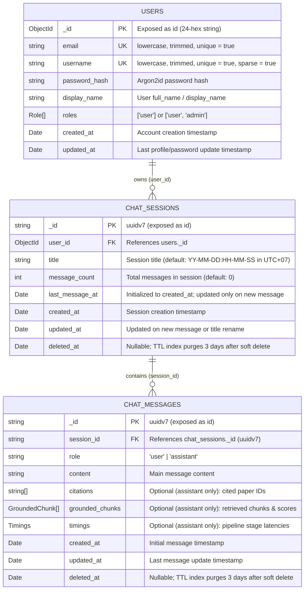

# MONGODB_SCHEMA_DESIGN.md — Hybrid MongoDB Document-Collection Specification

- **Motivation/Background**: The Scientific Literature RAG system requires a durable, high-performance MongoDB schema for user authentication, multi-session conversations, and RAG-grounded messages that reconciles the merged `feat/monolith-v1` backend and `frontend_rag` Liquid Glass Auth UI with the multi-session lifecycle and UUIDv7 requirements.
- **Purpose**: Define the authoritative hybrid document-collection schemas, field constraints, B-Tree compound indexes, and TTL soft-delete retention policies for the `users`, `chat_sessions` (conversations), and `chat_messages` (messages) collections in MongoDB.
- **Overview Pipeline**: Formulated through architectural debate and cross-verification against the existing NestJS Mongoose schemas, frontend authentication store, and multi-session draft specifications.
- **Detailed Plan**: §1 Hybrid Design Stance & Reconciliation Matrix; §2 Entity-Relationship Diagram; §3 Collection Specifications (`users`, `chat_sessions`, `chat_messages`); §4 Indexing, Sorting & TTL Retention Strategy; §5 Data Integrity & Lifecycle Rules; §6 Self-Review Checklist.
- **References**: [`agents/rules/MD_CONVENTION.md`](../agents/rules/MD_CONVENTION.md), [`agents/rules/COMMIT_CONVENTION.md`](../agents/rules/COMMIT_CONVENTION.md), [`docs/CHAT_SESSIONS_SPECIFICATION.md`](CHAT_SESSIONS_SPECIFICATION.md), [`docs/DECISION_LOG.md`](DECISION_LOG.md), [`backend_rag/src/auth/schemas/user.schema.ts`](../backend_rag/src/auth/schemas/user.schema.ts), [`backend_rag/src/chat-sessions/schemas/chat-session.schema.ts`](../backend_rag/src/chat-sessions/schemas/chat-session.schema.ts), [`backend_rag/src/chat-sessions/schemas/chat-message.schema.ts`](../backend_rag/src/chat-sessions/schemas/chat-message.schema.ts), [`backend_rag/src/common/uuid.ts`](../backend_rag/src/common/uuid.ts), [`frontend_rag/src/components/auth/AuthOverlay.tsx`](../frontend_rag/src/components/auth/AuthOverlay.tsx).
- **Created**: 2026-10-22T17:20:08+07:00
- **Last Updated**: 2026-10-28T10:28:30+07:00

---

[STATUS: ACTIVE]

## Table of Contents

- [1. Hybrid Design Stance & Reconciliation Matrix](#1-hybrid-design-stance--reconciliation-matrix)
- [2. Entity-Relationship Diagram](#2-entity-relationship-diagram)
- [3. Collection Specifications](#3-collection-specifications)
  - [3.1 `users` Collection (Người dùng)](#31-users-collection-người-dùng)
  - [3.2 `chat_sessions` / `conversations` Collection (Các phiên cuộc trò chuyện)](#32-chat_sessions--conversations-collection-các-phiên-cuộc-trò-chuyện)
  - [3.3 `chat_messages` / `messages` Collection (Tin nhắn)](#33-chat_messages--messages-collection-tin-nhắn)
- [4. Indexing, Sorting & TTL Retention Strategy](#4-indexing-sorting--ttl-retention-strategy)
- [5. Data Integrity & Lifecycle Rules](#5-data-integrity--lifecycle-rules)
- [6. Self-Review Checklist](#6-self-review-checklist)

---

## 1. Hybrid Design Stance & Reconciliation Matrix

To prevent breaking the merged monolithic backend ([`backend_rag/PROGRESS.md`](../backend_rag/PROGRESS.md)) and the frontend authentication overlay ([`frontend_rag/src/components/auth/AuthOverlay.tsx`](../frontend_rag/src/components/auth/AuthOverlay.tsx)) while fulfilling the new schema requirements, this specification adopts a **Hybrid Design**:

| Design Dimension | Merged Repo State (`main`) | New Requirement | Hybrid Specification Decision |
| :--- | :--- | :--- | :--- |
| **Collection Naming** | `users`, `chat_sessions`, `chat_messages` | `users`, `conversations`, `messages` | Retain physical collection names `users`, `chat_sessions`, and `chat_messages` to preserve infrastructure and test compatibility. |
| **Primary Keys (`_id`)** | MongoDB `ObjectId` across all collections | `uuidv7` required for chat sessions | Use **`uuidv7` (`_id: string`)** on `chat_sessions` and `chat_messages` via [`backend_rag/src/common/uuid.ts`](../backend_rag/src/common/uuid.ts); retain `ObjectId` on `users` to maintain compatibility with [`backend_rag/src/auth/schemas/refresh-token.schema.ts`](../backend_rag/src/auth/schemas/refresh-token.schema.ts). |
| **User Authentication** | `email` + `display_name` + `roles: Role[]` | Dual login (`username` or `email`), `full_name`, `role` | Add `username` (`unique`, `sparse`) and allow login via **either `username` or `email`**. Keep `display_name` (aliased with `full_name`) and `roles: Role[]` so [`frontend_rag/src/store/authStore.ts`](../frontend_rag/src/store/authStore.ts) and [`backend_rag/src/auth/guards/roles.guard.ts`](../backend_rag/src/auth/guards/roles.guard.ts) remain unbroken. |
| **Session Ownership** | Authenticated `user_id: ObjectId` | `user_id` only (no `device_id`) | Scope all conversations strictly to `user_id` (`ObjectId` referencing `users._id`). |
| **Session Timestamps** | Single `updated_at` (renaming reorders list) | Split `last_message_at` and `updated_at` | Separate `last_message_at` (updated **only** on message creation; drives UI sorting) from `updated_at` (updated on any mutation including title rename). |
| **Deletion Policy** | Immediate physical hard delete | Soft delete (`deleted_at`, 3-day retention) | Apply soft delete (`deleted_at: Date \| null`) with a 3-day MongoDB TTL index (`259,200` seconds) across **both** `chat_sessions` and `chat_messages` to prevent orphaned message documents. |
| **Message Payload** | RAG fields on assistant messages, `created_at` only | Include `updated_at` and RAG fields for `assistant` | Include `created_at`, `updated_at`, `deleted_at`, and optional RAG synthesis fields (`citations`, `grounded_chunks`, `timings`) when `role === 'assistant'`. Omit redundant `title` and `check_sum`. |

---

## 2. Entity-Relationship Diagram

---

## 3. Collection Specifications

### 3.1 `users` Collection (Người dùng)

Defined in [`backend_rag/src/auth/schemas/user.schema.ts`](../backend_rag/src/auth/schemas/user.schema.ts). Supports authentication via **either `username` or `email`**.

| Field | Data Type | Constraints | Note |
| :--- | :--- | :--- | :--- |
| `_id` (`id`) | `ObjectId` | Primary Key | Định danh duy nhất của người dùng (trả về dạng chuỗi hex 24 ký tự qua DTO). |
| `password_hash` | `string` | `required: true` | Mật khẩu đã được băm bằng thuật toán `argon2id`. |
| `email` | `string` | `required: true`, `unique: true`, `lowercase: true`, `trim: true` | Địa chỉ email đăng nhập (`unique = true`). |
| `username` | `string` | `unique: true`, `sparse: true`, `lowercase: true`, `trim: true` | Tên đăng nhập của người dùng (`unique = true`); cho phép đăng nhập bằng `username` hoặc `email`. |
| `display_name` (`full_name`) | `string` | `required: true`, `trim: true`, `1–60` chars | Họ và tên đầy đủ / tên hiển thị của người dùng (tương thích ngược với UI [`AuthOverlay.tsx`](../frontend_rag/src/components/auth/AuthOverlay.tsx)). |
| `roles` (`role`) | `('user' \| 'admin')[]` | `default: ['user']` | Quyền hạn của người dùng (`'user'`, `'admin'`). |
| `created_at` | `Date` | Auto (`timestamps.createdAt`) | Thời điểm lần đầu tạo tài khoản. |
| `updated_at` | `Date` | Auto (`timestamps.updatedAt`) | Thời điểm cập nhật thông tin tài khoản lần cuối. |

---

### 3.2 `chat_sessions` / `conversations` Collection (Các phiên cuộc trò chuyện)

Defined in [`backend_rag/src/chat-sessions/schemas/chat-session.schema.ts`](../backend_rag/src/chat-sessions/schemas/chat-session.schema.ts).

| Field | Data Type | Constraints | Note |
| :--- | :--- | :--- | :--- |
| `_id` (`id`) | `uuidv7` (`string`) | Primary Key (`default: () => uuidv7()`) | Định danh phiên chat theo chuẩn `UUIDv7` sắp xếp theo thời gian ([`backend_rag/src/common/uuid.ts`](../backend_rag/src/common/uuid.ts)). |
| `user_id` | `ObjectId` | `required: true`, Indexed | Khoá ngoại trỏ tới `users._id` xác định chủ sở hữu phiên chat (không dùng `device_id`). |
| `title` | `string` | `required: true`, `1–120` Unicode chars | Tên phiên chat (mặc định khởi tạo theo định dạng `YY-MM-DD:HH-MM-SS` múi giờ UTC+07 cho đến khi được đổi tên). |
| `message_count` | `int` (`number`) | `default: 0` (`>= 2` when stored) | Tổng số lượng tin nhắn trong phiên chat (Computed Pattern giúp tránh `$lookup` khi phân trang). Phiên chat chỉ được lưu khi có tin nhắn đầu tiên (`message_count >= 2`). |
| `last_message_at` | `Date` | `default: () => new Date()`, Indexed | Thời điểm tin nhắn cuối cùng được gửi (khởi tạo bằng `created_at`). Dùng để sắp xếp vị trí hiển thị trên UI; **không thay đổi khi đổi tên phiên chat**. |
| `created_at` | `Date` | Auto (`timestamps.createdAt`) | Thời điểm phiên chat lần đầu được tạo. |
| `updated_at` | `Date` | Auto (`timestamps.updatedAt`) | Thời điểm cập nhật bất kỳ của phiên chat (bao gồm cả gửi tin nhắn mới hoặc đổi tên phiên chat). |
| `deleted_at` | `Date \| null` | `default: null`, TTL Index (`3d`) | Lưu thời điểm người dùng bấm xóa (Soft Delete). Tự động xóa vĩnh viễn sau 3 ngày (`259,200` giây). |

---

### 3.3 `chat_messages` / `messages` Collection (Tin nhắn)

Defined in [`backend_rag/src/chat-sessions/schemas/chat-message.schema.ts`](../backend_rag/src/chat-sessions/schemas/chat-message.schema.ts).

| Field | Data Type | Constraints | Note |
| :--- | :--- | :--- | :--- |
| `_id` (`id`) | `uuidv7` (`string`) | Primary Key (`default: () => uuidv7()`) | Định danh tin nhắn theo chuẩn `UUIDv7`. |
| `session_id` | `uuidv7` (`string`) | `required: true`, Indexed | Khoá ngoại liên kết tới `chat_sessions._id`. |
| `role` | `'user' \| 'assistant'` | `required: true`, `enum: ['user', 'assistant']` | Xác định tin nhắn thuộc về người dùng (`user`) hay AI (`assistant`). |
| `content` | `string` | `required: true` | Nội dung văn bản / Markdown chính của tin nhắn. |
| `citations` | `string[]` | Optional (`role === 'assistant'` only) | Danh sách mã bài báo khoa học được trích dẫn trong câu trả lời (VD: `["2106.09685"]`). |
| `grounded_chunks` | `GroundedChunk[]` | Optional (`role === 'assistant'` only) | Danh sách các đoạn văn bản trích xuất từ Vector Store kèm điểm `similarity_score`, `authority_score`, `final_score` ([`backend_rag/src/types/scientific-rag.ts`](../backend_rag/src/types/scientific-rag.ts)). |
| `timings` | `Timings` | Optional (`role === 'assistant'` only) | Thời gian thực thi từng pha của pipeline RAG (`embed_ms`, `route_ms`, `search_ms`, `rerank_ms`, `llm_ms`, `total_ms`). |
| `created_at` | `Date` | Auto (`timestamps.createdAt`) | Thời điểm tin nhắn được gửi lần đầu. |
| `updated_at` | `Date` | Auto (`timestamps.updatedAt`) | Thời điểm tin nhắn được cập nhật lần cuối. |
| `deleted_at` | `Date \| null` | `default: null`, TTL Index (`3d`) | Thời điểm xóa mềm theo phiên chat cha (giúp MongoDB TTL tự động dọn sạch tin nhắn sau 3 ngày, tránh dữ liệu mồ côi). |

---

## 4. Indexing, Sorting & TTL Retention Strategy

| Collection | Index Key Specification | Options | Purpose |
| :--- | :--- | :--- | :--- |
| `users` | `{ email: 1 }` | `{ unique: true }` | Đảm bảo tính duy nhất và tìm kiếm $O(\log N)$ khi đăng nhập bằng email. |
| `users` | `{ username: 1 }` | `{ unique: true, sparse: true }` | Đảm bảo tính duy nhất và tìm kiếm $O(\log N)$ khi đăng nhập bằng username. |
| `chat_sessions` | `{ user_id: 1, deleted_at: 1, last_message_at: -1, _id: -1 }` | Compound Index | Phục vụ phân trang con trỏ (cursor pagination) các phiên chat chưa xóa (`deleted_at: null`), sắp xếp giảm dần theo thời điểm tin nhắn gần nhất (`last_message_at`). |
| `chat_sessions` | `{ deleted_at: 1 }` | `{ expireAfterSeconds: 259200 }` | TTL Index tự động xóa cứng phiên chat sau 3 ngày kể từ thời điểm `deleted_at`. |
| `chat_messages` | `{ session_id: 1, deleted_at: 1, created_at: 1, _id: 1 }` | Compound Index | Tải danh sách tin nhắn theo thứ tự thời gian trong một phiên chat. |
| `chat_messages` | `{ deleted_at: 1 }` | `{ expireAfterSeconds: 259200 }` | TTL Index tự động xóa cứng các tin nhắn thuộc phiên chat đã xóa sau 3 ngày. |

---

## 5. Data Integrity & Lifecycle Rules

1. **No Write-Amplification Denormalization**:
   - `title` chỉ lưu duy nhất tại `chat_sessions.title`, tuyệt đối không nhúng vào `chat_messages` để tránh phải cập nhật hàng loạt (`updateMany`) khi người dùng đổi tên phiên chat.
2. **Rename vs. Message Activity Ordering**:
   - Khi người dùng đổi tên phiên chat (`PATCH /api/v1/chat-sessions/:id`), chỉ cập nhật `title` và `updated_at`. Trường `last_message_at` giữ nguyên để phiên chat không bị nhảy vị trí trên thanh bên (sidebar) của UI.
   - Khi có cặp tin nhắn Hỏi–Đáp mới (`saveExchange`), cập nhật đồng thời `last_message_at`, `updated_at`, và tăng `message_count` thêm `2`.
3. **Cascaded Soft Delete for TTL Cleanup**:
   - Vì MongoDB không hỗ trợ `ON DELETE CASCADE` giữa các collections khi TTL Index kích hoạt, thao tác xóa phiên chat (`DELETE /api/v1/chat-sessions/:id`) phải gán `deleted_at = new Date()` cho cả bản ghi trong `chat_sessions` và toàn bộ bản ghi con trong `chat_messages` có cùng `session_id`.
4. **Lazy Session Creation (No Empty `message_count = 0` Sessions)**:
   - Không lưu trữ phiên chat rỗng (`message_count = 0`) khi người dùng chưa gửi tin nhắn; loại bỏ route `POST /api/v1/chat-sessions`. Phiên chat chỉ được khởi tạo tự động trong `saveExchange()` / `writeExchange()` ngay khi cặp tin nhắn Hỏi–Đáp đầu tiên hoàn tất (`message_count = 2`).
5. **Fixed 10-Item Cursor Pagination (`has_more`)**:
   - `GET /api/v1/chat-sessions` áp dụng kích thước trang cố định `10` bản ghi tóm tắt (`SESSION_PAGE_SIZE = 10`) và trả về `{ items, next_cursor, has_more }` theo chuẩn [`docs/CHAT_SESSIONS_SPECIFICATION.md`](CHAT_SESSIONS_SPECIFICATION.md).

---

## 6. Self-Review Checklist

- [x] All 7 required header fields present (`Motivation/Background`, `Purpose`, `Overview Pipeline`, `Detailed Plan`, `References`, `Created`, `Last Updated`).
- [x] `Created` and `Last Updated` timestamps formatted in strict ISO 8601 with `+07:00` timezone offset.
- [x] Document lifecycle status (`[STATUS: ACTIVE]`) declared beneath the header.
- [x] Table of Contents anchors resolve cleanly to all major sections.
- [x] Every file and rule mention is formatted as an active relative link per [`agents/rules/MD_CONVENTION.md`](../agents/rules/MD_CONVENTION.md).

