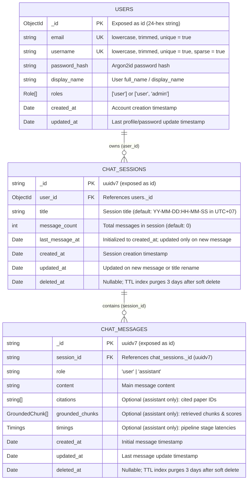
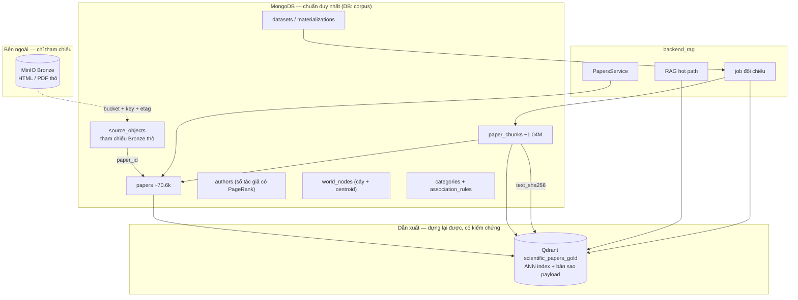
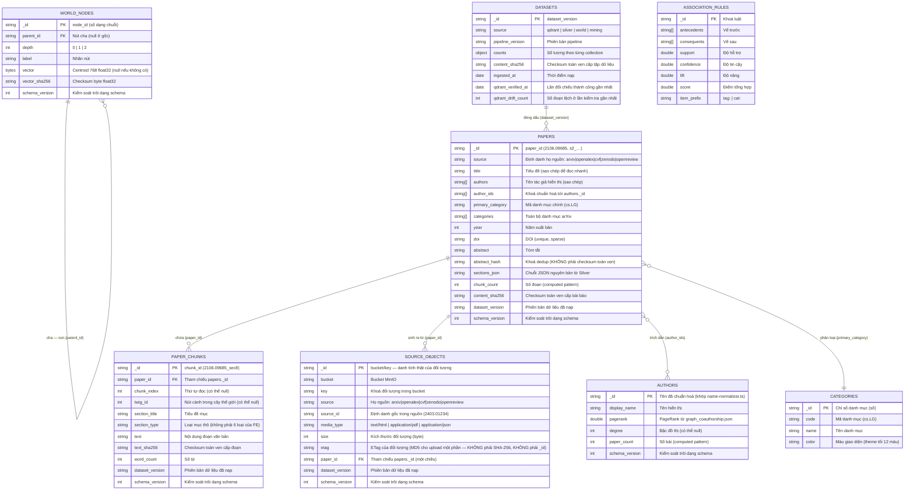

# MONGODB_SCHEMA_DESIGN.md — Hybrid MongoDB Document-Collection Specification

- **Motivation/Background**: The Scientific Literature RAG system requires a durable, high-performance MongoDB schema for user authentication, multi-session conversations, and RAG-grounded messages that reconciles the merged `feat/monolith-v1` backend and `frontend_rag` Liquid Glass Auth UI with the multi-session lifecycle and UUIDv7 requirements. Concurrently, the corpus metadata currently held in Qdrant (`scientific_papers_gold`) and MinIO (Silver Parquet / Bronze raw objects) must be consolidated so that MongoDB becomes the canonical Source of Truth for the scientific corpus.
- **Purpose**: Define the authoritative hybrid document-collection schemas, field constraints, B-Tree compound indexes, and TTL soft-delete retention policies for the `users`, `chat_sessions` (conversations), and `chat_messages` (messages) collections in MongoDB; and in Part II, define the corpus collections (`papers`, `paper_chunks`, `source_objects`, `authors`, `categories`, `world_nodes`, `association_rules`, `datasets`) that make MongoDB the canonical Source of Truth for the scientific corpus.
- **Overview Pipeline**: Formulated through architectural debate and cross-verification against the existing NestJS Mongoose schemas, frontend authentication store, and multi-session draft specifications. Part II was formulated through a corpus schema design session and subsequently reviewed against the official MongoDB `mongodb-schema-design` agent skill (embed-vs-reference, unnecessary-collections, excessive-lookup, unnecessary-index, schema-validation and schema-versioning rules).
- **Detailed Plan**: Part I — §1 Hybrid Design Stance & Reconciliation Matrix; §2 Entity-Relationship Diagram; §3 Collection Specifications (`users`, `chat_sessions`, `chat_messages`); §4 Indexing, Sorting & TTL Retention Strategy; §5 Data Integrity & Lifecycle Rules; §6 Self-Review Checklist. Part II — §7 Corpus Design Stance & Store Roles; §8 Corpus Entity-Relationship Diagram; §9 Corpus Collection Specifications; §10 Corpus Indexing & Validation Strategy; §11 Corpus Checksum & Integrity Model; §12 Corpus Ingest Pipeline & Runtime Read-Path; §13 Corpus Self-Review Checklist.
- **References**: [`agents/rules/MD_CONVENTION.md`](../../agents/rules/MD_CONVENTION.md), [`agents/rules/COMMIT_CONVENTION.md`](../../agents/rules/COMMIT_CONVENTION.md), [`docs/DECISION_LOG.md`](../../docs/DECISION_LOG.md), [`docs/RAG.md`](../../docs/RAG.md), [`backend_rag/src/auth/schemas/user.schema.ts`](../src/auth/schemas/user.schema.ts), [`backend_rag/src/chat-sessions/schemas/chat-session.schema.ts`](../src/chat-sessions/schemas/chat-session.schema.ts), [`backend_rag/src/chat-sessions/schemas/chat-message.schema.ts`](../src/chat-sessions/schemas/chat-message.schema.ts), [`backend_rag/src/common/uuid.ts`](../src/common/uuid.ts), [`backend_rag/src/papers/papers.service.ts`](../src/papers/papers.service.ts), [`backend_rag/src/tree-router/tree-router.service.ts`](../src/tree-router/tree-router.service.ts), [`backend_rag/src/mining/mining.service.ts`](../src/mining/mining.service.ts), [`backend_rag/src/mining/name-normalizer.ts`](../src/mining/name-normalizer.ts), [`backend_rag/src/vector-store/vector-store.service.ts`](../src/vector-store/vector-store.service.ts), [`backend_rag/src/types/scientific-rag.ts`](../src/types/scientific-rag.ts), [`backend_rag/src/config/env.schema.ts`](../src/config/env.schema.ts), [`backend_rag/src/app.module.ts`](../src/app.module.ts), [`backend_rag/src/health/health.service.ts`](../src/health/health.service.ts), [`backend_rag/docs/CHAT_SESSIONS_SPECIFICATION.md`](CHAT_SESSIONS_SPECIFICATION.md), [`backend_rag/docs/AUTH_AND_SECURITY_ARCHITECTURE.md`](AUTH_AND_SECURITY_ARCHITECTURE.md), [`backend_rag/docs/PERFORMANCE_AND_CACHING.md`](PERFORMANCE_AND_CACHING.md), [`frontend_rag/src/components/auth/AuthOverlay.tsx`](../../frontend_rag/src/components/auth/AuthOverlay.tsx), [`frontend_rag/src/theme/tokens.ts`](../../frontend_rag/src/theme/tokens.ts).
- **Created**: 2026-10-22T17:20:08+07:00
- **Last Updated**: 2026-11-04T22:15:00+07:00

---

[STATUS: ACTIVE]

## Table of Contents

- [1. Hybrid Design Stance & Reconciliation Matrix](#1-hybrid-design-stance--reconciliation-matrix)
- [2. Entity-Relationship Diagram](#2-entity-relationship-diagram)
- [3. Collection Specifications](#3-collection-specifications)
  - [3.1 `users` Collection (Người dùng)](#31-users-collection-người-dùng)
  - [3.2 `chat_sessions` / `conversations` Collection (Các phiên cuộc trò chuyện)](#32-chat_sessions--conversations-collection-các-phiên-cuộc-trò-chuyện)
  - [3.3 `chat_messages` / `messages` Collection (Tin nhắn)](#33-chat_messages--messages-collection-tin-nhắn)
- [4. Indexing, Sorting & TTL Retention Strategy](#4-indexing-sorting--ttl-retention-strategy)
- [5. Data Integrity & Lifecycle Rules](#5-data-integrity--lifecycle-rules)
- [6. Self-Review Checklist](#6-self-review-checklist)
- [7. Corpus Design Stance & Store Roles](#7-corpus-design-stance--store-roles)
  - [7.1 Quyết định kiến trúc](#71-quyết-định-kiến-trúc)
  - [7.2 Ranh giới trách nhiệm giữa các kho lưu trữ](#72-ranh-giới-trách-nhiệm-giữa-các-kho-lưu-trữ)
- [8. Corpus Entity-Relationship Diagram](#8-corpus-entity-relationship-diagram)
- [9. Corpus Collection Specifications](#9-corpus-collection-specifications)
  - [9.1 `papers` Collection (Bài báo khoa học)](#91-papers-collection-bài-báo-khoa-học)
  - [9.2 `paper_chunks` Collection (Đoạn văn bản)](#92-paper_chunks-collection-đoạn-văn-bản)
  - [9.3 `source_objects` Collection (Đối tượng Bronze thô)](#93-source_objects-collection-đối-tượng-bronze-thô)
  - [9.4 `authors` Collection (Tác giả & PageRank)](#94-authors-collection-tác-giả--pagerank)
  - [9.5 `categories` Collection (Danh mục)](#95-categories-collection-danh-mục)
  - [9.6 `world_nodes` Collection (Cây thế giới & centroid)](#96-world_nodes-collection-cây-thế-giới--centroid)
  - [9.7 `association_rules` Collection (Luật FP-Growth)](#97-association_rules-collection-luật-fp-growth)
  - [9.8 `datasets` Collection (Mốc đối chiếu)](#98-datasets-collection-mốc-đối-chiếu)
- [10. Corpus Indexing & Validation Strategy](#10-corpus-indexing--validation-strategy)
- [11. Corpus Checksum & Integrity Model](#11-corpus-checksum--integrity-model)
- [12. Corpus Ingest Pipeline & Runtime Read-Path](#12-corpus-ingest-pipeline--runtime-read-path)
- [13. Corpus Self-Review Checklist](#13-corpus-self-review-checklist)

---

## 1. Hybrid Design Stance & Reconciliation Matrix

To prevent breaking the merged monolithic backend ([`backend_rag/PROGRESS.md`](../PROGRESS.md)) and the frontend authentication overlay ([`frontend_rag/src/components/auth/AuthOverlay.tsx`](../../frontend_rag/src/components/auth/AuthOverlay.tsx)) while fulfilling the new schema requirements, this specification adopts a **Hybrid Design**:

| Design Dimension | Merged Repo State (`main`) | New Requirement | Hybrid Specification Decision |
| :--- | :--- | :--- | :--- |
| **Collection Naming** | `users`, `chat_sessions`, `chat_messages` | `users`, `conversations`, `messages` | Retain physical collection names `users`, `chat_sessions`, and `chat_messages` to preserve infrastructure and test compatibility. |
| **Primary Keys (`_id`)** | MongoDB `ObjectId` across all collections | `uuidv7` required for chat sessions | Use **`uuidv7` (`_id: string`)** on `chat_sessions` and `chat_messages` via [`backend_rag/src/common/uuid.ts`](../src/common/uuid.ts); retain `ObjectId` on `users` to maintain compatibility with [`backend_rag/src/auth/schemas/refresh-token.schema.ts`](../src/auth/schemas/refresh-token.schema.ts). |
| **User Authentication** | `email` + `display_name` + `roles: Role[]` | Dual login (`username` or `email`), `full_name`, `role` | Add `username` (`unique`, `sparse`) and allow login via **either `username` or `email`**. Keep `display_name` (aliased with `full_name`) and `roles: Role[]` so [`frontend_rag/src/store/authStore.ts`](../../frontend_rag/src/store/authStore.ts) and [`backend_rag/src/auth/guards/roles.guard.ts`](../src/auth/guards/roles.guard.ts) remain unbroken. |
| **Session Ownership** | Authenticated `user_id: ObjectId` | `user_id` only (no `device_id`) | Scope all conversations strictly to `user_id` (`ObjectId` referencing `users._id`). |
| **Session Timestamps** | Single `updated_at` (renaming reorders list) | Split `last_message_at` and `updated_at` | Separate `last_message_at` (updated **only** on message creation; drives UI sorting) from `updated_at` (updated on any mutation including title rename). |
| **Deletion Policy** | Immediate physical hard delete | Soft delete (`deleted_at`, 3-day retention) | Apply soft delete (`deleted_at: Date \| null`) with a 3-day MongoDB TTL index (`259,200` seconds) across **both** `chat_sessions` and `chat_messages` to prevent orphaned message documents. |
| **Message Payload** | RAG fields on assistant messages, `created_at` only | Include `updated_at` and RAG fields for `assistant` | Include `created_at`, `updated_at`, `deleted_at`, and optional RAG synthesis fields (`citations`, `grounded_chunks`, `timings`) when `role === 'assistant'`. Omit redundant `title` and `check_sum`. |

---

## 2. Entity-Relationship Diagram



---

## 3. Collection Specifications

### 3.1 `users` Collection (Người dùng)

Defined in [`backend_rag/src/auth/schemas/user.schema.ts`](../src/auth/schemas/user.schema.ts). Supports authentication via **either `username` or `email`**.

| Field | Data Type | Constraints | Note |
| :--- | :--- | :--- | :--- |
| `_id` (`id`) | `ObjectId` | Primary Key | Định danh duy nhất của người dùng (trả về dạng chuỗi hex 24 ký tự qua DTO). |
| `password_hash` | `string` | `required: true` | Mật khẩu đã được băm bằng thuật toán `argon2id`. |
| `email` | `string` | `required: true`, `unique: true`, `lowercase: true`, `trim: true` | Địa chỉ email đăng nhập (`unique = true`). |
| `username` | `string` | `unique: true`, `sparse: true`, `lowercase: true`, `trim: true` | Tên đăng nhập của người dùng (`unique = true`); cho phép đăng nhập bằng `username` hoặc `email`. |
| `display_name` (`full_name`) | `string` | `required: true`, `trim: true`, `1–60` chars | Họ và tên đầy đủ / tên hiển thị của người dùng (tương thích ngược với UI [`AuthOverlay.tsx`](../../frontend_rag/src/components/auth/AuthOverlay.tsx)). |
| `roles` (`role`) | `('user' \| 'admin')[]` | `default: ['user']` | Quyền hạn của người dùng (`'user'`, `'admin'`). |
| `created_at` | `Date` | Auto (`timestamps.createdAt`) | Thời điểm lần đầu tạo tài khoản. |
| `updated_at` | `Date` | Auto (`timestamps.updatedAt`) | Thời điểm cập nhật thông tin tài khoản lần cuối. |

---

### 3.2 `chat_sessions` / `conversations` Collection (Các phiên cuộc trò chuyện)

Defined in [`backend_rag/src/chat-sessions/schemas/chat-session.schema.ts`](../src/chat-sessions/schemas/chat-session.schema.ts).

| Field | Data Type | Constraints | Note |
| :--- | :--- | :--- | :--- |
| `_id` (`id`) | `uuidv7` (`string`) | Primary Key (`default: () => uuidv7()`) | Định danh phiên chat theo chuẩn `UUIDv7` sắp xếp theo thời gian ([`backend_rag/src/common/uuid.ts`](../src/common/uuid.ts)). |
| `user_id` | `ObjectId` | `required: true`, Indexed | Khoá ngoại trỏ tới `users._id` xác định chủ sở hữu phiên chat (không dùng `device_id`). |
| `title` | `string` | `required: true`, `1–120` Unicode chars | Tên phiên chat (mặc định khởi tạo theo định dạng `YY-MM-DD:HH-MM-SS` múi giờ UTC+07 cho đến khi được đổi tên). |
| `message_count` | `int` (`number`) | `default: 0` (`>= 2` when stored) | Tổng số lượng tin nhắn trong phiên chat (Computed Pattern giúp tránh `$lookup` khi phân trang). Phiên chat chỉ được lưu khi có tin nhắn đầu tiên (`message_count >= 2`). |
| `last_message_at` | `Date` | `default: () => new Date()`, Indexed | Thời điểm tin nhắn cuối cùng được gửi (khởi tạo bằng `created_at`). Dùng để sắp xếp vị trí hiển thị trên UI; **không thay đổi khi đổi tên phiên chat**. |
| `created_at` | `Date` | Auto (`timestamps.createdAt`) | Thời điểm phiên chat lần đầu được tạo. |
| `updated_at` | `Date` | Auto (`timestamps.updatedAt`) | Thời điểm cập nhật bất kỳ của phiên chat (bao gồm cả gửi tin nhắn mới hoặc đổi tên phiên chat). |
| `deleted_at` | `Date \| null` | `default: null`, TTL Index (`3d`) | Lưu thời điểm người dùng bấm xóa (Soft Delete). Tự động xóa vĩnh viễn sau 3 ngày (`259,200` giây). |

---

### 3.3 `chat_messages` / `messages` Collection (Tin nhắn)

Defined in [`backend_rag/src/chat-sessions/schemas/chat-message.schema.ts`](../src/chat-sessions/schemas/chat-message.schema.ts).

| Field | Data Type | Constraints | Note |
| :--- | :--- | :--- | :--- |
| `_id` (`id`) | `uuidv7` (`string`) | Primary Key (`default: () => uuidv7()`) | Định danh tin nhắn theo chuẩn `UUIDv7`. |
| `session_id` | `uuidv7` (`string`) | `required: true`, Indexed | Khoá ngoại liên kết tới `chat_sessions._id`. |
| `role` | `'user' \| 'assistant'` | `required: true`, `enum: ['user', 'assistant']` | Xác định tin nhắn thuộc về người dùng (`user`) hay AI (`assistant`). |
| `content` | `string` | `required: true` | Nội dung văn bản / Markdown chính của tin nhắn. |
| `citations` | `string[]` | Optional (`role === 'assistant'` only) | Danh sách mã bài báo khoa học được trích dẫn trong câu trả lời (VD: `["2106.09685"]`). |
| `grounded_chunks` | `GroundedChunk[]` | Optional (`role === 'assistant'` only) | Danh sách các đoạn văn bản trích xuất từ Vector Store kèm điểm `similarity_score`, `authority_score`, `final_score` ([`backend_rag/src/types/scientific-rag.ts`](../src/types/scientific-rag.ts)). |
| `timings` | `Timings` | Optional (`role === 'assistant'` only) | Thời gian thực thi từng pha của pipeline RAG (`embed_ms`, `route_ms`, `search_ms`, `rerank_ms`, `llm_ms`, `total_ms`). |
| `created_at` | `Date` | Auto (`timestamps.createdAt`) | Thời điểm tin nhắn được gửi lần đầu. |
| `updated_at` | `Date` | Auto (`timestamps.updatedAt`) | Thời điểm tin nhắn được cập nhật lần cuối. |
| `deleted_at` | `Date \| null` | `default: null`, TTL Index (`3d`) | Thời điểm xóa mềm theo phiên chat cha (giúp MongoDB TTL tự động dọn sạch tin nhắn sau 3 ngày, tránh dữ liệu mồ côi). |

---

## 4. Indexing, Sorting & TTL Retention Strategy

| Collection | Index Key Specification | Options | Purpose |
| :--- | :--- | :--- | :--- |
| `users` | `{ email: 1 }` | `{ unique: true }` | Đảm bảo tính duy nhất và tìm kiếm $O(\log N)$ khi đăng nhập bằng email. |
| `users` | `{ username: 1 }` | `{ unique: true, sparse: true }` | Đảm bảo tính duy nhất và tìm kiếm $O(\log N)$ khi đăng nhập bằng username. |
| `chat_sessions` | `{ user_id: 1, deleted_at: 1, last_message_at: -1, _id: -1 }` | Compound Index | Phục vụ phân trang con trỏ (cursor pagination) các phiên chat chưa xóa (`deleted_at: null`), sắp xếp giảm dần theo thời điểm tin nhắn gần nhất (`last_message_at`). |
| `chat_sessions` | `{ deleted_at: 1 }` | `{ expireAfterSeconds: 259200 }` | TTL Index tự động xóa cứng phiên chat sau 3 ngày kể từ thời điểm `deleted_at`. |
| `chat_messages` | `{ session_id: 1, deleted_at: 1, created_at: 1, _id: 1 }` | Compound Index | Tải danh sách tin nhắn theo thứ tự thời gian trong một phiên chat. |
| `chat_messages` | `{ deleted_at: 1 }` | `{ expireAfterSeconds: 259200 }` | TTL Index tự động xóa cứng các tin nhắn thuộc phiên chat đã xóa sau 3 ngày. |

---

## 5. Data Integrity & Lifecycle Rules

1. **No Write-Amplification Denormalization**:
   - `title` chỉ lưu duy nhất tại `chat_sessions.title`, tuyệt đối không nhúng vào `chat_messages` để tránh phải cập nhật hàng loạt (`updateMany`) khi người dùng đổi tên phiên chat.
2. **Rename vs. Message Activity Ordering**:
   - Khi người dùng đổi tên phiên chat (`PATCH /api/v1/chat-sessions/:id`), chỉ cập nhật `title` và `updated_at`. Trường `last_message_at` giữ nguyên để phiên chat không bị nhảy vị trí trên thanh bên (sidebar) của UI.
   - Khi có cặp tin nhắn Hỏi–Đáp mới (`saveExchange`), cập nhật đồng thời `last_message_at`, `updated_at`, và tăng `message_count` thêm `2`.
3. **Cascaded Soft Delete for TTL Cleanup**:
   - Vì MongoDB không hỗ trợ `ON DELETE CASCADE` giữa các collections khi TTL Index kích hoạt, thao tác xóa phiên chat (`DELETE /api/v1/chat-sessions/:id`) phải gán `deleted_at = new Date()` cho cả bản ghi trong `chat_sessions` và toàn bộ bản ghi con trong `chat_messages` có cùng `session_id`.
4. **Lazy Session Creation (No Empty `message_count = 0` Sessions)**:
   - Không lưu trữ phiên chat rỗng (`message_count = 0`) khi người dùng chưa gửi tin nhắn; loại bỏ route `POST /api/v1/chat-sessions`. Phiên chat chỉ được khởi tạo tự động trong `saveExchange()` / `writeExchange()` ngay khi cặp tin nhắn Hỏi–Đáp đầu tiên hoàn tất (`message_count = 2`).
5. **Fixed 10-Item Cursor Pagination (`has_more`)**:
   - `GET /api/v1/chat-sessions` áp dụng kích thước trang cố định `10` bản ghi tóm tắt (`SESSION_PAGE_SIZE = 10`) và trả về `{ items, next_cursor, has_more }` theo chuẩn [`docs/CHAT_SESSIONS_SPECIFICATION.md`](CHAT_SESSIONS_SPECIFICATION.md).

---

## 6. Self-Review Checklist

- [x] All 7 required header fields present (`Motivation/Background`, `Purpose`, `Overview Pipeline`, `Detailed Plan`, `References`, `Created`, `Last Updated`).
- [x] `Created` and `Last Updated` timestamps formatted in strict ISO 8601 with `+07:00` timezone offset.
- [x] Document lifecycle status (`[STATUS: ACTIVE]`) declared beneath the header.
- [x] Table of Contents anchors resolve cleanly to all major sections.
- [x] Every file and rule mention is formatted as an active relative link per [`agents/rules/MD_CONVENTION.md`](../../agents/rules/MD_CONVENTION.md).


---

# PART II — CORPUS SOURCE OF TRUTH

## 7. Corpus Design Stance & Store Roles

### 7.1 Quyết định kiến trúc

Phần II định nghĩa lớp dữ liệu **corpus khoa học** — toàn bộ siêu dữ liệu và nội dung văn bản của kho bài báo. Mục tiêu là biến MongoDB thành **Source of Truth duy nhất**, thay thế trạng thái phân tán hiện tại giữa Qdrant (`scientific_papers_gold`), MinIO (Silver Parquet + Bronze HTML/PDF) và các tệp JSON của pipeline.

| Quyết định | Giá trị đã chốt | Lý do |
| :--- | :--- | :--- |
| **Đường nóng (hot path)** | **Phương án A** — Qdrant giữ bản sao vật liệu hoá (payload: `text` + siêu dữ liệu cốt lõi); MongoDB giữ bản ghi chuẩn (canonical). | `POST /api/v1/rag/chat` chỉ cần **1 vòng tròn mạng (RTT) tới Qdrant**. Không thêm RTT nào vào đường nóng, nên ngưỡng P95 < 500 ms được giữ nguyên (xem [`backend_rag/docs/PERFORMANCE_AND_CACHING.md`](PERFORMANCE_AND_CACHING.md)). |
| **Toàn vẹn văn bản** | **Checksum SHA-256** ở ba cấp: chunk, paper, dataset. | Cho phép phát hiện **lệch dữ liệu (drift)** giữa MongoDB và Qdrant một cách *tường minh*, thay vì để nó diễn ra trong im lặng. |
| **Phạm vi MinIO** | **Chỉ Silver + tách nguồn riêng** — Siêu dữ liệu Silver Parquet chuyển vào MongoDB; **Bronze HTML/PDF vẫn nằm trong MinIO** và chỉ được tham chiếu trong collection riêng `source_objects` (bucket, key, size, `etag`, media_type, họ nguồn). | Không sao chép byte thô vào MongoDB. Mỗi đối tượng Bronze có vòng đời (lifecycle) khác với siêu dữ liệu bài báo: một bài báo có thể có 0, 1 hoặc nhiều đối tượng thô. |
| **Kho vector** | Qdrant được giữ lại (MongoDB tự host không có ANN). Nó là **chỉ mục dựng lại được**, không phải SoT. | Vector 768 chiều **không bao giờ** được ghi vào MongoDB. Vector được tái tạo bằng cách chạy lại embedder trên `paper_chunks.text` mỗi khi cần dựng lại Qdrant. |
| **Đường đọc corpus** | **Không có vòng tròn mạng nào tới corpus trên đường nóng.** Cây thế giới, luật khai phá và bảng uy tín được nạp **một lần lúc khởi động** vào bộ nhớ đệm. | Giữ nguyên đặc tính đã được kiểm chứng qua benchmark: chat không chậm thêm dù nguồn dữ liệu chuyển từ tệp JSON sang MongoDB. |

### 7.2 Ranh giới trách nhiệm giữa các kho lưu trữ



Ba quyết định then chốt được nhấn mạnh trong sơ đồ:

1. **Vector không bị nhân bản.** Chúng chỉ tồn tại trong Qdrant và được tái tạo từ `paper_chunks.text`. Vì `paper_chunks.text` chính là *đầu vào* mà embedder tiêu thụ, MongoDB vẫn là nguồn sự thật cho *nội dung* sinh ra chúng.
2. **Đối tượng Bronze được tách riêng.** Byte thô vẫn ở MinIO; MongoDB chỉ giữ *tham chiếu* (bucket, key, size, `etag`, media_type) cùng thông tin nguồn gốc. Nhờ vậy tài liệu `papers` hoàn toàn không mang trường có hình dạng đường dẫn hệ thống tệp.
3. **Đối chiếu hai chiều.** Job `reconcile-qdrant.ts` đọc `text` từ payload Qdrant (chỉ đọc theo chính sách), tính `sha256` cục bộ, rồi so với `text_sha256` lưu trong MongoDB. Kết quả được ghi vào `datasets.qdrant_drift_count`.

## 8. Corpus Entity-Relationship Diagram



## 9. Corpus Collection Specifications

Module mới: `backend_rag/src/corpus/` kèm thư mục `schemas/`. Toàn bộ `_id` là **chuỗi** (khoá tự nhiên bên ngoài). Dùng `timestamps: { createdAt: 'created_at', updatedAt: 'updated_at' }` theo quy ước repo. Mọi collection đều mang thêm `schema_version: number` và một bộ kiểm định `$jsonSchema` (xem §10.2).

### 9.1 `papers` Collection (Bài báo khoa học)

Nguồn: Silver Parquet (arXiv / OpenAlex / CVF / Zenodo / OpenReview). Số lượng thực tế **~70.590** tài liệu (đo trên `rag_ts_corpus`: 70.590 `paper_id` phân biệt trong `paper_chunks`). Dùng **mẫu đa hình (polymorphic pattern)**: một collection duy nhất với trường phân biệt `source`, vì các họ nguồn có bộ trường khác nhau.

| Trường | Kiểu dữ liệu | Ràng buộc | Ghi chú |
| :--- | :--- | :--- | :--- |
| `_id` | `string` | Primary Key | Bằng `paper_id` (`2106.09685`, `s2_…`). Khoá tự nhiên bên ngoài. |
| `source` | `enum` | `required: true`, `enum: ['arxiv','openalex','cvf','zenodo','openreview']` | Trường phân biện đa hình; dùng cho truy vấn theo họ nguồn và để validator `oneOf` áp riêng từng họ. |
| `title` | `string` | `required: true` | Tiêu đề bài báo (sao chép từ Silver). Cần cho mọi lượt đọc và hiển thị ở UI. |
| `authors` | `string[]` | `maxItems: 256` | Tên tác giả hiển thị (sao chép). Dùng cho hiển thị và nâng điểm uy tín. |
| `author_ids` | `string[]` | `maxItems: 256` | Khoá chuẩn hoá trỏ tới `authors._id`; là **khoá nối thật sự** giữa `papers` và `authors`. |
| `primary_category` | `string` | Indexed | Danh mục chính (VD `cs.LG`); quyết định chỉ số màu trong 3D world. |
| `categories` | `string[]` | `maxItems: 32` | Toàn bộ danh mục arXiv. |
| `year` | `int` (`number`) | `>= 1900` | Năm xuất bản. |
| `doi` | `string \| null` | `unique: true`, `sparse: true` | DOI (bản ghi không có DOI thì không tạo index entry). |
| `journal_ref` | `string \| null` | | Tham chiếu tạp chí. |
| `abstract` | `string` | | Tóm tắt bài báo. |
| `abstract_hash` | `string` | | SHA-256 của tóm tắt — là **khoá dedup**, *không* phải checksum toàn vẹn. Lưu riêng biệt với `content_sha256`. |
| `published_date` | `string` | ISO 8601 | Ngày xuất bản. |
| `crawled_at`, `transformed_at` | `string` | ISO 8601 | Mốc thời gian thu thập và biến đổi ở tầng pipeline. |
| `pdf_url`, `html_url` | `string` | | Liên kết tới bản gốc. |
| `cite_count` | `int` (`number`) | `>= 0` | Số trích dẫn (chỉ có ở OpenAlex). |
| `total_sections`, `total_math_count`, `total_words` | `int` (`number`) | `>= 0` | Số liệu thống kê từ Silver. |
| `sections_json` | `string` | | JSON nguyên bản từ Silver (danh sách mục). Trường lớn nhất của tài liệu, nhưng bị chặn bởi số mục. |
| `chunk_count` | `int` (`number`) | `>= 0` | Số đoạn văn bản (computed pattern) — tránh phải `$count` khi dựng chi tiết bài báo. |
| `content_sha256` | `string` | | Checksum toàn vẹn cấp bài báo (xem §11). |
| `dataset_version` | `string` | Indexed | Phiên bản tập dữ liệu đã sinh ra tài liệu này. |
| `schema_version` | `int` (`number`) | `required: true` | Kiểm soát trôi dạng schema; migration lọc theo `{ schema_version: { $lt: N } }`. |

### 9.2 `paper_chunks` Collection (Đoạn văn bản)

Nguồn: payload của Qdrant (`scientific_papers_gold`) + Silver Parquet. Số lượng thực tế **1.042.767** tài liệu.

**Vì sao tách thành collection riêng** (đã được đối chiếu với quy tắc *embed vs reference* của MongoDB): quan hệ một–nhiều, phần tử con không có giới hạn trên (một bài báo có tới 500 đoạn); tài liệu con lớn hơn nhiều so với tài liệu cha; nhúng vào sẽ buộc phải ghi lại toàn bộ tài liệu cha mỗi kần nạp lại cấp đoạn và đẩy các bài báo lớn về phía giới hạn 16 MB của BSON.

| Trường | Kiểu dữ liệu | Ràng buộc | Ghi chú |
| :--- | :--- | :--- | :--- |
| `_id` | `string` | Primary Key | Bằng `chunk_id` (`2106.09685_sec8`). |
| `paper_id` | `string` | `required: true`, Indexed | Khoá ngoại trỏ tới `papers._id`. |
| `chunk_index` | `int \| null` | `>= 0` | Thứ tự đọc. Hiện **chưa có** trong payload Qdrant (Phụ lục B P3) — cho phép null để nạp được ngay. |
| `twig_id` | `int \| null` | | Nút cành trong cây thế giới. Hiện **chưa có** trong payload Qdrant (Phụ lục B P2). |
| `section_title` | `string` | | Tiêu đề mục (VD `3.2 Methodology`). |
| `section_type` | `string` | | Giá trị thô của pipeline, **không** phải ánh xạ 6 loại mà frontend dùng (xem [`backend_rag/src/types/scientific-rag.ts`](../src/types/scientific-rag.ts)). |
| `text` | `string` | `required: true` | Nội dung đoạn văn bản. Chính là đầu vào để tái tạo vector. |
| `text_sha256` | `string` | `required: true` | Checksum toàn vẹn cấp đoạn (xem §11). |
| `word_count` | `int` (`number`) | `>= 0` | Số từ. |
| `dataset_version` | `string` | Indexed | Phiên bản tập dữ liệu đã nạp. |
| `schema_version` | `int` (`number`) | `required: true` | Kiểm soát trôi dạng schema. |

### 9.3 `source_objects` Collection (Đối tượng Bronze thô)

Nguồn: các đối tượng Bronze trong MinIO (HTML arXiv, JSON thu thập OpenAlex/CVF/Zenodo, PDF mốc lịch sử).

Đối tượng thô **được tách riêng khỏi `papers`** thành collection độc lập. Đây là bản ghi nguồn gốc của *byte đến từ đâu*, và có vòng đời khác với siêu dữ liệu bài báo.

| Trường | Kiểu dữ liệu | Ràng buộc | Ghi chú |
| :--- | :--- | :--- | :--- |
| `_id` | `string` | Primary Key | Bằng `${bucket}/${key}` — **danh tính thật sự** của đối tượng MinIO. *(Đã sửa: trước đây là `sha256(bytes)`; xem ghi chú bên dưới.)* |
| `bucket` | `string` | `required: true` | Bucket MinIO. |
| `key` | `string` | `required: true` | Khoá đối tượng trong bucket. |
| `source` | `enum` | `required: true`, `enum: ['arxiv','openalex','cvf','zenodo','openreview']` | Họ nguồn. |
| `source_id` | `string` | `required: true` | Định danh gốc trong nguồn (VD `2403.01234`, `W2594538354`). |
| `media_type` | `enum` | `required: true`, `enum: ['text/html','application/pdf','application/json']` | Kiểu nội dung. |
| `size` | `int` (`number`) | `required: true`, `>= 0` | Kích thước đối tượng (đơn vị: byte). |
| `etag` | `string \| null` | | ETag do object store báo — **MD5 32 hex cho upload một phần, KHÔNG phải SHA-256**. *(Đã sửa: trước đây là `sha256`.)* |
| `paper_id` | `string \| null` | Indexed | Khoá ngoại trỏ tới `papers._id`; **quan hệ một chiều**, không có mảng trỏ ngược. |
| `dataset_version` | `string` | Indexed | Phiên bản tập dữ liệu đã nạp. |
| `schema_version` | `int` (`number`) | `required: true` | Kiểm soát trôi dạng schema. |

**Byte vẫn nằm trong MinIO.** Collection này chỉ lưu *tham chiếu* (bucket, key, size, etag, media_type) — không bao giờ lưu nội dung. Trường `etag` ghim tham chiếu vào một phiên bản cụ thể của byte tệp.

**Vì sao trường tên là `etag` chứ không phải `sha256`.** Listing `ListObjectsV2` chỉ trả về **ETag** — với upload một phần, ETag của S3/MinIO là **MD5** của byte thô (32 ký tự hex), *không phải* SHA-256. Đặt tên là `sha256` sẽ nói dối người đọc và khiến mọi đối chiếu toàn vẹn sau này phải giả định sai. SHA-256 thật đòi hỏi một `GetObject` cho mỗi tệp (3.8 GB lưu lượng) và đã bị loại khỏi phạm vi — xem [`backend_rag/docs/CORPUS_SCHEMA_DESIGN.md`](CORPUS_SCHEMA_DESIGN.md) §6.1. Vì vậy `etag` là **nullable**: một đối tượng không có ETag (multipart upload) vẫn được ghi, chỉ là không có handle toàn vẹn.

**Vì sao `_id` là `${bucket}/${key}` chứ không phải `sha256(bytes)`.** Định danh theo nội dung (content-addressing) sẽ gộp hai bài báo có byte trùng nhau vào một tài liệu, khiến một bài báo mất liên kết tới tệp thô của nó. `bucket/key` là danh tính tự nhiên của đối tượng trong MinIO; `etag` giữ vai trò trường toàn vẹn và có index riêng.

**Vì sao không có mảng `paper_ids[]` trỏ ngược.** Quan hệ thực tế là nhiều–một (một tệp Bronze thuộc về một bài báo). Mảng trỏ ngược sẽ biến quan hệ thành hai chiều, mà để duy trì nhất quán thì cần **transaction** — nhưng MongoDB production đang chạy ở chế độ **standalone** (không có replica set), nên không dùng được transaction. Liên kết một chiều `paper_id` + index `{ paper_id: 1 }` phục vụ đúng truy vấn cần thiết ("các tệp thô của bài báo này") trong **một** vòng tròn mạng.

### 9.4 `authors` Collection (Tác giả & PageRank)

| Trường | Kiểu dữ liệu | Ràng buộc | Ghi chú |
| :--- | :--- | :--- | :--- |
| `_id` | `string` | Primary Key | Tên đã chuẩn hoá: chữ thường, bỏ dấu, bỏ `et al.` và nội dung trong ngoặc — khớp với [`backend_rag/src/mining/name-normalizer.ts`](../src/mining/name-normalizer.ts). |
| `display_name` | `string` | | Tên hiển thị. |
| `pagerank` | `double` (`number`) | `>= 0` | PageRank từ `graph_coauthorship.json`. Giá trị `0` = không có trong bảng uy tín. |
| `degree` | `int \| null` | `>= 0` | Bậc đồ thị cộng tác. |
| `paper_count` | `int` (`number`) | `>= 0` | Số bài (computed pattern). |
| `schema_version` | `int` (`number`) | `required: true` | Kiểm soát trôi dạng schema. |

Collection này chỉ chứa **những tác giả có PageRank** — số lượng thực tế phụ thuộc vào bảng `gold/mining/graph_coauthorship.json` mà pipeline xuất ra (đo gần nhất: **120** tác giả có xếp hạng). Danh sách hàng trăm nghìn influencer đầy đủ **không** được nạp; chỉ mục `{ pagerank: -1 }` phục vụ đúng truy vấn lúc khởi động. Vì vậy con số "~140.000" trong các bản mô tả trước đây là **sai** — nó đếm từ một nguồn khác và không phản ánh nội dung collection này.

`MiningService.getAuthorityScore` ([`backend_rag/src/mining/mining.service.ts`](../src/mining/mining.service.ts)) chuyển từ quét và so khớp chuỗi con trên toàn bộ danh sách người ảnh hưởng, sang **tra cứu khoá chính xác**. Bộ nhớ đệm trong tiến trình vẫn giữ nguyên cơ chế `Map` như hiện tại (xem §12).

### 9.5 `categories` Collection (Danh mục)

`_id` = chỉ số danh mục (dạng số), `code`, `name`, `color`, `schema_version`. Thay thế tệp `categories.json`; `TreeRouterService.categoryIndex()` đọc từ MongoDB. Trường `color` đồng bộ với bảng 12 màu của giao diện tối ([`frontend_rag/src/theme/tokens.ts`](../../frontend_rag/src/theme/tokens.ts)).

**Trạng thái hiện tại: collection chưa tồn tại.** Tệp `categories.json` không có trong `WORLD_DATA_DIR` và cũng không có trong MinIO, nên Pha 3 chưa tạo được collection này. Cho tới khi có tệp, `TreeRouterService` rơi về đường đọc tệp và cờ `world: false` của health endpoint vẫn đúng. Xem [`backend_rag/docs/CORPUS_SCHEMA_DESIGN.md`](CORPUS_SCHEMA_DESIGN.md) §9.

### 9.6 `world_nodes` Collection (Cây thế giới & centroid)

`world_nodes` và `world_centroids` trước đây là hai collection riêng, quan hệ 1–1 theo `node_id` và luôn được đọc cùng nhau — nên nay được **gộp làm một**. Mỗi nút mang centroid nội tuyến khi có.

| Trường | Kiểu dữ liệu | Ràng buộc | Ghi chú |
| :--- | :--- | :--- | :--- |
| `_id` | `string` | Primary Key | Bằng `node_id` (số dạng chuỗi). |
| `parent_id` | `string \| null` | Indexed | Nút cha; `null` ở nút gốc. |
| `depth` | `int` (`number`) | `required: true`, `enum: [0,1,2]` | Cấp độ trong cây. |
| `label` | `string` | `required: true` | Nhãn nút. |
| `vector` | `BinData \| null` | subtype 0, 3072 byte | Centroid 768 × float32 — chỉ có ở các nút L1/L2 có centroid. |
| `vector_sha256` | `string \| null` | | Checksum của byte float32 thô. |
| `schema_version` | `int` (`number`) | `required: true` | Kiểm soát trôi dạng schema. |

Collection `world_centroids` bị loại bỏ. Bộ nạp vẫn tạo ra cùng dạng ma trận `Float32Array` liên tục, nên `parseCentroids` / `parseTree` giữ nguyên hợp đồng hình dạng dữ liệu ([`backend_rag/src/tree-router/tree-router.service.ts`](../src/tree-router/tree-router.service.ts)).

**Trạng thái hiện tại: collection chưa tồn tại.** `tree.json`, `centroids_l1.json` và `centroids_l2.json` không có trong `WORLD_DATA_DIR` và cũng không có trong MinIO, nên Pha 3 chưa tạo được collection này. Xem [`backend_rag/docs/CORPUS_SCHEMA_DESIGN.md`](CORPUS_SCHEMA_DESIGN.md) §9.

### 9.7 `association_rules` Collection (Luật FP-Growth)

`antecedents[]`, `consequents[]`, `support`, `confidence`, `lift`, `score`, `item_prefix` (`tag:` / `cat:`), `schema_version`. Nạp một lần lúc khởi động vào mảng luật trong bộ nhớ. Số luật thực tế đo được: **40**.

### 9.8 `datasets` Collection (Mốc đối chiếu)

| Trường | Kiểu dữ liệu | Ràng buộc | Ghi chú |
| :--- | :--- | :--- | :--- |
| `_id` | `string` | Primary Key | Bằng `dataset_version`. |
| `source` | `enum` | `required: true`, `enum: ['qdrant','silver','world','mining']` | Nguồn dữ liệu. |
| `pipeline_version` | `string` | | Phiên bản pipeline đã sinh ra dữ liệu. |
| `counts` | `object` | | Số lượng theo từng collection. |
| `content_sha256` | `string` | | Checksum toàn vẹn cấp tập dữ liệu (xem §11). |
| `ingested_at` | `Date` | | Thời điểm nạp. |
| `qdrant_verified_at` | `Date \| null` | | Lần đối chiếu thành công gần nhất. |
| `qdrant_drift_count` | `int` (`number`) | `>= 0` | Số đoạn lệch ở lần kiểm tra gần nhất. |

## 10. Corpus Indexing & Validation Strategy

### 10.1 Chỉ mục

| Collection | Khoá chỉ mục | Tuỳ chọn | Mục đích |
| :--- | :--- | :--- | :--- |
| `papers` | `{ doi: 1 }` | `{ unique: true, sparse: true }` | Đảm bảo tính duy nhất của DOI; tra cứu nhanh theo DOI. |
| `papers` | `{ primary_category: 1, year: -1 }` | Compound Index | Lọc theo danh mục chính kèm sắp xếp giảm dần theo năm. |
| `papers` | `{ author_ids: 1 }` | Multikey Index | Tra cứu tác giả ➔ bài báo; phục vụ khoá nối thật sự với `authors`. |
| `papers` | `{ source: 1, year: -1 }` | Compound Index | Lọc theo họ nguồn kèm sắp xếp theo năm (thay thế chỉ mục đơn `{ source: 1 }`). |
| `papers` | `{ dataset_version: 1 }` | | Phạm vi truy vấn của job đối chiếu. |
| `paper_chunks` | `{ paper_id: 1, chunk_index: 1 }` | Compound Index | Sắp xếp đoạn văn bản theo thứ tự đọc; phục vụ **cả** điều kiện lọc lẫn thứ tự sắp xếp trong cùng một chỉ mục. |
| `paper_chunks` | `{ dataset_version: 1 }` | | Phạm vi truy vấn của job đối chiếu. |
| `source_objects` | `{ paper_id: 1 }` | | "Các tệp thô của bài báo này". |
| `source_objects` | `{ source: 1, source_id: 1 }` | Compound Index | Tra cứu nguồn gốc. |
| `source_objects` | `{ etag: 1 }` | Non-unique | Kiểm chứng toàn vẹn và **báo cáo** trùng lặp. |
| `source_objects` | `{ dataset_version: 1 }` | | Phạm vi truy vấn của job đối chiếu. |
| `authors` | `{ pagerank: -1 }` | | **Phục vụ lần nạp lúc khởi động**: runtime chỉ cần những tác giả có xếp hạng. |
| `world_nodes` | `{ depth: 1 }` | | Bộ nạp đọc theo cấp độ (tập L1, rồi tập L2). |
| `world_nodes` | `{ parent_id: 1 }` | | Tra cứu nút con / dựng lại cây. |

**Chỉ mục đã bị loại bỏ:** `papers { authors: 1 }`. Đây là chỉ mục multikey trên *tên hiển thị* — không thể phục vụ truy vấn tiền tố (prefix match), và trùng lặp chức năng với `author_ids` vốn là khoá nối thật sự. Mọi chỉ mục đều phải có **bằng chứng truy vấn** đi kèm; sau khi nạp xong sẽ chạy `$indexStats` để xác nhận không có chỉ mục nào có `ops: 0` và không có chỉ mục nào là tiền tố của một chỉ mục hợp bốn khác.

### 10.2 Kiểm định schema & kiểm soát trôi dạng

Áp dụng cho **mọi** collection của corpus:

- Bộ kiểm định `$jsonSchema` được cài bằng `collMod` sau khi tạo collection, với `validationLevel: "strict"` và `validationAction: "error"` — dữ liệu sai bị chặn **ngay tại cơ sở dữ liệu**, không phải lúc chạy production.
- Collection `papers` dùng `oneOf` trên `source` để mỗi họ nguồn tự ràng buộc các trường bắt buộc của riêng nó (VD: arXiv bắt buộc `primary_category`; OpenAlex bắt buộc `doi` hoặc `source_id`).
- Các mảng bị chặn trần bằng validator: `papers.categories` `maxItems: 32`, `papers.author_ids` `maxItems: 256`, `papers.authors` `maxItems: 256`, `association_rules.antecedents` `maxItems: 16`.
- Mọi tài liệu mang `schema_version`. Việc nâng phiên bản được thực hiện bằng cập nhật hàng loạt ở chế độ nền, lọc theo `{ schema_version: { $lt: N } }`, nên dạng cũ và dạng mới cùng tồn tại an toàn trong lúc triển khai.

## 11. Corpus Checksum & Integrity Model

Quy tắc băm chuẩn hoá (không mơ hồ do nối chuỗi):

| Cấp | Trường | Công thức |
| :--- | :--- | :--- |
| **Đoạn văn bản** | `paper_chunks.text_sha256` | `sha256(chunk.text)` trên byte UTF-8. Tính lúc nạp; sau đó không bao giờ bị sửa. |
| **Bài báo** | `papers.content_sha256` | `sha256( join("\n", [chunk_id + ":" + text_sha256] theo thứ tự chunk_index) )`. Bất kỳ thay đổi nào về nội dung hoặc thứ tự đoạn đều làm đổi giá trị này. |
| **Tập dữ liệu** | `datasets.content_sha256` | `sha256( join("\n", sorted(paper_id + ":" + content_sha256)) + "\|" + join(",", sorted("<key>=<value>")) )`. `counts` được serialize với **khoá đã sắp xếp** và dạng `k=v` (nguồn sự thật: [`backend_rag/src/corpus/checksum.ts`](../src/corpus/checksum.ts) — hàm `datasetContentSha256`). |
| **Tệp Bronze** | `source_objects.etag` | ETag do object store báo — **MD5 32 hex** cho upload một phần. **Không** phải SHA-256, và **không** phải `_id` — `_id` là `bucket/key`. |

**Vì sao không cần quyền ghi vào Qdrant.** RAG_TS chỉ đọc Qdrant theo chính sách (`scripts/seed-qdrant.ts` từ chối mọi collection không mang hậu tố `_test`). Vì vậy job đối chiếu **không** yêu cầu pipeline dập checksum vào payload: nó đọc `text` ra từ payload Qdrant, tính `sha256` cục bộ, rồi so với `text_sha256` lưu trong MongoDB. Cùng một phép kiểm tra, **không** thay đổi pipeline, **không** ghi Qdrant.

Cần phân biệt rõ với `abstract_hash` sẵn có của Silver: đó là *khoá dedup*, không phải checksum toàn vẹn. Hai trường được lưu riêng biệt.

## 12. Corpus Ingest Pipeline & Runtime Read-Path

### 12.1 Các pha nạp

Tất cả script nằm trong `backend_rag/scripts/ingest/`. Mọi script đều **idempotent** (upsert theo `_id`), có thể chạy lại an toàn, và dùng **kết nối MongoDB trực tiếp** — không bao giờ đi qua tunnel Cloudflare `localhost:27018` (nạp 1.042.767 tài liệu qua tunnel có RTT ~114 ms là không khả thi).

| Pha | Script | Nguồn ➔ Đích | Điều kiện nghiệm thu (Gate) |
| :--- | :--- | :--- | :--- |
| 0 | `corpus.module.ts` + schemas + env | — | Schema biên dịch được; `MONGO_CORPUS_URI` / `MONGO_CORPUS_DB` có trong [`backend_rag/src/config/env.schema.ts`](../src/config/env.schema.ts). |
| 0b | `apply-validators.ts` | — | Mọi collection báo cáo có validator; `db.getCollectionInfos()` hiển thị `strict`/`error`. |
| 0c | `apply-corpus-indexes.ts` | — | Mọi chỉ mục §10.1 tồn tại trên DB thật; `collStats` xác nhận `nindexes` khớp. |
| 1 | `backfill-qdrant-to-mongo.ts` | Qdrant `scroll` ➔ `papers` + `paper_chunks` | Số đoạn khớp Qdrant; đối chiếu mẫu 100 bài báo. |
| 2 | `enrich-from-silver.ts` | MinIO Silver Parquet (DuckDB) ➔ `papers` + `paper_chunks` | Báo cáo tỉ lệ khớp `paper_id`; mục tiêu 100%. |
| 3 | `migrate-world-mining.ts` | tree / centroid / categories / coauthorship / rules ➔ Mongo | `TreeRouterService` cho ra kết quả định tuyến **giống hệt từng byte** trước và sau. |
| 4 | `ingest-source-objects.ts` | Đối tượng MinIO Bronze ➔ `source_objects` | Mỗi đối tượng Bronze có đúng một tài liệu; đối chiếu mẫu ETag của 100 đối tượng. |
| 5 | `reconcile-qdrant.ts` | MongoDB ↔ Qdrant | Lệch = 0 sau một chu kỳ đầy đủ. |

Thuật toán đối chiếu (Pha 5):

```
for each paper_id in Mongo:
    qdrant_texts = scrollByPaper(paper_id)          # chỉ đọc
    mongo_chunks = paper_chunks.find({ paper_id })
    assert counts match
    for each chunk:
        assert sha256(qdrant.text) === mongo.text_sha256
    assert paper content_sha256 matches recomputed
write datasets[...].qdrant_verified_at / qdrant_drift_count
```

Chạy theo yêu cầu (CI / trước khi triển khai) và có thể chạy định kỳ. Lệch khác 0 ➔ **cảnh báo, không tự sửa âm thầm**: việc upsert lại Qdrant trong im lặng sẽ che giấu lỗi trong pipeline.

### 12.2 Thay đổi đường đọc lúc chạy

| Tệp | Thay đổi |
| :--- | :--- |
| `src/papers/papers.service.ts` | `get()` đọc `papers` + `paper_chunks` từ MongoDB; `orderChunks()` / `buildPaperDetail()` giữ nguyên logic, chỉ làm việc trên tài liệu Mongo. **Hai lượt đọc có chỉ mục, không dùng `$lookup`.** |
| `src/tree-router/tree-router.service.ts` | Nạp `world_nodes` (cây + centroid) và `categories` từ MongoDB lúc khởi động, thay cho tệp `WORLD_DATA_DIR`; giữ `parseCentroids` / `parseTree` làm hợp đồng hình dạng. |
| `src/mining/mining.service.ts` | Bảng uy tín từ `authors` (chỉ những tác giả có xếp hạng), luật khai phá từ `association_rules` — cả hai nạp **một lần** lúc khởi động vào đúng bộ nhớ `Map` / mảng luật sẵn có. |
| `src/vector-store/vector-store.service.ts` | **Không đổi** — vẫn là đường nóng; payload tiếp tục là bản vật liệu hoá. |
| `src/rag/rag.service.ts` | **Không đổi** — không thêm RTT nào. |
| `src/health/health.service.ts` | Thêm cờ `corpus` (MongoDB corpus kết nối được + lần đối chiếu gần nhất có lệch = 0). |
| `src/config/env.schema.ts` | Thêm `MONGO_CORPUS_URI`, `MONGO_CORPUS_DB`. |
| `src/app.module.ts` | Thêm kết nối `MongooseModule.forRoot` thứ hai với `connectionName: 'corpus'`. |

**Chiến lược nạp lúc khởi động (giữ cho đường nóng không có vòng tròn mạng tới corpus).** `TreeRouterService` và `MiningService` hiện đọc tệp JSON một lần vào bộ nhớ rồi phục vụ mọi yêu cầu từ bộ nhớ đó. Phiên bản MongoDB làm y hệt, với **một** truy vấn cho mỗi collection lúc khởi động:

- `world_nodes.find({ depth: 0 })` và `world_nodes.find({ depth: { $in: [1, 2] } })` ➔ hai ma trận centroid.
- `categories.find({})` ➔ 10 tài liệu.
- `association_rules.find({})` ➔ 40 tài liệu.
- `authors.find({ pagerank: { $gt: 0 } }).sort({ pagerank: -1 })` ➔ bảng uy tín, **chỉ những tác giả có xếp hạng** (chỉ mục `{ pagerank: -1 }` phục vụ truy vấn này). Danh sách tác giả đầy đủ **không bao giờ** được nạp toàn bộ.

Ứng dụng vẫn phục vụ xác thực và health trong lúc các dữ liệu này đang nạp, y hệt cách nó phục vụ trong lúc LLM đang nạp.

`WORLD_DATA_DIR` và `MINING_DIR` trở thành **tuỳ chọn** — ứng dụng đọc tệp JSON nếu có (trong giai đoạn chuyển đổi) và ưu tiên MongoDB khi đã nạp xong.

## 13. Corpus Self-Review Checklist

- [x] Toàn bộ collection của corpus dùng `_id` dạng chuỗi (khoá tự nhiên bên ngoài), theo đúng quy ước của Part I.
- [x] Mọi collection đều có `schema_version` và bộ kiểm định `$jsonSchema` ở mức `strict`/`error` (§10.2). *(Cài đặt bằng [`backend_rag/scripts/ingest/apply-validators.ts`](../scripts/ingest/apply-validators.ts); validator chỉ kiểm tra các lần ghi **sau** khi nó được cài, nên phải nạp dữ liệu trước rồi mới cài validator.)*
- [x] Không có `$lookup` nào trên đường đọc lúc chạy — `PaperDetail` được dựng từ hai lượt đọc có chỉ mục.
- [x] Quan hệ giữa `source_objects` và `papers` là **một chiều**, nhất quán với việc MongoDB production chạy ở chế độ standalone (không transaction).
- [x] Byte thô (Bronze) **không** được sao chép vào MongoDB hay GridFS; chỉ lưu tham chiếu `bucket` / `key` / `size` / `etag` / `media_type`.
- [x] Vector 768 chiều **không** được ghi vào MongoDB; Qdrant giữ bản duy nhất và được tái tạo từ `paper_chunks.text`.
- [x] Mọi trường trong tài liệu là đường dẫn tương đối đang hoạt động, theo [`agents/rules/MD_CONVENTION.md`](../../agents/rules/MD_CONVENTION.md).
- [x] Đường nóng RAG giữ nguyên đặc tính độ trễ: **không** thêm vòng tròn mạng nào vào `POST /api/v1/rag/chat`.
