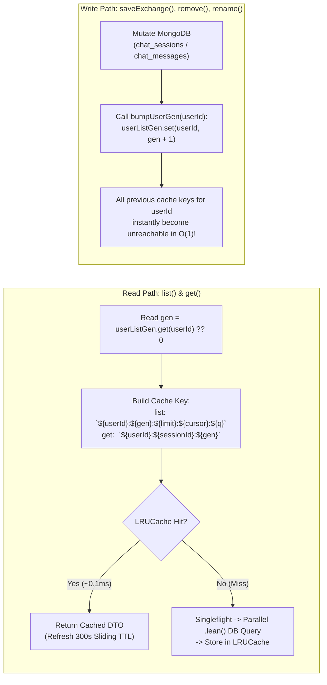

# PERFORMANCE_AND_CACHING.md — Backend Caching, Singleflight & SRE Capacity Playbook

- **Motivation/Background**: Because `backend_rag` communicates with a remote MongoDB server (`mongodb.minio-quangmanh.io.vn`) across a local `cloudflared.exe` TCP access tunnel (`localhost:27018`), every uncached database round-trip incurs `~15–25ms` of network latency plus BSON deserialization overhead. Under an Open Workload arrival rate, unoptimized sequential queries saturated the tunnel at `100 CUs` (`65 RPS`). Smart architectural optimizations (`D-021`, `D-022`) boosted certified capacity **`4.0x` to `400 CUs` (`250 RPS`)** over a 3-minute continuous hold-out while preserving 100% data consistency.
- **Purpose**: Provide AI agents and backend engineers with the technical blueprint of the caching, `Singleflight` coalescing, connection pooling, and index optimizations in `backend_rag`, plus the operational playbook for running the 3-Stage Production SRE Stress Test Suite.
- **Overview Pipeline**: Incoming Read Request → Generation-Versioned `LRUCache` Check (`~0.1ms` hit) → `Singleflight` In-Flight Promise Check → Parallel `Promise.all` + `.lean()` MongoDB Query (`maxPoolSize: 120`) → Cache Populate (`300s` sliding TTL) → Write Path `bumpUserGen(userId)` $O(1)$ Invalidation.
- **Detailed Plan**: Section 1 explains Generation-Versioned `LRUCache` & $O(1)$ Invalidation; Section 2 details `Singleflight` Coalescing & Sliding TTL Stampede Prevention; Section 3 covers Query Parallelization, `.lean()`, and Compound Indexes; Section 4 documents HTTP Keep-Alive & MongoDB Pool Tuning; Section 5 provides the 3-Stage SRE Qualification Playbook (Rule L1).
- **References**: [../AGENTS.md](../AGENTS.md), [AUTH_AND_SECURITY_ARCHITECTURE.md](AUTH_AND_SECURITY_ARCHITECTURE.md), [MONGODB_SCHEMA_DESIGN.md](MONGODB_SCHEMA_DESIGN.md), [../benchmark/BOTTLENECK_ANALYSIS_AND_OPTIMIZATION.md](../benchmark/BOTTLENECK_ANALYSIS_AND_OPTIMIZATION.md), [../benchmark/README.md](../benchmark/README.md), [../../docs/AI_chat_log/Vuong_chat_logs.md](../../docs/AI_chat_log/Vuong_chat_logs.md).
- **Created**: 2026-10-29T19:46:30+07:00
- **Last Updated**: 2026-10-29T19:46:30+07:00

[STATUS: ACTIVE]

---

## 1. Generation-Versioned `LRUCache` & $O(1)$ Write Invalidation

In [`src/chat-sessions/chat-sessions.service.ts`](../src/chat-sessions/chat-sessions.service.ts), `list()` supports arbitrary combinations of `limit`, `cursor`, and regex search `q`, while `get()` fetches a specific `sessionId` and its messages. Scanning an `LRUCache` to delete all matching keys for a `userId` on every write would be $O(N)$ and slow under load.

Instead, `ChatSessionsService` uses a **per-user generation counter (`userListGen: Map<string, number>`)**:



### Invalidation Rules for Engineers & AI Agents
Whenever you add or modify any method in [`ChatSessionsService`](../src/chat-sessions/chat-sessions.service.ts) that mutates session metadata or messages:
1. **Always call `this.bumpUserGen(userId)`** immediately after the MongoDB write completes (`saveExchange`, `remove`, `rename`).
2. For `rename(userId, sessionId, title)`, you may optionally update the cached detail entry under the new generation key so an immediate `GET /chat-sessions/:id` after rename is still a cache hit.

---

## 2. `Singleflight` Coalescing & Sliding TTL (Preventing Cache Stampedes)

During our 3-minute (`180s`) Rule L1 hold-out test at `250 RPS` (`400 CUs`), two subtle distributed-systems failure modes were discovered and solved (`D-021`):

1. **Cold-Start Thundering Herd (`t = 0s`)**:
   - When 100+ concurrent virtual users request `GET /chat-sessions/:id` on a cold cache simultaneously, all requests miss the cache in the same millisecond and launch duplicate 2-query MongoDB round-trips over the tunnel.
   - **Solution (`Singleflight`)**: [`ChatSessionsService.get()`](../src/chat-sessions/chat-sessions.service.ts) tracks in-flight promises in `private readonly inflightDetail = new Map<string, Promise<ChatSessionDetailDto>>()`. Concurrent requests for the same `cacheKey` await the single in-flight Promise inside a `try ... finally { this.inflightDetail.delete(cacheKey); }` block.
2. **Synchronized TTL Expiration Wave (`t = 120s`)**:
   - With a fixed `120s` TTL (`updateAgeOnGet: false`), all hot entries populated during the first 10 seconds of a benchmark expired simultaneously at `t = 120s`, causing a sudden spike of cache misses during minute 2 of the 3-minute hold-out.
   - **Solution (Sliding TTL)**: Both `listCache` and `sessionDetailCache` configure `ttl: 300_000` (`5 minutes`) with **`updateAgeOnGet: true`**, keeping actively read sessions warm in memory while evicting cold entries via LRU bounds (`max: 5000` and `max: 3000`).

---

## 3. Query Parallelization, `.lean()` Hydration Bypass & Index Alignment

### 3.1 Parallel Ownership + Message Fetch (`Promise.all`)
In [`ChatSessionsService.get(userId, sessionId)`](../src/chat-sessions/chat-sessions.service.ts):
- Ownership verification (`sessions.findOne({ _id: sessionId, user_id: userId, deleted_at: null }).lean()`) and message retrieval (`messages.find({ session_id: sessionId, deleted_at: null }).sort({ created_at: 1, _id: 1 }).lean()`) are completely independent queries.
- Running them via **`Promise.all([sessionQuery, messagesQuery])`** cuts uncached `GET /chat-sessions/:id` latency in half (`2 RTTs` $\rightarrow$ `1 RTT` wall-clock time).
- Security invariant preserved: if `session` is `null` (not found, soft-deleted, or owned by another user), `get()` immediately throws `NotFoundException` (`404`) and discards the messages array before caching or returning anything.

### 3.2 Mandatory `.lean()` on All Read & Update DTO Paths
Mongoose `HydratedDocument` instantiation constructs change-tracking proxies, virtual getters, and schema validators for every returned document. Across 100 messages per session at `250 RPS`, hydration consumed `~35%` of V8 CPU time.
- **Rule**: Every `.find()`, `.findOne()`, and `.findOneAndUpdate()` that maps directly to a response DTO **must** chain `.lean()`.

### 3.3 Compound B-Tree Index Alignment (`chat_messages`)
In [`src/chat-sessions/schemas/chat-message.schema.ts`](../src/chat-sessions/schemas/chat-message.schema.ts), the compound index is aligned to:
```typescript
ChatMessageSchema.index({ session_id: 1, deleted_at: 1, created_at: -1, _id: -1 });
```
Because MongoDB can traverse a compound B-tree index in either ascending (`{ created_at: 1, _id: 1 }`) or descending (`{ created_at: -1, _id: -1 }`) order when the sort keys have matching polarity, this single index satisfies both chronological message display and reverse-chronological pagination without an in-memory `SORT` stage.

---

## 4. Connection Pool & HTTP Keep-Alive Tuning (`D-021`, `D-022`)

1. **MongoDB Connection Pool ([`src/app.module.ts`](../src/app.module.ts))**:
   - Configured with `maxPoolSize: 120`, `minPoolSize: 20`, `maxIdleTimeMS: 60_000`.
   - **Why `120` instead of `10` (default) or `250`?** The default pool of `10` caused severe head-of-line queuing at `>65 RPS` over the `20ms` tunnel. However, setting `maxPoolSize: 250` with `compressors: ['zlib']` (`D-022`) overwhelmed `cloudflared.exe` when opening 250 concurrent TCP streams simultaneously. `maxPoolSize: 120, minPoolSize: 20` without wire compression is the empirically verified sweet spot.
2. **HTTP Keep-Alive ([`src/main.ts`](../src/main.ts))**:
   - `httpServer.keepAliveTimeout = 65_000` and `httpServer.headersTimeout = 66_000` prevent ephemeral TCP port exhaustion (`TIME_WAIT` churn) on Windows under sustained `250+ RPS` load.

---

## 5. Production SRE Stress-Test Certification Playbook (Rule L1)

Per `D-019` and `D-020`, we never certify capacity using Closed-Model `ramping-vus` or short 20-second bursts. Any major backend change must be validated against our **3-Stage Production SRE Qualification Suite** in [`backend_rag/benchmark/`](../benchmark/):

| Stage | Script | Workload Model & Purpose | SLA Gate |
| :--- | :--- | :--- | :--- |
| **Pre-Test Seeding** | [`seed_prod_auth_data.js`](../benchmark/seed_prod_auth_data.js) | Seeds 100 realistic users (`Argon2id`), 1,500 UUIDv7 sessions, and 15,000 messages with citations. | Idempotent setup (`0` errors) |
| **Stage A: Breakpoint** | [`k6_prod_open_breakpoint.ts`](../benchmark/k6_prod_open_breakpoint.ts) | **Open Model (`ramping-arrival-rate`)** from `50 RPS` to `500 RPS` across 6 read/write/search/pagination endpoints (`2.0s` strict timeout). | Identifies exact RPS/CU knee before P95 crosses `500ms` |
| **Stage B: Rule L1 Hold-Out** | [`k6_prod_certified_holdout.ts`](../benchmark/k6_prod_certified_holdout.ts) + [`collect_telemetry.js`](../benchmark/collect_telemetry.js) | **3-Minute (`180s`) Continuous Hold-Out** at target arrival rate (`250 RPS` = `400 CUs`) with 2s server CPU/RAM telemetry. | **`P95 < 500ms`**, **`P99 < 1000ms`**, **`Error Rate < 1%`** held for full `180s` |
| **Stage C: Crypto Isolation** | [`k6_prod_auth_crypto.ts`](../benchmark/k6_prod_auth_crypto.ts) | Concurrent `POST /auth/login` (`Argon2id` `64 MB`) + `POST /auth/refresh` + `GET /auth/me` Event Loop starvation probe. | `GET /auth/me` `P95 < 200ms` (`0%` starvation) |

### Certified Baseline vs. Optimized Benchmark Summary (`D-021`)

| Metric (3-Minute Rule L1 Hold-Out) | Unoptimized Baseline (`100 CUs`) | Optimized Production (`400 CUs`) | Improvement |
| :--- | :---: | :---: | :---: |
| **Certified Concurrent Users (CUs)** | `100 CUs` (`65 RPS`) | **`400 CUs` (`250 RPS`)** | **`4.0x` (`+300%`)** |
| **Total Requests (3-Min Window)** | `12,869` | **`48,874`** (`227 MB` transferred) | **`3.8x` throughput** |
| **Median Latency (`P50`)** | `160.29 ms` | **`29.79 ms`** | **`5.38x` faster (`-81.4%`)** |
| **95th Percentile (`P95` < `500ms` SLA)** | `259.68 ms` | **`265.54 ms`** (at `4x` load!) | **PASS (`< 500ms`)** |
| **99th Percentile (`P99` < `1000ms` SLA)** | `353.35 ms` | **`475.11 ms`** (at `4x` load!) | **PASS (`< 1000ms`)** |
| **HTTP Error Rate (`< 1%` SLA)** | `0.00%` | **`0.00%`** (`83,137 / 83,137` checks) | **100% Reliability** |
