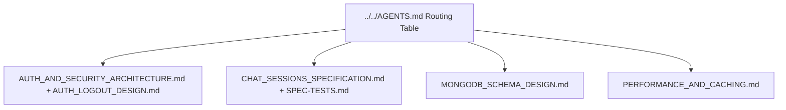

# backend_rag/docs — Tài liệu Đặc tả Kiến trúc Phân hệ Backend

- **Motivation/Background**: Cung cấp tài liệu đặc tả tự chứa ngay tại `backend_rag/docs/` theo yêu cầu chuẩn hóa kiến trúc, giúp người đọc nắm bắt nhanh mục đích thư mục, trách nhiệm từng file và luồng nghiệp vụ mà không phải dò thủ công toàn bộ mã nguồn.
- **Purpose**: Tập hợp các bản thiết kế kỹ thuật chuyên sâu cho từng hệ thống con của `backend_rag`: Xác thực & Bảo mật JWT/Argon2id, Luồng Đăng xuất 1-RTT, Đặc tả Phiên chat UUIDv7 & Test Matrix, Thiết kế Schema MongoDB và Báo cáo Tối ưu Hiệu năng Caching.
- **Overview Pipeline**: Mỗi phân hệ lớn trước khi triển khai hoặc tối ưu đều được đặc tả hóa hợp đồng... -> AI Agent và kỹ sư tra cứu trực tiếp qua Progressive-Disclosure Table ở....
- **Detailed Plan**: Mục 1 định nghĩa phạm vi & vai trò; Mục 2 liệt kê cấu trúc thư mục con và danh mục file/export thực tế; Mục 3 mô tả chức năng, luồng nghiệp vụ kèm sơ đồ Mermaid; Mục 4 quy định hợp đồng I/O, bất biến hệ thống và lệnh kiểm chứng.
- **References**: [AGENTS.md](../AGENTS.md), [AGENTS.md](../../AGENTS.md), [MD_CONVENTION.md](../../agents/rules/MD_CONVENTION.md).
- **Created**: 2026-11-15T12:55:00+07:00
- **Last Updated**: 2026-11-15T12:55:00+07:00

[STATUS: ACTIVE]

---
## 1. Mục đích & Phạm vi Thư mục (Directory Scope & Architectural Role)

Tập hợp các bản thiết kế kỹ thuật chuyên sâu cho từng hệ thống con của `backend_rag`: Xác thực & Bảo mật JWT/Argon2id, Luồng Đăng xuất 1-RTT, Đặc tả Phiên chat UUIDv7 & Test Matrix, Thiết kế Schema MongoDB và Báo cáo Tối ưu Hiệu năng Caching.

---

## 2. Đặc tả Kỹ thuật & Danh mục File (Technical Specification)

### 2.2. Danh mục File & Ký hiệu Kỹ thuật (File & Symbol Inventory)

| File | Loại / Tầng | Exports / Routes / Ký hiệu Chính | Mô tả Trách nhiệm |
| :--- | :--- | :--- | :--- |
| [`AUTH_AND_SECURITY_ARCHITECTURE.md`](AUTH_AND_SECURITY_ARCHITECTURE.md) | Markdown Spec | Markdown Document | AUTH_AND_SECURITY_ARCHITECTURE.md — Authentication, Token Rotation & Cryptographic Architecture |
| [`AUTH_LOGOUT_DESIGN.md`](AUTH_LOGOUT_DESIGN.md) | Markdown Spec | Markdown Document | Thiết kế API: Route & Controller Logout (Monolithic) |
| [`CHAT_SESSIONS_SPEC-TESTS.md`](CHAT_SESSIONS_SPEC-TESTS.md) | Markdown Spec | Markdown Document | CHAT_SESSIONS-SPEC-TESTS.md — Chat Sessions Test Inventory and Coverage Documentation |
| [`CHAT_SESSIONS_SPECIFICATION.md`](CHAT_SESSIONS_SPECIFICATION.md) | Markdown Spec | Markdown Document | Chat Sessions — Full-Stack Specification |
| [`MONGODB_SCHEMA_DESIGN.md`](MONGODB_SCHEMA_DESIGN.md) | Markdown Spec | Markdown Document | MONGODB_SCHEMA_DESIGN.md — Hybrid MongoDB Document-Collection Specification |
| [`PERFORMANCE_AND_CACHING.md`](PERFORMANCE_AND_CACHING.md) | Markdown Spec | Markdown Document | PERFORMANCE_AND_CACHING.md — Backend Caching, Singleflight & SRE Capacity Playbook |

---

## 3. Mô tả Chức năng & Luồng Nghiệp vụ (Business Flow)

1. Mỗi phân hệ lớn trước khi triển khai hoặc tối ưu đều được đặc tả hóa hợp đồng schema, chỉ số TTL và quy tắc bảo mật tại đây.
2. AI Agent và kỹ sư tra cứu trực tiếp qua Progressive-Disclosure Table ở `AGENTS.md` gốc trước khi chỉnh sửa code.



---

## 4. Hợp đồng Đầu vào / Đầu ra, Bất biến & Kiểm chứng

- **Đầu vào (Inputs)**: Các quyết định thiết kế kiến trúc (`D-001`..`D-058`) và kết quả benchmark SRE.
- **Đầu ra & Tác động (Outputs / Side Effects)**: Tài liệu tham chiếu chuẩn có 7 trường metadata (`MD_CONVENTION.md`) hướng dẫn trực tiếp quá trình lập trình và kiểm thử.

### Bất biến & Quy tắc Kiến trúc (System Invariants)
- Mọi tài liệu trong `docs/` tuân thủ header 7 trường và trạng thái `[STATUS: ACTIVE]` theo `agents/rules/MD_CONVENTION.md`.

### Lệnh Kiểm chứng (Verification)
```powershell
cd backend_rag && ls docs
```
