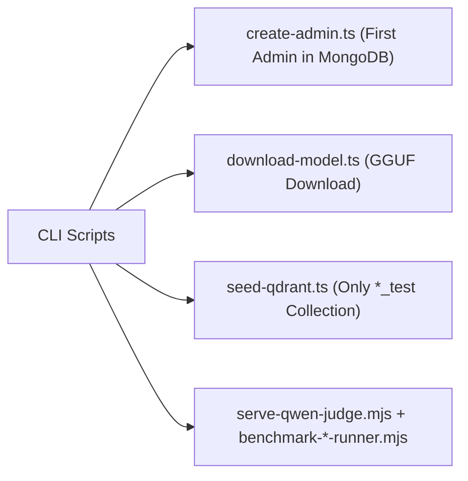

# scripts — Công cụ CLI Vận hành, Bootstrap Admin, Nạp Qdrant Test & Benchmark Model

- **Motivation/Background**: Cung cấp tài liệu đặc tả tự chứa ngay tại `backend_rag/scripts/` theo yêu cầu chuẩn hóa kiến trúc, giúp người đọc nắm bắt nhanh mục đích thư mục, trách nhiệm từng file và luồng nghiệp vụ mà không phải dò thủ công toàn bộ mã nguồn.
- **Purpose**: Tập hợp các script CLI chạy độc lập ngoài vòng đời HTTP chính: khởi tạo tài khoản Admin đầu tiên, tải mô hình GGUF, nạp collection Qdrant thử nghiệm, phục vụ server chấm điểm Qwen Judge và chạy benchmark Laya/Vector.
- **Overview Pipeline**: `create-admin.ts` khởi tạo hoặc thăng hạng tài khoản Admin đầu tiên một cách... -> `download-model.ts` tải file mô hình GGUF vào thư mục `model/` -> `seed-qdrant.ts` chỉ cho phép ghi vào collection có hậu tố `_test` để phục vụ....
- **Detailed Plan**: Mục 1 định nghĩa phạm vi & vai trò; Mục 2 liệt kê cấu trúc thư mục con và danh mục file/export thực tế; Mục 3 mô tả chức năng, luồng nghiệp vụ kèm sơ đồ Mermaid; Mục 4 quy định hợp đồng I/O, bất biến hệ thống và lệnh kiểm chứng.
- **References**: [package.json](../package.json), [AGENTS.md](../AGENTS.md), [AGENTS.md](../../AGENTS.md).
- **Created**: 2026-11-15T12:55:00+07:00
- **Last Updated**: 2026-11-15T12:55:00+07:00

[STATUS: ACTIVE]

---
## 1. Mục đích & Phạm vi Thư mục (Directory Scope & Architectural Role)

Tập hợp các script CLI chạy độc lập ngoài vòng đời HTTP chính: khởi tạo tài khoản Admin đầu tiên, tải mô hình GGUF, nạp collection Qdrant thử nghiệm, phục vụ server chấm điểm Qwen Judge và chạy benchmark Laya/Vector.

---

## 2. Đặc tả Kỹ thuật & Danh mục File (Technical Specification)

### 2.2. Danh mục File & Ký hiệu Kỹ thuật (File & Symbol Inventory)

| File | Loại / Tầng | Exports / Routes / Ký hiệu Chính | Mô tả Trách nhiệm |
| :--- | :--- | :--- | :--- |
| [`benchmark-laya-runner.mjs`](benchmark-laya-runner.mjs) | ESM Runner Script | - | benchmark-laya-runner.mjs ------------------------- Tier 1 & Tier 2 Benchmark Runner for Laya New (20261108-seed0) vs Laya Baseline. Supports: node... |
| [`benchmark-vector-runner.mjs`](benchmark-vector-runner.mjs) | ESM Runner Script | - | benchmark-vector-runner.mjs --------------------------- Pure Vector RAG Benchmark Runner (No Rerank, No Laya) using Nomic-embed-text-v1.5 on the... |
| [`create-admin.ts`](create-admin.ts) | TypeScript Module | - | Admin bootstrap CLI (prompt_security S7). Creates the **first** admin account. The script is intentionally idempotent: running it again for an... |
| [`download-model.ts`](download-model.ts) | TypeScript Module | - | Priority: process.env.MODEL_PATH -> process.env.LLM_MODEL_PATH -> '../model/qwen2.5-7b-instruct-q4_k_m.gguf' |
| [`seed-qdrant.ts`](seed-qdrant.ts) | TypeScript Module | `DIM`, `SEED_CHUNKS`, `SEED_PAPERS`, `assertTestCollection`, `unitVector`, `SeedPoint`, `seedPoints` (+1) | Seeds a small TEST collection (200 random 768-D chunks, payload as in API_DESIGN §7). Refuses any collection whose name does not end in `_test`: the... |
| [`serve-qwen-judge.mjs`](serve-qwen-judge.mjs) | ESM Runner Script | - | serve-qwen-judge.mjs ------------------- Lightweight OpenAI-compatible HTTP server running on port 9001 Serving local Qwen2.5-7B-Instruct GGUF for... |

---

## 3. Mô tả Chức năng & Luồng Nghiệp vụ (Business Flow)

1. `create-admin.ts` khởi tạo hoặc thăng hạng tài khoản Admin đầu tiên một cách lũy đẳng theo quy định bảo mật (`D-040`).
2. `download-model.ts` tải file mô hình GGUF vào thư mục `model/`.
3. `seed-qdrant.ts` chỉ cho phép ghi vào collection có hậu tố `_test` để phục vụ kiểm thử E2E Qdrant thật.
4. `serve-qwen-judge.mjs` và `benchmark-*-runner.mjs` đánh giá độc lập chất lượng xếp hạng Laya vs Pure Vector.



---

## 4. Hợp đồng Đầu vào / Đầu ra, Bất biến & Kiểm chứng

- **Đầu vào (Inputs)**: Tham số dòng lệnh CLI và biến môi trường `.env` (`MONGO_URI`, `QDRANT_URL`, `MODEL_PATH`).
- **Đầu ra & Tác động (Outputs / Side Effects)**: Tài khoản admin bootstrap trong MongoDB, file model GGUF cục bộ, collection test trên Qdrant và báo cáo JSON benchmark.

### Bất biến & Quy tắc Kiến trúc (System Invariants)
- Admin đầu tiên CHỈ được tạo qua `npm run create:admin`, không có API đăng ký admin công khai (`D-040`).
- `seed-qdrant.ts` từ chối mọi collection không kết thúc bằng `_test` để bảo vệ `scientific_papers_gold`.

### Lệnh Kiểm chứng (Verification)
```powershell
cd backend_rag && npx tsc --noEmit scripts/create-admin.ts
```
