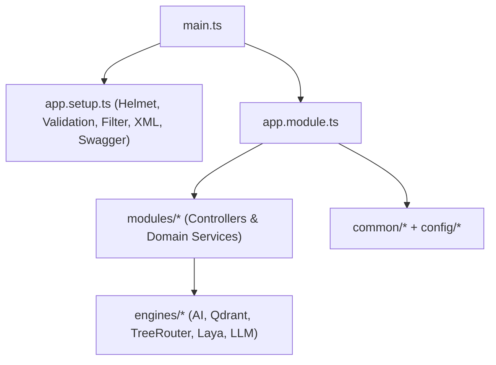

# backend_rag/src — Mã nguồn Chính Ứng dụng NestJS 11

- **Motivation/Background**: Cung cấp tài liệu đặc tả tự chứa ngay tại `backend_rag/src/` theo yêu cầu chuẩn hóa kiến trúc, giúp người đọc nắm bắt nhanh mục đích thư mục, trách nhiệm từng file và luồng nghiệp vụ mà không phải dò thủ công toàn bộ mã nguồn.
- **Purpose**: Chứa toàn bộ mã nguồn TypeScript của backend: entrypoint khởi chạy `main.ts`, lắp ráp toàn cục `app.module.ts` & `app.setup.ts`, lớp hạ tầng dùng chung (`common/`, `config/`), các engine AI/truy xuất (`engines/`), các API feature module (`modules/`), tiện ích kiểm thử (`testing/`) và kiểu dữ liệu chuẩn (`types/`).
- **Overview Pipeline**: `main.ts` thiết lập `UV_THREADPOOL_SIZE`, tạo `NestFactory`, gọi... -> `AppModule` liên kết `AppConfigModule`, `LoggerModule`, `MongooseModule` ... -> Request đi qua `common/security` + `Guards` -> `Controller` -> `Service` ->....
- **Detailed Plan**: Mục 1 định nghĩa phạm vi & vai trò; Mục 2 liệt kê cấu trúc thư mục con và danh mục file/export thực tế; Mục 3 mô tả chức năng, luồng nghiệp vụ kèm sơ đồ Mermaid; Mục 4 quy định hợp đồng I/O, bất biến hệ thống và lệnh kiểm chứng.
- **References**: [AGENTS.md](../AGENTS.md), [package.json](../package.json), [main.ts](main.ts), [app.module.ts](app.module.ts), [app.setup.ts](app.setup.ts).
- **Created**: 2026-11-15T12:55:00+07:00
- **Last Updated**: 2026-11-15T12:55:00+07:00

[STATUS: ACTIVE]

---
## 1. Mục đích & Phạm vi Thư mục (Directory Scope & Architectural Role)

Chứa toàn bộ mã nguồn TypeScript của backend: entrypoint khởi chạy `main.ts`, lắp ráp toàn cục `app.module.ts` & `app.setup.ts`, lớp hạ tầng dùng chung (`common/`, `config/`), các engine AI/truy xuất (`engines/`), các API feature module (`modules/`), tiện ích kiểm thử (`testing/`) và kiểu dữ liệu chuẩn (`types/`).

---

## 2. Đặc tả Kỹ thuật & Danh mục File (Technical Specification)

### 2.1. Danh mục Thư mục con (Subdirectories)

| Thư mục con | Liên kết Đặc tả | Vai trò Chính |
| :--- | :--- | :--- |
| **`common/`** | [`common/README.md`](common/README.md) | Cung cấp các khối nền tảng không phụ thuộc nghiệp vụ cụ thể: chuẩn hóa HTTP contract/XML/HATEOAS (`http/`), logging có Request ID (`logging/`), metric Prometheus (`metrics/`), phân trang con trỏ Keyset & lọc an toàn (`pagination/`), bảo mật tiêu đề HTTP/rate-limit/chống ReDoS (`security/`) và tiện ích UUIDv7/Mongo errors (`utils/`). |
| **`config/`** | [`config/README.md`](config/README.md) | Validate toàn bộ biến môi trường lúc khởi động bằng `envSchema` (`zod`) để ứng dụng dừng ngay (fail-fast exit 1) nếu thiếu hoặc sai định dạng thông số tối quan trọng, sau đó cung cấp qua `AppConfigService` toàn cục. |
| **`engines/`** | [`engines/README.md`](engines/README.md) | Chứa 7 engine cốt lõi tách biệt khỏi HTTP controller theo kiến trúc Port/Adapter: `corpus` (đọc văn bản bài báo MongoDB), `embedding` (Nomic Embed v1.5 768-D), `tree-router` (định tuyến cây k-means World 3D), `vector-store` (truy vấn Qdrant), `mining` (rerank PageRank tác giả & mở rộng truy vấn), `judge` (chấm điểm liên quan/căn cứ bằng Laya) và `llm` (sinh token GGUF + hàng đợi). |
| **`modules/`** | [`modules/README.md`](modules/README.md) | Chứa 7 module nghiệp vụ cấu thành toàn bộ bề mặt API `/api/v1`: `api-root` (điểm vào HATEOAS), `auth` (JWT/Argon2id/Refresh Rotation), `users` (tài khoản cá nhân), `chat-sessions` (quản lý lịch sử UUIDv7 + Idempotency), `rag` (pipeline chat + SSE stream), `papers` (tra cứu chi tiết bài báo), `health` (kiểm tra phụ thuộc nền) và `admin` (RBAC quản trị & audit log). |
| **`testing/`** | [`testing/README.md`](testing/README.md) | Cung cấp `createTestApp`, `startMongo` (`MongoMemoryReplSet` hỗ trợ đa-document transactions) và `seedUser` kèm `TEST_ENV` mặc định an toàn cho toàn bộ bộ test tích hợp Jest mà không chạm tới MongoDB hoặc Qdrant production. |
| **`types/`** | [`types/README.md`](types/README.md) | Nơi tập trung các TypeScript interfaces/unions dùng chung giữa mọi Engine và HTTP Module: `AuthUser`/`Role`, mở rộng Express `Request` (`express.d.ts`) và hợp đồng `scientific-rag.ts` (`PaperDetail`, `ChunkPayload`, `ScoredChunk`, `GroundedChunk`, `RagStreamEvent`, `Timings`, `toSectionType`). |

### 2.2. Danh mục File & Ký hiệu Kỹ thuật (File & Symbol Inventory)

| File | Loại / Tầng | Exports / Routes / Ký hiệu Chính | Mô tả Trách nhiệm |
| :--- | :--- | :--- | :--- |
| [`app.module.ts`](app.module.ts) | NestJS Module | `AppModule` | Module NestJS khai báo imports, providers và exports DI. |
| [`app.setup.ts`](app.setup.ts) | TypeScript Module | `configureApp`, `API_PREFIX`, `RATE_LIMITS` | Thành phần `TypeScript Module` thuộc `src`. |
| [`main.ts`](main.ts) | TypeScript Module | - | Thành phần `TypeScript Module` thuộc `src`. |

---

## 3. Mô tả Chức năng & Luồng Nghiệp vụ (Business Flow)

1. `main.ts` thiết lập `UV_THREADPOOL_SIZE`, tạo `NestFactory`, gọi `configureApp(app)` trong `app.setup.ts` và lắng nghe cổng HTTP.
2. `AppModule` liên kết `AppConfigModule`, `LoggerModule`, `MongooseModule` (2 kết nối: primary & corpus read-only), `ThrottlerModule` và toàn bộ domain modules.
3. Request đi qua `common/security` + `Guards` -> `Controller` -> `Service` -> `Engines` / `Schemas` và đi ra qua `ContentNegotiationInterceptor` & `LinksInterceptor`.



---

## 4. Hợp đồng Đầu vào / Đầu ra, Bất biến & Kiểm chứng

- **Đầu vào (Inputs)**: Environment variables đã validate bởi Zod và HTTP requests tới `/api/v1/*`.
- **Đầu ra & Tác động (Outputs / Side Effects)**: HTTP application NestJS đã cấu hình đầy đủ Swagger OpenAPI (`/api/v1/docs`) và bảo mật production.

### Bất biến & Quy tắc Kiến trúc (System Invariants)
- `tsconfig.json` bật `strict: true` và `noImplicitAny: true` cùng module `commonjs` cho NestJS DI.
- Tất cả thư mục con cung cấp barrel `index.ts` giúp import rõ ràng, không tạo vòng lặp phụ thuộc.

### Lệnh Kiểm chứng (Verification)
```powershell
cd backend_rag && npm run build && npm test
```
