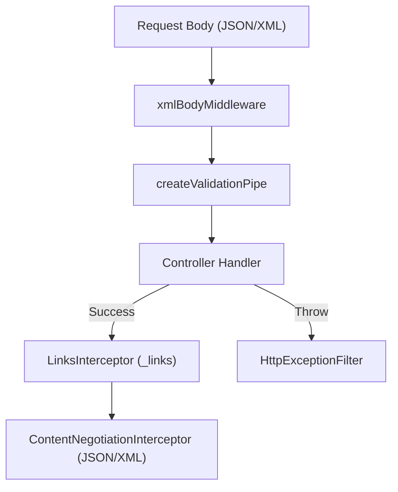

# common/http — Chuẩn hóa HTTP, Đàm phán Nội dung JSON/XML, HATEOAS & Bắt lỗi

- **Motivation/Background**: Cung cấp tài liệu đặc tả tự chứa ngay tại `backend_rag/src/common/http/` theo yêu cầu chuẩn hóa kiến trúc, giúp người đọc nắm bắt nhanh mục đích thư mục, trách nhiệm từng file và luồng nghiệp vụ mà không phải dò thủ công toàn bộ mã nguồn.
- **Purpose**: Thực thi hợp đồng API tại `docs/api/API_DESIGN.md`: tự động gắn `_links` HATEOAS (`WithLinks`, `LinksInterceptor`), hỗ trợ song song JSON và XML (`ContentNegotiationInterceptor`, `xmlBodyMiddleware`), `ValidationPipe` trả lỗi súc tích và `HttpExceptionFilter` ánh xạ mọi exception thành payload chuẩn.
- **Overview Pipeline**: `xmlBodyMiddleware` phân tích body `application/xml` hoặc `text/xml` trước... -> `createValidationPipe()` kiểm tra DTO và rút gọn thông báo lỗi đầu tiên -> `LinksInterceptor` chèn `_links` theo metadata `@WithLinks` vào response....
- **Detailed Plan**: Mục 1 định nghĩa phạm vi & vai trò; Mục 2 liệt kê cấu trúc thư mục con và danh mục file/export thực tế; Mục 3 mô tả chức năng, luồng nghiệp vụ kèm sơ đồ Mermaid; Mục 4 quy định hợp đồng I/O, bất biến hệ thống và lệnh kiểm chứng.
- **References**: [AGENTS.md](../../../AGENTS.md).
- **Created**: 2026-11-15T12:55:00+07:00
- **Last Updated**: 2026-11-17T17:48:00+07:00

[STATUS: ACTIVE]

---
## 1. Mục đích & Phạm vi Thư mục (Directory Scope & Architectural Role)

Thực thi hợp đồng API tại `docs/api/API_DESIGN.md`: tự động gắn `_links` HATEOAS (`WithLinks`, `LinksInterceptor`), hỗ trợ song song JSON và XML (`ContentNegotiationInterceptor`, `xmlBodyMiddleware`), `ValidationPipe` trả lỗi súc tích và `HttpExceptionFilter` ánh xạ mọi exception thành payload chuẩn.

---

## 2. Đặc tả Kỹ thuật & Danh mục File (Technical Specification)

### 2.2. Danh mục File & Ký hiệu Kỹ thuật (File & Symbol Inventory)

| File | Loại / Tầng | Exports / Routes / Ký hiệu Chính | Mô tả Trách nhiệm |
| :--- | :--- | :--- | :--- |
| [`hateoas.ts`](hateoas.ts) | TypeScript Module | `API_PREFIX`, `Link`, `Links`, `accountLinks`, `sessionLinks`, `paperLinks`, `chatLinks` (+8) | Absent means `GET`. |
| [`http-contract.ts`](http-contract.ts) | TypeScript Module | `allowedMethods` | The methods a path answers to; empty when no route matches it. Backs 405 and `Allow`. |
| [`http-exception.filter.spec.ts`](http-exception.filter.spec.ts) | Jest Integration/Unit Spec | - | Bộ kiểm thử tự động xác minh hành vi cho `backend_rag/src/common/http`. |
| [`http-exception.filter.ts`](http-exception.filter.ts) | Exception Filter | `ErrorBody`, `messageOf`, `toErrorBody`, `sendError`, `HttpExceptionFilter` | Error body of every endpoint (API_DESIGN §1.2). |
| [`index.ts`](index.ts) | Barrel Export | Re-exports: `./hateoas`, `./http-contract`, `./http-exception.filter`, `./validation`, `./xml` | Barrel thống nhất điểm import công khai của thư mục |
| [`validation.ts`](validation.ts) | TypeScript Module | `firstValidationMessage`, `createValidationPipe` | First human-readable constraint message, searching nested errors depth-first. |
| [`validation.spec.ts`](validation.spec.ts) | Jest Unit Spec | - | Kiểm thử rút gọn thông báo lỗi validation lồng nhau và từ chối field thừa. |
| [`xml.spec.ts`](xml.spec.ts) | Jest Unit Spec | - | Kiểm thử parser XML, chống XXE `DOCTYPE`/`ENTITY`, HTTP `415`/`406` và `ContentNegotiationInterceptor`. |
| [`xml.ts`](xml.ts) | TypeScript Module | `XML_MEDIA_TYPES`, `toXml`, `parseXmlBody`, `unsupportedBody`, `UNSUPPORTED_BODY`, `wantsXml`, `xmlBodyMiddleware` (+1) | Thành phần `TypeScript Module` thuộc `http`. |

---

## 3. Mô tả Chức năng & Luồng Nghiệp vụ (Business Flow)

1. `xmlBodyMiddleware` phân tích body `application/xml` hoặc `text/xml` trước controller.
2. `createValidationPipe()` kiểm tra DTO (`whitelist: true`, `transform: true`) và rút gọn thông báo lỗi đầu tiên.
3. `LinksInterceptor` chèn `_links` theo metadata `@WithLinks` vào response object hoặc từng phần tử trang.
4. `ContentNegotiationInterceptor` chuyển đổi payload sang XML nếu client gửi header `Accept: application/xml`.
5. `HttpExceptionFilter` bắt ngoại lệ, giữ nguyên cấu trúc error JSON/XML và không làm rò stacktrace ở production.



---

## 4. Hợp đồng Đầu vào / Đầu ra, Bất biến & Kiểm chứng

- **Đầu vào (Inputs)**: Express Request/Response, DTO class-validator metadata và `@WithLinks` decorator.
- **Đầu ra & Tác động (Outputs / Side Effects)**: JSON hoặc XML hợp chuẩn `_links` hay cấu trúc `ErrorBody` đồng nhất.

### Bất biến & Quy tắc Kiến trúc (System Invariants)
- Tiền tố toàn cục cố định là `api/v1` (`API_PREFIX`); hỗ trợ `JSON` và `XML` negotiation (`D-047`).

### Lệnh Kiểm chứng (Verification)
```powershell
cd backend_rag && npx jest src/common/http --runInBand
```
