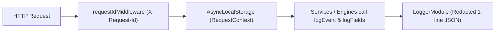

# common/logging — Logger Pino Có Cấu trúc & Request Context (AsyncLocalStorage)

- **Motivation/Background**: Cung cấp tài liệu đặc tả tự chứa ngay tại `backend_rag/src/common/logging/` theo yêu cầu chuẩn hóa kiến trúc, giúp người đọc nắm bắt nhanh mục đích thư mục, trách nhiệm từng file và luồng nghiệp vụ mà không phải dò thủ công toàn bộ mã nguồn.
- **Purpose**: Quản lý mã truy vết `X-Request-Id` xuyên suốt một vòng đời bất đồng bộ bằng `AsyncLocalStorage`, tự động ẩn thông tin nhạy cảm (`REDACT_PATHS` như password, token, authorization) khi ghi log JSON 1 dòng.
- **Overview Pipeline**: `requestIdMiddleware` đọc hoặc sinh mới `X-Request-Id` rồi gói thực thi kế... -> Trong suốt luồng async, `getRequestContext()`, `logEvent()` và `logFields()`... -> `LoggerModule` cấu hình `nestjs-pino` với mức log động theo HTTP status code .
- **Detailed Plan**: Mục 1 định nghĩa phạm vi & vai trò; Mục 2 liệt kê cấu trúc thư mục con và danh mục file/export thực tế; Mục 3 mô tả chức năng, luồng nghiệp vụ kèm sơ đồ Mermaid; Mục 4 quy định hợp đồng I/O, bất biến hệ thống và lệnh kiểm chứng.
- **References**: [index.ts](../http/index.ts), [AGENTS.md](../../../AGENTS.md).
- **Created**: 2026-11-15T12:55:00+07:00
- **Last Updated**: 2026-11-15T12:55:00+07:00

[STATUS: ACTIVE]

---
## 1. Mục đích & Phạm vi Thư mục (Directory Scope & Architectural Role)

Quản lý mã truy vết `X-Request-Id` xuyên suốt một vòng đời bất đồng bộ bằng `AsyncLocalStorage`, tự động ẩn thông tin nhạy cảm (`REDACT_PATHS` như password, token, authorization) khi ghi log JSON 1 dòng.

---

## 2. Đặc tả Kỹ thuật & Danh mục File (Technical Specification)

### 2.2. Danh mục File & Ký hiệu Kỹ thuật (File & Symbol Inventory)

| File | Loại / Tầng | Exports / Routes / Ký hiệu Chính | Mô tả Trách nhiệm |
| :--- | :--- | :--- | :--- |
| [`index.ts`](index.ts) | Barrel Export | Re-exports: `./logger.module`, `./request-context` | Barrel thống nhất điểm import công khai của thư mục |
| [`logger.module.ts`](logger.module.ts) | NestJS Module | `REDACT_PATHS`, `requestLineProps`, `requestLineLevel`, `LoggerModule` | Fields never written to logs, wherever they appear. |
| [`request-context.ts`](request-context.ts) | TypeScript Module | `RequestContext`, `REQUEST_ID_HEADER`, `requestIdMiddleware`, `requestIdOf`, `getRequestContext`, `logEvent`, `logFields` (+1) | Per-request state: the request id and the business event logged on the request line. |

---

## 3. Mô tả Chức năng & Luồng Nghiệp vụ (Business Flow)

1. `requestIdMiddleware` đọc hoặc sinh mới `X-Request-Id` rồi gói thực thi kế tiếp trong `AsyncLocalStorage`.
2. Trong suốt luồng async, `getRequestContext()`, `logEvent()` và `logFields()` tự động gắn metadata request vào log mà không phải truyền `req` xuống tận tầng engine.
3. `LoggerModule` cấu hình `nestjs-pino` với mức log động theo HTTP status code (`requestLineLevel`).



---

## 4. Hợp đồng Đầu vào / Đầu ra, Bất biến & Kiểm chứng

- **Đầu vào (Inputs)**: Header `X-Request-Id` từ client/proxy và sự kiện log nghiệp vụ trong request.
- **Đầu ra & Tác động (Outputs / Side Effects)**: Log JSON 1 dòng trên stdout/pino đã che trường nhạy cảm và header phản hồi `X-Request-Id`.

### Bất biến & Quy tắc Kiến trúc (System Invariants)
- Không bao giờ log mật khẩu, token JWT hay secret; danh sách đỏ `REDACT_PATHS` luôn được áp dụng.

### Lệnh Kiểm chứng (Verification)
```powershell
cd backend_rag && npm run build
```
