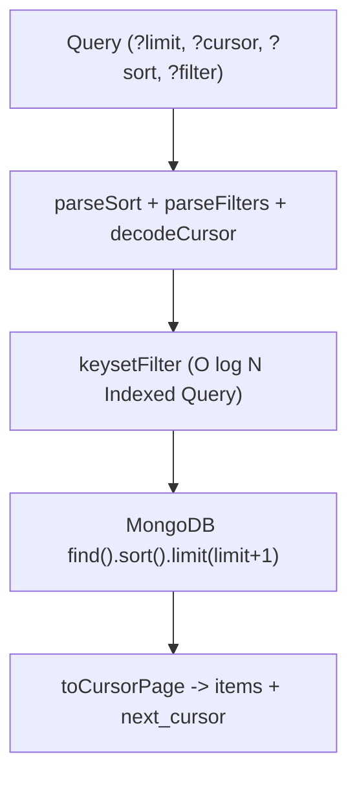

# common/pagination — Phân trang Con trỏ Keyset, Sắp xếp & Bộ lọc Động Chuẩn hóa

- **Motivation/Background**: Cung cấp tài liệu đặc tả tự chứa ngay tại `backend_rag/src/common/pagination/` theo yêu cầu chuẩn hóa kiến trúc, giúp người đọc nắm bắt nhanh mục đích thư mục, trách nhiệm từng file và luồng nghiệp vụ mà không phải dò thủ công toàn bộ mã nguồn.
- **Purpose**: Định nghĩa chuẩn `PaginationQueryDto`, `ListQueryDto`, `BatchIdsQueryDto` và các hàm mã hóa/giải mã `cursor` base64url, xây dựng bộ lọc MongoDB `keysetFilter` giúp truy vấn O(log N) ổn định bất kể độ sâu trang, cùng parser biểu thức `sort` và `filter` an toàn.
- **Overview Pipeline**: Controller nhận `ListQueryDto`  -> `parseSort` kiểm tra danh sách trường cho phép , tránh injection vào `$sort` -> `decodeCursor` + `keysetFilter` tạo điều kiện `$lt`/`$gt` ổn định ngay cả khi....
- **Detailed Plan**: Mục 1 định nghĩa phạm vi & vai trò; Mục 2 liệt kê cấu trúc thư mục con và danh mục file/export thực tế; Mục 3 mô tả chức năng, luồng nghiệp vụ kèm sơ đồ Mermaid; Mục 4 quy định hợp đồng I/O, bất biến hệ thống và lệnh kiểm chứng.
- **References**: [chat-sessions.service.ts](../../modules/chat-sessions/chat-sessions.service.ts), [AGENTS.md](../../../AGENTS.md).
- **Created**: 2026-11-15T12:55:00+07:00
- **Last Updated**: 2026-11-15T12:55:00+07:00

[STATUS: ACTIVE]

---
## 1. Mục đích & Phạm vi Thư mục (Directory Scope & Architectural Role)

Định nghĩa chuẩn `PaginationQueryDto`, `ListQueryDto`, `BatchIdsQueryDto` và các hàm mã hóa/giải mã `cursor` base64url, xây dựng bộ lọc MongoDB `keysetFilter` giúp truy vấn O(log N) ổn định bất kể độ sâu trang, cùng parser biểu thức `sort` và `filter` an toàn.

---

## 2. Đặc tả Kỹ thuật & Danh mục File (Technical Specification)

### 2.2. Danh mục File & Ký hiệu Kỹ thuật (File & Symbol Inventory)

| File | Loại / Tầng | Exports / Routes / Ký hiệu Chính | Mô tả Trách nhiệm |
| :--- | :--- | :--- | :--- |
| [`index.ts`](index.ts) | Barrel Export | Re-exports: `./pagination` | Barrel thống nhất điểm import công khai của thư mục |
| [`pagination.spec.ts`](pagination.spec.ts) | Jest Integration/Unit Spec | - | Bộ kiểm thử tự động xác minh hành vi cho `backend_rag/src/common/pagination`. |
| [`pagination.ts`](pagination.ts) | TypeScript Module | `INVALID_CURSOR`, `Page`, `encodeCursor`, `decodeCursor`, `PaginationQueryDto`, `INVALID_SORT`, `INVALID_IDS` (+18) | One page of a cursor-paginated list (API_DESIGN §1.4). |

---

## 3. Mô tả Chức năng & Luồng Nghiệp vụ (Business Flow)

1. Controller nhận `ListQueryDto` (`limit`, `cursor`, `sort`, `filter`, `q`).
2. `parseSort` kiểm tra danh sách trường cho phép (`ListSpec`), tránh injection vào `$sort`.
3. `decodeCursor` + `keysetFilter` tạo điều kiện `$lt`/`$gt` ổn định ngay cả khi có thêm bản ghi mới.
4. `toCursorPage` cắt tối đa `limit`, tạo `next_cursor` và đóng gói `Page<T>`.



---

## 4. Hợp đồng Đầu vào / Đầu ra, Bất biến & Kiểm chứng

- **Đầu vào (Inputs)**: Chuỗi query URL từ client và đặc tả whitelist `ListSpec` từ module tiêu thụ (`chat-sessions`, `admin`).
- **Đầu ra & Tác động (Outputs / Side Effects)**: Cấu trúc MongoDB filter/sort an toàn và đối tượng `Page<T>` có `items`, `next_cursor`, `has_more`.

### Bất biến & Quy tắc Kiến trúc (System Invariants)
- Mọi cursor phân trang đều bắt buộc mã hóa kết hợp tie-breaker `_id` duy nhất (UUIDv7 hoặc ObjectId).

### Lệnh Kiểm chứng (Verification)
```powershell
cd backend_rag && npx jest src/common/pagination/pagination.spec.ts --runInBand
```
