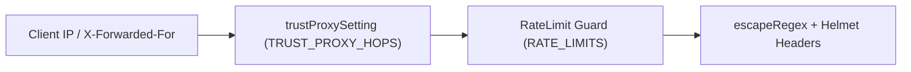

# common/security — Bảo mật Tiêu đề HTTP (Helmet), Proxy Trust, Rate Limiting & Sanitization

- **Motivation/Background**: Cung cấp tài liệu đặc tả tự chứa ngay tại `backend_rag/src/common/security/` theo yêu cầu chuẩn hóa kiến trúc, giúp người đọc nắm bắt nhanh mục đích thư mục, trách nhiệm từng file và luồng nghiệp vụ mà không phải dò thủ công toàn bộ mã nguồn.
- **Purpose**: Tập trung toàn bộ hàng rào phòng thủ vòng ngoài: cấu hình `securityHeaders` (Helmet), xác định `trustProxySetting` độc lập với `NODE_ENV` (`D-054`), `RATE_LIMITS` cho từng tuyến đường nhạy cảm (`login`, `refresh`, `register`, `chat`) và `escapeRegex` chống ReDoS.
- **Overview Pipeline**: Khởi động app áp dụng `securityHeaders(isProduction)` và... -> Decorator `@RateLimit('name')` gắn giới hạn tốc độ chính xác cho Auth, Chat... -> Khi tìm kiếm chuỗi bằng MongoDB `$regex`, dữ liệu nhập đi qua `escapeRegex()`....
- **Detailed Plan**: Mục 1 định nghĩa phạm vi & vai trò; Mục 2 liệt kê cấu trúc thư mục con và danh mục file/export thực tế; Mục 3 mô tả chức năng, luồng nghiệp vụ kèm sơ đồ Mermaid; Mục 4 quy định hợp đồng I/O, bất biến hệ thống và lệnh kiểm chứng.
- **References**: [AGENTS.md](../../../AGENTS.md).
- **Created**: 2026-11-15T12:55:00+07:00
- **Last Updated**: 2026-11-15T12:55:00+07:00

[STATUS: ACTIVE]

---
## 1. Mục đích & Phạm vi Thư mục (Directory Scope & Architectural Role)

Tập trung toàn bộ hàng rào phòng thủ vòng ngoài: cấu hình `securityHeaders` (Helmet), xác định `trustProxySetting` độc lập với `NODE_ENV` (`D-054`), `RATE_LIMITS` cho từng tuyến đường nhạy cảm (`login`, `refresh`, `register`, `chat`) và `escapeRegex` chống ReDoS.

---

## 2. Đặc tả Kỹ thuật & Danh mục File (Technical Specification)

### 2.2. Danh mục File & Ký hiệu Kỹ thuật (File & Symbol Inventory)

| File | Loại / Tầng | Exports / Routes / Ký hiệu Chính | Mô tả Trách nhiệm |
| :--- | :--- | :--- | :--- |
| [`index.ts`](index.ts) | Barrel Export | Re-exports: `./sanitize`, `./security`, `./throttler` | Barrel thống nhất điểm import công khai của thư mục |
| [`sanitize.ts`](sanitize.ts) | TypeScript Module | `escapeRegex` | Escapes every character that has a special meaning in a regular expression, so a user-provided string can safely be used inside a MongoDB `$regex`... |
| [`security.spec.ts`](security.spec.ts) | Jest Integration/Unit Spec | - | Bộ kiểm thử tự động xác minh hành vi cho `backend_rag/src/common/security`. |
| [`security.ts`](security.ts) | TypeScript Module | `securityHeaders`, `trustProxySetting` | Security response headers (prompt_security S1.1). `contentSecurityPolicy` stays at helmet's default (`default-src 'self'`) — the API serves JSON and... |
| [`throttler.spec.ts`](throttler.spec.ts) | Jest Integration/Unit Spec | - | Bộ kiểm thử tự động xác minh hành vi cho `backend_rag/src/common/security`. |
| [`throttler.ts`](throttler.ts) | TypeScript Module | `RATE_LIMITS`, `RateLimitName`, `THROTTLER_NAME`, `RateLimit`, `RateLimitChat` | Rate limits (prompt_security S1.1). The values follow the limits already documented in `backend_rag/docs/AUTH_AND_SECURITY_ARCHITECTURE.md` §5. The... |

---

## 3. Mô tả Chức năng & Luồng Nghiệp vụ (Business Flow)

1. Khởi động app áp dụng `securityHeaders(isProduction)` và `trustProxySetting(config.trustProxyHops)`.
2. Decorator `@RateLimit('name')` gắn giới hạn tốc độ chính xác cho Auth, Chat, Papers.
3. Khi tìm kiếm chuỗi bằng MongoDB `$regex`, dữ liệu nhập đi qua `escapeRegex()` để vô hiệu hóa ký tự đặc biệt.



---

## 4. Hợp đồng Đầu vào / Đầu ra, Bất biến & Kiểm chứng

- **Đầu vào (Inputs)**: Giá trị `TRUST_PROXY_HOPS`, loại endpoint trong `@RateLimit`, chuỗi tìm kiếm thô.
- **Đầu ra & Tác động (Outputs / Side Effects)**: Middleware bảo mật Express/NestJS và chuỗi regex an toàn.

### Bất biến & Quy tắc Kiến trúc (System Invariants)
- `TRUST_PROXY_HOPS` phản ánh đúng số reverse proxy đứng trước ứng dụng, tuyệt đối không suy diễn từ `NODE_ENV` (`D-054`).

### Lệnh Kiểm chứng (Verification)
```powershell
cd backend_rag && npx jest src/common/security --runInBand
```
