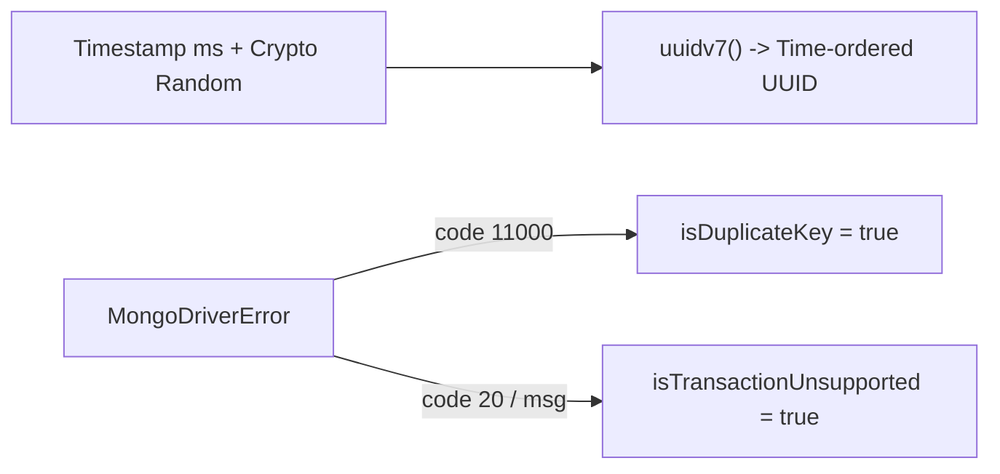

# common/utils — Tiện ích Sinh Khóa Chính UUIDv7 & Phân loại Lỗi MongoDB

- **Motivation/Background**: Cung cấp tài liệu đặc tả tự chứa ngay tại `backend_rag/src/common/utils/` theo yêu cầu chuẩn hóa kiến trúc, giúp người đọc nắm bắt nhanh mục đích thư mục, trách nhiệm từng file và luồng nghiệp vụ mà không phải dò thủ công toàn bộ mã nguồn.
- **Purpose**: Cung cấp bộ sinh và kiểm tra định dạng **UUIDv7** (đơn điệu theo thời gian 48-bit ms timestamp + bit ngẫu nhiên) làm khóa chính cho `chat_sessions` và `chat_messages`, cùng bộ nhận diện mã lỗi MongoDB E11000 (`isDuplicateKey`) và môi trường không có Replica Set (`isTransactionUnsupported`).
- **Overview Pipeline**: `uuidv7()` tạo chuỗi định danh có thể sắp xếp tự nhiên theo thời gian mà... -> `isUuid()` kiểm tra định dạng UUID chặt chẽ ở biên service/API -> `isDuplicateKey()` và `isTransactionUnsupported()` giúp service xử lý xung....
- **Detailed Plan**: Mục 1 định nghĩa phạm vi & vai trò; Mục 2 liệt kê cấu trúc thư mục con và danh mục file/export thực tế; Mục 3 mô tả chức năng, luồng nghiệp vụ kèm sơ đồ Mermaid; Mục 4 quy định hợp đồng I/O, bất biến hệ thống và lệnh kiểm chứng.
- **References**: [AGENTS.md](../../../AGENTS.md).
- **Created**: 2026-11-15T12:55:00+07:00
- **Last Updated**: 2026-11-15T12:55:00+07:00

[STATUS: ACTIVE]

---
## 1. Mục đích & Phạm vi Thư mục (Directory Scope & Architectural Role)

Cung cấp bộ sinh và kiểm tra định dạng **UUIDv7** (đơn điệu theo thời gian 48-bit ms timestamp + bit ngẫu nhiên) làm khóa chính cho `chat_sessions` và `chat_messages`, cùng bộ nhận diện mã lỗi MongoDB E11000 (`isDuplicateKey`) và môi trường không có Replica Set (`isTransactionUnsupported`).

---

## 2. Đặc tả Kỹ thuật & Danh mục File (Technical Specification)

### 2.2. Danh mục File & Ký hiệu Kỹ thuật (File & Symbol Inventory)

| File | Loại / Tầng | Exports / Routes / Ký hiệu Chính | Mô tả Trách nhiệm |
| :--- | :--- | :--- | :--- |
| [`index.ts`](index.ts) | Barrel Export | Re-exports: `./mongo-errors`, `./uuid` | Barrel thống nhất điểm import công khai của thư mục |
| [`mongo-errors.ts`](mongo-errors.ts) | TypeScript Module | `isDuplicateKey`, `isTransactionUnsupported` | Duplicate key error of a unique index (E11000). |
| [`uuid.spec.ts`](uuid.spec.ts) | Jest Integration/Unit Spec | - | Bộ kiểm thử tự động xác minh hành vi cho `backend_rag/src/common/utils`. |
| [`uuid.ts`](uuid.ts) | TypeScript Module | `UUID_RE`, `isUuid`, `uuidv7` | UUID v7 (RFC 9562): 48-bit unix ms timestamp, then random bits. |

---

## 3. Mô tả Chức năng & Luồng Nghiệp vụ (Business Flow)

1. `uuidv7()` tạo chuỗi định danh có thể sắp xếp tự nhiên theo thời gian mà không lộ ObjectId tuần tự.
2. `isUuid()` kiểm tra định dạng UUID chặt chẽ ở biên service/API.
3. `isDuplicateKey()` và `isTransactionUnsupported()` giúp service xử lý xung đột khóa và fallback giao dịch sạch sẽ.



---

## 4. Hợp đồng Đầu vào / Đầu ra, Bất biến & Kiểm chứng

- **Đầu vào (Inputs)**: Timestamp tùy chọn cho UUIDv7 hoặc đối tượng exception từ Mongoose/MongoDB driver.
- **Đầu ra & Tác động (Outputs / Side Effects)**: Chuỗi UUIDv7 hợp chuẩn RFC 9562 và boolean phân loại lỗi database.

### Bất biến & Quy tắc Kiến trúc (System Invariants)
- `chat_sessions._id` và `chat_messages._id` bắt buộc là chuỗi UUIDv7 do tầng ứng dụng sinh, không dùng MongoDB `ObjectId`.

### Lệnh Kiểm chứng (Verification)
```powershell
cd backend_rag && npx jest src/common/utils/uuid.spec.ts --runInBand
```
