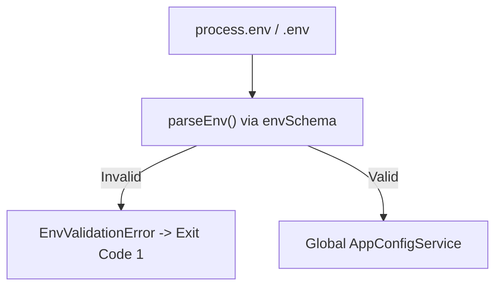

# src/config — Xác thực Biến Môi trường (Zod) & ConfigService Có Kiểu

- **Motivation/Background**: Cung cấp tài liệu đặc tả tự chứa ngay tại `backend_rag/src/config/` theo yêu cầu chuẩn hóa kiến trúc, giúp người đọc nắm bắt nhanh mục đích thư mục, trách nhiệm từng file và luồng nghiệp vụ mà không phải dò thủ công toàn bộ mã nguồn.
- **Purpose**: Validate toàn bộ biến môi trường lúc khởi động bằng `envSchema` (`zod`) để ứng dụng dừng ngay (fail-fast exit 1) nếu thiếu hoặc sai định dạng thông số tối quan trọng, sau đó cung cấp qua `AppConfigService` toàn cục.
- **Overview Pipeline**: `parseEnv(process.env)` chạy kiểm tra độ dài khóa `JWT_*_SECRET >= 32`, định... -> Nếu có lỗi, ném `EnvValidationError` liệt kê rõ từng biến sai -> `AppConfigModule` đăng ký global `AppConfigService` cho toàn bộ engine và....
- **Detailed Plan**: Mục 1 định nghĩa phạm vi & vai trò; Mục 2 liệt kê cấu trúc thư mục con và danh mục file/export thực tế; Mục 3 mô tả chức năng, luồng nghiệp vụ kèm sơ đồ Mermaid; Mục 4 quy định hợp đồng I/O, bất biến hệ thống và lệnh kiểm chứng.
- **References**: [AGENTS.md](../../AGENTS.md).
- **Created**: 2026-11-15T12:55:00+07:00
- **Last Updated**: 2026-11-15T12:55:00+07:00

[STATUS: ACTIVE]

---
## 1. Mục đích & Phạm vi Thư mục (Directory Scope & Architectural Role)

Validate toàn bộ biến môi trường lúc khởi động bằng `envSchema` (`zod`) để ứng dụng dừng ngay (fail-fast exit 1) nếu thiếu hoặc sai định dạng thông số tối quan trọng, sau đó cung cấp qua `AppConfigService` toàn cục.

---

## 2. Đặc tả Kỹ thuật & Danh mục File (Technical Specification)

### 2.2. Danh mục File & Ký hiệu Kỹ thuật (File & Symbol Inventory)

| File | Loại / Tầng | Exports / Routes / Ký hiệu Chính | Mô tả Trách nhiệm |
| :--- | :--- | :--- | :--- |
| [`app-config.service.ts`](app-config.service.ts) | Domain Service | `AppConfigService`, `AppConfigModule` | Typed, validated configuration. Built once from process.env at startup. |
| [`env.schema.spec.ts`](env.schema.spec.ts) | Jest Integration/Unit Spec | - | Bộ kiểm thử tự động xác minh hành vi cho `backend_rag/src/config`. |
| [`env.schema.ts`](env.schema.ts) | Mongoose Schema | `envSchema`, `AppConfig`, `EnvValidationError`, `parseEnv` | Placeholders shipped in `.env.example`; forbidden once the app runs for real. |
| [`index.ts`](index.ts) | Barrel Export | Re-exports: `./app-config.service`, `./env.schema` | Barrel thống nhất điểm import công khai của thư mục |

---

## 3. Mô tả Chức năng & Luồng Nghiệp vụ (Business Flow)

1. `parseEnv(process.env)` chạy kiểm tra độ dài khóa `JWT_*_SECRET >= 32`, định dạng URI MongoDB/Qdrant, ngưỡng hàng đợi LLM và các cờ bảo mật.
2. Nếu có lỗi, ném `EnvValidationError` liệt kê rõ từng biến sai.
3. `AppConfigModule` đăng ký global `AppConfigService` cho toàn bộ engine và module sử dụng kiểu an toàn.



---

## 4. Hợp đồng Đầu vào / Đầu ra, Bất biến & Kiểm chứng

- **Đầu vào (Inputs)**: `NodeJS.ProcessEnv` chứa cấu hình MongoDB, Corpus URI, Qdrant, JWT, LLM, World/Mining path.
- **Đầu ra & Tác động (Outputs / Side Effects)**: Đối tượng `AppConfig` bất biến và `AppConfigService` tiêm được ở mọi nơi.

### Bất biến & Quy tắc Kiến trúc (System Invariants)
- Không để lộ khóa bí mật thật vào mã nguồn; `JWT_ACCESS_SECRET` và `JWT_REFRESH_SECRET` bắt buộc >= 32 ký tự.

### Lệnh Kiểm chứng (Verification)
```powershell
cd backend_rag && npx jest src/config/env.schema.spec.ts --runInBand
```
