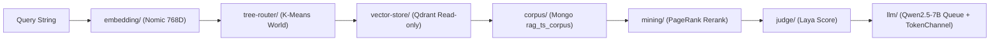

# src/engines — Lớp Động cơ AI, Định tuyến Cây, Tìm kiếm Vector & Kho Tài liệu

- **Motivation/Background**: Cung cấp tài liệu đặc tả tự chứa ngay tại `backend_rag/src/engines/` theo yêu cầu chuẩn hóa kiến trúc, giúp người đọc nắm bắt nhanh mục đích thư mục, trách nhiệm từng file và luồng nghiệp vụ mà không phải dò thủ công toàn bộ mã nguồn.
- **Purpose**: Chứa 7 engine cốt lõi tách biệt khỏi HTTP controller theo kiến trúc Port/Adapter: `corpus` (đọc văn bản bài báo MongoDB), `embedding` (Nomic Embed v1.5 768-D), `tree-router` (định tuyến cây k-means World 3D), `vector-store` (truy vấn Qdrant), `mining` (rerank PageRank tác giả & mở rộng truy vấn), `judge` (chấm điểm liên quan/căn cứ bằng Laya) và `llm` (sinh token GGUF + hàng đợi).
- **Overview Pipeline**: Nhận câu hỏi từ `RagService` -> `TreeRouterService` duyệt phân cấp centroid cây tìm top `nprobe` nhánh phù hợp -> `VectorStoreService` truy vấn ANN trên Qdrant và `CorpusService` tải nội dung....
- **Detailed Plan**: Mục 1 định nghĩa phạm vi & vai trò; Mục 2 liệt kê cấu trúc thư mục con và danh mục file/export thực tế; Mục 3 mô tả chức năng, luồng nghiệp vụ kèm sơ đồ Mermaid; Mục 4 quy định hợp đồng I/O, bất biến hệ thống và lệnh kiểm chứng.
- **References**: [AGENTS.md](../../AGENTS.md).
- **Created**: 2026-11-15T12:55:00+07:00
- **Last Updated**: 2026-11-15T12:55:00+07:00

[STATUS: ACTIVE]

---
## 1. Mục đích & Phạm vi Thư mục (Directory Scope & Architectural Role)

Chứa 7 engine cốt lõi tách biệt khỏi HTTP controller theo kiến trúc Port/Adapter: `corpus` (đọc văn bản bài báo MongoDB), `embedding` (Nomic Embed v1.5 768-D), `tree-router` (định tuyến cây k-means World 3D), `vector-store` (truy vấn Qdrant), `mining` (rerank PageRank tác giả & mở rộng truy vấn), `judge` (chấm điểm liên quan/căn cứ bằng Laya) và `llm` (sinh token GGUF + hàng đợi).

---

## 2. Đặc tả Kỹ thuật & Danh mục File (Technical Specification)

### 2.1. Danh mục Thư mục con (Subdirectories)

| Thư mục con | Liên kết Đặc tả | Vai trò Chính |
| :--- | :--- | :--- |
| **`corpus/`** | [`corpus/README.md`](corpus/README.md) | Cung cấp `CorpusService` (triển khai `CorpusPort`) kết nối tới database `rag_ts_corpus` tách biệt qua `CORPUS_MONGO_URI` để nạp nội dung text chi tiết của từng `ChunkRef` sau khi Qdrant chỉ trả về metadata/vector ID. |
| **`embedding/`** | [`embedding/README.md`](embedding/README.md) | Bao bọc `@huggingface/transformers` tải mô hình `nomic-ai/nomic-embed-text-v1.5` cục bộ khi khởi động module (`OnModuleInit`), tiền xử lý chuỗi câu hỏi với tiền tố `search_query: ` và xuất vector `Float32Array` 768 chiều đã chuẩn hóa. |
| **`judge/`** | [`judge/README.md`](judge/README.md) | Triển khai `JudgeService` sử dụng mô hình ngôn ngữ nhỏ **Laya** (`@receptron/laya`) chạy nền để chấm điểm mức độ liên quan (relevance) giữa câu hỏi và đoạn văn bản, cũng như mức độ có căn cứ (groundedness) của câu trả lời so với trích dẫn. |
| **`llm/`** | [`llm/README.md`](llm/README.md) | Quản lý vòng đời mô hình GGUF (`Qwen2.5-7B`) thông qua `NodeLlamaEngine`, điều tiết đồng thời bằng `LlmQueue` (trả HTTP 429 khi hàng đợi đầy, HTTP 504 khi timeout) và truyền token bất đồng bộ `AsyncIterable<string>` qua `TokenChannel` cho luồng SSE. |
| **`mining/`** | [`mining/README.md`](mining/README.md) | Cung cấp `MiningService` nạp 2 artifact khai phá từ `MINING_DIR`: đồ thị đồng tác giả (`graph_coauthorship.json`) để tính điểm uy tín `authorityOf` và tập luật kết hợp (`association_rules.json`) để mở rộng câu hỏi `expandTerms` trước khi tìm kiếm kết hợp RRF (`rerank`). |
| **`tree-router/`** | [`tree-router/README.md`](tree-router/README.md) | Nạp cấu trúc cây phân cấp (`tree.json`, `centroids_l1.json`, `centroids_l2.json`, `categories.json`) từ `WORLD_DATA_DIR`, tính điểm cosine tại từng tầng của cây 3D để chọn tối đa `nprobe` nhánh (`1..6`) hẹp phạm vi tìm kiếm trên Qdrant và trả dữ liệu `route` trực quan hóa quả cầu bay cho Frontend 3D. |
| **`vector-store/`** | [`vector-store/README.md`](vector-store/README.md) | Quản lý kết nối tới cụm Qdrant qua `@qdrant/js-client-rest` (tự động nhận diện `https: true` nếu cổng `443` theo `D-004`), thực hiện tìm kiếm vector ANN có lọc theo `categories`, khoảng `year` hoặc danh sách nhánh, đồng thời hỗ trợ tìm kiếm toàn văn các chunk thuộc một `paper_id` cụ thể. |

### 2.2. Danh mục File & Ký hiệu Kỹ thuật (File & Symbol Inventory)

| File | Loại / Tầng | Exports / Routes / Ký hiệu Chính | Mô tả Trách nhiệm |
| :--- | :--- | :--- | :--- |
| [`index.ts`](index.ts) | Barrel Export | Re-exports: `./corpus`, `./embedding`, `./judge`, `./llm`, `./mining`, `./tree-router` (+1) | Barrel thống nhất điểm import công khai của thư mục |

---

## 3. Mô tả Chức năng & Luồng Nghiệp vụ (Business Flow)

1. Nhận câu hỏi từ `RagService`: `EmbeddingService` chuyển text thành vector 768 chiều.
2. `TreeRouterService` duyệt phân cấp centroid cây (`L1` -> `L2`) tìm top `nprobe` nhánh phù hợp.
3. `VectorStoreService` truy vấn ANN trên Qdrant và `CorpusService` tải nội dung chunk thật từ `rag_ts_corpus`.
4. `MiningService` tính lại điểm `0.85 * cosine + 0.15 * authority` (RRF khi bật expansion), `JudgeService` chấm điểm grounding và `LlmService` sinh câu trả lời SSE.



---

## 4. Hợp đồng Đầu vào / Đầu ra, Bất biến & Kiểm chứng

- **Đầu vào (Inputs)**: Truy vấn người dùng, vector 768 chiều, các file artifact `WORLD_DATA_DIR`, `MINING_DIR`, model GGUF/HF.
- **Đầu ra & Tác động (Outputs / Side Effects)**: Kết quả định tuyến cây, danh sách chunk đã chấm điểm, phán quyết Judge và luồng token SSE.

### Bất biến & Quy tắc Kiến trúc (System Invariants)
- Mọi Engine giao tiếp với tầng `modules/` thông qua Token Port (`Symbol`) giúp thay thế mock cleanly trong Unit/E2E tests.
- Qdrant (`scientific_papers_gold`) và Mongo `rag_ts_corpus` tuyệt đối chỉ đọc (`D-058`).

### Lệnh Kiểm chứng (Verification)
```powershell
cd backend_rag && npx jest src/engines --runInBand
```
