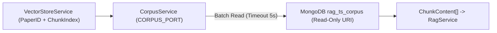

# engines/corpus — Bộ Đọc Kho Văn bản Gốc Chỉ Đọc (rag_ts_corpus)

- **Motivation/Background**: Cung cấp tài liệu đặc tả tự chứa ngay tại `backend_rag/src/engines/corpus/` theo yêu cầu chuẩn hóa kiến trúc, giúp người đọc nắm bắt nhanh mục đích thư mục, trách nhiệm từng file và luồng nghiệp vụ mà không phải dò thủ công toàn bộ mã nguồn.
- **Purpose**: Cung cấp `CorpusService` (triển khai `CorpusPort`) kết nối tới database `rag_ts_corpus` tách biệt qua `CORPUS_MONGO_URI` để nạp nội dung text chi tiết của từng `ChunkRef` sau khi Qdrant chỉ trả về metadata/vector ID.
- **Overview Pipeline**: `CorpusModule` tạo kết nối Mongoose thứ hai mang tên `'corpus'` với tài khoản... -> `CorpusService` nhận danh sách `(paper_id, chunk_index)` từ Qdrant và truy... -> Ánh xạ tài liệu trả về thành `ChunkContent` đầy đủ đoạn văn bản gốc cho bước....
- **Detailed Plan**: Mục 1 định nghĩa phạm vi & vai trò; Mục 2 liệt kê cấu trúc thư mục con và danh mục file/export thực tế; Mục 3 mô tả chức năng, luồng nghiệp vụ kèm sơ đồ Mermaid; Mục 4 quy định hợp đồng I/O, bất biến hệ thống và lệnh kiểm chứng.
- **References**: [AGENTS.md](../../../AGENTS.md), [vector-store/README.md](../vector-store/README.md).
- **Created**: 2026-11-15T12:55:00+07:00
- **Last Updated**: 2026-11-17T17:48:00+07:00

[STATUS: ACTIVE]

---
## 1. Mục đích & Phạm vi Thư mục (Directory Scope & Architectural Role)

Cung cấp `CorpusService` (triển khai `CorpusPort`) kết nối tới database `rag_ts_corpus` tách biệt qua `CORPUS_MONGO_URI` để nạp nội dung text chi tiết của từng `ChunkRef` sau khi Qdrant chỉ trả về metadata/vector ID.

---

## 2. Đặc tả Kỹ thuật & Danh mục File (Technical Specification)

### 2.2. Danh mục File & Ký hiệu Kỹ thuật (File & Symbol Inventory)

| File | Loại / Tầng | Exports / Routes / Ký hiệu Chính | Mô tả Trách nhiệm |
| :--- | :--- | :--- | :--- |
| [`corpus.module.ts`](corpus.module.ts) | NestJS Module | `CorpusModule` | Module NestJS khai báo imports, providers và exports DI. |
| [`corpus.service.spec.ts`](corpus.service.spec.ts) | Jest Unit Spec | - | Kiểm thử kết nối read-only, kiểm tra quyền role, hydrate chunks/papers và ném 503 `CORPUS_UNAVAILABLE`. |
| [`corpus.service.ts`](corpus.service.ts) | Domain Service | `CORPUS_UNAVAILABLE`, `CORPUS_DB`, `CORPUS_TIMEOUT_MS`, `ChunkContent`, `ChunkRef`, `CorpusPort`, `CORPUS_PORT` (+1) | What a Qdrant point no longer carries; MongoDB `rag_ts_corpus` is its source of truth. |
| [`index.ts`](index.ts) | Barrel Export | Re-exports: `./corpus.module`, `./corpus.service` | Barrel thống nhất điểm import công khai của thư mục |

---

## 3. Mô tả Chức năng & Luồng Nghiệp vụ (Business Flow)

1. `CorpusModule` tạo kết nối Mongoose thứ hai mang tên `'corpus'` với tài khoản read-only (`D-058`).
2. `CorpusService` nhận danh sách `(paper_id, chunk_index)` từ Qdrant và truy vấn song song/batch với timeout `CORPUS_TIMEOUT_MS = 5000ms`.
3. Ánh xạ tài liệu trả về thành `ChunkContent` đầy đủ đoạn văn bản gốc cho bước rerank và prompt builder.



---

## 4. Hợp đồng Đầu vào / Đầu ra, Bất biến & Kiểm chứng

- **Đầu vào (Inputs)**: Danh sách `ChunkRef` (`paper_id`, `chunk_index`) và chuỗi kết nối `CORPUS_MONGO_URI`.
- **Đầu ra & Tác động (Outputs / Side Effects)**: Mảng hoặc Map `ChunkContent` chứa toàn văn đoạn trích khoa học.

### Bất biến & Quy tắc Kiến trúc (System Invariants)
- `rag_ts_corpus` là chỉ đọc từ app thông qua `CORPUS_MONGO_URI` với tài khoản không phải root (`D-058`).

### Lệnh Kiểm chứng (Verification)
```powershell
cd backend_rag && npx jest src/engines/corpus/corpus.service.spec.ts --runInBand
```
