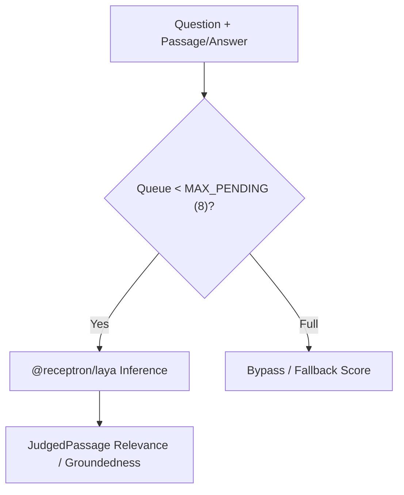

# engines/judge — Động cơ Đánh giá Grounding & Relevance (Laya SLM)

- **Motivation/Background**: Cung cấp tài liệu đặc tả tự chứa ngay tại `backend_rag/src/engines/judge/` theo yêu cầu chuẩn hóa kiến trúc, giúp người đọc nắm bắt nhanh mục đích thư mục, trách nhiệm từng file và luồng nghiệp vụ mà không phải dò thủ công toàn bộ mã nguồn.
- **Purpose**: Triển khai `JudgeService` sử dụng mô hình ngôn ngữ nhỏ **Laya** (`@receptron/laya`) chạy nền để chấm điểm mức độ liên quan (relevance) giữa câu hỏi và đoạn văn bản, cũng như mức độ có căn cứ (groundedness) của câu trả lời so với trích dẫn.
- **Overview Pipeline**: Nhận yêu cầu chấm điểm kèm kiểm soát độ dài tối đa và giới hạn hàng đợi... -> Đặt câu hỏi nhị phân `RELEVANCE_QUESTION` hoặc `GROUNDEDNESS_QUESTION` lên... -> Khi hủy module , giải phóng gọn tài nguyên mô hình Laya.
- **Detailed Plan**: Mục 1 định nghĩa phạm vi & vai trò; Mục 2 liệt kê cấu trúc thư mục con và danh mục file/export thực tế; Mục 3 mô tả chức năng, luồng nghiệp vụ kèm sơ đồ Mermaid; Mục 4 quy định hợp đồng I/O, bất biến hệ thống và lệnh kiểm chứng.
- **References**: [llm/README.md](../llm/README.md), [AGENTS.md](../../../AGENTS.md).
- **Created**: 2026-11-15T12:55:00+07:00
- **Last Updated**: 2026-11-15T12:55:00+07:00

[STATUS: ACTIVE]

---
## 1. Mục đích & Phạm vi Thư mục (Directory Scope & Architectural Role)

Triển khai `JudgeService` sử dụng mô hình ngôn ngữ nhỏ **Laya** (`@receptron/laya`) chạy nền để chấm điểm mức độ liên quan (relevance) giữa câu hỏi và đoạn văn bản, cũng như mức độ có căn cứ (groundedness) của câu trả lời so với trích dẫn.

---

## 2. Đặc tả Kỹ thuật & Danh mục File (Technical Specification)

### 2.2. Danh mục File & Ký hiệu Kỹ thuật (File & Symbol Inventory)

| File | Loại / Tầng | Exports / Routes / Ký hiệu Chính | Mô tả Trách nhiệm |
| :--- | :--- | :--- | :--- |
| [`index.ts`](index.ts) | Barrel Export | Re-exports: `./judge.module`, `./judge.service` | Barrel thống nhất điểm import công khai của thư mục |
| [`judge.module.ts`](judge.module.ts) | NestJS Module | `JudgeModule` | Module NestJS khai báo imports, providers và exports DI. |
| [`judge.service.spec.ts`](judge.service.spec.ts) | Jest Integration/Unit Spec | - | Bộ kiểm thử tự động xác minh hành vi cho `backend_rag/src/engines/judge`. |
| [`judge.service.ts`](judge.service.ts) | Domain Service | `JudgedPassage`, `JudgePort`, `JUDGE_PORT`, `LayaModel`, `RELEVANCE_QUESTION`, `GROUNDEDNESS_QUESTION`, `MAX_ANSWER_CHARS` (+3) | The part of a chunk the judge reads. |

---

## 3. Mô tả Chức năng & Luồng Nghiệp vụ (Business Flow)

1. Nhận yêu cầu chấm điểm kèm kiểm soát độ dài tối đa (`MAX_ANSWER_CHARS=900`, `MAX_PASSAGE_CHARS=1100`) và giới hạn hàng đợi `MAX_PENDING=8`.
2. Đặt câu hỏi nhị phân `RELEVANCE_QUESTION` hoặc `GROUNDEDNESS_QUESTION` lên Laya và lấy xác suất Yes/No.
3. Khi hủy module (`OnModuleDestroy`), giải phóng gọn tài nguyên mô hình Laya.



---

## 4. Hợp đồng Đầu vào / Đầu ra, Bất biến & Kiểm chứng

- **Đầu vào (Inputs)**: Câu hỏi người dùng, các đoạn `ScoredChunk` ứng viên và câu trả lời LLM.
- **Đầu ra & Tác động (Outputs / Side Effects)**: Điểm xác suất liên quan / có căn cứ (`JudgedPassage`) giúp lọc ảo giác trích dẫn.

### Bất biến & Quy tắc Kiến trúc (System Invariants)
- Hàng đợi Laya bị chặn bởi `MAX_PENDING = 8` và giới hạn ký tự đầu vào nhằm bảo vệ độ trễ hệ thống.

### Lệnh Kiểm chứng (Verification)
```powershell
cd backend_rag && npx jest src/engines/judge/judge.service.spec.ts --runInBand
```
