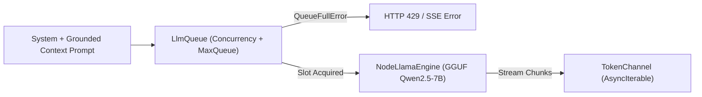

# engines/llm — Engine Sinh Ngôn ngữ Cục bộ (node-llama-cpp), Hàng đợi Backpressure & TokenChannel

- **Motivation/Background**: Cung cấp tài liệu đặc tả tự chứa ngay tại `backend_rag/src/engines/llm/` theo yêu cầu chuẩn hóa kiến trúc, giúp người đọc nắm bắt nhanh mục đích thư mục, trách nhiệm từng file và luồng nghiệp vụ mà không phải dò thủ công toàn bộ mã nguồn.
- **Purpose**: Quản lý vòng đời mô hình GGUF (`Qwen2.5-7B`) thông qua `NodeLlamaEngine`, điều tiết đồng thời bằng `LlmQueue` (trả HTTP 429 khi hàng đợi đầy, HTTP 504 khi timeout) và truyền token bất đồng bộ `AsyncIterable<string>` qua `TokenChannel` cho luồng SSE.
- **Overview Pipeline**: `LlmService` nạp file `.gguf` từ `MODEL_PATH` khi khởi động với cấu hình GPU... -> `LlmQueue` giới hạn số lượt sinh song song và kích thước chờ , tôn trọng... -> `NodeLlamaEngine` sinh token tuần tự đẩy vào `TokenChannel` đến khi hoàn tất....
- **Detailed Plan**: Mục 1 định nghĩa phạm vi & vai trò; Mục 2 liệt kê cấu trúc thư mục con và danh mục file/export thực tế; Mục 3 mô tả chức năng, luồng nghiệp vụ kèm sơ đồ Mermaid; Mục 4 quy định hợp đồng I/O, bất biến hệ thống và lệnh kiểm chứng.
- **References**: [rag/README.md](../../modules/rag/README.md), [AGENTS.md](../../../AGENTS.md).
- **Created**: 2026-11-15T12:55:00+07:00
- **Last Updated**: 2026-11-15T12:55:00+07:00

[STATUS: ACTIVE]

---
## 1. Mục đích & Phạm vi Thư mục (Directory Scope & Architectural Role)

Quản lý vòng đời mô hình GGUF (`Qwen2.5-7B`) thông qua `NodeLlamaEngine`, điều tiết đồng thời bằng `LlmQueue` (trả HTTP 429 khi hàng đợi đầy, HTTP 504 khi timeout) và truyền token bất đồng bộ `AsyncIterable<string>` qua `TokenChannel` cho luồng SSE.

---

## 2. Đặc tả Kỹ thuật & Danh mục File (Technical Specification)

### 2.2. Danh mục File & Ký hiệu Kỹ thuật (File & Symbol Inventory)

| File | Loại / Tầng | Exports / Routes / Ký hiệu Chính | Mô tả Trách nhiệm |
| :--- | :--- | :--- | :--- |
| [`index.ts`](index.ts) | Barrel Export | Re-exports: `./llm-engine`, `./llm-queue`, `./llm.module`, `./llm.service`, `./token-channel` | Barrel thống nhất điểm import công khai của thư mục |
| [`llm-engine.ts`](llm-engine.ts) | TypeScript Module | `GenerateOptions`, `LlmEngine`, `LLM_ENGINE`, `NodeLlamaOptions`, `NodeLlamaEngine` | The model runtime behind LlmService; a fake one is used in tests. |
| [`llm-queue.ts`](llm-queue.ts) | TypeScript Module | `QueueFullError`, `AbortedError`, `Release`, `LlmQueue` | Thrown when every slot is busy and the waiting line is full. |
| [`llm.module.ts`](llm.module.ts) | NestJS Module | `LlmModule` | Module NestJS khai báo imports, providers và exports DI. |
| [`llm.service.ts`](llm.service.ts) | Domain Service | `LLM_UNAVAILABLE`, `LLM_QUEUE_FULL`, `LLM_TIMEOUT`, `TEMPERATURE`, `MAX_TOKENS`, `LlmStatus`, `LlmPort` (+3) | Cài đặt logic nghiệp vụ cốt lõi và tích hợp lưu trữ/engine. |
| [`llm.spec.ts`](llm.spec.ts) | Jest Integration/Unit Spec | - | Bộ kiểm thử tự động xác minh hành vi cho `backend_rag/src/engines/llm`. |
| [`token-channel.ts`](token-channel.ts) | TypeScript Module | `TokenChannel` | Turns a callback producer (`push`, then `close` or `fail`) into an async iterator. Tokens pushed before the consumer asks are buffered in order. |

---

## 3. Mô tả Chức năng & Luồng Nghiệp vụ (Business Flow)

1. `LlmService` nạp file `.gguf` từ `MODEL_PATH` khi khởi động với cấu hình GPU `LLM_GPU` (`auto`/`cuda`/`metal`/`vulkan`).
2. `LlmQueue` giới hạn số lượt sinh song song (`LLM_CONCURRENCY`) và kích thước chờ (`LLM_MAX_QUEUE`), tôn trọng `AbortSignal` từ client.
3. `NodeLlamaEngine` sinh token tuần tự đẩy vào `TokenChannel` (backpressure async iterable) đến khi hoàn tất hoặc `LLM_TIMEOUT_MS`.



---

## 4. Hợp đồng Đầu vào / Đầu ra, Bất biến & Kiểm chứng

- **Đầu vào (Inputs)**: System prompt, User prompt, `temperature=0.2`, `maxTokens=1024`, `AbortSignal`.
- **Đầu ra & Tác động (Outputs / Side Effects)**: Luồng token văn bản tiếng Việt/Anh qua `TokenChannel` và trạng thái sức khỏe `LlmStatus`.

### Bất biến & Quy tắc Kiến trúc (System Invariants)
- Hủy SSE giữa chừng kích hoạt `AbortSignal` giải phóng slot hàng đợi ngay khi vòng lặp token tiếp nhận signal.

### Lệnh Kiểm chứng (Verification)
```powershell
cd backend_rag && npx jest src/engines/llm/llm.spec.ts --runInBand
```
