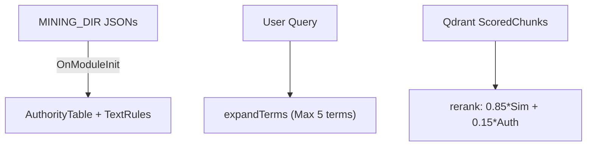

# engines/mining — Khai phá Tri thức: PageRank Tác giả & Luật Kết hợp Mở rộng Truy vấn

- **Motivation/Background**: Cung cấp tài liệu đặc tả tự chứa ngay tại `backend_rag/src/engines/mining/` theo yêu cầu chuẩn hóa kiến trúc, giúp người đọc nắm bắt nhanh mục đích thư mục, trách nhiệm từng file và luồng nghiệp vụ mà không phải dò thủ công toàn bộ mã nguồn.
- **Purpose**: Cung cấp `MiningService` nạp 2 artifact khai phá từ `MINING_DIR`: đồ thị đồng tác giả (`graph_coauthorship.json`) để tính điểm uy tín `authorityOf` và tập luật kết hợp (`association_rules.json`) để mở rộng câu hỏi `expandTerms` trước khi tìm kiếm kết hợp RRF (`rerank`).
- **Overview Pipeline**: `OnModuleInit` nạp `AuthorityTable` và danh sách `TextRule[]` -> `expandTerms(query, rules)` token hóa truy vấn và đối chiếu cụm từ tìm tối đa... -> `rerank()` kết hợp độ tương đồng cosine và độ uy tín tác giả theo trọng số cố....
- **Detailed Plan**: Mục 1 định nghĩa phạm vi & vai trò; Mục 2 liệt kê cấu trúc thư mục con và danh mục file/export thực tế; Mục 3 mô tả chức năng, luồng nghiệp vụ kèm sơ đồ Mermaid; Mục 4 quy định hợp đồng I/O, bất biến hệ thống và lệnh kiểm chứng.
- **References**: [pipeline/README.md](../../modules/rag/pipeline/README.md), [src/README.md](../../README.md), [AGENTS.md](../../../AGENTS.md).
- **Created**: 2026-11-15T12:55:00+07:00
- **Last Updated**: 2026-11-15T12:55:00+07:00

[STATUS: ACTIVE]

---
## 1. Mục đích & Phạm vi Thư mục (Directory Scope & Architectural Role)

Cung cấp `MiningService` nạp 2 artifact khai phá từ `MINING_DIR`: đồ thị đồng tác giả (`graph_coauthorship.json`) để tính điểm uy tín `authorityOf` và tập luật kết hợp (`association_rules.json`) để mở rộng câu hỏi `expandTerms` trước khi tìm kiếm kết hợp RRF (`rerank`).

---

## 2. Đặc tả Kỹ thuật & Danh mục File (Technical Specification)

### 2.2. Danh mục File & Ký hiệu Kỹ thuật (File & Symbol Inventory)

| File | Loại / Tầng | Exports / Routes / Ký hiệu Chính | Mô tả Trách nhiệm |
| :--- | :--- | :--- | :--- |
| [`index.ts`](index.ts) | Barrel Export | Re-exports: `./mining.module`, `./mining.service`, `./name-normalizer` | Barrel thống nhất điểm import công khai của thư mục |
| [`mining.module.ts`](mining.module.ts) | NestJS Module | `MiningModule` | Module NestJS khai báo imports, providers và exports DI. |
| [`mining.service.spec.ts`](mining.service.spec.ts) | Jest Integration/Unit Spec | - | Bộ kiểm thử tự động xác minh hành vi cho `backend_rag/src/engines/mining`. |
| [`mining.service.ts`](mining.service.ts) | Domain Service | `SIMILARITY_WEIGHT`, `AUTHORITY_WEIGHT`, `MAX_EXPANSION_TERMS`, `TextRule`, `AuthorityTable`, `round4`, `parseAuthority` (+7) | A rule whose antecedents and consequents are word sequences (already tokenized). |
| [`name-normalizer.ts`](name-normalizer.ts) | TypeScript Module | `normalizeName`, `tokenize` | Canonical author name for exact matching: lowercase, accents removed, "et al." and anything in parentheses dropped, punctuation and whitespace... |

---

## 3. Mô tả Chức năng & Luồng Nghiệp vụ (Business Flow)

1. `OnModuleInit` nạp `AuthorityTable` (đã chuẩn hóa tên tác giả qua `name-normalizer.ts`) và danh sách `TextRule[]`.
2. `expandTerms(query, rules)` token hóa truy vấn và đối chiếu cụm từ (`containsPhrase`) tìm tối đa `MAX_EXPANSION_TERMS = 5` thuật ngữ mở rộng.
3. `rerank()` kết hợp độ tương đồng cosine và độ uy tín tác giả theo trọng số cố định `0.85 * similarity + 0.15 * authority`.



---

## 4. Hợp đồng Đầu vào / Đầu ra, Bất biến & Kiểm chứng

- **Đầu vào (Inputs)**: Tệp JSON từ `MINING_DIR`, câu hỏi văn bản và mảng ứng viên `ScoredChunk`.
- **Đầu ra & Tác động (Outputs / Side Effects)**: Danh sách cụm từ mở rộng `string[]` và mảng chunk đã được xếp hạng lại theo công thức chuẩn.

### Bất biến & Quy tắc Kiến trúc (System Invariants)
- Trọng số xếp hạng cố định `SIMILARITY_WEIGHT = 0.85`, `AUTHORITY_WEIGHT = 0.15`, tối đa `MAX_EXPANSION_TERMS = 5`.

### Lệnh Kiểm chứng (Verification)
```powershell
cd backend_rag && npx jest src/engines/mining/mining.service.spec.ts --runInBand
```
