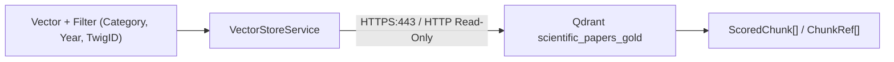

# engines/vector-store — Adapter Truy vấn Qdrant Chỉ Đọc (scientific_papers_gold)

- **Motivation/Background**: Cung cấp tài liệu đặc tả tự chứa ngay tại `backend_rag/src/engines/vector-store/` theo yêu cầu chuẩn hóa kiến trúc, giúp người đọc nắm bắt nhanh mục đích thư mục, trách nhiệm từng file và luồng nghiệp vụ mà không phải dò thủ công toàn bộ mã nguồn.
- **Purpose**: Quản lý kết nối tới cụm Qdrant qua `@qdrant/js-client-rest` (tự động nhận diện `https: true` nếu cổng `443` theo `D-004`), thực hiện tìm kiếm vector ANN có lọc theo `categories`, khoảng `year` hoặc danh sách nhánh, đồng thời hỗ trợ tìm kiếm toàn văn các chunk thuộc một `paper_id` cụ thể.
- **Overview Pipeline**: Khởi tạo `QdrantClient` kiểm tra collection `QDRANT_COLLECTION` với timeout... -> `search(vector, options)` gửi truy vấn Qdrant kèm bộ lọc payload, tự động thử... -> Chuyển đổi payload Qdrant qua `toChunkPayload` / `toChunkRef` rồi chuyển tiếp....
- **Detailed Plan**: Mục 1 định nghĩa phạm vi & vai trò; Mục 2 liệt kê cấu trúc thư mục con và danh mục file/export thực tế; Mục 3 mô tả chức năng, luồng nghiệp vụ kèm sơ đồ Mermaid; Mục 4 quy định hợp đồng I/O, bất biến hệ thống và lệnh kiểm chứng.
- **References**: [AGENTS.md](../../../AGENTS.md), [corpus/README.md](../corpus/README.md).
- **Created**: 2026-11-15T12:55:00+07:00
- **Last Updated**: 2026-11-15T12:55:00+07:00

[STATUS: ACTIVE]

---
## 1. Mục đích & Phạm vi Thư mục (Directory Scope & Architectural Role)

Quản lý kết nối tới cụm Qdrant qua `@qdrant/js-client-rest` (tự động nhận diện `https: true` nếu cổng `443` theo `D-004`), thực hiện tìm kiếm vector ANN có lọc theo `categories`, khoảng `year` hoặc danh sách nhánh, đồng thời hỗ trợ tìm kiếm toàn văn các chunk thuộc một `paper_id` cụ thể.

---

## 2. Đặc tả Kỹ thuật & Danh mục File (Technical Specification)

### 2.2. Danh mục File & Ký hiệu Kỹ thuật (File & Symbol Inventory)

| File | Loại / Tầng | Exports / Routes / Ký hiệu Chính | Mô tả Trách nhiệm |
| :--- | :--- | :--- | :--- |
| [`index.ts`](index.ts) | Barrel Export | Re-exports: `./vector-store.module`, `./vector-store.service` | Barrel thống nhất điểm import công khai của thư mục |
| [`vector-store.module.ts`](vector-store.module.ts) | NestJS Module | `VectorStoreModule` | Module NestJS khai báo imports, providers và exports DI. |
| [`vector-store.service.spec.ts`](vector-store.service.spec.ts) | Jest Integration/Unit Spec | - | Bộ kiểm thử tự động xác minh hành vi cho `backend_rag/src/engines/vector-store`. |
| [`vector-store.service.ts`](vector-store.service.ts) | Domain Service | `QDRANT_UNAVAILABLE`, `MAX_CHUNKS_PER_PAPER`, `QDRANT_TIMEOUT_MS`, `CATEGORY_RE`, `QdrantReader`, `QDRANT_CLIENT`, `SearchOptions` (+6) | arXiv-style category code, e.g. `cs.LG`, `stat.ML`, `math-ph`. |

---

## 3. Mô tả Chức năng & Luồng Nghiệp vụ (Business Flow)

1. Khởi tạo `QdrantClient` kiểm tra collection `QDRANT_COLLECTION` (mặc định `scientific_papers_gold`) với timeout `15000ms`.
2. `search(vector, options)` gửi truy vấn Qdrant kèm bộ lọc payload, tự động thử lại nếu gặp lỗi kết nối `isStaleSocket`.
3. Chuyển đổi payload Qdrant qua `toChunkPayload` / `toChunkRef` rồi chuyển tiếp cho `CorpusService` lấy văn bản nếu cần.



---

## 4. Hợp đồng Đầu vào / Đầu ra, Bất biến & Kiểm chứng

- **Đầu vào (Inputs)**: Vector 768-D, `SearchOptions` (`top_k`, `categories`, `year_min/max`, `twig_ids`) hoặc `paper_id`.
- **Đầu ra & Tác động (Outputs / Side Effects)**: Danh sách `ScoredChunk` hoặc toàn bộ `ChunkPayload[]` của một bài báo (tối đa `MAX_CHUNKS_PER_PAPER = 500`).

### Bất biến & Quy tắc Kiến trúc (System Invariants)
- Tuyệt đối **chỉ đọc** trên `scientific_papers_gold`; không bao giờ drop, tạo lại hay đột biến collection từ `backend_rag` (`D-004`).

### Lệnh Kiểm chứng (Verification)
```powershell
cd backend_rag && npx jest src/engines/vector-store/vector-store.service.spec.ts --runInBand
```
