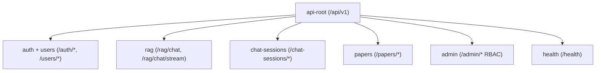

# src/modules — Lớp Các Feature HTTP Modules (REST & SSE Endpoints)

- **Motivation/Background**: Cung cấp tài liệu đặc tả tự chứa ngay tại `backend_rag/src/modules/` theo yêu cầu chuẩn hóa kiến trúc, giúp người đọc nắm bắt nhanh mục đích thư mục, trách nhiệm từng file và luồng nghiệp vụ mà không phải dò thủ công toàn bộ mã nguồn.
- **Purpose**: Chứa 7 module nghiệp vụ cấu thành toàn bộ bề mặt API `/api/v1`: `api-root` (điểm vào HATEOAS), `auth` (JWT/Argon2id/Refresh Rotation), `users` (tài khoản cá nhân), `chat-sessions` (quản lý lịch sử UUIDv7 + Idempotency), `rag` (pipeline chat + SSE stream), `papers` (tra cứu chi tiết bài báo), `health` (kiểm tra phụ thuộc nền) và `admin` (RBAC quản trị & audit log).
- **Overview Pipeline**: Mỗi module tự đóng gói Controller, Service, DTO validation , Schema Mongoose... -> Các module gọi xuống `src/engines/*` thông qua DI token và sử dụng tiện ích....
- **Detailed Plan**: Mục 1 định nghĩa phạm vi & vai trò; Mục 2 liệt kê cấu trúc thư mục con và danh mục file/export thực tế; Mục 3 mô tả chức năng, luồng nghiệp vụ kèm sơ đồ Mermaid; Mục 4 quy định hợp đồng I/O, bất biến hệ thống và lệnh kiểm chứng.
- **References**: [AGENTS.md](../../AGENTS.md).
- **Created**: 2026-11-15T12:55:00+07:00
- **Last Updated**: 2026-11-15T12:55:00+07:00

[STATUS: ACTIVE]

---
## 1. Mục đích & Phạm vi Thư mục (Directory Scope & Architectural Role)

Chứa 7 module nghiệp vụ cấu thành toàn bộ bề mặt API `/api/v1`: `api-root` (điểm vào HATEOAS), `auth` (JWT/Argon2id/Refresh Rotation), `users` (tài khoản cá nhân), `chat-sessions` (quản lý lịch sử UUIDv7 + Idempotency), `rag` (pipeline chat + SSE stream), `papers` (tra cứu chi tiết bài báo), `health` (kiểm tra phụ thuộc nền) và `admin` (RBAC quản trị & audit log).

---

## 2. Đặc tả Kỹ thuật & Danh mục File (Technical Specification)

### 2.1. Danh mục Thư mục con (Subdirectories)

| Thư mục con | Liên kết Đặc tả | Vai trò Chính |
| :--- | :--- | :--- |
| **`admin/`** | [`admin/README.md`](admin/README.md) | Cung cấp toàn bộ tuyến `/api/v1/admin/*` phục vụ quản trị viên giám sát tài khoản, đổi vai trò (`user`/`admin`), vô hiệu hóa tài khoản, thu hồi gia đình token, kiểm tra phiên chat, xem lịch sử đăng nhập thất bại và tra cứu `admin_audit_logs` bất biến. |
| **`api-root/`** | [`api-root/README.md`](api-root/README.md) | Cung cấp `ApiRootController` trả về tài liệu gốc API cùng bản đồ liên kết HATEOAS (`rootLinks`) giúp client và công cụ kiểm thử khám phá tự động các tài nguyên chính (`/auth`, `/users`, `/rag`, `/chat-sessions`, `/papers`, `/health`). |
| **`auth/`** | [`auth/README.md`](auth/README.md) | Quản lý vòng đời tài khoản và phiên đăng nhập bảo mật cao: đăng ký user (`POST /users`), hồ sơ/đổi mật khẩu (`/users/me`), đăng nhập (`POST /auth/tokens`), xoay vòng token dùng 1 lần 1-RTT phát hiện tái sử dụng (`POST /auth/token-rotations`) và đăng xuất thu hồi gia đình token (`POST /auth/token-revocations`). |
| **`chat-sessions/`** | [`chat-sessions/README.md`](chat-sessions/README.md) | Quản lý lưu trữ, phân trang con trỏ UUIDv7, tìm kiếm, đổi tên và xóa mềm (`deleted_at`) các phiên hội thoại & tin nhắn, đồng thời cung cấp cổng `SessionStorePort` (`ChatSessionsService`) và bộ khóa lũy đẳng `ChatRequestsService` chống lặp/đứt stream SSE khi mạng chập chờn. |
| **`health/`** | [`health/README.md`](health/README.md) | Theo dõi định kỳ (mỗi `10s` qua `CHECK_INTERVAL_MS`) trạng thái kết nối của 4 thành phần phụ thuộc: `mongo`, `qdrant`, `llm`, `world`, tổng hợp trạng thái `ok` / `degraded` / `down` qua `GET /api/v1/health` mà không chặn Event Loop. |
| **`papers/`** | [`papers/README.md`](papers/README.md) | Cho phép Frontend tải chi tiết một bài báo (`GET /papers/:paper_id`) hoặc tải lô tối đa `20` bài báo cùng lúc (`GET /papers?ids=...`) khi người dùng hover điểm vector trên cây 3D hoặc bấm vào chip trích dẫn trong câu trả lời. |
| **`rag/`** | [`rag/README.md`](rag/README.md) | Trái tim nghiệp vụ hỏi đáp của `RAG_TS`: điều phối tuần tự qua toàn bộ các engine (`Embedding` -> `TreeRouter` -> `VectorStore` + `Corpus` -> `Mining` -> `Judge` -> `PromptBuilder` -> `LlmService`), quản lý đồng thời theo User/IP (`ClientSlots`), thực thi `Idempotency-Key` và phát sự kiện SSE thời gian thực (`phase`, `route`, `compare`, `retrieval`, `token`, `done`) cho cảnh 3D. |

### 2.2. Danh mục File & Ký hiệu Kỹ thuật (File & Symbol Inventory)

| File | Loại / Tầng | Exports / Routes / Ký hiệu Chính | Mô tả Trách nhiệm |
| :--- | :--- | :--- | :--- |
| [`index.ts`](index.ts) | Barrel Export | Re-exports: `./admin`, `./api-root`, `./auth`, `./chat-sessions`, `./health`, `./papers` (+1) | Barrel thống nhất điểm import công khai của thư mục |

---

## 3. Mô tả Chức năng & Luồng Nghiệp vụ (Business Flow)

1. Mỗi module tự đóng gói Controller, Service, DTO validation (`dto/`), Schema Mongoose (`schemas/`), Guard/Decorator và bài test riêng (`*.spec.ts`).
2. Các module gọi xuống `src/engines/*` thông qua DI token và sử dụng tiện ích từ `src/common/*`.



---

## 4. Hợp đồng Đầu vào / Đầu ra, Bất biến & Kiểm chứng

- **Đầu vào (Inputs)**: HTTP requests dưới tiền tố `/api/v1` kèm JWT Bearer token (đối với tuyến bảo vệ).
- **Đầu ra & Tác động (Outputs / Side Effects)**: JSON/XML HATEOAS responses, SSE streams hoặc mã lỗi HTTP chuẩn.

### Bất biến & Quy tắc Kiến trúc (System Invariants)
- Mọi tuyến mới phải cập nhật kiểm thử hợp đồng OpenAPI trong `test/flow.e2e-spec.ts` (`D-047`).

### Lệnh Kiểm chứng (Verification)
```powershell
cd backend_rag && npm test
```
