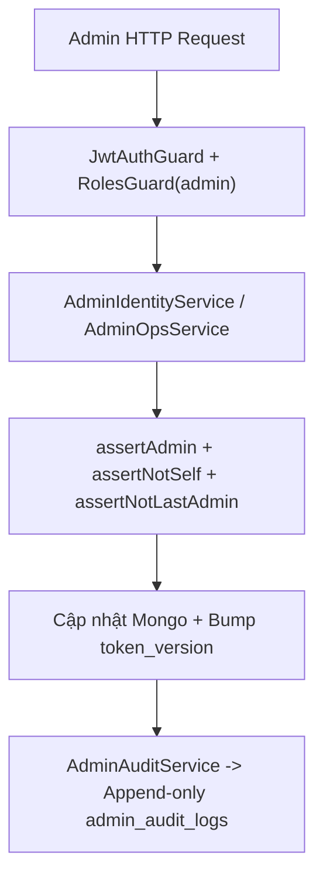

# modules/admin — Phân hệ Quản trị Hệ thống, RBAC & Nhật ký Kiểm toán

- **Motivation/Background**: Cung cấp tài liệu đặc tả tự chứa ngay tại `backend_rag/src/modules/admin/` theo yêu cầu chuẩn hóa kiến trúc, giúp người đọc nắm bắt nhanh mục đích thư mục, trách nhiệm từng file và luồng nghiệp vụ mà không phải dò thủ công toàn bộ mã nguồn.
- **Purpose**: Cung cấp toàn bộ tuyến `/api/v1/admin/*` phục vụ quản trị viên giám sát tài khoản, đổi vai trò (`user`/`admin`), vô hiệu hóa tài khoản, thu hồi gia đình token, kiểm tra phiên chat, xem lịch sử đăng nhập thất bại và tra cứu `admin_audit_logs` bất biến.
- **Overview Pipeline**: Mọi endpoint bắt buộc vượt qua 2 lớp guard  -> Tầng Service kiểm tra lại quyền qua `assertAdmin(actor)` , chặn tự khóa/tự hạ... -> Thao tác thay đổi trạng thái hoặc vai trò lập tức tăng `token_version` để vô....
- **Detailed Plan**: Mục 1 định nghĩa phạm vi & vai trò; Mục 2 liệt kê cấu trúc thư mục con và danh mục file/export thực tế; Mục 3 mô tả chức năng, luồng nghiệp vụ kèm sơ đồ Mermaid; Mục 4 quy định hợp đồng I/O, bất biến hệ thống và lệnh kiểm chứng.
- **References**: [AGENTS.md](../../../AGENTS.md).
- **Created**: 2026-11-15T12:55:00+07:00
- **Last Updated**: 2026-11-15T12:55:00+07:00

[STATUS: ACTIVE]

---
## 1. Mục đích & Phạm vi Thư mục (Directory Scope & Architectural Role)

Cung cấp toàn bộ tuyến `/api/v1/admin/*` phục vụ quản trị viên giám sát tài khoản, đổi vai trò (`user`/`admin`), vô hiệu hóa tài khoản, thu hồi gia đình token, kiểm tra phiên chat, xem lịch sử đăng nhập thất bại và tra cứu `admin_audit_logs` bất biến.

---

## 2. Đặc tả Kỹ thuật & Danh mục File (Technical Specification)

### 2.1. Danh mục Thư mục con (Subdirectories)

| Thư mục con | Liên kết Đặc tả | Vai trò Chính |
| :--- | :--- | :--- |
| **`decorators/`** | [`decorators/README.md`](decorators/README.md) | Cung cấp parameter decorator `@AuditContext` trích xuất đồng bộ IP thực (`req.ip`), User-Agent và `X-Request-Id` từ HTTP request vào `AdminController` để truyền xuống `AdminAuditService`. |
| **`dto/`** | [`dto/README.md`](dto/README.md) | Định nghĩa các lớp DTO có trang trí `@ApiProperty` (Swagger) và `class-validator` cho toàn bộ endpoint quản trị: truy vấn phân trang người dùng, cập nhật `roles`/`disabled`, thống kê hệ thống, xem chi tiết phiên chat, token families và audit logs. |
| **`schemas/`** | [`schemas/README.md`](schemas/README.md) | Định nghĩa lược đồ MongoDB `AdminAuditLog` lưu trữ mọi hành động nhạy cảm của quản trị viên (`AUDIT_ACTIONS`: đổi vai trò, vô hiệu hóa tài khoản, thu hồi token, xóa phiên chat, v.v.) cùng index truy vấn theo thời gian và đối tượng. |

### 2.2. Danh mục File & Ký hiệu Kỹ thuật (File & Symbol Inventory)

| File | Loại / Tầng | Exports / Routes / Ký hiệu Chính | Mô tả Trách nhiệm |
| :--- | :--- | :--- | :--- |
| [`admin-audit.service.ts`](admin-audit.service.ts) | Domain Service | `USER_NOT_FOUND`, `AuditRequest`, `AdminAuditService` | Cài đặt logic nghiệp vụ cốt lõi và tích hợp lưu trữ/engine. |
| [`admin-identity.service.ts`](admin-identity.service.ts) | Domain Service | `USER_NOT_FOUND`, `SELF_LOCKOUT_FORBIDDEN`, `LAST_ADMIN_PROTECTED`, `VALIDATION_ERROR`, `AdminIdentityService` | Cài đặt logic nghiệp vụ cốt lõi và tích hợp lưu trữ/engine. |
| [`admin-ops.service.ts`](admin-ops.service.ts) | Domain Service | `SESSION_NOT_FOUND`, `AdminOpsService` | Cài đặt logic nghiệp vụ cốt lõi và tích hợp lưu trữ/engine. |
| [`admin-user.mapper.ts`](admin-user.mapper.ts) | Domain Mapper | `toAdminUserDto`, `lockState` | Public admin view of a user. Never exposes `password_hash`. |
| [`admin.controller.ts`](admin.controller.ts) | HTTP Controller | @Controller('admin'), @Get('users'), @Get('users/:id'), @Put('users/:id/roles'), @Put('users/:id/status'), @Get('users/:id/tokens'), @Delete('users/:id/tokens') (+8) | Tiếp nhận HTTP request, kiểm tra guard/DTO và điều phối sang service. |
| [`admin.module.ts`](admin.module.ts) | NestJS Module | `AdminModule` | Module NestJS khai báo imports, providers và exports DI. |
| [`admin.spec.ts`](admin.spec.ts) | Jest Integration/Unit Spec | - | Bộ kiểm thử tự động xác minh hành vi cho `backend_rag/src/modules/admin`. |
| [`assert-admin.ts`](assert-admin.ts) | TypeScript Module | `ADMIN_ROLE_REQUIRED`, `assertAdmin` | Defense in depth: `RolesGuard` already rejects non-admins at the HTTP layer (AGENTS.md §3.8). |
| [`index.ts`](index.ts) | Barrel Export | Re-exports: `./admin-audit.service`, `./admin-identity.service`, `./admin-ops.service`, `./admin-user.mapper`, `./admin.controller`, `./admin.module` (+4) | Barrel thống nhất điểm import công khai của thư mục |

---

## 3. Mô tả Chức năng & Luồng Nghiệp vụ (Business Flow)

1. Mọi endpoint bắt buộc vượt qua 2 lớp guard (`JwtAuthGuard` + `RolesGuard` với `@Roles('admin')`).
2. Tầng Service kiểm tra lại quyền qua `assertAdmin(actor)` (`defense-in-depth`, `D-039`), chặn tự khóa/tự hạ quyền (`assertNotSelf`) và bảo vệ Admin cuối cùng (`assertNotLastAdmin`).
3. Thao tác thay đổi trạng thái hoặc vai trò lập tức tăng `token_version` (`revokeAllForUser`) để vô hiệu hóa tức thì Access Token đang lưu hành.
4. Mọi hành động quản trị đều ghi bản ghi nối tiếp vào bộ sưu tập chỉ-thêm `admin_audit_logs`.



---

## 4. Hợp đồng Đầu vào / Đầu ra, Bất biến & Kiểm chứng

- **Đầu vào (Inputs)**: `AuthUser` có vai trò `admin`, tham số lọc `ListQueryDto`, DTO thay đổi role/status và `AuditContext` (IP, RequestId).
- **Đầu ra & Tác động (Outputs / Side Effects)**: Báo cáo phân trang người dùng, phiên chat, token family, log kiểm toán và thống kê tổng quan.

### Bất biến & Quy tắc Kiến trúc (System Invariants)
- Không bao giờ mở route `/admin/*` thiếu `RolesGuard` HOẶC thiếu `assertAdmin` ở tầng Service (`D-039`).
- `admin_audit_logs` là append-only: nghiêm cấm thêm API sửa hoặc xóa nhật ký kiểm toán (`D-042`).

### Lệnh Kiểm chứng (Verification)
```powershell
cd backend_rag && npx jest src/modules/admin/admin.spec.ts --runInBand
```
