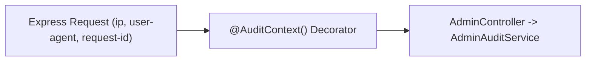

# modules/admin/decorators — Decorator Trích xuất Ngữ cảnh Kiểm toán (@AuditContext)

- **Motivation/Background**: Cung cấp tài liệu đặc tả tự chứa ngay tại `backend_rag/src/modules/admin/decorators/` theo yêu cầu chuẩn hóa kiến trúc, giúp người đọc nắm bắt nhanh mục đích thư mục, trách nhiệm từng file và luồng nghiệp vụ mà không phải dò thủ công toàn bộ mã nguồn.
- **Purpose**: Cung cấp parameter decorator `@AuditContext` trích xuất đồng bộ IP thực (`req.ip`), User-Agent và `X-Request-Id` từ HTTP request vào `AdminController` để truyền xuống `AdminAuditService`.
- **Overview Pipeline**: NestJS kích hoạt factory `AuditContext` trước khi gọi phương thức controller -> Đóng gói thông tin người thao tác và metadata mạng phục vụ truy vết bảo mật.
- **Detailed Plan**: Mục 1 định nghĩa phạm vi & vai trò; Mục 2 liệt kê cấu trúc thư mục con và danh mục file/export thực tế; Mục 3 mô tả chức năng, luồng nghiệp vụ kèm sơ đồ Mermaid; Mục 4 quy định hợp đồng I/O, bất biến hệ thống và lệnh kiểm chứng.
- **References**: [admin/README.md](../README.md), [schemas/README.md](../schemas/README.md), [AGENTS.md](../../../../AGENTS.md).
- **Created**: 2026-11-15T12:55:00+07:00
- **Last Updated**: 2026-11-15T12:55:00+07:00

[STATUS: ACTIVE]

---
## 1. Mục đích & Phạm vi Thư mục (Directory Scope & Architectural Role)

Cung cấp parameter decorator `@AuditContext` trích xuất đồng bộ IP thực (`req.ip`), User-Agent và `X-Request-Id` từ HTTP request vào `AdminController` để truyền xuống `AdminAuditService`.

---

## 2. Đặc tả Kỹ thuật & Danh mục File (Technical Specification)

### 2.2. Danh mục File & Ký hiệu Kỹ thuật (File & Symbol Inventory)

| File | Loại / Tầng | Exports / Routes / Ký hiệu Chính | Mô tả Trách nhiệm |
| :--- | :--- | :--- | :--- |
| [`audit-context.decorator.ts`](audit-context.decorator.ts) | Custom Decorator | `AuditContext` | Who and where an admin action comes from, as recorded in the audit trail. |
| [`index.ts`](index.ts) | Barrel Export | Re-exports: `./audit-context.decorator` | Barrel thống nhất điểm import công khai của thư mục |

---

## 3. Mô tả Chức năng & Luồng Nghiệp vụ (Business Flow)

1. NestJS kích hoạt factory `AuditContext` trước khi gọi phương thức controller.
2. Đóng gói thông tin người thao tác và metadata mạng phục vụ truy vết bảo mật.



---

## 4. Hợp đồng Đầu vào / Đầu ra, Bất biến & Kiểm chứng

- **Đầu vào (Inputs)**: ExecutionContext HTTP hiện tại.
- **Đầu ra & Tác động (Outputs / Side Effects)**: Đối tượng metadata ngữ cảnh kiểm toán (IP, userAgent, requestId).

### Bất biến & Quy tắc Kiến trúc (System Invariants)
- Mọi thao tác ghi của admin đều phải đi kèm ngữ cảnh kiểm toán đầy đủ.

### Lệnh Kiểm chứng (Verification)
```powershell
cd backend_rag && npx jest src/modules/admin/admin.spec.ts --runInBand
```
