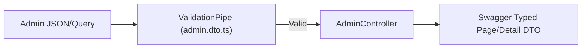

# modules/admin/dto — DTO Đầu vào / Đầu ra Trang Quản trị RBAC

- **Motivation/Background**: Cung cấp tài liệu đặc tả tự chứa ngay tại `backend_rag/src/modules/admin/dto/` theo yêu cầu chuẩn hóa kiến trúc, giúp người đọc nắm bắt nhanh mục đích thư mục, trách nhiệm từng file và luồng nghiệp vụ mà không phải dò thủ công toàn bộ mã nguồn.
- **Purpose**: Định nghĩa các lớp DTO có trang trí `@ApiProperty` (Swagger) và `class-validator` cho toàn bộ endpoint quản trị: truy vấn phân trang người dùng, cập nhật `roles`/`disabled`, thống kê hệ thống, xem chi tiết phiên chat, token families và audit logs.
- **Overview Pipeline**: Kế thừa `ListQueryDto` chuẩn từ `common/pagination` cho các truy vấn lọc &... -> `ValidationPipe` kiểm tra danh sách vai trò hợp lệ ADMIN_ROLES = ['user'....
- **Detailed Plan**: Mục 1 định nghĩa phạm vi & vai trò; Mục 2 liệt kê cấu trúc thư mục con và danh mục file/export thực tế; Mục 3 mô tả chức năng, luồng nghiệp vụ kèm sơ đồ Mermaid; Mục 4 quy định hợp đồng I/O, bất biến hệ thống và lệnh kiểm chứng.
- **References**: [admin/README.md](../README.md), [pagination/README.md](../../../common/pagination/README.md), [AGENTS.md](../../../../AGENTS.md).
- **Created**: 2026-11-15T12:55:00+07:00
- **Last Updated**: 2026-11-15T12:55:00+07:00

[STATUS: ACTIVE]

---
## 1. Mục đích & Phạm vi Thư mục (Directory Scope & Architectural Role)

Định nghĩa các lớp DTO có trang trí `@ApiProperty` (Swagger) và `class-validator` cho toàn bộ endpoint quản trị: truy vấn phân trang người dùng, cập nhật `roles`/`disabled`, thống kê hệ thống, xem chi tiết phiên chat, token families và audit logs.

---

## 2. Đặc tả Kỹ thuật & Danh mục File (Technical Specification)

### 2.2. Danh mục File & Ký hiệu Kỹ thuật (File & Symbol Inventory)

| File | Loại / Tầng | Exports / Routes / Ký hiệu Chính | Mô tả Trách nhiệm |
| :--- | :--- | :--- | :--- |
| [`admin.dto.ts`](admin.dto.ts) | DTO & OpenAPI | `ADMIN_ROLES`, `ListAdminUsersQueryDto`, `UpdateRolesDto`, `UpdateUserStatusDto`, `AdminUserDto`, `AdminUserDetailDto`, `AdminUserPageDto` (+16) | Định nghĩa DTO đầu vào/ra kèm ràng buộc `class-validator` & Swagger. |
| [`index.ts`](index.ts) | Barrel Export | Re-exports: `./admin.dto` | Barrel thống nhất điểm import công khai của thư mục |

---

## 3. Mô tả Chức năng & Luồng Nghiệp vụ (Business Flow)

1. Kế thừa `ListQueryDto` chuẩn từ `common/pagination` cho các truy vấn lọc & tìm kiếm.
2. `ValidationPipe` kiểm tra danh sách vai trò hợp lệ `ADMIN_ROLES = ['user', 'admin']` trước khi vào service.



---

## 4. Hợp đồng Đầu vào / Đầu ra, Bất biến & Kiểm chứng

- **Đầu vào (Inputs)**: Request body (`UpdateRolesDto`, `UpdateUserStatusDto`) và query phân trang (`ListAdminUsersQueryDto`, `ListAuditLogsQueryDto`, v.v.).
- **Đầu ra & Tác động (Outputs / Side Effects)**: DTO đã chuẩn hóa kiểu dữ liệu và schema OpenAPI.

### Bất biến & Quy tắc Kiến trúc (System Invariants)
- Vai trò hợp lệ chỉ giới hạn trong `['user', 'admin']`.

### Lệnh Kiểm chứng (Verification)
```powershell
cd backend_rag && npm run build
```
