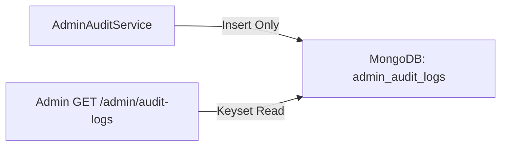

# modules/admin/schemas — Schema Mongoose Nhật ký Kiểm toán Admin (Append-Only)

- **Motivation/Background**: Cung cấp tài liệu đặc tả tự chứa ngay tại `backend_rag/src/modules/admin/schemas/` theo yêu cầu chuẩn hóa kiến trúc, giúp người đọc nắm bắt nhanh mục đích thư mục, trách nhiệm từng file và luồng nghiệp vụ mà không phải dò thủ công toàn bộ mã nguồn.
- **Purpose**: Định nghĩa lược đồ MongoDB `AdminAuditLog` lưu trữ mọi hành động nhạy cảm của quản trị viên (`AUDIT_ACTIONS`: đổi vai trò, vô hiệu hóa tài khoản, thu hồi token, xóa phiên chat, v.v.) cùng index truy vấn theo thời gian và đối tượng.
- **Overview Pipeline**: `AdminAuditService.record()` khởi tạo và `.create()` tài liệu mới vào... -> Cung cấp index theo `created_at`, `actor_id` và `target_id` phục vụ tra cứu....
- **Detailed Plan**: Mục 1 định nghĩa phạm vi & vai trò; Mục 2 liệt kê cấu trúc thư mục con và danh mục file/export thực tế; Mục 3 mô tả chức năng, luồng nghiệp vụ kèm sơ đồ Mermaid; Mục 4 quy định hợp đồng I/O, bất biến hệ thống và lệnh kiểm chứng.
- **References**: [admin/README.md](../README.md), [AGENTS.md](../../../../AGENTS.md).
- **Created**: 2026-11-15T12:55:00+07:00
- **Last Updated**: 2026-11-15T12:55:00+07:00

[STATUS: ACTIVE]

---
## 1. Mục đích & Phạm vi Thư mục (Directory Scope & Architectural Role)

Định nghĩa lược đồ MongoDB `AdminAuditLog` lưu trữ mọi hành động nhạy cảm của quản trị viên (`AUDIT_ACTIONS`: đổi vai trò, vô hiệu hóa tài khoản, thu hồi token, xóa phiên chat, v.v.) cùng index truy vấn theo thời gian và đối tượng.

---

## 2. Đặc tả Kỹ thuật & Danh mục File (Technical Specification)

### 2.2. Danh mục File & Ký hiệu Kỹ thuật (File & Symbol Inventory)

| File | Loại / Tầng | Exports / Routes / Ký hiệu Chính | Mô tả Trách nhiệm |
| :--- | :--- | :--- | :--- |
| [`admin-audit-log.schema.ts`](admin-audit-log.schema.ts) | Mongoose Schema | `AUDIT_ACTIONS`, `AuditAction`, `AuditTargetType`, `AdminAuditLog`, `AdminAuditLogDocument`, `AdminAuditLogSchema` | The audit actions recorded by the admin module (prompt_security S4.1). |
| [`index.ts`](index.ts) | Barrel Export | Re-exports: `./admin-audit-log.schema` | Barrel thống nhất điểm import công khai của thư mục |

---

## 3. Mô tả Chức năng & Luồng Nghiệp vụ (Business Flow)

1. `AdminAuditService.record()` khởi tạo và `.create()` tài liệu mới vào collection `admin_audit_logs`.
2. Cung cấp index theo `created_at`, `actor_id` và `target_id` phục vụ tra cứu phân trang keyset.



---

## 4. Hợp đồng Đầu vào / Đầu ra, Bất biến & Kiểm chứng

- **Đầu vào (Inputs)**: Mã hành động `AuditAction`, actor ID, target ID (`user`/`session`/`system`), chi tiết thay đổi và IP.
- **Đầu ra & Tác động (Outputs / Side Effects)**: Tài liệu lưu trữ bất biến trong collection `admin_audit_logs`.

### Bất biến & Quy tắc Kiến trúc (System Invariants)
- Collection `admin_audit_logs` tuyệt đối chỉ ghi nối tiếp (append-only), không cập nhật hay xóa bản ghi (`D-042`).

### Lệnh Kiểm chứng (Verification)
```powershell
cd backend_rag && npx jest src/modules/admin/admin.spec.ts --runInBand
```
