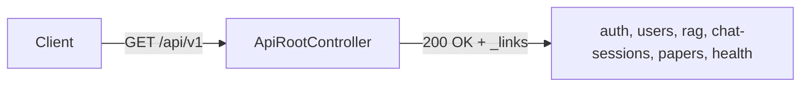

# modules/api-root — Điểm Vào Điều hướng HATEOAS (/api/v1)

- **Motivation/Background**: Cung cấp tài liệu đặc tả tự chứa ngay tại `backend_rag/src/modules/api-root/` theo yêu cầu chuẩn hóa kiến trúc, giúp người đọc nắm bắt nhanh mục đích thư mục, trách nhiệm từng file và luồng nghiệp vụ mà không phải dò thủ công toàn bộ mã nguồn.
- **Purpose**: Cung cấp `ApiRootController` trả về tài liệu gốc API cùng bản đồ liên kết HATEOAS (`rootLinks`) giúp client và công cụ kiểm thử khám phá tự động các tài nguyên chính (`/auth`, `/users`, `/rag`, `/chat-sessions`, `/papers`, `/health`).
- **Overview Pipeline**: Client gửi `GET /api/v1` -> Trả HTTP 200 kèm các liên kết điều hướng chuẩn JSON hoặc XML.
- **Detailed Plan**: Mục 1 định nghĩa phạm vi & vai trò; Mục 2 liệt kê cấu trúc thư mục con và danh mục file/export thực tế; Mục 3 mô tả chức năng, luồng nghiệp vụ kèm sơ đồ Mermaid; Mục 4 quy định hợp đồng I/O, bất biến hệ thống và lệnh kiểm chứng.
- **References**: [AGENTS.md](../../../AGENTS.md).
- **Created**: 2026-11-15T12:55:00+07:00
- **Last Updated**: 2026-11-15T12:55:00+07:00

[STATUS: ACTIVE]

---
## 1. Mục đích & Phạm vi Thư mục (Directory Scope & Architectural Role)

Cung cấp `ApiRootController` trả về tài liệu gốc API cùng bản đồ liên kết HATEOAS (`rootLinks`) giúp client và công cụ kiểm thử khám phá tự động các tài nguyên chính (`/auth`, `/users`, `/rag`, `/chat-sessions`, `/papers`, `/health`).

---

## 2. Đặc tả Kỹ thuật & Danh mục File (Technical Specification)

### 2.2. Danh mục File & Ký hiệu Kỹ thuật (File & Symbol Inventory)

| File | Loại / Tầng | Exports / Routes / Ký hiệu Chính | Mô tả Trách nhiệm |
| :--- | :--- | :--- | :--- |
| [`api-root.controller.ts`](api-root.controller.ts) | HTTP Controller | @Get('/'), `ApiRootController` | `GET /api/v1`: where a hypermedia client starts. |
| [`index.ts`](index.ts) | Barrel Export | Re-exports: `./api-root.controller` | Barrel thống nhất điểm import công khai của thư mục |

---

## 3. Mô tả Chức năng & Luồng Nghiệp vụ (Business Flow)

1. Client gửi `GET /api/v1`.
2. Trả HTTP 200 kèm các liên kết điều hướng chuẩn JSON hoặc XML.



---

## 4. Hợp đồng Đầu vào / Đầu ra, Bất biến & Kiểm chứng

- **Đầu vào (Inputs)**: HTTP `GET /api/v1` kèm header `Accept` (JSON/XML).
- **Đầu ra & Tác động (Outputs / Side Effects)**: Payload siêu dữ liệu kèm `_links` HATEOAS.

### Bất biến & Quy tắc Kiến trúc (System Invariants)
- Mọi tài nguyên chính đều có mặt trong bản đồ `rootLinks()` theo `docs/api/API_DESIGN.md`.

### Lệnh Kiểm chứng (Verification)
```powershell
cd backend_rag && npm run build
```
