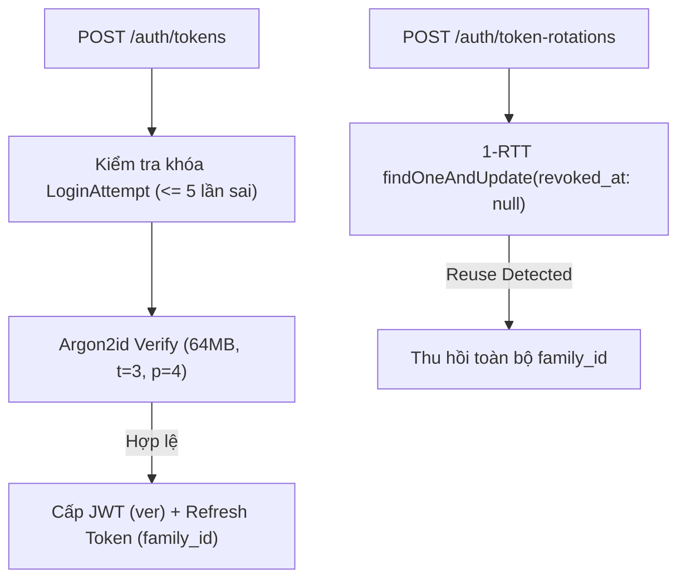

# modules/auth — Phân hệ Xác thực Argon2id, JWT Phiên bản Hóa & Refresh Rotation 1-RTT

- **Motivation/Background**: Cung cấp tài liệu đặc tả tự chứa ngay tại `backend_rag/src/modules/auth/` theo yêu cầu chuẩn hóa kiến trúc, giúp người đọc nắm bắt nhanh mục đích thư mục, trách nhiệm từng file và luồng nghiệp vụ mà không phải dò thủ công toàn bộ mã nguồn.
- **Purpose**: Quản lý vòng đời tài khoản và phiên đăng nhập bảo mật cao: đăng ký user (`POST /users`), hồ sơ/đổi mật khẩu (`/users/me`), đăng nhập (`POST /auth/tokens`), xoay vòng token dùng 1 lần 1-RTT phát hiện tái sử dụng (`POST /auth/token-rotations`) và đăng xuất thu hồi gia đình token (`POST /auth/token-revocations`).
- **Overview Pipeline**: Đăng ký/đổi mật khẩu kiểm tra độ mạnh và băm bằng **Argon2id**  -> Đăng nhập chống brute-force theo cặp `(email_hash, ip)` qua collection... -> Refresh Token thực hiện cập nhật nguyên tử 1-RTT ; nếu phát hiện reuse , thu....
- **Detailed Plan**: Mục 1 định nghĩa phạm vi & vai trò; Mục 2 liệt kê cấu trúc thư mục con và danh mục file/export thực tế; Mục 3 mô tả chức năng, luồng nghiệp vụ kèm sơ đồ Mermaid; Mục 4 quy định hợp đồng I/O, bất biến hệ thống và lệnh kiểm chứng.
- **References**: [AGENTS.md](../../../AGENTS.md).
- **Created**: 2026-11-15T12:55:00+07:00
- **Last Updated**: 2026-11-15T12:55:00+07:00

[STATUS: ACTIVE]

---
## 1. Mục đích & Phạm vi Thư mục (Directory Scope & Architectural Role)

Quản lý vòng đời tài khoản và phiên đăng nhập bảo mật cao: đăng ký user (`POST /users`), hồ sơ/đổi mật khẩu (`/users/me`), đăng nhập (`POST /auth/tokens`), xoay vòng token dùng 1 lần 1-RTT phát hiện tái sử dụng (`POST /auth/token-rotations`) và đăng xuất thu hồi gia đình token (`POST /auth/token-revocations`).

---

## 2. Đặc tả Kỹ thuật & Danh mục File (Technical Specification)

### 2.1. Danh mục Thư mục con (Subdirectories)

| Thư mục con | Liên kết Đặc tả | Vai trò Chính |
| :--- | :--- | :--- |
| **`decorators/`** | [`decorators/README.md`](decorators/README.md) | Cung cấp parameter decorator `@CurrentUser()` đọc `request.user` (đã được `JwtAuthGuard` xác thực và gắn vào Express request) để các Controller nhận đối tượng `AuthUser` có kiểu mạnh. |
| **`dto/`** | [`dto/README.md`](dto/README.md) | Định nghĩa toàn bộ DTO đầu vào/đầu ra cho `AuthController` và `UsersController` (`RegisterDto`, `LoginDto`, `RefreshDto`, `UpdateProfileDto`, `ChangePasswordDto`, `UserDto`, `AuthResponseDto`) kèm rule kiểm tra `class-validator` và tài liệu Swagger. |
| **`guards/`** | [`guards/README.md`](guards/README.md) | Cung cấp `JwtAuthGuard` (yêu cầu JWT hợp lệ + kiểm tra `ver` vs `user.token_version`), `OptionalJwtAuthGuard` (cho phép ẩn danh trên endpoint chat công cộng nhưng nhận diện nếu có Bearer token) và `RolesGuard` kết hợp `@Roles(...)` kiểm tra phân quyền RBAC. |
| **`schemas/`** | [`schemas/README.md`](schemas/README.md) | Định nghĩa 3 schema cốt lõi trong MongoDB cho phân hệ Auth: `User` (lưu email chuẩn hóa, Argon2id hash, `roles`, `token_version`, `disabled`), `RefreshToken` (lưu `token_hash`, `family_id`, `expires_at` TTL, `revoked_at`) và `LoginAttempt` (đếm số lần sai mật khẩu kèm TTL 15 phút). |

### 2.2. Danh mục File & Ký hiệu Kỹ thuật (File & Symbol Inventory)

| File | Loại / Tầng | Exports / Routes / Ký hiệu Chính | Mô tả Trách nhiệm |
| :--- | :--- | :--- | :--- |
| [`auth.controller.ts`](auth.controller.ts) | HTTP Controller | @Controller('auth'), @Post('tokens'), @Post('token-rotations'), @Post('token-revocations'), `AuthController` | Tiếp nhận HTTP request, kiểm tra guard/DTO và điều phối sang service. |
| [`auth.module.ts`](auth.module.ts) | NestJS Module | `AuthModule` | Global so every feature module can use the guards without re-importing. |
| [`auth.service.ts`](auth.service.ts) | Domain Service | `MAX_LOGIN_FAILURES`, `ARGON2_OPTIONS`, `AuthService` | Cài đặt logic nghiệp vụ cốt lõi và tích hợp lưu trữ/engine. |
| [`auth.spec.ts`](auth.spec.ts) | Jest Integration/Unit Spec | @Controller('probe'), @Get('optional'), @Get('admin') | Bộ kiểm thử tự động xác minh hành vi cho `backend_rag/src/modules/auth`. |
| [`auth.utils.ts`](auth.utils.ts) | TypeScript Module | `normalizeEmail`, `emailHash`, `toUserDto` | Short, non-reversible id of an email for logs (the email itself is never logged). |
| [`common-passwords.spec.ts`](common-passwords.spec.ts) | Jest Integration/Unit Spec | - | Bộ kiểm thử tự động xác minh hành vi cho `backend_rag/src/modules/auth`. |
| [`common-passwords.ts`](common-passwords.ts) | TypeScript Module | `COMMON_PASSWORDS`, `PASSWORD_MIN_LENGTH`, `PASSWORD_MAX_LENGTH`, `PASSWORD_TOO_SHORT`, `PASSWORD_TOO_LONG`, `PASSWORD_TOO_COMMON`, `PASSWORD_CONTAINS_EMAIL` (+3) | Password policy for register / change-password / admin bootstrap (prompt_security S2). Rules (OWASP-aligned, deliberately stricter than the previous... |
| [`index.ts`](index.ts) | Barrel Export | Re-exports: `./auth.controller`, `./auth.module`, `./auth.service`, `./auth.utils`, `./common-passwords`, `./token.service` (+5) | Barrel thống nhất điểm import công khai của thư mục |
| [`token.service.ts`](token.service.ts) | Domain Service | `ACCESS_TTL_SECONDS`, `REFRESH_TTL_SECONDS`, `TOKEN_EXPIRED`, `UNAUTHORIZED`, `AccessClaims`, `IssuedTokens`, `ConsumeResult` (+1) | Cài đặt logic nghiệp vụ cốt lõi và tích hợp lưu trữ/engine. |
| [`users.controller.ts`](users.controller.ts) | HTTP Controller | @Controller('users'), @Post('/'), @Get('me'), @Patch('me'), @Put('me/password'), `UsersController` | Tiếp nhận HTTP request, kiểm tra guard/DTO và điều phối sang service. |

---

## 3. Mô tả Chức năng & Luồng Nghiệp vụ (Business Flow)

1. Đăng ký/đổi mật khẩu kiểm tra độ mạnh (`validatePassword`: >= 10 ký tự, không thuộc `COMMON_PASSWORDS`, không chứa email) và băm bằng **Argon2id** (`64 MB`, `t=3`, `p=4`).
2. Đăng nhập chống brute-force theo cặp `(email_hash, ip)` qua collection `login_attempts` (khóa sau `5` lần sai trong 15 phút), rồi ký Access Token (JWT có `ver = token_version`) + Refresh Token (SHA-256 hash lưu MongoDB kèm `family_id`).
3. Refresh Token thực hiện cập nhật nguyên tử 1-RTT (`findOneAndUpdate({ token_hash, revoked_at: null })`); nếu phát hiện reuse (`revoked_at != null`), thu hồi lập tức toàn bộ `family_id`.
4. Đăng xuất/vô hiệu hóa thu hồi token gia đình hoặc tăng `token_version` làm mất hiệu lực mọi Access Token đang chạy.



---

## 4. Hợp đồng Đầu vào / Đầu ra, Bất biến & Kiểm chứng

- **Đầu vào (Inputs)**: Email, mật khẩu, tên hiển thị, Refresh Token cần xoay vòng hoặc thu hồi.
- **Đầu ra & Tác động (Outputs / Side Effects)**: `AuthResponseDto` (`user`, `access_token`, `refresh_token`) hoặc `UserDto`.

### Bất biến & Quy tắc Kiến trúc (System Invariants)
- Không bao giờ giảm tham số Argon2id (`memoryCost: 65536, timeCost: 3, parallelism: 4`) (`D-021`).
- Access Token mang claim `ver` đối chiếu `user.token_version`; đăng ký công khai luôn tạo quyền `user` (`D-040`).

### Lệnh Kiểm chứng (Verification)
```powershell
cd backend_rag && npx jest src/modules/auth/auth.spec.ts --runInBand
```
