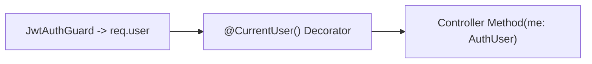

# modules/auth/decorators — Decorator Tiêm Thông tin Người dùng (@CurrentUser)

- **Motivation/Background**: Cung cấp tài liệu đặc tả tự chứa ngay tại `backend_rag/src/modules/auth/decorators/` theo yêu cầu chuẩn hóa kiến trúc, giúp người đọc nắm bắt nhanh mục đích thư mục, trách nhiệm từng file và luồng nghiệp vụ mà không phải dò thủ công toàn bộ mã nguồn.
- **Purpose**: Cung cấp parameter decorator `@CurrentUser()` đọc `request.user` (đã được `JwtAuthGuard` xác thực và gắn vào Express request) để các Controller nhận đối tượng `AuthUser` có kiểu mạnh.
- **Overview Pipeline**: `JwtAuthGuard` giải mã JWT, đối chiếu `token_version` và gán `req.user` -> `@CurrentUser()` lấy `req.user` trực tiếp ở tham số hàm controller.
- **Detailed Plan**: Mục 1 định nghĩa phạm vi & vai trò; Mục 2 liệt kê cấu trúc thư mục con và danh mục file/export thực tế; Mục 3 mô tả chức năng, luồng nghiệp vụ kèm sơ đồ Mermaid; Mục 4 quy định hợp đồng I/O, bất biến hệ thống và lệnh kiểm chứng.
- **References**: [auth/README.md](../README.md), [guards/README.md](../guards/README.md), [AGENTS.md](../../../../AGENTS.md).
- **Created**: 2026-11-15T12:55:00+07:00
- **Last Updated**: 2026-11-15T12:55:00+07:00

[STATUS: ACTIVE]

---
## 1. Mục đích & Phạm vi Thư mục (Directory Scope & Architectural Role)

Cung cấp parameter decorator `@CurrentUser()` đọc `request.user` (đã được `JwtAuthGuard` xác thực và gắn vào Express request) để các Controller nhận đối tượng `AuthUser` có kiểu mạnh.

---

## 2. Đặc tả Kỹ thuật & Danh mục File (Technical Specification)

### 2.2. Danh mục File & Ký hiệu Kỹ thuật (File & Symbol Inventory)

| File | Loại / Tầng | Exports / Routes / Ký hiệu Chính | Mô tả Trách nhiệm |
| :--- | :--- | :--- | :--- |
| [`current-user.decorator.ts`](current-user.decorator.ts) | Custom Decorator | `CurrentUser` | `req.user` set by the JWT guards (undefined on anonymous requests behind OptionalJwtAuthGuard). |
| [`index.ts`](index.ts) | Barrel Export | Re-exports: `./current-user.decorator` | Barrel thống nhất điểm import công khai của thư mục |

---

## 3. Mô tả Chức năng & Luồng Nghiệp vụ (Business Flow)

1. `JwtAuthGuard` giải mã JWT, đối chiếu `token_version` và gán `req.user`.
2. `@CurrentUser()` lấy `req.user` trực tiếp ở tham số hàm controller.



---

## 4. Hợp đồng Đầu vào / Đầu ra, Bất biến & Kiểm chứng

- **Đầu vào (Inputs)**: HTTP ExecutionContext chứa `req.user`.
- **Đầu ra & Tác động (Outputs / Side Effects)**: Đối tượng `AuthUser` (`id`, `email`, `roles`, `token_version`).

### Bất biến & Quy tắc Kiến trúc (System Invariants)
- Chỉ dùng trên tuyến đã qua `JwtAuthGuard` hoặc kiểm tra null khi dùng kèm `OptionalJwtAuthGuard`.

### Lệnh Kiểm chứng (Verification)
```powershell
cd backend_rag && npm run build
```
