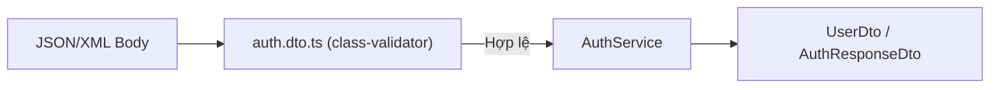

# modules/auth/dto — DTO Xác thực & Hồ sơ Người dùng

- **Motivation/Background**: Cung cấp tài liệu đặc tả tự chứa ngay tại `backend_rag/src/modules/auth/dto/` theo yêu cầu chuẩn hóa kiến trúc, giúp người đọc nắm bắt nhanh mục đích thư mục, trách nhiệm từng file và luồng nghiệp vụ mà không phải dò thủ công toàn bộ mã nguồn.
- **Purpose**: Định nghĩa toàn bộ DTO đầu vào/đầu ra cho `AuthController` và `UsersController` (`RegisterDto`, `LoginDto`, `RefreshDto`, `UpdateProfileDto`, `ChangePasswordDto`, `UserDto`, `AuthResponseDto`) kèm rule kiểm tra `class-validator` và tài liệu Swagger.
- **Overview Pipeline**: Kiểm tra định dạng email, độ dài chuỗi mật khẩu và trường bắt buộc ở... -> Chuẩn hóa cấu trúc response trả về cả JSON và XML.
- **Detailed Plan**: Mục 1 định nghĩa phạm vi & vai trò; Mục 2 liệt kê cấu trúc thư mục con và danh mục file/export thực tế; Mục 3 mô tả chức năng, luồng nghiệp vụ kèm sơ đồ Mermaid; Mục 4 quy định hợp đồng I/O, bất biến hệ thống và lệnh kiểm chứng.
- **References**: [auth/README.md](../README.md), [AGENTS.md](../../../../AGENTS.md).
- **Created**: 2026-11-15T12:55:00+07:00
- **Last Updated**: 2026-11-15T12:55:00+07:00

[STATUS: ACTIVE]

---
## 1. Mục đích & Phạm vi Thư mục (Directory Scope & Architectural Role)

Định nghĩa toàn bộ DTO đầu vào/đầu ra cho `AuthController` và `UsersController` (`RegisterDto`, `LoginDto`, `RefreshDto`, `UpdateProfileDto`, `ChangePasswordDto`, `UserDto`, `AuthResponseDto`) kèm rule kiểm tra `class-validator` và tài liệu Swagger.

---

## 2. Đặc tả Kỹ thuật & Danh mục File (Technical Specification)

### 2.2. Danh mục File & Ký hiệu Kỹ thuật (File & Symbol Inventory)

| File | Loại / Tầng | Exports / Routes / Ký hiệu Chính | Mô tả Trách nhiệm |
| :--- | :--- | :--- | :--- |
| [`auth.dto.ts`](auth.dto.ts) | DTO & OpenAPI | `RegisterDto`, `LoginDto`, `RefreshDto`, `UpdateProfileDto`, `ChangePasswordDto`, `UserDto`, `AuthResponseDto` | Định nghĩa DTO đầu vào/ra kèm ràng buộc `class-validator` & Swagger. |
| [`index.ts`](index.ts) | Barrel Export | Re-exports: `./auth.dto` | Barrel thống nhất điểm import công khai của thư mục |

---

## 3. Mô tả Chức năng & Luồng Nghiệp vụ (Business Flow)

1. Kiểm tra định dạng email, độ dài chuỗi mật khẩu và trường bắt buộc ở `ValidationPipe`.
2. Chuẩn hóa cấu trúc response trả về cả JSON và XML.



---

## 4. Hợp đồng Đầu vào / Đầu ra, Bất biến & Kiểm chứng

- **Đầu vào (Inputs)**: Payload đăng nhập, đăng ký, làm mới token, đổi tên hiển thị hoặc đổi mật khẩu.
- **Đầu ra & Tác động (Outputs / Side Effects)**: Đối tượng DTO đã xác thực và kiểu response OpenAPI.

### Bất biến & Quy tắc Kiến trúc (System Invariants)
- DTO đăng ký tuyệt đối không chấp nhận trường `role` từ client (`D-040`).

### Lệnh Kiểm chứng (Verification)
```powershell
cd backend_rag && npm run build
```
