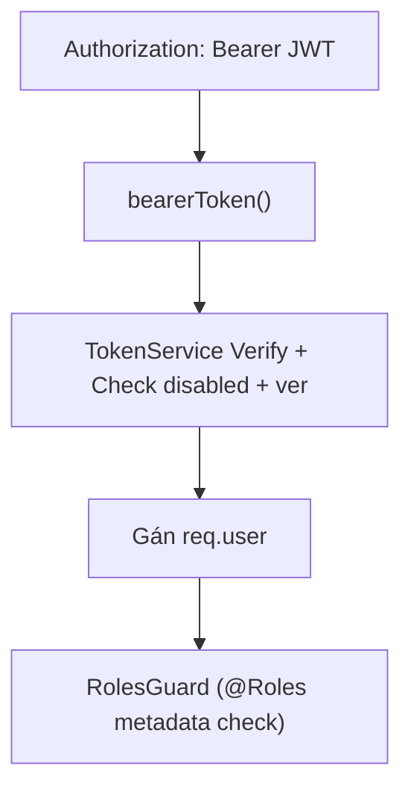

# modules/auth/guards — Bộ Bảo vệ Tuyến JWT, Optional Auth & RBAC RolesGuard

- **Motivation/Background**: Cung cấp tài liệu đặc tả tự chứa ngay tại `backend_rag/src/modules/auth/guards/` theo yêu cầu chuẩn hóa kiến trúc, giúp người đọc nắm bắt nhanh mục đích thư mục, trách nhiệm từng file và luồng nghiệp vụ mà không phải dò thủ công toàn bộ mã nguồn.
- **Purpose**: Cung cấp `JwtAuthGuard` (yêu cầu JWT hợp lệ + kiểm tra `ver` vs `user.token_version`), `OptionalJwtAuthGuard` (cho phép ẩn danh trên endpoint chat công cộng nhưng nhận diện nếu có Bearer token) và `RolesGuard` kết hợp `@Roles(...)` kiểm tra phân quyền RBAC.
- **Overview Pipeline**: `bearerToken(req)` tách JWT từ header `Authorization: Bearer ...` -> `JwtAuthGuard` xác thực chữ ký JWT và gọi DB/cache kiểm tra `user.disabled`... -> `RolesGuard` đọc metadata `@Roles('admin')` và đối chiếu `req.user.roles`.
- **Detailed Plan**: Mục 1 định nghĩa phạm vi & vai trò; Mục 2 liệt kê cấu trúc thư mục con và danh mục file/export thực tế; Mục 3 mô tả chức năng, luồng nghiệp vụ kèm sơ đồ Mermaid; Mục 4 quy định hợp đồng I/O, bất biến hệ thống và lệnh kiểm chứng.
- **References**: [auth/README.md](../README.md), [admin/README.md](../../admin/README.md), [AGENTS.md](../../../../AGENTS.md).
- **Created**: 2026-11-15T12:55:00+07:00
- **Last Updated**: 2026-11-15T12:55:00+07:00

[STATUS: ACTIVE]

---
## 1. Mục đích & Phạm vi Thư mục (Directory Scope & Architectural Role)

Cung cấp `JwtAuthGuard` (yêu cầu JWT hợp lệ + kiểm tra `ver` vs `user.token_version`), `OptionalJwtAuthGuard` (cho phép ẩn danh trên endpoint chat công cộng nhưng nhận diện nếu có Bearer token) và `RolesGuard` kết hợp `@Roles(...)` kiểm tra phân quyền RBAC.

---

## 2. Đặc tả Kỹ thuật & Danh mục File (Technical Specification)

### 2.2. Danh mục File & Ký hiệu Kỹ thuật (File & Symbol Inventory)

| File | Loại / Tầng | Exports / Routes / Ký hiệu Chính | Mô tả Trách nhiệm |
| :--- | :--- | :--- | :--- |
| [`index.ts`](index.ts) | Barrel Export | Re-exports: `./jwt-auth.guard`, `./roles.guard` | Barrel thống nhất điểm import công khai của thư mục |
| [`jwt-auth.guard.ts`](jwt-auth.guard.ts) | NestJS Guard | `bearerToken`, `JwtAuthGuard`, `OptionalJwtAuthGuard` | `Bearer <token>` ➔ token; no header ➔ null; any other shape ➔ 401. |
| [`roles.guard.ts`](roles.guard.ts) | NestJS Guard | `ROLES_KEY`, `Roles`, `RolesGuard` | Roles required on top of JwtAuthGuard, e.g. `@Roles('admin')`. |

---

## 3. Mô tả Chức năng & Luồng Nghiệp vụ (Business Flow)

1. `bearerToken(req)` tách JWT từ header `Authorization: Bearer ...`.
2. `JwtAuthGuard` xác thực chữ ký JWT và gọi DB/cache kiểm tra `user.disabled` và `ver === user.token_version`.
3. `RolesGuard` đọc metadata `@Roles('admin')` và đối chiếu `req.user.roles`.



---

## 4. Hợp đồng Đầu vào / Đầu ra, Bất biến & Kiểm chứng

- **Đầu vào (Inputs)**: Express request header `Authorization` và reflector metadata `@Roles(...)`.
- **Đầu ra & Tác động (Outputs / Side Effects)**: Boolean `canActivate` (ném `401 Unauthorized` hoặc `403 Forbidden` khi vi phạm).

### Bất biến & Quy tắc Kiến trúc (System Invariants)
- Mọi Access Token cũ hơn `user.token_version` bị từ chối tức thì không đợi hết TTL 15 phút (`D-041`).

### Lệnh Kiểm chứng (Verification)
```powershell
cd backend_rag && npx jest src/modules/auth/auth.spec.ts --runInBand
```
