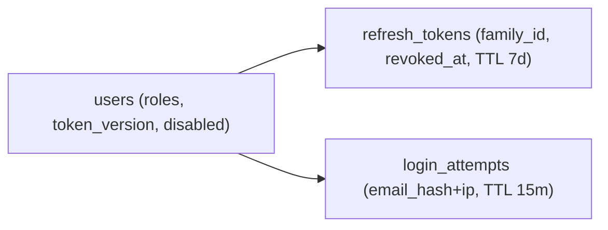

# modules/auth/schemas — Lược đồ MongoDB Người dùng, Refresh Token & Bảo vệ Brute-Force

- **Motivation/Background**: Cung cấp tài liệu đặc tả tự chứa ngay tại `backend_rag/src/modules/auth/schemas/` theo yêu cầu chuẩn hóa kiến trúc, giúp người đọc nắm bắt nhanh mục đích thư mục, trách nhiệm từng file và luồng nghiệp vụ mà không phải dò thủ công toàn bộ mã nguồn.
- **Purpose**: Định nghĩa 3 schema cốt lõi trong MongoDB cho phân hệ Auth: `User` (lưu email chuẩn hóa, Argon2id hash, `roles`, `token_version`, `disabled`), `RefreshToken` (lưu `token_hash`, `family_id`, `expires_at` TTL, `revoked_at`) và `LoginAttempt` (đếm số lần sai mật khẩu kèm TTL 15 phút).
- **Overview Pipeline**: Mongoose đồng bộ index duy nhất trên `users.email_hash` / `users.email`... -> `AuthService` và `TokenService` thao tác nguyên tử trên các model này.
- **Detailed Plan**: Mục 1 định nghĩa phạm vi & vai trò; Mục 2 liệt kê cấu trúc thư mục con và danh mục file/export thực tế; Mục 3 mô tả chức năng, luồng nghiệp vụ kèm sơ đồ Mermaid; Mục 4 quy định hợp đồng I/O, bất biến hệ thống và lệnh kiểm chứng.
- **References**: [auth/README.md](../README.md), [AGENTS.md](../../../../AGENTS.md).
- **Created**: 2026-11-15T12:55:00+07:00
- **Last Updated**: 2026-11-15T12:55:00+07:00

[STATUS: ACTIVE]

---
## 1. Mục đích & Phạm vi Thư mục (Directory Scope & Architectural Role)

Định nghĩa 3 schema cốt lõi trong MongoDB cho phân hệ Auth: `User` (lưu email chuẩn hóa, Argon2id hash, `roles`, `token_version`, `disabled`), `RefreshToken` (lưu `token_hash`, `family_id`, `expires_at` TTL, `revoked_at`) và `LoginAttempt` (đếm số lần sai mật khẩu kèm TTL 15 phút).

---

## 2. Đặc tả Kỹ thuật & Danh mục File (Technical Specification)

### 2.2. Danh mục File & Ký hiệu Kỹ thuật (File & Symbol Inventory)

| File | Loại / Tầng | Exports / Routes / Ký hiệu Chính | Mô tả Trách nhiệm |
| :--- | :--- | :--- | :--- |
| [`index.ts`](index.ts) | Barrel Export | Re-exports: `./login-attempt.schema`, `./refresh-token.schema`, `./user.schema` | Barrel thống nhất điểm import công khai của thư mục |
| [`login-attempt.schema.ts`](login-attempt.schema.ts) | Mongoose Schema | `LOGIN_WINDOW_SECONDS`, `LoginAttempt`, `LoginAttemptDocument`, `LoginAttemptSchema` | One failed login; expires after the 15-minute window. `key` = hash(email, ip). |
| [`refresh-token.schema.ts`](refresh-token.schema.ts) | Mongoose Schema | `RefreshToken`, `RefreshTokenDocument`, `RefreshTokenSchema` | Only the hash of a refresh token is stored; the raw value exists only in the client. |
| [`user.schema.ts`](user.schema.ts) | Mongoose Schema | `User`, `UserDocument`, `UserSchema`, `LeanUser` | `false` when an admin locks the account (prompt_security S2). |

---

## 3. Mô tả Chức năng & Luồng Nghiệp vụ (Business Flow)

1. Mongoose đồng bộ index duy nhất trên `users.email_hash` / `users.email`, index TTL tự dọn trên `refresh_tokens` và `login_attempts`.
2. `AuthService` và `TokenService` thao tác nguyên tử trên các model này.



---

## 4. Hợp đồng Đầu vào / Đầu ra, Bất biến & Kiểm chứng

- **Đầu vào (Inputs)**: Thông tin định danh người dùng, token hash SHA-256 và bộ đếm đăng nhập sai.
- **Đầu ra & Tác động (Outputs / Side Effects)**: Mongoose Schemas & Document types phục vụ injection `@InjectModel`.

### Bất biến & Quy tắc Kiến trúc (System Invariants)
- Chỉ lưu hash SHA-256 của Refresh Token và hash Argon2id của mật khẩu, không bao giờ lưu bản rõ.

### Lệnh Kiểm chứng (Verification)
```powershell
cd backend_rag && npx jest src/modules/auth/auth.spec.ts --runInBand
```
