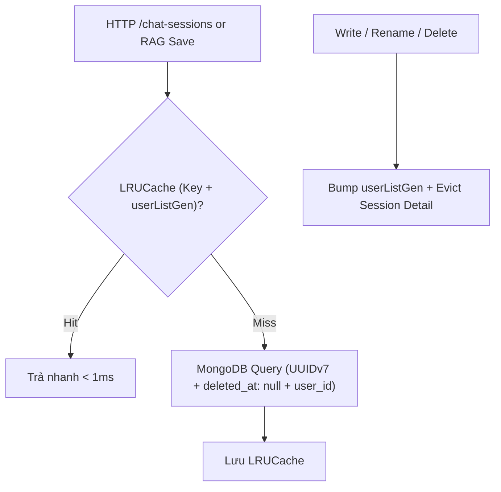

# modules/chat-sessions — Quản lý Phiên Chat UUIDv7, Idempotency & LRUCache Thế hệ

- **Motivation/Background**: Cung cấp tài liệu đặc tả tự chứa ngay tại `backend_rag/src/modules/chat-sessions/` theo yêu cầu chuẩn hóa kiến trúc, giúp người đọc nắm bắt nhanh mục đích thư mục, trách nhiệm từng file và luồng nghiệp vụ mà không phải dò thủ công toàn bộ mã nguồn.
- **Purpose**: Quản lý lưu trữ, phân trang con trỏ UUIDv7, tìm kiếm, đổi tên và xóa mềm (`deleted_at`) các phiên hội thoại & tin nhắn, đồng thời cung cấp cổng `SessionStorePort` (`ChatSessionsService`) và bộ khóa lũy đẳng `ChatRequestsService` chống lặp/đứt stream SSE khi mạng chập chờn.
- **Overview Pipeline**: `ChatSessionsService` duy trì `LRUCache` theo bộ đếm thế hệ `userListGen`... -> Mọi truy vấn đều lọc `user_id: userId` và `deleted_at: null`; truy cập chéo... -> `ChatRequestsService` kiểm tra header `Idempotency-Key` +....
- **Detailed Plan**: Mục 1 định nghĩa phạm vi & vai trò; Mục 2 liệt kê cấu trúc thư mục con và danh mục file/export thực tế; Mục 3 mô tả chức năng, luồng nghiệp vụ kèm sơ đồ Mermaid; Mục 4 quy định hợp đồng I/O, bất biến hệ thống và lệnh kiểm chứng.
- **References**: [AGENTS.md](../../../AGENTS.md).
- **Created**: 2026-11-15T12:55:00+07:00
- **Last Updated**: 2026-11-15T12:55:00+07:00

[STATUS: ACTIVE]

---
## 1. Mục đích & Phạm vi Thư mục (Directory Scope & Architectural Role)

Quản lý lưu trữ, phân trang con trỏ UUIDv7, tìm kiếm, đổi tên và xóa mềm (`deleted_at`) các phiên hội thoại & tin nhắn, đồng thời cung cấp cổng `SessionStorePort` (`ChatSessionsService`) và bộ khóa lũy đẳng `ChatRequestsService` chống lặp/đứt stream SSE khi mạng chập chờn.

---

## 2. Đặc tả Kỹ thuật & Danh mục File (Technical Specification)

### 2.1. Danh mục Thư mục con (Subdirectories)

| Thư mục con | Liên kết Đặc tả | Vai trò Chính |
| :--- | :--- | :--- |
| **`dto/`** | [`dto/README.md`](dto/README.md) | Khai báo DTO truy vấn và phản hồi chuẩn cho `/chat-sessions`: `ListSessionsQueryDto`, `ListMessagesQueryDto`, `RenameSessionDto` và các DTO trả về có phân trang (`SessionPageDto`, `MessagePageDto`, `SessionDto`, `SessionSummaryDto`, `MessageDto`). |
| **`schemas/`** | [`schemas/README.md`](schemas/README.md) | Định nghĩa 3 schema Mongoose cho hội thoại: `ChatSession` (khóa UUIDv7, `user_id`, `deleted_at`, TTL), `ChatMessage` (khóa UUIDv7, nội dung, `citations`, `grounded_chunks`, `timings`) và `ChatRequest` (bản ghi `Idempotency-Key` + `request_hash` TTL 24 giờ). |

### 2.2. Danh mục File & Ký hiệu Kỹ thuật (File & Symbol Inventory)

| File | Loại / Tầng | Exports / Routes / Ký hiệu Chính | Mô tả Trách nhiệm |
| :--- | :--- | :--- | :--- |
| [`chat-requests.service.ts`](chat-requests.service.ts) | Domain Service | `ChatRequestsService` | The `Idempotency-Key` records of `POST /rag/chat*`: one lock per key, then the stored answer. |
| [`chat-session.mapper.ts`](chat-session.mapper.ts) | Domain Mapper | `validTitle`, `formatTimestampTitle`, `toSummary`, `toMessage` | Unicode-aware length (an emoji counts as one character). |
| [`chat-sessions.constants.ts`](chat-sessions.constants.ts) | Constants & Errors | `SESSION_NOT_FOUND`, `SESSION_PAGE_SIZE`, `SESSION_BATCH_MAX`, `TITLE_MAX`, `MAX_MESSAGES`, `MESSAGE_PAGE_SIZE`, `UTC7_OFFSET_MS` (+2) | Thành phần `Constants & Errors` thuộc `chat-sessions`. |
| [`chat-sessions.controller.ts`](chat-sessions.controller.ts) | HTTP Controller | @Controller('chat-sessions'), @Get('/'), @Get(':id'), @Get(':id/messages'), @Patch(':id'), @Delete('/'), @Delete(':id') (+1) | Tiếp nhận HTTP request, kiểm tra guard/DTO và điều phối sang service. |
| [`chat-sessions.module.ts`](chat-sessions.module.ts) | NestJS Module | `ChatSessionsModule` | Module NestJS khai báo imports, providers và exports DI. |
| [`chat-sessions.service.ts`](chat-sessions.service.ts) | Domain Service | `ChatSessionsService` | Cài đặt logic nghiệp vụ cốt lõi và tích hợp lưu trữ/engine. |
| [`chat-sessions.spec.ts`](chat-sessions.spec.ts) | Jest Integration/Unit Spec | - | Bộ kiểm thử tự động xác minh hành vi cho `backend_rag/src/modules/chat-sessions`. |
| [`index.ts`](index.ts) | Barrel Export | Re-exports: `./chat-requests.service`, `./chat-session.mapper`, `./chat-sessions.constants`, `./chat-sessions.controller`, `./chat-sessions.module`, `./chat-sessions.service` (+3) | Barrel thống nhất điểm import công khai của thư mục |
| [`session-store.port.ts`](session-store.port.ts) | Port Interface & DI Token | `AssistantMessageInput`, `SavedExchange`, `StoredExchange`, `BeginRequestResult`, `SessionStorePort`, `SESSION_STORE` | A stored answer, enough to replay the response of an idempotent request. |

---

## 3. Mô tả Chức năng & Luồng Nghiệp vụ (Business Flow)

1. `ChatSessionsService` duy trì `LRUCache` theo bộ đếm thế hệ `userListGen` (`listCache` & `sessionDetailCache`) giúp giảm tải đọc qua Cloudflare WAN tunnel.
2. Mọi truy vấn đều lọc `user_id: userId` và `deleted_at: null`; truy cập chéo user hoặc phiên đã xóa trả `404 Not Found` (`never 403`).
3. `ChatRequestsService` kiểm tra header `Idempotency-Key` + `requestFingerprint` trước khi chạy `POST /rag/chat*`: trả `409` nếu đang chạy, hoặc replay ngay câu trả lời đã lưu nếu hoàn tất.
4. Mọi thao tác sửa/xóa/lưu đều gọi `invalidate(userId, ...sessionIds)` tăng số thế hệ cache ngay lập tức (`D-021`).



---

## 4. Hợp đồng Đầu vào / Đầu ra, Bất biến & Kiểm chứng

- **Đầu vào (Inputs)**: `AuthUser`, tham số phân trang con trỏ UUIDv7, tiêu đề phiên chat, `Idempotency-Key` và cặp tin nhắn `SavedExchange`.
- **Đầu ra & Tác động (Outputs / Side Effects)**: Trang `SessionPageDto`, `MessagePageDto`, `SessionDto` và kết quả kiểm tra idempotency (`BeginRequestResult`).

### Bất biến & Quy tắc Kiến trúc (System Invariants)
- `_id` là chuỗi **UUIDv7**; mọi query phải có `deleted_at: null` và trả `404` khi khác chủ sở hữu.
- Mọi endpoint thay đổi dữ liệu phiên/tin nhắn bắt buộc gọi `invalidate(userId, ...)` (`D-021`).
- `DELETE /chat-sessions/:id` và batch `DELETE` hoàn toàn lũy đẳng (trả 204 kể cả khi gọi lặp lại).

### Lệnh Kiểm chứng (Verification)
```powershell
cd backend_rag && npx jest src/modules/chat-sessions/chat-sessions.spec.ts --runInBand
```
