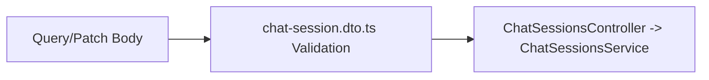

# modules/chat-sessions/dto — DTO Phiên Chat & Tin nhắn Phân trang Con trỏ

- **Motivation/Background**: Cung cấp tài liệu đặc tả tự chứa ngay tại `backend_rag/src/modules/chat-sessions/dto/` theo yêu cầu chuẩn hóa kiến trúc, giúp người đọc nắm bắt nhanh mục đích thư mục, trách nhiệm từng file và luồng nghiệp vụ mà không phải dò thủ công toàn bộ mã nguồn.
- **Purpose**: Khai báo DTO truy vấn và phản hồi chuẩn cho `/chat-sessions`: `ListSessionsQueryDto`, `ListMessagesQueryDto`, `RenameSessionDto` và các DTO trả về có phân trang (`SessionPageDto`, `MessagePageDto`, `SessionDto`, `SessionSummaryDto`, `MessageDto`).
- **Overview Pipeline**: Validate tham số `?limit`, `?cursor`, `?q`, và độ dài `title`  -> Chuẩn hóa kiểu dữ liệu khi serialize sang JSON/XML và Swagger OpenAPI.
- **Detailed Plan**: Mục 1 định nghĩa phạm vi & vai trò; Mục 2 liệt kê cấu trúc thư mục con và danh mục file/export thực tế; Mục 3 mô tả chức năng, luồng nghiệp vụ kèm sơ đồ Mermaid; Mục 4 quy định hợp đồng I/O, bất biến hệ thống và lệnh kiểm chứng.
- **References**: [chat-sessions/README.md](../README.md), [pagination/README.md](../../../common/pagination/README.md), [AGENTS.md](../../../../AGENTS.md).
- **Created**: 2026-11-15T12:55:00+07:00
- **Last Updated**: 2026-11-15T12:55:00+07:00

[STATUS: ACTIVE]

---
## 1. Mục đích & Phạm vi Thư mục (Directory Scope & Architectural Role)

Khai báo DTO truy vấn và phản hồi chuẩn cho `/chat-sessions`: `ListSessionsQueryDto`, `ListMessagesQueryDto`, `RenameSessionDto` và các DTO trả về có phân trang (`SessionPageDto`, `MessagePageDto`, `SessionDto`, `SessionSummaryDto`, `MessageDto`).

---

## 2. Đặc tả Kỹ thuật & Danh mục File (Technical Specification)

### 2.2. Danh mục File & Ký hiệu Kỹ thuật (File & Symbol Inventory)

| File | Loại / Tầng | Exports / Routes / Ký hiệu Chính | Mô tả Trách nhiệm |
| :--- | :--- | :--- | :--- |
| [`chat-session.dto.ts`](chat-session.dto.ts) | DTO & OpenAPI | `ListSessionsQueryDto`, `ListMessagesQueryDto`, `RenameSessionDto`, `SessionSummaryDto`, `MessageDto`, `SessionDto`, `MessagePageDto` (+1) | Định nghĩa DTO đầu vào/ra kèm ràng buộc `class-validator` & Swagger. |
| [`index.ts`](index.ts) | Barrel Export | Re-exports: `./chat-session.dto` | Barrel thống nhất điểm import công khai của thư mục |

---

## 3. Mô tả Chức năng & Luồng Nghiệp vụ (Business Flow)

1. Validate tham số `?limit`, `?cursor`, `?q`, và độ dài `title` (tối đa 120 ký tự).
2. Chuẩn hóa kiểu dữ liệu khi serialize sang JSON/XML và Swagger OpenAPI.



---

## 4. Hợp đồng Đầu vào / Đầu ra, Bất biến & Kiểm chứng

- **Đầu vào (Inputs)**: Query phân trang/tìm kiếm và body `{ title }`.
- **Đầu ra & Tác động (Outputs / Side Effects)**: Dữ liệu DTO đã kiểm tra hợp lệ và metadata OpenAPI.

### Bất biến & Quy tắc Kiến trúc (System Invariants)
- Giới hạn trang session mặc định `10`, tối đa xóa lô `50`, độ dài tiêu đề tối đa `120`.

### Lệnh Kiểm chứng (Verification)
```powershell
cd backend_rag && npm run build
```
