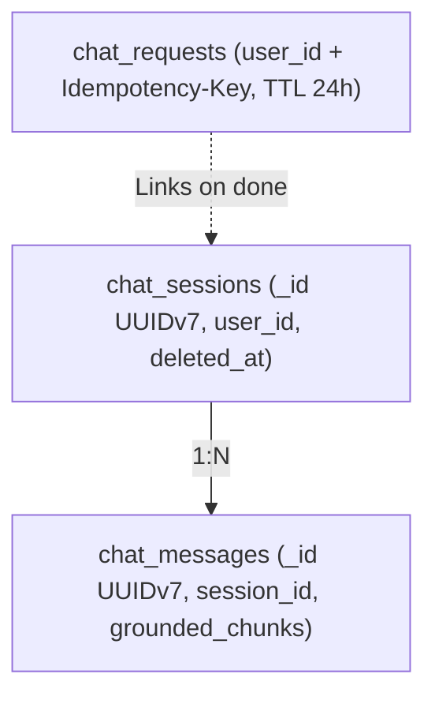

# modules/chat-sessions/schemas — Lược đồ MongoDB ChatSession, ChatMessage & ChatRequest

- **Motivation/Background**: Cung cấp tài liệu đặc tả tự chứa ngay tại `backend_rag/src/modules/chat-sessions/schemas/` theo yêu cầu chuẩn hóa kiến trúc, giúp người đọc nắm bắt nhanh mục đích thư mục, trách nhiệm từng file và luồng nghiệp vụ mà không phải dò thủ công toàn bộ mã nguồn.
- **Purpose**: Định nghĩa 3 schema Mongoose cho hội thoại: `ChatSession` (khóa UUIDv7, `user_id`, `deleted_at`, TTL), `ChatMessage` (khóa UUIDv7, nội dung, `citations`, `grounded_chunks`, `timings`) và `ChatRequest` (bản ghi `Idempotency-Key` + `request_hash` TTL 24 giờ).
- **Overview Pipeline**: `ChatSession` và `ChatMessage` dùng `_id: String` kết hợp compound index phục... -> `ChatRequest` giữ khóa duy nhất `(user_id, key)` để chống chạy trùng request....
- **Detailed Plan**: Mục 1 định nghĩa phạm vi & vai trò; Mục 2 liệt kê cấu trúc thư mục con và danh mục file/export thực tế; Mục 3 mô tả chức năng, luồng nghiệp vụ kèm sơ đồ Mermaid; Mục 4 quy định hợp đồng I/O, bất biến hệ thống và lệnh kiểm chứng.
- **References**: [AGENTS.md](../../../../AGENTS.md).
- **Created**: 2026-11-15T12:55:00+07:00
- **Last Updated**: 2026-11-15T12:55:00+07:00

[STATUS: ACTIVE]

---
## 1. Mục đích & Phạm vi Thư mục (Directory Scope & Architectural Role)

Định nghĩa 3 schema Mongoose cho hội thoại: `ChatSession` (khóa UUIDv7, `user_id`, `deleted_at`, TTL), `ChatMessage` (khóa UUIDv7, nội dung, `citations`, `grounded_chunks`, `timings`) và `ChatRequest` (bản ghi `Idempotency-Key` + `request_hash` TTL 24 giờ).

---

## 2. Đặc tả Kỹ thuật & Danh mục File (Technical Specification)

### 2.2. Danh mục File & Ký hiệu Kỹ thuật (File & Symbol Inventory)

| File | Loại / Tầng | Exports / Routes / Ký hiệu Chính | Mô tả Trách nhiệm |
| :--- | :--- | :--- | :--- |
| [`chat-message.schema.ts`](chat-message.schema.ts) | Mongoose Schema | `MessageRole`, `ChatMessage`, `ChatMessageDocument`, `ChatMessageSchema` | Định nghĩa lược đồ MongoDB Mongoose & các index truy vấn. |
| [`chat-request.schema.ts`](chat-request.schema.ts) | Mongoose Schema | `REQUEST_KEY_TTL_SECONDS`, `ChatRequestStatus`, `ChatRequest`, `ChatRequestSchema` | One `Idempotency-Key` of `POST /rag/chat*`. `_id` = `<user_id>:<key>`, so the insert is the atomic reservation and keys of different users can never... |
| [`chat-session.schema.ts`](chat-session.schema.ts) | Mongoose Schema | `SESSION_TTL_SECONDS`, `ChatSession`, `ChatSessionDocument`, `ChatSessionSchema` | Định nghĩa lược đồ MongoDB Mongoose & các index truy vấn. |
| [`index.ts`](index.ts) | Barrel Export | Re-exports: `./chat-message.schema`, `./chat-request.schema`, `./chat-session.schema` | Barrel thống nhất điểm import công khai của thư mục |

---

## 3. Mô tả Chức năng & Luồng Nghiệp vụ (Business Flow)

1. `ChatSession` và `ChatMessage` dùng `_id: String` (UUIDv7) kết hợp compound index phục vụ keyset pagination.
2. `ChatRequest` giữ khóa duy nhất `(user_id, key)` để chống chạy trùng request `POST /rag/chat*`.



---

## 4. Hợp đồng Đầu vào / Đầu ra, Bất biến & Kiểm chứng

- **Đầu vào (Inputs)**: Dữ liệu trao đổi chat từ `ChatSessionsService` và khóa idempotency từ `ChatRequestsService`.
- **Đầu ra & Tác động (Outputs / Side Effects)**: Tài liệu lưu trữ an toàn trên MongoDB Replica Set với TTL index tự dọn.

### Bất biến & Quy tắc Kiến trúc (System Invariants)
- Phiên chat và tin nhắn sử dụng chuỗi **UUIDv7** làm `_id` (không dùng ObjectId) và lọc `deleted_at: null`.

### Lệnh Kiểm chứng (Verification)
```powershell
cd backend_rag && npx jest src/modules/chat-sessions/chat-sessions.spec.ts --runInBand
```
