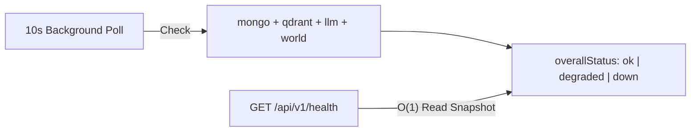

# modules/health — Giám sát Sức khỏe Hệ thống Nền (/api/v1/health)

- **Motivation/Background**: Cung cấp tài liệu đặc tả tự chứa ngay tại `backend_rag/src/modules/health/` theo yêu cầu chuẩn hóa kiến trúc, giúp người đọc nắm bắt nhanh mục đích thư mục, trách nhiệm từng file và luồng nghiệp vụ mà không phải dò thủ công toàn bộ mã nguồn.
- **Purpose**: Theo dõi định kỳ (mỗi `10s` qua `CHECK_INTERVAL_MS`) trạng thái kết nối của 4 thành phần phụ thuộc: `mongo`, `qdrant`, `llm`, `world`, tổng hợp trạng thái `ok` / `degraded` / `down` qua `GET /api/v1/health` mà không chặn Event Loop.
- **Overview Pipeline**: `HealthService` khởi chạy kiểm tra nền khi boot ứng dụng và dừng sạch sẽ khi... -> `HealthController` trả snapshot mới nhất từ bộ nhớ với chi phí `0` truy vấn... -> Frontend đọc trường `components.{mongo,qdrant,llm,world}` để hiển thị đèn tín....
- **Detailed Plan**: Mục 1 định nghĩa phạm vi & vai trò; Mục 2 liệt kê cấu trúc thư mục con và danh mục file/export thực tế; Mục 3 mô tả chức năng, luồng nghiệp vụ kèm sơ đồ Mermaid; Mục 4 quy định hợp đồng I/O, bất biến hệ thống và lệnh kiểm chứng.
- **References**: [benchmark/README.md](../../../benchmark/README.md), [AGENTS.md](../../../AGENTS.md).
- **Created**: 2026-11-15T12:55:00+07:00
- **Last Updated**: 2026-11-15T12:55:00+07:00

[STATUS: ACTIVE]

---
## 1. Mục đích & Phạm vi Thư mục (Directory Scope & Architectural Role)

Theo dõi định kỳ (mỗi `10s` qua `CHECK_INTERVAL_MS`) trạng thái kết nối của 4 thành phần phụ thuộc: `mongo`, `qdrant`, `llm`, `world`, tổng hợp trạng thái `ok` / `degraded` / `down` qua `GET /api/v1/health` mà không chặn Event Loop.

---

## 2. Đặc tả Kỹ thuật & Danh mục File (Technical Specification)

### 2.1. Danh mục Thư mục con (Subdirectories)

| Thư mục con | Liên kết Đặc tả | Vai trò Chính |
| :--- | :--- | :--- |
| **`dto/`** | [`dto/README.md`](dto/README.md) | Khai báo `HealthDto` triển khai interface `Health` để Swagger OpenAPI và Content Negotiation (JSON/XML) mô tả chính xác cấu trúc phản hồi của `/api/v1/health`. |

### 2.2. Danh mục File & Ký hiệu Kỹ thuật (File & Symbol Inventory)

| File | Loại / Tầng | Exports / Routes / Ký hiệu Chính | Mô tả Trách nhiệm |
| :--- | :--- | :--- | :--- |
| [`health.controller.ts`](health.controller.ts) | HTTP Controller | @Controller('health'), @Get('/'), @Get('live'), @Get('ready'), `HealthController` | Tiếp nhận HTTP request, kiểm tra guard/DTO và điều phối sang service. |
| [`health.module.ts`](health.module.ts) | NestJS Module | `HealthModule` | Module NestJS khai báo imports, providers và exports DI. |
| [`health.service.ts`](health.service.ts) | Domain Service | `CHECK_INTERVAL_MS`, `HealthStatus`, `Components`, `Health`, `overallStatus`, `HealthService` | Cài đặt logic nghiệp vụ cốt lõi và tích hợp lưu trữ/engine. |
| [`health.spec.ts`](health.spec.ts) | Jest Integration/Unit Spec | - | A non-production config, so the controller returns the detailed payload. |
| [`index.ts`](index.ts) | Barrel Export | Re-exports: `./health.controller`, `./health.module`, `./health.service`, `./dto` | Barrel thống nhất điểm import công khai của thư mục |

---

## 3. Mô tả Chức năng & Luồng Nghiệp vụ (Business Flow)

1. `HealthService` khởi chạy kiểm tra nền khi boot ứng dụng (`OnApplicationBootstrap`) và dừng sạch sẽ khi tắt (`OnModuleDestroy`).
2. `HealthController` trả snapshot mới nhất từ bộ nhớ với chi phí `0` truy vấn đồng bộ trực tiếp lúc cao điểm.
3. Frontend đọc trường `components.{mongo,qdrant,llm,world}` để hiển thị đèn tín hiệu trên TopBar và HealthBanner.



---

## 4. Hợp đồng Đầu vào / Đầu ra, Bất biến & Kiểm chứng

- **Đầu vào (Inputs)**: Ping MongoDB (`db.admin().ping()`), Qdrant collections, `LlmService.status()` và `TreeRouterService`.
- **Đầu ra & Tác động (Outputs / Side Effects)**: `HealthDto` gồm `status`, `components` và HATEOAS `_links`.

### Bất biến & Quy tắc Kiến trúc (System Invariants)
- Nếu LLM chưa nạp xong (ví dụ đang tải mô hình), `/health` báo `degraded` thay vì sập ứng dụng.

### Lệnh Kiểm chứng (Verification)
```powershell
cd backend_rag && npx jest src/modules/health/health.spec.ts --runInBand
```
