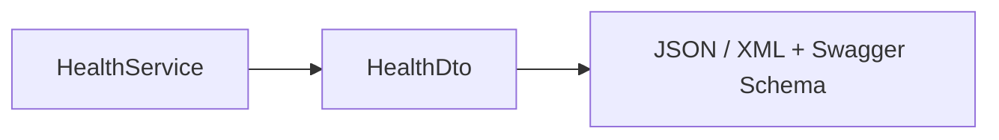

# modules/health/dto — DTO Đầu ra Kiểm tra Sức khỏe Hệ thống

- **Motivation/Background**: Cung cấp tài liệu đặc tả tự chứa ngay tại `backend_rag/src/modules/health/dto/` theo yêu cầu chuẩn hóa kiến trúc, giúp người đọc nắm bắt nhanh mục đích thư mục, trách nhiệm từng file và luồng nghiệp vụ mà không phải dò thủ công toàn bộ mã nguồn.
- **Purpose**: Khai báo `HealthDto` triển khai interface `Health` để Swagger OpenAPI và Content Negotiation (JSON/XML) mô tả chính xác cấu trúc phản hồi của `/api/v1/health`.
- **Overview Pipeline**: Mô tả trường `status` và đối tượng `components` .
- **Detailed Plan**: Mục 1 định nghĩa phạm vi & vai trò; Mục 2 liệt kê cấu trúc thư mục con và danh mục file/export thực tế; Mục 3 mô tả chức năng, luồng nghiệp vụ kèm sơ đồ Mermaid; Mục 4 quy định hợp đồng I/O, bất biến hệ thống và lệnh kiểm chứng.
- **References**: [health/README.md](../README.md), [AGENTS.md](../../../../AGENTS.md).
- **Created**: 2026-11-15T12:55:00+07:00
- **Last Updated**: 2026-11-15T12:55:00+07:00

[STATUS: ACTIVE]

---
## 1. Mục đích & Phạm vi Thư mục (Directory Scope & Architectural Role)

Khai báo `HealthDto` triển khai interface `Health` để Swagger OpenAPI và Content Negotiation (JSON/XML) mô tả chính xác cấu trúc phản hồi của `/api/v1/health`.

---

## 2. Đặc tả Kỹ thuật & Danh mục File (Technical Specification)

### 2.2. Danh mục File & Ký hiệu Kỹ thuật (File & Symbol Inventory)

| File | Loại / Tầng | Exports / Routes / Ký hiệu Chính | Mô tả Trách nhiệm |
| :--- | :--- | :--- | :--- |
| [`health.dto.ts`](health.dto.ts) | DTO & OpenAPI | `HealthDto` | `GET /health` (API_DESIGN §6). |
| [`index.ts`](index.ts) | Barrel Export | Re-exports: `./health.dto` | Barrel thống nhất điểm import công khai của thư mục |

---

## 3. Mô tả Chức năng & Luồng Nghiệp vụ (Business Flow)

1. Mô tả trường `status` (`ok`/`degraded`/`down`) và đối tượng `components` (`mongo`, `qdrant`, `llm`, `world`).



---

## 4. Hợp đồng Đầu vào / Đầu ra, Bất biến & Kiểm chứng

- **Đầu vào (Inputs)**: Trạng thái từ `HealthService`.
- **Đầu ra & Tác động (Outputs / Side Effects)**: Mô hình phản hồi OpenAPI typed cho `GET /api/v1/health`.

### Bất biến & Quy tắc Kiến trúc (System Invariants)
- Khớp đúng tên 4 khóa thành phần `{ mongo, qdrant, llm, world }` mà Frontend đang theo dõi.

### Lệnh Kiểm chứng (Verification)
```powershell
cd backend_rag && npm run build
```
