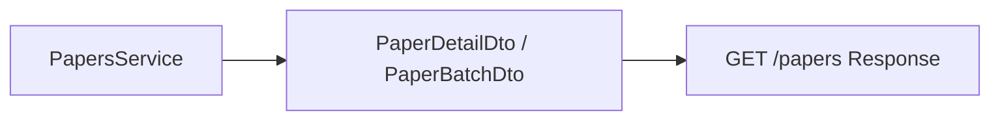

# modules/papers/dto — DTO Metadata Bài báo & Danh sách Chunks

- **Motivation/Background**: Cung cấp tài liệu đặc tả tự chứa ngay tại `backend_rag/src/modules/papers/dto/` theo yêu cầu chuẩn hóa kiến trúc, giúp người đọc nắm bắt nhanh mục đích thư mục, trách nhiệm từng file và luồng nghiệp vụ mà không phải dò thủ công toàn bộ mã nguồn.
- **Purpose**: Khai báo `ChunkDto`, `PaperDetailDto` và `PaperBatchDto` phản chiếu đúng kiểu `PaperDetail` chia sẻ hợp đồng giữa Backend và Frontend 3D.
- **Overview Pipeline**: Cung cấp trang trí `@ApiProperty` cho từng trường `paper_id`, `title`....
- **Detailed Plan**: Mục 1 định nghĩa phạm vi & vai trò; Mục 2 liệt kê cấu trúc thư mục con và danh mục file/export thực tế; Mục 3 mô tả chức năng, luồng nghiệp vụ kèm sơ đồ Mermaid; Mục 4 quy định hợp đồng I/O, bất biến hệ thống và lệnh kiểm chứng.
- **References**: [papers/README.md](../README.md), [AGENTS.md](../../../../AGENTS.md).
- **Created**: 2026-11-15T12:55:00+07:00
- **Last Updated**: 2026-11-15T12:55:00+07:00

[STATUS: ACTIVE]

---
## 1. Mục đích & Phạm vi Thư mục (Directory Scope & Architectural Role)

Khai báo `ChunkDto`, `PaperDetailDto` và `PaperBatchDto` phản chiếu đúng kiểu `PaperDetail` chia sẻ hợp đồng giữa Backend và Frontend 3D.

---

## 2. Đặc tả Kỹ thuật & Danh mục File (Technical Specification)

### 2.2. Danh mục File & Ký hiệu Kỹ thuật (File & Symbol Inventory)

| File | Loại / Tầng | Exports / Routes / Ký hiệu Chính | Mô tả Trách nhiệm |
| :--- | :--- | :--- | :--- |
| [`index.ts`](index.ts) | Barrel Export | Re-exports: `./paper-detail.dto` | Barrel thống nhất điểm import công khai của thư mục |
| [`paper-detail.dto.ts`](paper-detail.dto.ts) | DTO & OpenAPI | `ChunkDto`, `PaperDetailDto`, `PaperBatchDto` | Swagger shape of `GET /papers/:paper_id` (API_DESIGN §5). |

---

## 3. Mô tả Chức năng & Luồng Nghiệp vụ (Business Flow)

1. Cung cấp trang trí `@ApiProperty` cho từng trường `paper_id`, `title`, `authors`, `year`, `category`, `chunks`.



---

## 4. Hợp đồng Đầu vào / Đầu ra, Bất biến & Kiểm chứng

- **Đầu vào (Inputs)**: Dữ liệu tổng hợp từ Qdrant payload và `CorpusService`.
- **Đầu ra & Tác động (Outputs / Side Effects)**: Response JSON/XML và OpenAPI spec cho `/api/v1/papers`.

### Bất biến & Quy tắc Kiến trúc (System Invariants)
- Tên trường dùng `snake_case` đồng nhất với kiểu `PaperDetail` bên Frontend (`frontend_rag/src/shared/types/world.ts`).

### Lệnh Kiểm chứng (Verification)
```powershell
cd backend_rag && npm run build
```
