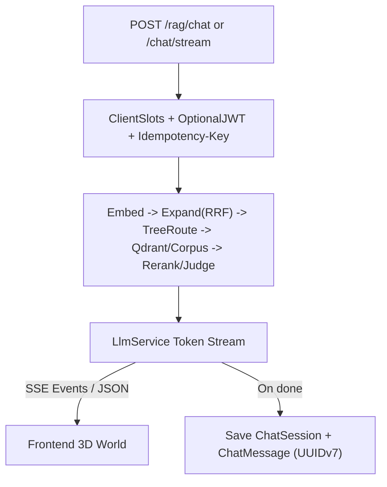

# modules/rag — Phân hệ Điều phối Pipeline RAG Khoa học & SSE Streaming

- **Motivation/Background**: Cung cấp tài liệu đặc tả tự chứa ngay tại `backend_rag/src/modules/rag/` theo yêu cầu chuẩn hóa kiến trúc, giúp người đọc nắm bắt nhanh mục đích thư mục, trách nhiệm từng file và luồng nghiệp vụ mà không phải dò thủ công toàn bộ mã nguồn.
- **Purpose**: Trái tim nghiệp vụ hỏi đáp của `RAG_TS`: điều phối tuần tự qua toàn bộ các engine (`Embedding` -> `TreeRouter` -> `VectorStore` + `Corpus` -> `Mining` -> `Judge` -> `PromptBuilder` -> `LlmService`), quản lý đồng thời theo User/IP (`ClientSlots`), thực thi `Idempotency-Key` và phát sự kiện SSE thời gian thực (`phase`, `route`, `compare`, `retrieval`, `token`, `done`) cho cảnh 3D.
- **Overview Pipeline**: Xác thực tùy chọn và kiểm soát slot đang chạy  -> Nếu đã đăng nhập kèm `Idempotency-Key`, kiểm tra trạng thái yêu cầu qua... -> Thực thi pipeline.
- **Detailed Plan**: Mục 1 định nghĩa phạm vi & vai trò; Mục 2 liệt kê cấu trúc thư mục con và danh mục file/export thực tế; Mục 3 mô tả chức năng, luồng nghiệp vụ kèm sơ đồ Mermaid; Mục 4 quy định hợp đồng I/O, bất biến hệ thống và lệnh kiểm chứng.
- **References**: [AGENTS.md](../../../AGENTS.md).
- **Created**: 2026-11-15T12:55:00+07:00
- **Last Updated**: 2026-11-15T12:55:00+07:00

[STATUS: ACTIVE]

---
## 1. Mục đích & Phạm vi Thư mục (Directory Scope & Architectural Role)

Trái tim nghiệp vụ hỏi đáp của `RAG_TS`: điều phối tuần tự qua toàn bộ các engine (`Embedding` -> `TreeRouter` -> `VectorStore` + `Corpus` -> `Mining` -> `Judge` -> `PromptBuilder` -> `LlmService`), quản lý đồng thời theo User/IP (`ClientSlots`), thực thi `Idempotency-Key` và phát sự kiện SSE thời gian thực (`phase`, `route`, `compare`, `retrieval`, `token`, `done`) cho cảnh 3D.

---

## 2. Đặc tả Kỹ thuật & Danh mục File (Technical Specification)

### 2.1. Danh mục Thư mục con (Subdirectories)

| Thư mục con | Liên kết Đặc tả | Vai trò Chính |
| :--- | :--- | :--- |
| **`dto/`** | [`dto/README.md`](dto/README.md) | Khai báo `ChatRequestDto` (kiểm soát giới hạn `question`, `top_k`, `nprobe 1..6`, bộ lọc năm/chuyên mục, UUID phiên chat) và `ChatResponseDto` (`answer`, `citations`, `grounded_chunks`, `timings`, `quality`, `session_id`, `message_id`). |
| **`pipeline/`** | [`pipeline/README.md`](pipeline/README.md) | Tách biệt toàn bộ logic tính toán thuần túy không I/O của pipeline RAG để dễ kiểm thử đơn vị: `buildUserPrompt` (ép mô hình bám sát trích dẫn `[Paper: ...]`), `fuseRanks` (Reciprocal Rank Fusion `RRF_K = 60`), `topPapers`, `extractCitations` và `requestFingerprint` (hash SHA-256 kiểm tra xung đột `Idempotency-Key`). |
| **`transport/`** | [`transport/README.md`](transport/README.md) | Đảm bảo vận hành ổn định kết nối SSE dài hạn qua Cloudflare Tunnel/Proxy bằng `SseWriter` (tự động phát `: ping` giữ kết nối mỗi `5s` theo `PING_INTERVAL_MS`), `abortOnClientClose` hủy xử lý khi người dùng tắt tab và `ClientSlots` giới hạn số lượt stream song song mỗi user/IP. |

### 2.2. Danh mục File & Ký hiệu Kỹ thuật (File & Symbol Inventory)

| File | Loại / Tầng | Exports / Routes / Ký hiệu Chính | Mô tả Trách nhiệm |
| :--- | :--- | :--- | :--- |
| [`index.ts`](index.ts) | Barrel Export | Re-exports: `./rag.controller`, `./rag.module`, `./rag.service`, `./rag.types`, `./dto`, `./pipeline` (+1) | Barrel thống nhất điểm import công khai của thư mục |
| [`rag.controller.ts`](rag.controller.ts) | HTTP Controller | @Controller('rag'), @Post('chat'), @Post('chat/stream'), `RagController` | Tiếp nhận HTTP request, kiểm tra guard/DTO và điều phối sang service. |
| [`rag.gates.spec.ts`](rag.gates.spec.ts) | Jest Integration/Unit Spec | - | Bộ kiểm thử tự động xác minh hành vi cho `backend_rag/src/modules/rag`. |
| [`rag.module.ts`](rag.module.ts) | NestJS Module | `RagModule` | Module NestJS khai báo imports, providers và exports DI. |
| [`rag.service.ts`](rag.service.ts) | Domain Service | `RagService` | Cài đặt logic nghiệp vụ cốt lõi và tích hợp lưu trữ/engine. |
| [`rag.spec.ts`](rag.spec.ts) | Jest Integration/Unit Spec | - | Bộ kiểm thử tự động xác minh hành vi cho `backend_rag/src/modules/rag`. |
| [`rag.types.ts`](rag.types.ts) | TypeScript Module | `PipelineEvent`, `PipelineResult` | Events the pipeline yields (errors are thrown, the controller turns them into `error`). |

---

## 3. Mô tả Chức năng & Luồng Nghiệp vụ (Business Flow)

1. Xác thực tùy chọn (`OptionalJwtAuthGuard`) và kiểm soát slot đang chạy (`ClientSlots`: tối đa 2/user hoặc 3/IP).
2. Nếu đã đăng nhập kèm `Idempotency-Key`, kiểm tra trạng thái yêu cầu qua `ChatRequestsService` (chống lặp / replay đáp án khi rớt mạng).
3. Thực thi pipeline (`rag.service.ts` + `pipeline/*`): nhúng câu hỏi -> mở rộng & RRF nếu bật -> định tuyến cây -> tìm Qdrant + tải văn bản Corpus -> rerank + judge -> dựng prompt -> stream LLM.
4. Trích xuất trích dẫn `extractCitations`, đóng gói `timings` + `quality` và lưu bất đồng bộ vào phiên chat MongoDB (`SessionStorePort`), phát sự kiện `done` kèm `session_id` và `message_id`.



---

## 4. Hợp đồng Đầu vào / Đầu ra, Bất biến & Kiểm chứng

- **Đầu vào (Inputs)**: `ChatRequestDto` (`question`, `top_k`, `nprobe`, `session_id`, `categories`, `year_*`, `authority_boost`, `query_expansion`), header `Idempotency-Key`, `AbortSignal`.
- **Đầu ra & Tác động (Outputs / Side Effects)**: Luồng SSE (`RagStreamEvent`) hoặc JSON `ChatResponseDto` kèm trích dẫn đã kiểm chứng và số đo thời gian từng pha.

### Bất biến & Quy tắc Kiến trúc (System Invariants)
- `POST /rag/chat*` bắt buộc giữ lũy đẳng qua `Idempotency-Key` khi người dùng đã đăng nhập (`D-047`).
- Không để rò slot xử lý khi client ngắt kết nối giữa stream (`abortOnClientClose`).

### Lệnh Kiểm chứng (Verification)
```powershell
cd backend_rag && npx jest src/modules/rag --runInBand
```
