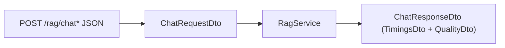

# modules/rag/dto — DTO Yêu cầu & Phản hồi Hỏi đáp RAG

- **Motivation/Background**: Cung cấp tài liệu đặc tả tự chứa ngay tại `backend_rag/src/modules/rag/dto/` theo yêu cầu chuẩn hóa kiến trúc, giúp người đọc nắm bắt nhanh mục đích thư mục, trách nhiệm từng file và luồng nghiệp vụ mà không phải dò thủ công toàn bộ mã nguồn.
- **Purpose**: Khai báo `ChatRequestDto` (kiểm soát giới hạn `question`, `top_k`, `nprobe 1..6`, bộ lọc năm/chuyên mục, UUID phiên chat) và `ChatResponseDto` (`answer`, `citations`, `grounded_chunks`, `timings`, `quality`, `session_id`, `message_id`).
- **Overview Pipeline**: Validate tham số nhập trước khi đưa vào hàng đợi LLM đắt đỏ -> Xuất schema chuẩn Swagger cho cả endpoint JSON `POST /rag/chat` và tham chiếu....
- **Detailed Plan**: Mục 1 định nghĩa phạm vi & vai trò; Mục 2 liệt kê cấu trúc thư mục con và danh mục file/export thực tế; Mục 3 mô tả chức năng, luồng nghiệp vụ kèm sơ đồ Mermaid; Mục 4 quy định hợp đồng I/O, bất biến hệ thống và lệnh kiểm chứng.
- **References**: [rag/README.md](../README.md), [AGENTS.md](../../../../AGENTS.md).
- **Created**: 2026-11-15T12:55:00+07:00
- **Last Updated**: 2026-11-15T12:55:00+07:00

[STATUS: ACTIVE]

---
## 1. Mục đích & Phạm vi Thư mục (Directory Scope & Architectural Role)

Khai báo `ChatRequestDto` (kiểm soát giới hạn `question`, `top_k`, `nprobe 1..6`, bộ lọc năm/chuyên mục, UUID phiên chat) và `ChatResponseDto` (`answer`, `citations`, `grounded_chunks`, `timings`, `quality`, `session_id`, `message_id`).

---

## 2. Đặc tả Kỹ thuật & Danh mục File (Technical Specification)

### 2.2. Danh mục File & Ký hiệu Kỹ thuật (File & Symbol Inventory)

| File | Loại / Tầng | Exports / Routes / Ký hiệu Chính | Mô tả Trách nhiệm |
| :--- | :--- | :--- | :--- |
| [`chat-request.dto.ts`](chat-request.dto.ts) | DTO & OpenAPI | `ChatRequestDto` | Body of `POST /rag/chat` and `POST /rag/chat/stream` (API_DESIGN §3 + `nprobe`). |
| [`chat-response.dto.ts`](chat-response.dto.ts) | DTO & OpenAPI | `TimingsDto`, `QualityDto`, `ChatResponseDto` | Định nghĩa DTO đầu vào/ra kèm ràng buộc `class-validator` & Swagger. |
| [`index.ts`](index.ts) | Barrel Export | Re-exports: `./chat-request.dto`, `./chat-response.dto` | Barrel thống nhất điểm import công khai của thư mục |

---

## 3. Mô tả Chức năng & Luồng Nghiệp vụ (Business Flow)

1. Validate tham số nhập trước khi đưa vào hàng đợi LLM đắt đỏ.
2. Xuất schema chuẩn Swagger cho cả endpoint JSON `POST /rag/chat` và tham chiếu SSE.



---

## 4. Hợp đồng Đầu vào / Đầu ra, Bất biến & Kiểm chứng

- **Đầu vào (Inputs)**: Payload hỏi đáp JSON của người dùng.
- **Đầu ra & Tác động (Outputs / Side Effects)**: Request hợp lệ và đối tượng phản hồi OpenAPI.

### Bất biến & Quy tắc Kiến trúc (System Invariants)
- `nprobe` giới hạn `[1, 6]`, `top_k` có ngưỡng chặn trên nhằm đảm bảo prompt vừa cửa sổ ngữ cảnh Qwen2.5-7B.

### Lệnh Kiểm chứng (Verification)
```powershell
cd backend_rag && npm run build
```
