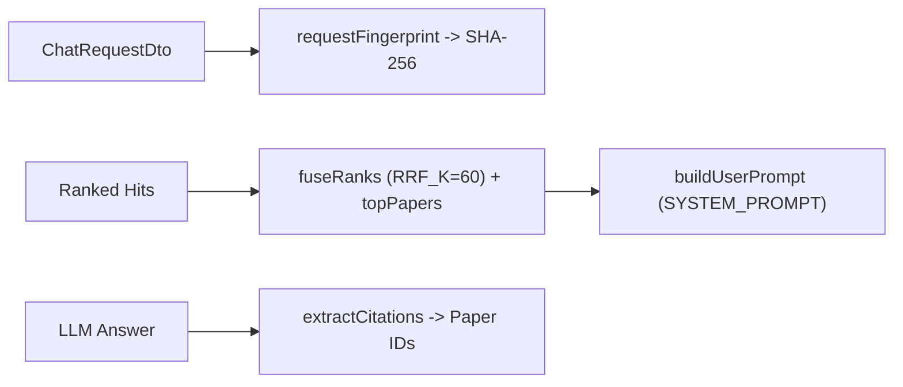

# modules/rag/pipeline — Các Hàm Thuần Pipeline RAG (Prompt, Ranking, RRF, Citations & Fingerprint)

- **Motivation/Background**: Cung cấp tài liệu đặc tả tự chứa ngay tại `backend_rag/src/modules/rag/pipeline/` theo yêu cầu chuẩn hóa kiến trúc, giúp người đọc nắm bắt nhanh mục đích thư mục, trách nhiệm từng file và luồng nghiệp vụ mà không phải dò thủ công toàn bộ mã nguồn.
- **Purpose**: Tách biệt toàn bộ logic tính toán thuần túy không I/O của pipeline RAG để dễ kiểm thử đơn vị: `buildUserPrompt` (ép mô hình bám sát trích dẫn `[Paper: ...]`), `fuseRanks` (Reciprocal Rank Fusion `RRF_K = 60`), `topPapers`, `extractCitations` và `requestFingerprint` (hash SHA-256 kiểm tra xung đột `Idempotency-Key`).
- **Overview Pipeline**: `requestFingerprint` băm tham số câu hỏi để phát hiện trường hợp client tái... -> `fuseRanks` gộp thứ hạng tìm kiếm gốc và tìm kiếm mở rộng bằng công thức RRF  -> `topPapers` giữ lại các passage grounded hàng đầu chuyển cho `buildUserPrompt`.
- **Detailed Plan**: Mục 1 định nghĩa phạm vi & vai trò; Mục 2 liệt kê cấu trúc thư mục con và danh mục file/export thực tế; Mục 3 mô tả chức năng, luồng nghiệp vụ kèm sơ đồ Mermaid; Mục 4 quy định hợp đồng I/O, bất biến hệ thống và lệnh kiểm chứng.
- **References**: [rag/README.md](../README.md), [AGENTS.md](../../../../AGENTS.md).
- **Created**: 2026-11-15T12:55:00+07:00
- **Last Updated**: 2026-11-17T17:48:00+07:00

[STATUS: ACTIVE]

---
## 1. Mục đích & Phạm vi Thư mục (Directory Scope & Architectural Role)

Tách biệt toàn bộ logic tính toán thuần túy không I/O của pipeline RAG để dễ kiểm thử đơn vị: `buildUserPrompt` (ép mô hình bám sát trích dẫn `[Paper: ...]`), `fuseRanks` (Reciprocal Rank Fusion `RRF_K = 60`), `topPapers`, `extractCitations` và `requestFingerprint` (hash SHA-256 kiểm tra xung đột `Idempotency-Key`).

---

## 2. Đặc tả Kỹ thuật & Danh mục File (Technical Specification)

### 2.2. Danh mục File & Ký hiệu Kỹ thuật (File & Symbol Inventory)

| File | Loại / Tầng | Exports / Routes / Ký hiệu Chính | Mô tả Trách nhiệm |
| :--- | :--- | :--- | :--- |
| [`citations.ts`](citations.ts) | TypeScript Module | `extractCitations` | `[Paper: id]`, `[Paper: a, b]`; also `[Paper ID: id \| Title …]` (the model copying a header). |
| [`index.ts`](index.ts) | Barrel Export | Re-exports: `./citations`, `./prompt-builder`, `./ranking`, `./request-fingerprint` | Barrel thống nhất điểm import công khai của thư mục |
| [`prompt-builder.ts`](prompt-builder.ts) | TypeScript Module | `NO_CONTEXT_ANSWER`, `SYSTEM_PROMPT`, `REWRITE_SYSTEM_PROMPT`, `cleanRewrite`, `buildUserPrompt` | Thành phần `TypeScript Module` thuộc `pipeline`. |
| [`ranking.ts`](ranking.ts) | TypeScript Module | `judgedPoolSize`, `GROUNDED_PASSAGES`, `RRF_K`, `topPapers`, `fuseRanks` | Candidates the judge reads: enough to reorder, few enough to keep the wait in seconds. |
| [`request-fingerprint.spec.ts`](request-fingerprint.spec.ts) | Jest Unit Spec | - | Kiểm thử hàm băm SHA-256 `requestFingerprint` cho `Idempotency-Key`. |
| [`request-fingerprint.ts`](request-fingerprint.ts) | TypeScript Module | `requestFingerprint` | Identifies the request body behind an `Idempotency-Key`. |

---

## 3. Mô tả Chức năng & Luồng Nghiệp vụ (Business Flow)

1. `requestFingerprint` băm tham số câu hỏi để phát hiện trường hợp client tái sử dụng `Idempotency-Key` cho câu hỏi khác.
2. `fuseRanks` gộp thứ hạng tìm kiếm gốc và tìm kiếm mở rộng bằng công thức RRF (`k = 60`).
3. `topPapers` giữ lại các passage grounded hàng đầu (`GROUNDED_PASSAGES = 3`) chuyển cho `buildUserPrompt`.
4. `extractCitations` tách mọi thẻ `[Paper: ...]` từ câu trả lời LLM hoàn chỉnh.



---

## 4. Hợp đồng Đầu vào / Đầu ra, Bất biến & Kiểm chứng

- **Đầu vào (Inputs)**: Truy vấn, các tập chunk đã xếp hạng, ngữ cảnh tài liệu và chuỗi trả lời LLM.
- **Đầu ra & Tác động (Outputs / Side Effects)**: Fingerprint hash, danh sách passage tối ưu, chuỗi prompt hoàn chỉnh và danh sách ID trích dẫn.

### Bất biến & Quy tắc Kiến trúc (System Invariants)
- Tất cả hàm trong `pipeline/` là hàm thuần (pure functions), không giữ state nội bộ.

### Lệnh Kiểm chứng (Verification)
```powershell
cd backend_rag && npx jest src/modules/rag --runInBand
```
