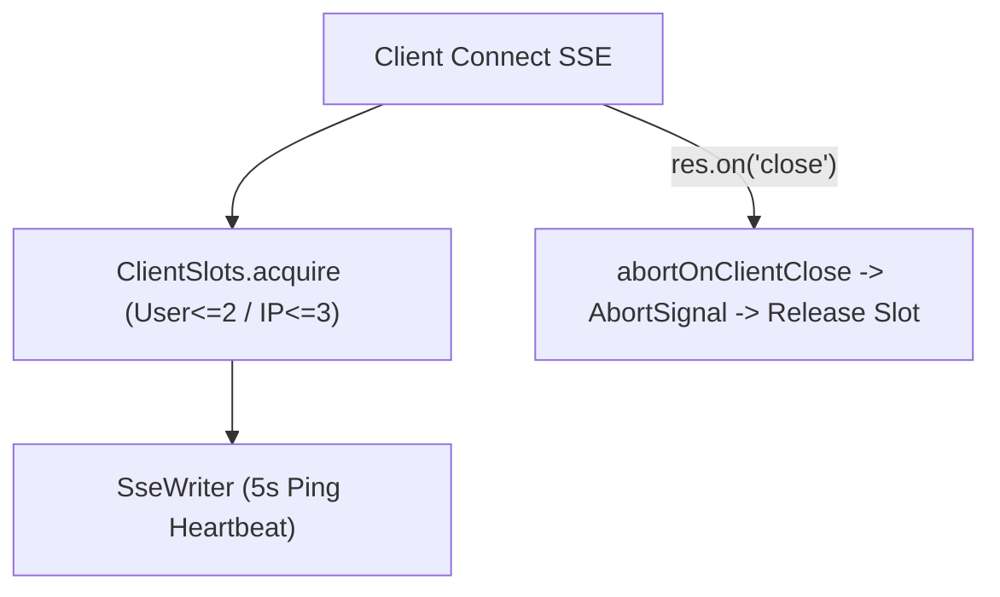

# modules/rag/transport — Lớp Truyền tải SSE Keep-Alive & Kiểm soát Khe Xử lý Đồng thời (ClientSlots)

- **Motivation/Background**: Cung cấp tài liệu đặc tả tự chứa ngay tại `backend_rag/src/modules/rag/transport/` theo yêu cầu chuẩn hóa kiến trúc, giúp người đọc nắm bắt nhanh mục đích thư mục, trách nhiệm từng file và luồng nghiệp vụ mà không phải dò thủ công toàn bộ mã nguồn.
- **Purpose**: Đảm bảo vận hành ổn định kết nối SSE dài hạn qua Cloudflare Tunnel/Proxy bằng `SseWriter` (tự động phát `: ping` giữ kết nối mỗi `5s` theo `PING_INTERVAL_MS`), `abortOnClientClose` hủy xử lý khi người dùng tắt tab và `ClientSlots` giới hạn số lượt stream song song mỗi user/IP.
- **Overview Pipeline**: `ClientSlots.acquire()` cấp slot theo `userId` hoặc IP ; vượt quá trả lỗi... -> `SseWriter` thiết lập header `text/event-stream`, tắt nén/buffering và gửi... -> Khi Express `res` phát sự kiện `close`, `abortOnClientClose` kích hoạt....
- **Detailed Plan**: Mục 1 định nghĩa phạm vi & vai trò; Mục 2 liệt kê cấu trúc thư mục con và danh mục file/export thực tế; Mục 3 mô tả chức năng, luồng nghiệp vụ kèm sơ đồ Mermaid; Mục 4 quy định hợp đồng I/O, bất biến hệ thống và lệnh kiểm chứng.
- **References**: [rag/README.md](../README.md), [AGENTS.md](../../../../AGENTS.md).
- **Created**: 2026-11-15T12:55:00+07:00
- **Last Updated**: 2026-11-15T12:55:00+07:00

[STATUS: ACTIVE]

---
## 1. Mục đích & Phạm vi Thư mục (Directory Scope & Architectural Role)

Đảm bảo vận hành ổn định kết nối SSE dài hạn qua Cloudflare Tunnel/Proxy bằng `SseWriter` (tự động phát `: ping` giữ kết nối mỗi `5s` theo `PING_INTERVAL_MS`), `abortOnClientClose` hủy xử lý khi người dùng tắt tab và `ClientSlots` giới hạn số lượt stream song song mỗi user/IP.

---

## 2. Đặc tả Kỹ thuật & Danh mục File (Technical Specification)

### 2.2. Danh mục File & Ký hiệu Kỹ thuật (File & Symbol Inventory)

| File | Loại / Tầng | Exports / Routes / Ký hiệu Chính | Mô tả Trách nhiệm |
| :--- | :--- | :--- | :--- |
| [`client-slots.spec.ts`](client-slots.spec.ts) | Jest Integration/Unit Spec | - | Bộ kiểm thử tự động xác minh hành vi cho `backend_rag/src/modules/rag/transport`. |
| [`client-slots.ts`](client-slots.ts) | TypeScript Module | `TOO_MANY_INFLIGHT`, `MAX_INFLIGHT_PER_USER`, `MAX_INFLIGHT_PER_IP`, `ClientSlots` | One tab streaming plus one being replaced: the abort of the old stream can lag behind. |
| [`index.ts`](index.ts) | Barrel Export | Re-exports: `./client-slots`, `./sse` | Barrel thống nhất điểm import công khai của thư mục |
| [`sse.ts`](sse.ts) | TypeScript Module | `PING_INTERVAL_MS`, `SseWriter`, `abortOnClientClose` | Server-Sent Events over a raw Express response (POST, so `@Sse()` cannot be used). |

---

## 3. Mô tả Chức năng & Luồng Nghiệp vụ (Business Flow)

1. `ClientSlots.acquire()` cấp slot theo `userId` (`MAX_INFLIGHT_PER_USER = 2`) hoặc IP (`MAX_INFLIGHT_PER_IP = 3`); vượt quá trả lỗi `TOO_MANY_INFLIGHT`.
2. `SseWriter` thiết lập header `text/event-stream`, tắt nén/buffering và gửi comment ping định kỳ.
3. Khi Express `res` phát sự kiện `close`, `abortOnClientClose` kích hoạt `AbortController.abort()` giải phóng slot và dừng LLM.



---

## 4. Hợp đồng Đầu vào / Đầu ra, Bất biến & Kiểm chứng

- **Đầu vào (Inputs)**: Express `Request` / `Response`, `userId` / IP và sự kiện `RagStreamEvent`.
- **Đầu ra & Tác động (Outputs / Side Effects)**: Khung `data: {...}\n\n` trên HTTP chunked stream và dọn dẹp tài nguyên khi đóng.

### Bất biến & Quy tắc Kiến trúc (System Invariants)
- Luôn giữ heartbeat `PING_INTERVAL_MS = 5000ms` tránh bị reverse proxy/Cloudflare cắt idle timeout.

### Lệnh Kiểm chứng (Verification)
```powershell
cd backend_rag && npx jest src/modules/rag/transport/client-slots.spec.ts --runInBand
```
