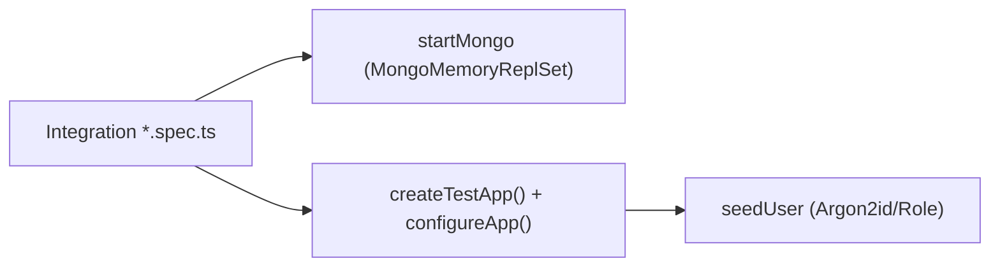

# src/testing — Nhà máy Tạo Ứng dụng Kiểm thử Tích hợp (MongoMemoryReplSet)

- **Motivation/Background**: Cung cấp tài liệu đặc tả tự chứa ngay tại `backend_rag/src/testing/` theo yêu cầu chuẩn hóa kiến trúc, giúp người đọc nắm bắt nhanh mục đích thư mục, trách nhiệm từng file và luồng nghiệp vụ mà không phải dò thủ công toàn bộ mã nguồn.
- **Purpose**: Cung cấp `createTestApp`, `startMongo` (`MongoMemoryReplSet` hỗ trợ đa-document transactions) và `seedUser` kèm `TEST_ENV` mặc định an toàn cho toàn bộ bộ test tích hợp Jest mà không chạm tới MongoDB hoặc Qdrant production.
- **Overview Pipeline**: `startMongo()` khởi chạy MongoDB in-memory dạng Replica Set đơn nút phục vụ... -> `createTestApp()` dựng `TestingModule` + `configureApp()` giống hệt `main.ts`... -> `seedUser()` nạp tài khoản test có vai trò `user` hoặc `admin` vào DB tạm.
- **Detailed Plan**: Mục 1 định nghĩa phạm vi & vai trò; Mục 2 liệt kê cấu trúc thư mục con và danh mục file/export thực tế; Mục 3 mô tả chức năng, luồng nghiệp vụ kèm sơ đồ Mermaid; Mục 4 quy định hợp đồng I/O, bất biến hệ thống và lệnh kiểm chứng.
- **References**: [test/README.md](../../test/README.md), [app.setup.ts](../app.setup.ts), [AGENTS.md](../../AGENTS.md).
- **Created**: 2026-11-15T12:55:00+07:00
- **Last Updated**: 2026-11-17T17:48:00+07:00

[STATUS: ACTIVE]

---
## 1. Mục đích & Phạm vi Thư mục (Directory Scope & Architectural Role)

Cung cấp `createTestApp`, `startMongo` (`MongoMemoryReplSet` hỗ trợ đa-document transactions) và `seedUser` kèm `TEST_ENV` mặc định an toàn cho toàn bộ bộ test tích hợp Jest mà không chạm tới MongoDB hoặc Qdrant production.

---

## 2. Đặc tả Kỹ thuật & Danh mục File (Technical Specification)

### 2.2. Danh mục File & Ký hiệu Kỹ thuật (File & Symbol Inventory)

| File | Loại / Tầng | Exports / Routes / Ký hiệu Chính | Mô tả Trách nhiệm |
| :--- | :--- | :--- | :--- |
| [`barrels.spec.ts`](barrels.spec.ts) | Jest Unit Spec | - | Kiểm tra toàn bộ `40` barrel exports trong `backend_rag/src` không gặp lỗi circular dependency hay export `undefined`. |
| [`index.ts`](index.ts) | Barrel Export | Re-exports: `./test-app` | Barrel thống nhất điểm import công khai của thư mục |
| [`test-app.ts`](test-app.ts) | TypeScript Module | `TEST_ENV`, `startMongo`, `SEED_PASSWORD`, `seedUser`, `TestApp`, `TestAppOptions`, `createTestApp` | Thành phần `TypeScript Module` thuộc `testing`. |

---

## 3. Mô tả Chức năng & Luồng Nghiệp vụ (Business Flow)

1. `startMongo()` khởi chạy MongoDB in-memory dạng Replica Set đơn nút phục vụ transaction.
2. `createTestApp()` dựng `TestingModule` + `configureApp()` giống hệt `main.ts` với khả năng thay thế mock port.
3. `seedUser()` nạp tài khoản test có vai trò `user` hoặc `admin` vào DB tạm.



---

## 4. Hợp đồng Đầu vào / Đầu ra, Bất biến & Kiểm chứng

- **Đầu vào (Inputs)**: `TestAppOptions` tùy chỉnh override provider hoặc kết nối MongoDB memory.
- **Đầu ra & Tác động (Outputs / Side Effects)**: `TestApp` (`INestApplication`, Express server, cleanup helper).

### Bất biến & Quy tắc Kiến trúc (System Invariants)
- Luôn khởi tạo `MongoMemoryReplSet` (chế độ replica set) để kiểm thử thật hành vi Mongoose session/transaction.

### Lệnh Kiểm chứng (Verification)
```powershell
cd backend_rag && npm test
```
