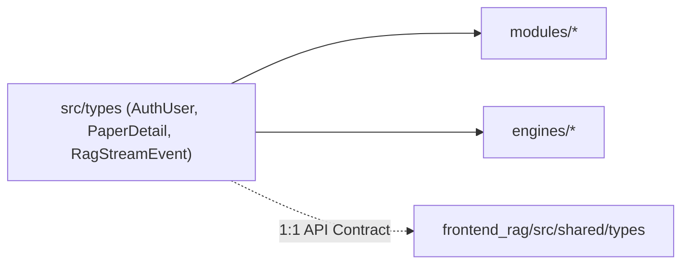

# src/types — Định nghĩa Kiểu Dữ liệu Lõi Toàn Hệ thống

- **Motivation/Background**: Cung cấp tài liệu đặc tả tự chứa ngay tại `backend_rag/src/types/` theo yêu cầu chuẩn hóa kiến trúc, giúp người đọc nắm bắt nhanh mục đích thư mục, trách nhiệm từng file và luồng nghiệp vụ mà không phải dò thủ công toàn bộ mã nguồn.
- **Purpose**: Nơi tập trung các TypeScript interfaces/unions dùng chung giữa mọi Engine và HTTP Module: `AuthUser`/`Role`, mở rộng Express `Request` (`express.d.ts`) và hợp đồng `scientific-rag.ts` (`PaperDetail`, `ChunkPayload`, `ScoredChunk`, `GroundedChunk`, `RagStreamEvent`, `Timings`, `toSectionType`).
- **Overview Pipeline**: Đồng bộ cấu trúc `PaperDetail` và `RagStreamEvent` 1-1 với Frontend  -> Bổ sung kiểu `request.user` và `request.id` vào đối tượng Express chuẩn.
- **Detailed Plan**: Mục 1 định nghĩa phạm vi & vai trò; Mục 2 liệt kê cấu trúc thư mục con và danh mục file/export thực tế; Mục 3 mô tả chức năng, luồng nghiệp vụ kèm sơ đồ Mermaid; Mục 4 quy định hợp đồng I/O, bất biến hệ thống và lệnh kiểm chứng.
- **References**: [AGENTS.md](../../AGENTS.md).
- **Created**: 2026-11-15T12:55:00+07:00
- **Last Updated**: 2026-11-15T12:55:00+07:00

[STATUS: ACTIVE]

---
## 1. Mục đích & Phạm vi Thư mục (Directory Scope & Architectural Role)

Nơi tập trung các TypeScript interfaces/unions dùng chung giữa mọi Engine và HTTP Module: `AuthUser`/`Role`, mở rộng Express `Request` (`express.d.ts`) và hợp đồng `scientific-rag.ts` (`PaperDetail`, `ChunkPayload`, `ScoredChunk`, `GroundedChunk`, `RagStreamEvent`, `Timings`, `toSectionType`).

---

## 2. Đặc tả Kỹ thuật & Danh mục File (Technical Specification)

### 2.2. Danh mục File & Ký hiệu Kỹ thuật (File & Symbol Inventory)

| File | Loại / Tầng | Exports / Routes / Ký hiệu Chính | Mô tả Trách nhiệm |
| :--- | :--- | :--- | :--- |
| [`auth-user.ts`](auth-user.ts) | TypeScript Module | `Role`, `AuthUser` | Identity attached to `req.user` by the JWT guards. |
| [`express.d.ts`](express.d.ts) | TypeScript Module | - | Thành phần `TypeScript Module` thuộc `types`. |
| [`index.ts`](index.ts) | Barrel Export | Re-exports: `./auth-user`, `./scientific-rag` | Barrel thống nhất điểm import công khai của thư mục |
| [`scientific-rag.ts`](scientific-rag.ts) | TypeScript Module | `SectionType`, `ChunkPayload`, `ScoredChunk`, `GroundedChunk`, `Timings`, `Quality`, `RouteCandidate` (+7) | Types shared by the RAG pipeline and the API (snake_case, matching API_DESIGN.md §3, §5 and the frontend `src/types/rag.ts` / `world.ts`). |

---

## 3. Mô tả Chức năng & Luồng Nghiệp vụ (Business Flow)

1. Đồng bộ cấu trúc `PaperDetail` và `RagStreamEvent` 1-1 với Frontend (`frontend_rag/src/shared/types/*`).
2. Bổ sung kiểu `request.user` và `request.id` vào đối tượng Express chuẩn.



---

## 4. Hợp đồng Đầu vào / Đầu ra, Bất biến & Kiểm chứng

- **Đầu vào (Inputs)**: Không có đầu vào runtime (chỉ chứa compile-time types và helper `toSectionType`).
- **Đầu ra & Tác động (Outputs / Side Effects)**: Kiểu dữ liệu an toàn xuyên biên giới HTTP, Service và Engine.

### Bất biến & Quy tắc Kiến trúc (System Invariants)
- Tên vai trò RBAC cố định là `'user' | 'admin'` (`D-039`); không làm sai lệch trường `snake_case` của payload Qdrant/SSE.

### Lệnh Kiểm chứng (Verification)
```powershell
cd backend_rag && npm run build
```
