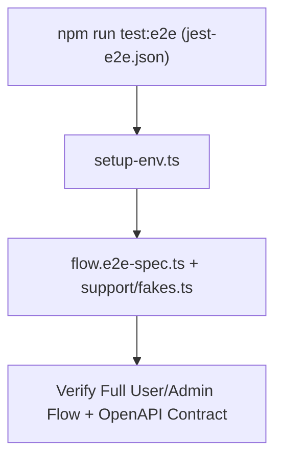

# backend_rag/test — Bộ Kiểm thử End-to-End (Supertest + Hợp đồng OpenAPI)

- **Motivation/Background**: Cung cấp tài liệu đặc tả tự chứa ngay tại `backend_rag/test/` theo yêu cầu chuẩn hóa kiến trúc, giúp người đọc nắm bắt nhanh mục đích thư mục, trách nhiệm từng file và luồng nghiệp vụ mà không phải dò thủ công toàn bộ mã nguồn.
- **Purpose**: Thực thi kiểm thử đầu-cuối toàn bộ ứng dụng NestJS (`flow.e2e-spec.ts`), bao gồm cả bài test **API contract (OpenAPI)** xác nhận mọi endpoint thực tế đều được khai báo trong Swagger, hỗ trợ XML/JSON negotiation, HATEOAS `_links`, luồng Auth/Chat/Papers/Admin đầy đủ.
- **Overview Pipeline**: `jest-e2e.json` chạy `setup-env.ts` cấu hình môi trường test -> `flow.e2e-spec.ts` dựng app hoàn chỉnh với các fake port từ... -> Kiểm tra chéo từng đường dẫn route với OpenAPI document sinh ra tại runtime.
- **Detailed Plan**: Mục 1 định nghĩa phạm vi & vai trò; Mục 2 liệt kê cấu trúc thư mục con và danh mục file/export thực tế; Mục 3 mô tả chức năng, luồng nghiệp vụ kèm sơ đồ Mermaid; Mục 4 quy định hợp đồng I/O, bất biến hệ thống và lệnh kiểm chứng.
- **References**: [AGENTS.md](../AGENTS.md), [support/README.md](support/README.md).
- **Created**: 2026-11-15T12:55:00+07:00
- **Last Updated**: 2026-11-15T12:55:00+07:00

[STATUS: ACTIVE]

---
## 1. Mục đích & Phạm vi Thư mục (Directory Scope & Architectural Role)

Thực thi kiểm thử đầu-cuối toàn bộ ứng dụng NestJS (`flow.e2e-spec.ts`), bao gồm cả bài test **API contract (OpenAPI)** xác nhận mọi endpoint thực tế đều được khai báo trong Swagger, hỗ trợ XML/JSON negotiation, HATEOAS `_links`, luồng Auth/Chat/Papers/Admin đầy đủ.

---

## 2. Đặc tả Kỹ thuật & Danh mục File (Technical Specification)

### 2.1. Danh mục Thư mục con (Subdirectories)

| Thư mục con | Liên kết Đặc tả | Vai trò Chính |
| :--- | :--- | :--- |
| **`support/`** | [`support/README.md`](support/README.md) | Cung cấp bản cài đặt giả lập nhẹ, xác định kết quả (`fakes.ts`) thay thế các phụ thuộc nặng (HuggingFace Embedding, Laya Judge, Qwen2.5 LLM, Qdrant) giúp `test:e2e` chạy trong vài giây mà vẫn giữ nguyên toàn bộ tầng HTTP/Auth/MongoDB/SSE thật. |

### 2.2. Danh mục File & Ký hiệu Kỹ thuật (File & Symbol Inventory)

| File | Loại / Tầng | Exports / Routes / Ký hiệu Chính | Mô tả Trách nhiệm |
| :--- | :--- | :--- | :--- |
| [`flow.e2e-spec.ts`](flow.e2e-spec.ts) | End-to-End Spec | - | Thành phần `End-to-End Spec` thuộc `test`. |
| [`jest-e2e.json`](jest-e2e.json) | JSON Config / Dataset | Config / Data (254 B) | Cấu hình hoặc dữ liệu tĩnh `jest-e2e.json` |
| [`setup-env.ts`](setup-env.ts) | TypeScript Module | - | Defaults for e2e runs; real services (Mongo, Qdrant, models) are replaced in each spec. |

---

## 3. Mô tả Chức năng & Luồng Nghiệp vụ (Business Flow)

1. `jest-e2e.json` chạy `setup-env.ts` cấu hình môi trường test.
2. `flow.e2e-spec.ts` dựng app hoàn chỉnh với các fake port từ `support/fakes.ts` và bắn chuỗi HTTP request qua `supertest`.
3. Kiểm tra chéo từng đường dẫn route với OpenAPI document sinh ra tại runtime.



---

## 4. Hợp đồng Đầu vào / Đầu ra, Bất biến & Kiểm chứng

- **Đầu vào (Inputs)**: Cấu hình Jest E2E và các fake AI/Qdrant providers.
- **Đầu ra & Tác động (Outputs / Side Effects)**: Báo cáo Pass/Fail toàn bộ kịch bản E2E và hợp đồng OpenAPI.

### Bất biến & Quy tắc Kiến trúc (System Invariants)
- Mọi route mới thêm vào `backend_rag` BẮT BUỘC phải mở rộng kiểm thử `API contract (OpenAPI)` trong `flow.e2e-spec.ts` (`D-047`).

### Lệnh Kiểm chứng (Verification)
```powershell
cd backend_rag && npm run test:e2e
```
