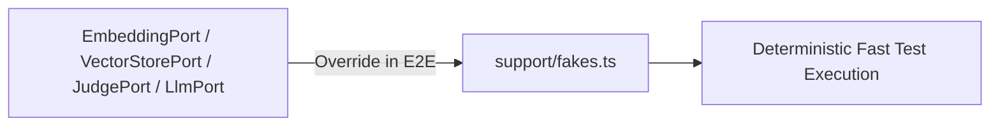

# backend_rag/test/support — Đối tượng Giả lập Xác định (Deterministic Fakes) cho E2E

- **Motivation/Background**: Cung cấp tài liệu đặc tả tự chứa ngay tại `backend_rag/test/support/` theo yêu cầu chuẩn hóa kiến trúc, giúp người đọc nắm bắt nhanh mục đích thư mục, trách nhiệm từng file và luồng nghiệp vụ mà không phải dò thủ công toàn bộ mã nguồn.
- **Purpose**: Cung cấp bản cài đặt giả lập nhẹ, xác định kết quả (`fakes.ts`) thay thế các phụ thuộc nặng (HuggingFace Embedding, Laya Judge, Qwen2.5 LLM, Qdrant) giúp `test:e2e` chạy trong vài giây mà vẫn giữ nguyên toàn bộ tầng HTTP/Auth/MongoDB/SSE thật.
- **Overview Pipeline**: Dùng `createHash` băm câu hỏi thành vector 768 chiều nhất quán  -> Trả về các đoạn chunk mẫu và luồng token LLM giả lập tốc độ cao theo đúng....
- **Detailed Plan**: Mục 1 định nghĩa phạm vi & vai trò; Mục 2 liệt kê cấu trúc thư mục con và danh mục file/export thực tế; Mục 3 mô tả chức năng, luồng nghiệp vụ kèm sơ đồ Mermaid; Mục 4 quy định hợp đồng I/O, bất biến hệ thống và lệnh kiểm chứng.
- **References**: [test/README.md](../README.md), [engines/README.md](../../src/engines/README.md), [AGENTS.md](../../AGENTS.md).
- **Created**: 2026-11-15T12:55:00+07:00
- **Last Updated**: 2026-11-15T12:55:00+07:00

[STATUS: ACTIVE]

---
## 1. Mục đích & Phạm vi Thư mục (Directory Scope & Architectural Role)

Cung cấp bản cài đặt giả lập nhẹ, xác định kết quả (`fakes.ts`) thay thế các phụ thuộc nặng (HuggingFace Embedding, Laya Judge, Qwen2.5 LLM, Qdrant) giúp `test:e2e` chạy trong vài giây mà vẫn giữ nguyên toàn bộ tầng HTTP/Auth/MongoDB/SSE thật.

---

## 2. Đặc tả Kỹ thuật & Danh mục File (Technical Specification)

### 2.2. Danh mục File & Ký hiệu Kỹ thuật (File & Symbol Inventory)

| File | Loại / Tầng | Exports / Routes / Ký hiệu Chính | Mô tả Trách nhiệm |
| :--- | :--- | :--- | :--- |
| [`fakes.ts`](fakes.ts) | TypeScript Module | `fakeEmbedding`, `FakeLlmEngine`, `inMemoryQdrant` | Deterministic unit vector from the text (stands in for Nomic in e2e runs). |

---

## 3. Mô tả Chức năng & Luồng Nghiệp vụ (Business Flow)

1. Dùng `createHash` băm câu hỏi thành vector 768 chiều nhất quán (không phụ thuộc mạng hay GPU).
2. Trả về các đoạn chunk mẫu và luồng token LLM giả lập tốc độ cao theo đúng `LlmPort` / `EmbeddingPort`.



---

## 4. Hợp đồng Đầu vào / Đầu ra, Bất biến & Kiểm chứng

- **Đầu vào (Inputs)**: Lời gọi interface `EmbeddingPort`, `JudgePort`, `LlmPort`, `CorpusPort` từ `flow.e2e-spec.ts`.
- **Đầu ra & Tác động (Outputs / Side Effects)**: Kết quả giả lập khớp hoàn toàn giao diện TypeScript thật.

### Bất biến & Quy tắc Kiến trúc (System Invariants)
- Giữ đồng bộ chữ ký giao diện 100% với các Port sản phẩm trong `src/engines/*`.

### Lệnh Kiểm chứng (Verification)
```powershell
cd backend_rag && npm run build
```
